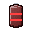

# Crafting

The cheap TNT types need only vanilla items. The strong ones need **components**: custom items you craft first.
The nuclear tiers need the most, and the  Thermonuclear Core at the top of the chain is the hardest recipe on the server.

Both kinds of recipe are registered with the server when the plugin loads or `/cf reload` runs. Their
definitions live in [`items.yml`](../CoreFactory-Paper/src/main/resources/items.yml) (components), [`materials.yml`](../CoreFactory-Paper/src/main/resources/materials.yml) (science materials, machines, drills
and the scanner), [`processes.yml`](../CoreFactory-Paper/src/main/resources/processes.yml) (machines and processes) and
[`tnts.yml`](../CoreFactory-Paper/src/main/resources/tnts.yml) (TNT). Ingredients that are custom items match
exactly, by their identity, so a plain vanilla item of the same material never substitutes for a component.

The Ore Density Scanner (`ore_density_scanner`) crafts after Laboratory Basics. Right-click it to scan for the nearest deposits,
and sneak-click to change its filter or survey them (see [the player guide](PLAYER_GUIDE.md#the-ore-density-scanner)).

## Components

| Component id | Name | Recipe (shaped rows, or shapeless list) |
|---|---|---|
|  `fuse_linker` |  Fuse Linker (tool) | shapeless: 2 Redstone, Iron Ingot |
|  `fuse_wire` |  Fuse Wire | shapeless: 3 Copper Ingot, Redstone |
|  `shaped_charge_lens` |  Shaped Charge Lens | `GIG` / `IDI` / `GIG`: G Glass, I Iron Ingot, D Diamond |
|  `gravity_core` |  Gravity Core | `OEO` / `ENE` / `OEO`: O Obsidian, E Ender Pearl, N Nether Star |
|  `vitrifier_flux` |  Vitrifier Flux | shapeless: 4 Sand, Glowstone Dust, Blaze Powder |
|  `sorting_magnet` |  Sorting Magnet | shapeless: 2 Iron Ingot, Redstone, Lodestone |
|  `anchor_crystal` |  Anchor Crystal | ` A ` / `AEA` / ` A `: A Amethyst Shard, E End Crystal |
|  `pulse_capacitor` |  Pulse Capacitor | `RRR` / `CCC` / `RRR`: R Redstone, C Copper Ingot |
|  `quantum_detonator` |  Quantum Detonator | `RDR` / `DGD` / `RDR`: R Redstone, D Diamond, G Gold Ingot |
|  `biohazard_culture` |  Biohazard Culture | shapeless: 2 Rotten Flesh, Spider Eye, Fermented Spider Eye, Slime Ball |
|  `napalm_gel` |  Napalm Gel | shapeless: Magma Cream, 2 Coal, Gunpowder, Slime Ball |
|  `anchor_plate` |  Anchor Plate | `III` / `IGI` / `III`: I Iron Ingot, G Gold Ingot. *Not used by a TNT recipe in the shipped config; for your own recipes.* |
|  `enriched_uranium` |  Enriched Uranium | No hand recipe: made in an enrichment cascade (see the machines) |
|  `plutonium_pit` |  Plutonium Pit | shapeless: 4  Plutonium Oxide, Nether Star, Gold Block |
|  `tritium_booster` |  Tritium Booster | `GBG` / `BNB` / `GBG`: G Gold Ingot, B Blaze Powder, N Nether Star |
|  `neutron_initiator` |  Neutron Initiator | shapeless: Amethyst Block, 2 Gunpowder, Redstone Block |
|  `nuclear_casing` |  Nuclear Casing | `IGI` / `GDG` / `IGI`: I Iron Block, G Gold Block, D Diamond Block |
|  `thermonuclear_core` |  Thermonuclear Core | `PBP` / `BNB` / `PBP`: P  Plutonium Pit, B  Tritium Booster, N  Neutron Initiator |
|  `hazmat_fabric` |  Hazmat Fabric | 2 leather and 2 lead, shapeless |
|  `radioactive_helmet` |  Radioactive Helmet | `FFF` / `F F`: F  Hazmat Fabric |
|  `radioactive_chestplate` |  Radioactive Chestplate | `F F` / `FFF` / `FFF`: F  Hazmat Fabric |
|  `radioactive_leggings` |  Radioactive Leggings | `FFF` / `F F` / `F F`: F  Hazmat Fabric |
|  `radioactive_boots` |  Radioactive Boots | `F F` / `F F`: F  Hazmat Fabric |
|  `geiger_counter` |  Geiger Counter | `IRI` / `FCF` / `IRI`: I Iron Ingot, R Redstone, F  Hazmat Fabric, C Compass |

The component chain for the nuclear family is therefore: **Enriched Uranium** comes from the enrichment cascade, and
**Plutonium Oxide** from the neutron transmuter; four plutonium oxide with a Nether Star and a Gold Block make a
**Plutonium Pit**; Deuterium Cells, Blaze Powder and a Nether Star make a **Tritium Booster**; and the **Thermonuclear Core** is made from pits, boosters and an initiator.

## Materials, machines and drills (materials.yml)

These components are in [`materials.yml`](../CoreFactory-Paper/src/main/resources/materials.yml). The research column
is the node that gates the crafting, placing and lighting of the item. "None" means no node lists it. The machines are
placed by their own item, and the drills work like machines.

| Component id | Name | Recipe | Research |
|---|---|---|---|
| `neutron_flux_cell` | Neutron Flux Cell | shaped: `GNG` / `NPN` / `GNG`. G High-Purity Graphite, N Neutron Initiator, P Purified Iron | Materials Purification |
| `superconducting_magnet` | Superconducting Magnet | shaped: `PDP` / `DCD` / `PDP`. P Purified Iron, D Deuterium Cell, C Gold Block | Particle Physics |
| `tesseract_lattice` | Tesseract Lattice | shaped: `SAS` / `ACA` / `SAS`. S Superconducting Magnet, A Antiproton Capsule, C High-Purity Graphite | Tesseract Geometry |
| `crusher` | Crusher | shaped: `IRI` / `RDR` / `IRI`. I Iron Ingot, R Redstone, D Dispenser | Laboratory Basics |
| `roaster` | Roasting Kiln | shaped: `BRB` / `BFB` / `BBB`. B Brick, R Redstone Block, F Furnace | Metallurgy |
| `separator` | Centrifugal Separator | shaped: `GIG` / `CTC` / `GIG`. G Glass, I Iron Ingot, C Copper Ingot, T Cauldron | Chemical Separation |
| `purifier` | Purification Still | shaped: `RIR` / `IBI` / `RIR`. R Redstone, I Iron Ingot, B Brewing Stand | Chemical Separation |
| `converter` | Fluorination Converter | shaped: `PHP` / `GBG` / `PHP`. P Purified Iron, H Hopper, G Glass, B Blast Furnace | Fluorine Chemistry |
| `enrichment_cascade` | Enrichment Cascade | shaped: `MPM` / `PRP` / `MPM`. M Superconducting Magnet, P Purified Iron, R Redstone Block | Nuclear Fission |
| `transmuter` | Neutron Transmuter | shaped: `NFN` / `FCF` / `NFN`. N Neutron Initiator, F Neutron Flux Cell, C Lodestone | Nuclear Fission |
| `spectrometer` | Spectrometer | shaped: `GRG` / `RLR` / `GRG`. G Glass, R Redstone, L Lapis Lazuli | Laboratory Basics |
| `research_console` | Research Console | shaped: `BLB` / `LRL` / `BLB`. B Book, L Lapis Lazuli, R Redstone Block | Laboratory Basics |
| `particle_accelerator` | Particle Accelerator | shaped: `MMM` / `MCM` / `MMM`. M Superconducting Magnet, C End Crystal | Particle Physics |
| `antimatter_condenser` | Antimatter Condenser | shaped: `SAS` / `ACA` / `SAS`. S Superconducting Magnet, A Antiproton Capsule, C Neutron Flux Cell | Antimatter Physics |
| `ore_density_scanner` | Ore Density Scanner (finds deposits) | shaped: `GIG` / `ILI` / `GRG`. G Glass, I Iron Ingot, L Amethyst Shard, R Redstone | Laboratory Basics |
| `solar_panel` | Solar Panel | shaped: `PPP` / `RIR` / `IRI`. P Blue Stained Glass Pane, R Redstone, I Iron Ingot | Metallurgy |
| `petroleum_drill_1` | Petroleum Drill I | shaped: `IPI` / `HBH` / `IRI`. I Iron Ingot, P Piston, H Hopper, B Chest, R Redstone | Chemical Separation |
| `petroleum_drill_2` | Petroleum Drill II | shapeless: Petroleum Drill I, Iron Block, Redstone, Piston | Chemical Separation |
| `petroleum_drill_3` | Petroleum Drill III | shapeless: Petroleum Drill II, Iron Block, Redstone Block, Piston, Hopper | Hydrogen Processes |
| `petroleum_drill_4` | Petroleum Drill IV | shapeless: Petroleum Drill III, Diamond, Iron Block, Redstone Block, Piston, Hopper | Hydrogen Processes |
| `petroleum_drill_5` | Petroleum Drill V | shapeless: Petroleum Drill IV, Diamond Block, Redstone Block, Piston | Materials Purification |
| `ore_drill_1` | Ore Drill I | shaped: `IPI` / `HBH` / `IRI`. I Iron Ingot, P Purified Iron, H Hopper, B Chest, R Redstone Block | Fluorine Chemistry |
| `ore_drill_2` | Ore Drill II | shapeless: Ore Drill I, Iron Block, Redstone, Piston | Nuclear Fission |
| `ore_drill_3` | Ore Drill III | shapeless: Ore Drill II, Iron Block, Redstone Block, Piston, Hopper | Materials Purification |
| `ore_drill_4` | Ore Drill IV | shapeless: Ore Drill III, Diamond, Iron Block, Redstone Block, Piston, Hopper | Plasma Physics |
| `ore_drill_5` | Ore Drill V | shapeless: Ore Drill IV, Diamond Block, Redstone Block, Piston | Thermonuclear Engineering |

The lab machines have these slot counts (from `processes.yml`). Input, output and fuel are the slots of the barrel.

| Machine id | Input slots | Output slots | Fuel slots |
|---|---|---|---|
| `crusher` | 1 | 3 | 0 |
| `roaster` | 2 | 3 | 1 |
| `separator` | 2 | 3 | 0 |
| `purifier` | 2 | 2 | 0 |
| `converter` | 2 | 1 | 1 |
| `enrichment_cascade` | 8 | 4 | 0 |
| `transmuter` | 2 | 3 | 0 |
| `spectrometer` | 2 | 2 | 0 |
| `particle_accelerator` | 2 | 2 | 0 |
| `antimatter_condenser` | 2 | 1 | 0 |
| `research_console` | 6 (research packs) | 0 | 0 |
| `crude_oil_refinery` | 0 | 0 | 0 |
| `induction_furnace` | 2 | 1 | 0 |
| `powder_mill` | 3 | 1 | 0 |
| `cartridge_press` | 2 | 1 | 0 |
| `bullet_swaging_machine` | 2 | 1 | 0 |
| `ammunition_assembly` | 3 | 1 | 0 |
| `metal_lathe` | 2 | 1 | 0 |
| `component_assembly` | 4 | 1 | 0 |
| `heavy_weapons_assembly` | 6 | 1 | 0 |

Each drill has one fuel slot and nine output slots. The levels and the cycle lengths are in `DrillTable` in the code.

## Electricity and belts (materials.yml)

These items are in [`materials.yml`](../CoreFactory-Paper/src/main/resources/materials.yml). Their research node is in
[`research.yml`](../CoreFactory-Paper/src/main/resources/research.yml). "None" means no node lists the item, so it is free.
The solar panel is in the table above.

| Component id | Name | Recipe | Research |
|---|---|---|---|
| `energy_wire` |  Energy Wire | shapeless: 2 Copper Ingot, Redstone | Metallurgy |
| `pylon_1` |  Pylon I | shaped: `ICI` / `CRC` / `ICI`. I Iron Ingot, C Copper Ingot, R Redstone | Metallurgy |
| `pylon_2` |  Pylon II | shapeless:  Pylon I,  Purified Iron, Copper Ingot | Chemical Separation |
| `pylon_3` |  Pylon III | shapeless:  Pylon II,  High-Purity Graphite,  Superconducting Magnet | Particle Physics |
| `pylon_4` | Pylon IV | None: made only by the process `assemble_pylon_4` | Pylon IV |
| `pylon_5` | Pylon V | None: made only by the process `assemble_pylon_5` | Pylon V |
| `accumulator_1` |  Accumulator I | shaped: `LIL` / `IRI` / `LIL`. L Lead, I Iron Ingot, R Redstone | Chemical Separation |
| `accumulator_2` |  Accumulator II | shapeless:  Accumulator I, Copper Ingot, Lapis Lazuli | Fluorine Chemistry |
| `accumulator_3` |  Accumulator III | shapeless:  Accumulator II,  Superconducting Magnet,  Purified Iron | Particle Physics |
| `accumulator_4` | Accumulator IV | None: made only by the process `assemble_accumulator_4` | Accumulator IV |
| `accumulator_5` | Accumulator V | None: made only by the process `assemble_accumulator_5` | Accumulator V |
| `wind_generator` |  Wind Generator | shaped: `ISI` / `SCS` / `ISI`. I Iron Ingot, S Stick, C Copper Ingot | Metallurgy |
| `charcoal_generator` |  Charcoal Generator | shaped: `BIB` / `IRI` / `BIB`. B Brick, I Iron Ingot, R Redstone Block | Chemical Separation |
| `petroleum_generator` |  Petroleum Generator | shapeless: Oil Tube, Oil T Splitter, Purified Iron | Fluorine Chemistry |
| `diesel_generator` |  Diesel Generator | shapeless:  Petroleum Generator,  Purified Iron,  Deuterium Cell | Nuclear Fission |
| `nuclear_generator` |  Nuclear Generator | shapeless: Purified Iron, High-Purity Graphite,  Neutron Flux Cell,  Plutonium Pit | Isotope Transmutation |
| `nuclear_fuel_rod` |  Nuclear Fuel Rod | shaped: ` E ` / ` N ` / ` E `. E  Enriched Uranium, N  Neutron Initiator | Hydrogen Processes |
| `crude_oil_refinery` |  Crude Oil Refinery | shapeless: 2 Iron Block, Copper Ingot, Piston, Furnace | Fluorine Chemistry |
| `belt_1` |  Transport Belt I | shapeless: Iron Ingot, Redstone, Copper Ingot | Chemical Separation |
| `belt_2` |  Transport Belt II | shapeless:  Transport Belt I, Gold Ingot, Redstone | Fluorine Chemistry |
| `belt_3` |  Transport Belt III | shapeless:  Transport Belt II, Diamond, Redstone Block | Nuclear Fission |
| `picker_1` |  Picker I | shapeless: Piston, Hopper, Iron Ingot, Redstone | Chemical Separation |
| `picker_2` |  Picker II | shapeless:  Picker I, Gold Ingot,  Purified Iron | Fluorine Chemistry |
| `picker_3` |  Picker III | shapeless:  Picker II, Diamond Block,  Superconducting Magnet | Nuclear Fission |
| `splitter_1` |  Splitter I | shapeless: Hopper, Iron Ingot, Copper Ingot, Lapis Lazuli | Fluorine Chemistry |
| `splitter_2` |  Splitter II | shapeless:  Splitter I,  Purified Iron, Gold Ingot | Nuclear Fission |
| `splitter_3` |  Splitter III | shapeless:  Splitter II,  Neutron Flux Cell, Diamond | Hydrogen Processes |

The refinery has no process row. The code runs it: it takes three litres of petroleum from the oil network and gives two litres of diesel back to it in 600 ticks at full speed (see [MECHANICS.md](MECHANICS.md#oil-and-fluids)).

## Processes (processes.yml)

Each process names its machine, its time in ticks, its inputs and its outputs. A process runs only when every input is
present in full and the outputs fit. A `fuel` machine burns one coal or charcoal per pass. The inputs are shown as
`name amount`, and an output with a chance shows the chance in brackets.

| Process id | Machine | Ticks | Inputs | Outputs |
|---|---|---|---|---|
| `crush_uraninite` | crusher | 100 | raw_uraninite 1 | crushed_uraninite 2 |
| `crush_pitchblende` | crusher | 100 | raw_pitchblende 1 | crushed_pitchblende 2 |
| `crush_monazite` | crusher | 100 | raw_monazite 1 | crushed_monazite 2 |
| `crush_thorite` | crusher | 100 | raw_thorite 1 | crushed_thorite 2 |
| `crush_galena` | crusher | 100 | raw_galena 1 | crushed_galena 2 |
| `crush_cinnabar` | crusher | 100 | raw_cinnabar 1 | crushed_cinnabar 2 |
| `crush_fluorite` | crusher | 100 | raw_fluorite 1 | crushed_fluorite 2 |
| `roast_uraninite` | roaster, fuel | 200 | crushed_uraninite 2 | uranium_calcine 1; slag 1 (40%) |
| `roast_pitchblende` | roaster, fuel | 200 | crushed_pitchblende 2 | uranium_calcine 1; slag 1 (50%) |
| `roast_galena` | roaster, fuel | 240 | crushed_galena 2 | refined_lead 1; slag 1 (60%) |
| `roast_cinnabar` | roaster, fuel | 200 | crushed_cinnabar 2 | mercury_flask 1; slag 1 (30%) |
| `separate_uranium` | separator | 240 | uranium_calcine 2 | yellowcake 1; tailings 1 |
| `separate_monazite` | separator | 200 | crushed_monazite 2 | rare_earth_concentrate 1; phosphate_tailings 1 |
| `separate_thorite` | separator | 200 | crushed_thorite 2 | thorium_concentrate 1; silicate_tailings 1 |
| `electrolyse_heavy_water` | purifier | 400 | water bucket 2 | deuterium_cell 1; bucket 2 |
| `zone_refine_iron` | purifier | 300 | iron ingot 4 | purified_iron 1 |
| `zone_refine_graphite` | purifier | 240 | coal block 2 | high_purity_graphite 1 |
| `fluorinate_yellowcake` | converter, fuel | 300 | yellowcake 1; crushed_fluorite 2 | uf6_cylinder 1 |
| `enrich_uranium` | enrichment_cascade | 1200 | uf6_cylinder 8 | enriched_uranium 1; depleted_uranium 2 |
| `transmute_thorium` | transmuter | 1200 | thorium_concentrate 2; neutron_flux_cell 1 | u233_oxide 1; fission_waste 1 |
| `transmute_monazite` | transmuter | 1400 | rare_earth_concentrate 2; neutron_flux_cell 1 | u233_oxide 1 (50%); fission_waste 1 |
| `transmute_plutonium` | transmuter | 1600 | yellowcake 2; neutron_flux_cell 1 | plutonium_oxide 1; fission_waste 1 |
| `analyse_galena` | spectrometer | 200 | crushed_galena 1 | research_pack_basic 1 |
| `analyse_cinnabar` | spectrometer | 200 | crushed_cinnabar 1 | research_pack_basic 1 |
| `analyse_chemical` | spectrometer | 400 | purified_iron 1; mercury_flask 1 | research_pack_chemical 2 |
| `analyse_nuclear` | spectrometer | 400 | yellowcake 1 | research_pack_nuclear 1 |
| `analyse_plasma` | spectrometer | 600 | deuterium_cell 1; tritium_booster 1 | research_pack_plasma 2 |
| `analyse_exotic` | spectrometer | 800 | antiproton_capsule 1 | research_pack_exotic 2 |
| `accelerate_antiprotons` | particle_accelerator | 1200 | deuterium_cell 1; superconducting_magnet 1 (used up each pass) | antiproton_capsule 2 |
| `accelerate_neutronium` | particle_accelerator | 1600 | neutron_flux_cell 2; superconducting_magnet 1 | neutronium_slug 1 |
| `condense_antimatter` | antimatter_condenser | 2400 | antiproton_capsule 2; neutron_flux_cell 1 | antimatter_condensate 1 |
| `crush_saltpeter` | crusher | 100 | raw_saltpeter 1 | crude_saltpeter 2 |
| `crush_sulfur` | crusher | 100 | raw_sulfur 1 | sulfur 2 |
| `crush_sphalerite` | crusher | 120 | raw_sphalerite 1 | zinc_ore_dust 2 |
| `roast_sphalerite` | roaster, fuel | 240 | zinc_ore_dust 2 | zinc_ingot 1; slag 1 (30%) |
| `recrystallise_saltpeter` | purifier | 300 | water bucket 1; crude_saltpeter 2 | potassium_nitrate 1; bucket 1 |
| `recrystallise_potassium_nitrate` | purifier | 400 | water bucket 1; potassium_nitrate 2 | high_purity_potassium_nitrate 1; bucket 1 |
| `induction_brass` | induction_furnace | 400 | copper ingot 2; zinc_ingot 1 | brass_ingot 3 |
| `mill_gunpowder` | powder_mill | 300 | charcoal 1; sulfur 1; high_purity_potassium_nitrate 1 | high_grade_gunpowder 3 |
| `press_empty_shell` | cartridge_press | 300 | brass_ingot 2 | empty_shell 4 |
| `swage_bullet_regular` | bullet_swaging_machine | 100 | refined_lead 1 | bullet_regular 2 |
| `swage_bullet_armor_piercing` | bullet_swaging_machine | 160 | refined_lead 1; iron ingot 1 | bullet_armor_piercing 2 |
| `swage_bullet_incendiary` | bullet_swaging_machine | 160 | refined_lead 1; blaze powder 1 | bullet_incendiary 2 |
| `swage_bullet_depleted_uranium` | bullet_swaging_machine | 200 | depleted_uranium 1; refined_lead 1 | bullet_depleted_uranium 2 |
| `assemble_round_regular` | ammunition_assembly | 100 | empty_shell 1; bullet_regular 1; high_grade_gunpowder 1 | round_regular 1 |
| `assemble_round_armor_piercing` | ammunition_assembly | 120 | empty_shell 1; bullet_armor_piercing 1; high_grade_gunpowder 1 | round_armor_piercing 1 |
| `assemble_round_incendiary` | ammunition_assembly | 120 | empty_shell 1; bullet_incendiary 1; high_grade_gunpowder 1 | round_incendiary 1 |
| `assemble_round_depleted_uranium` | ammunition_assembly | 140 | empty_shell 1; bullet_depleted_uranium 1; high_grade_gunpowder 1 | round_depleted_uranium 1 |
| `turn_precision_barrel` | metal_lathe | 400 | iron ingot 4; purified_iron 1 | precision_barrel 1 |
| `turn_optical_lens` | metal_lathe | 300 | amethyst shard 1; high_purity_graphite 1 | optical_lens 2 |
| `assemble_oil_pipe` | component_assembly | 200 | iron_plate 2; high_purity_graphite 1; circuit_board 1 | oil_pipe 2 |
| `assemble_oil_splitter_t` | component_assembly | 300 | oil_pipe 2; iron_plate 1 | oil_splitter_t 1 |
| `assemble_oil_splitter_x` | component_assembly | 400 | oil_pipe 4; iron_plate 2 | oil_splitter_x 1 |
| `assemble_steel_frame` | component_assembly | 300 | iron ingot 6; iron_plate 2 | steel_frame 1 |
| `assemble_turret_mechanism` | component_assembly | 300 | iron_gear 3; iron_plate 1 | turret_mechanism 1 |
| `assemble_ammunition_feed` | component_assembly | 300 | iron_gear 2; brass_ingot 2 | ammunition_feed 1 |
| `assemble_targeting_unit` | component_assembly | 500 | circuit_board 2; pulse_capacitor 1; iron_plate 1 | targeting_unit 1 |
| `assemble_laser_emitter` | component_assembly | 400 | circuit_board 2; glowstone dust 1; brass_ingot 1 | laser_emitter 1 |
| `assemble_turret_upgrade_2` | component_assembly | 600 | circuit_board 2; iron_gear 2; precision_barrel 1; brass_ingot 1 | turret_upgrade_2 1 |
| `assemble_turret_upgrade_3` | component_assembly | 900 | steel_frame 1; turret_mechanism 1; ammunition_feed 1; optical_lens 1 | turret_upgrade_3 1 |
| `assemble_machine_gun_turret` | heavy_weapons_assembly | 1200 | steel_frame 1; brass_ingot 8; precision_barrel 1; targeting_unit 1; turret_mechanism 1; ammunition_feed 1 | machine_gun_turret 1 |
| `assemble_laser_turret` | heavy_weapons_assembly | 1400 | steel_frame 1; targeting_unit 1; turret_mechanism 1; optical_lens 4; laser_emitter 2 | laser_turret 1 |
| `turn_rail_barrel` | metal_lathe | 800 | precision_barrel 2; high_purity_graphite 2 | rail_barrel 1 |
| `assemble_rail_coil` | heavy_weapons_assembly | 1200 | superconducting_magnet 2; pulse_capacitor 2; antiproton_capsule 1; COPPER_INGOT 8 | rail_coil 2 |
| `assemble_railgun_turret` | heavy_weapons_assembly | 2400 | rail_barrel 2; rail_coil 4; enriched_uranium 2; tesseract_lattice 1; targeting_unit 1; turret_mechanism 1 | railgun_turret 1 |
| `assemble_turret_upgrade_4` | heavy_weapons_assembly | 1200 | targeting_unit 1; precision_barrel 2; turret_mechanism 1; steel_frame 1; optical_lens 2 | turret_upgrade_4 1 |
| `assemble_turret_upgrade_5` | heavy_weapons_assembly | 1800 | targeting_unit 1; turret_mechanism 1; ammunition_feed 1; precision_barrel 1; optical_lens 2; laser_emitter 2 | turret_upgrade_5 1 |
| `assemble_pylon_4` | heavy_weapons_assembly | 2400 | pylon_3 1; tesseract_lattice 1; superconducting_magnet 4; antiproton_capsule 2; enriched_uranium 2 | pylon_4 1 |
| `assemble_pylon_5` | heavy_weapons_assembly | 4800 | pylon_4 1; tesseract_lattice 2; antimatter_containment 1; antiproton_capsule 4; superconducting_magnet 8 | pylon_5 1 |
| `assemble_accumulator_4` | heavy_weapons_assembly | 2000 | accumulator_3 1; pulse_capacitor 4; superconducting_magnet 2; tesseract_lattice 1 | accumulator_4 1 |
| `assemble_accumulator_5` | heavy_weapons_assembly | 4000 | accumulator_4 1; pulse_capacitor 8; antiproton_capsule 2; enriched_uranium 4; tesseract_lattice 1 | accumulator_5 1 |

The drills are not processes. Their kind and level are in the `drills:` section of `processes.yml`, and the
[Drills](MECHANICS.md#drills) section of the mechanics explains how each one runs.

## TNT recipes

Most TNT recipes place a vanilla TNT block (`T`) in the middle or on the outside of a 3×3 grid, so you need gunpowder
and sand to make the first one. The nuclear warheads and the exotic bombs are built from components and do not use
vanilla TNT, apart from the 4-dimensional bomb, which uses one in its grid. Recipes with empty cells are shaped;
the nuclear recipes use only shaped grids too.

| TNT id | Recipe |
|---|---|
|  `chain_reaction_tnt` | `RRR` / `RTR` / `RRR` — R Redstone, T TNT |
|  `shaped_charge_tnt` | `LIL` / `ITI` / `LIL` — L  Shaped Charge Lens, I Iron Ingot, T TNT |
|  `gravity_well_tnt` | `OGO` / `GTG` / `OGO` — O Obsidian, G  Gravity Core, T TNT |
|  `implosion_tnt` | `DDD` / `DTD` / `DDD` — D Diamond Block, T TNT |
|  `fuse_linked_tnt` | `WRW` / `RTR` / `WRW` — W  Fuse Wire, R Redstone, T TNT |
|  `delayed_cascade_tnt` | `SGS` / `GTG` / `SGS` — S Sand, G Gunpowder, T TNT |
|  `four_dimensional_tnt` | `GNG` / `NTN` / `GNG` — G Amethyst Shard, N  Neutron Initiator, T TNT |
|  `vitrify_tnt` | `FSF` / `STS` / `FSF` — F  Vitrifier Flux, S Glass, T TNT |
|  `liquefy_tnt` | `WLW` / `LTL` / `WLW` — W Water Bucket, L Lava Bucket, T TNT |
|  `terraform_tnt` | `DGD` / `GTG` / `DGD` — D Dirt, G Gravel, T TNT |
|  `randomize_tnt` | `CRC` / `RTR` / `CRC` — C Cobblestone, R Redstone, T TNT |
|  `sculpt_tnt` | `BIB` / `ITI` / `BIB` — B Iron Block, I Iron Ingot, T TNT |
|  `concussion_tnt` | `GBG` / `BTB` / `GBG` — G Glowstone Dust, B Blaze Powder, T TNT |
|  `launch_tnt` | `SPS` / `PTP` / `SPS` — S Slime Block, P Piston, T TNT |
|  `teleport_tnt` | `EPE` / `PTP` / `EPE` — E Ender Pearl, P Chorus Fruit, T TNT |
|  `gravity_flip_tnt` | `FGF` / `GTG` / `FGF` — F Feather, G  Gravity Core, T TNT |
|  `conditional_tnt` | `CRC` / `RTR` / `CRC` — C Comparator, R Redstone, T TNT |
|  `proximity_tnt` | `QPQ` / `PTP` / `QPQ` — Q  Quantum Detonator, P Stone Pressure Plate, T TNT |
|  `pulse_tnt` | `CRC` / `CTC` / `CRC` — C  Pulse Capacitor, R Redstone Block, T TNT |
|  `mirror_tnt` | `GIG` / `ITI` / `GIG` — G Glass, I Iron Ingot, T TNT |
|  `shockwave_tnt` | `FFF` / `FTF` / `FFF` — F Firework Rocket, T TNT |
|  `debris_tnt` | `CCC` / `CTC` / `CCC` — C Cobblestone, T TNT |
|  `echo_tnt` | `NNN` / `NTN` / `NNN` — N Note Block, T TNT |
|  `silent_tnt` | `WWW` / `WTW` / `WWW` — W White Wool, T TNT |
|  `harvest_tnt` | `HHH` / `HTH` / `HHH` — H Hopper, T TNT |
|  `sorting_tnt` | `CMC` / `MTM` / `CMC` — C Chest, M  Sorting Magnet, T TNT |
|  `marker_tnt` | `PLP` / `LTL` / `PLP` — P Paper, L Lapis Lazuli, T TNT |
|  `anchor_tnt` | `ACA` / `CTC` / `ACA` — A  Anchor Crystal, C Crying Obsidian, T TNT |
|  `biological_tnt` | `BCB` / `CTC` / `BCB` — B  Biohazard Culture, C Composter, T TNT |
|  `napalm_tnt` | `NGN` / `GTG` / `NGN` — N  Napalm Gel, G Gunpowder, T TNT |
|  `nuke_davy_crockett` | `ENE` / `NCN` / `ENE` — E  Enriched Uranium, N  Neutron Initiator, C  Nuclear Casing |
|  `nuke_little_boy` | `EEE` / `ECE` / `EEE` — E  Enriched Uranium, C  Nuclear Casing |
|  `nuke_fat_man` | `PEP` / `ECE` / `PEP` — P  Plutonium Pit, E  Enriched Uranium, C  Nuclear Casing |
|  `nuke_joe_1` | `EPE` / `PCP` / `EPE` — E  Enriched Uranium, P  Plutonium Pit, C  Nuclear Casing |
|  `nuke_ivy_king` | `PBP` / `BCB` / `PBP` — P  Plutonium Pit, B  Tritium Booster, C  Nuclear Casing |
|  `nuke_b83` | `BPB` / `PCP` / `BPB` — B  Tritium Booster, P  Plutonium Pit, C  Nuclear Casing |
|  `nuke_ivy_mike` | `BBB` / `PCP` / `BBB` — B  Tritium Booster, P  Plutonium Pit, C  Thermonuclear Core |
|  `nuke_castle_bravo` | `NBN` / `PCP` / `NBN` — N  Neutron Initiator, B  Tritium Booster, P  Plutonium Pit, C  Thermonuclear Core |
|  `nuke_mk17` | `PPP` / `BCB` / `PPP` — P  Plutonium Pit, B  Tritium Booster, C  Thermonuclear Core |
|  `nuke_tsar_bomba` | `MBM` / `BCB` / `MBM` — M  Thermonuclear Core, B  Tritium Booster, C  Nuclear Casing |

## The recipe grammar

A recipe block in `tnts.yml` or `items.yml`:

```yaml
recipe:
  type: shaped              # or shapeless
  amount: 1                 # results per craft (optional, default 1)

  # shaped only: up to three rows of three characters; a space is an empty cell
  pattern: ["GIG", "IDI", "GIG"]
  ingredients:
    G: "material:GLASS"
    I: "material:IRON_INGOT"
    D: "material:DIAMOND"

  # shapeless only: up to nine ingredients, in any arrangement
  # ingredients: [material:REDSTONE, material:REDSTONE, material:IRON_INGOT]
```

Ingredient strings:

| Form | Meaning |
|---|---|
| `material:NAME` | A vanilla item. `NAME` is a Bukkit material, e.g. `material:IRON_INGOT`. |
| `NAME` (bare) | Also a vanilla material. |
| `item:<id>` | A component from `items.yml`, e.g. `item:enriched_uranium`. |
| `tnt:<id>` | A TNT type from `tnts.yml`, e.g. `tnt:chain_reaction_tnt`. |

A recipe whose ingredient is unknown, or whose pattern is malformed, is **skipped with a warning** in the console,
and the rest load normally. Check the log after editing.

## Changing the progression

- To make a TNT easier, drop a component from its recipe, or replace `item:` with a `material:` ingredient.
- To add a new component: add it under `components:` in `items.yml` with a `recipe:` (or none, if it should be
  obtained only from a loot table or a shop), then reference it with `item:<id>` anywhere.
- After any change, `/cf reload`. Recipes are removed and registered again; placed TNT keeps working.
  A player who already holds an item keeps it, and its item stays valid because identity is the stored id.
