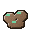
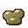

# Mechanics

Every TNT type names one **mechanic** (its behaviour) and carries that mechanic's **settings** in `tnts.yml`.
Mechanics are shared: several TNT types can use the same one with different numbers. The `radius` of a TNT
means whatever its mechanic needs; the table of each family says what.

The values in brackets are the ones in the shipped `tnts.yml`. Remove a key to use the built-in fallback; where the fallback differs from the shipped value it is noted in the setting's description.

Contents: [How ignition works](#how-ignition-works) · [Standard blast and effects](#standard-blast-and-effect-modifiers) ·
[Structural](#structural--physics) · [Terrain](#terrain-morphing) · [Entity](#entity--status) ·
[Logic](#timing--logic) · [Visual / audio](#visual--audio) · [Utility](#utility--economy) ·
[Military](#military) · [Nuclear](#nuclear) · [Lab tools](#lab-tools-hoppers-and-barrels) · [Concealment](#barrel-concealment) · [Drills](#drills) · [Electricity and logistics](#electricity-and-logistics) · [Water](#water) · [Oil and fluids](#oil-and-fluids) · [Vertical belts](#vertical-transport-belts) · [Deposits](#deposits) · [Ore blocks](#ore-blocks) · [Chemistry and ammunition](#chemistry-and-ammunition) · [Machine gun turret](#machine-gun-turret) · [Artillery](#artillery) · [Holograms](#progress-holograms) · [Effects](#effects) · [Placement, timing and chains](#placement-timing-and-chains)

## How ignition works

| Way it is lit | What happens |
|---|---|
| Flint and steel, or a fire charge, used on it | The core lights it. The item is not used up. |
| Fire, lava, lightning, fire spread and the other vanilla causes | The core lights it, and the vanilla ignition is cancelled. |
| A flaming arrow, or a fire charge or fireball that hits it | The core lights it, as fire does. |
| Redstone power | Same as above, when a neighbouring source powers the block. |
| A vanilla explosion that reaches it | The core lights it after `chain-ignite-delay-ticks`. |
| A chain from another blast | The block is ignited after a delay that grows with distance. |

An ignition that another plugin cancelled (a claim, or a region that denies fire) stays cancelled, and the TNT does not
light. An explosion that another plugin cancelled does not chain into placed TNT either. A block lights once: a second
request for a block that is already lit, or that detonated on the same tick, does nothing.

Ignition depends on the mechanic's **ignition mode**:

| Mode | Used by | Behaviour |
|---|---|---|
| `PRIMED_ENTITY` | most types | The block becomes a tagged, vanilla-looking primed TNT with the TNT's fuse. When it explodes, the mechanic runs instead of the vanilla blast. |
| `DELAYED` | ( silent TNT) | The block is removed; the mechanic runs after the fuse with no entity, no hiss and no boom. |
| `PERSISTENT` | fuse-linked, marker | The block stays; the mechanic runs at once. |
| `INERT` | anchor | Lighting it does nothing. |

Any TNT with the `silent` effect uses the delayed path.

## Standard blast and effect modifiers

The **standard** mechanic is a sphere of radius `radius`. Blocks inside are destroyed (except unbreakable
materials, anchor fields and containers in some mechanics). Entities inside take damage that falls off to zero at
the edge. TNT caught in the blast is **ignited, not destroyed**, so chains look right. Vanilla TNT is primed.

| Setting | Default | Meaning |
|---|---|---|
| `damage` | 12 | Maximum entity damage at the centre |
| `chain-delay-per-block` | 2 | Extra ignition delay, in ticks per block, for TNT caught in the blast |

Effect modifiers are listed under `effects:` in `tnts.yml`. Any standard-blast TNT can use them:

| Effect | Settings | What it does |
|---|---|---|
| `shockwave_ring` | `ring-ticks` (12) | A ring of flame expands for `ring-ticks` before anything breaks. Only players near the ring see it. |
| `debris` | | Up to 80 destroyed blocks fly out as falling blocks, land, and can be collected. |
| `echo` | `echo-count` (3), `echo-interval` (8), `echo-jitter` (4) | Extra booms follow at the same place, with sound and smoke only and no damage. |
| `silent` | | No boom and no fuse sound; the blast comes from a silent, delayed ignition. |

Effects are capped per tick (`performance.particles-per-tick`) and reach only players within
`performance.effect-view-distance`.

## Structural / physics

| TNT id | Mechanic | Radius means | Settings (default) | Behaviour |
|---|---|---|---|---|
|  `chain_reaction_tnt` | `chain_reaction` | blast radius | `delay-per-block` (3), `chain-radius` (1.6 × radius), `damage` (10) | After the blast, TNT out to `chain-radius` is ignited with a delay of `delay-per-block` ticks per block away. A rolling wave. |
|  `shaped_charge_tnt` | `shaped_charge` | cone length | `length` (radius), `cone-degrees` (25), `damage` (14), `default-direction` ([1,0,0]) | Blasts only inside a cone along the TNT's direction: the facing it was placed with, or set with `/cf aim`. |
|  `gravity_well_tnt` | `gravity_well` | pull radius | `pull-ticks` (40), `pull-strength` (0.45), `max-debris` (300), `crater-fraction` (0.5), `damage` (6) | Blocks become floating debris and entities are pulled in for `pull-ticks`; then the debris vanishes into a smaller crater. |
|  `implosion_tnt` | `implosion` | collapse radius | `core-radius` (0.25 × radius), `core-material` (BLACK_CONCRETE), `pull-strength` (1.2), `damage` (4) | Everything in the radius is removed and pulled inward, leaving a dense core of `core-material`. |
|  `fuse_linked_tnt` | `fuse_linked` | not used | `link-delay` (4) | Does not explode. Lighting it relays the signal along its fuse links, one link after another, `link-delay` ticks apart. Links are drawn as red fuse lines. Set links with the  Fuse Linker. |
|  `delayed_cascade_tnt` | `delayed_cascade` | spread | `waves` (3), `wave-interval` (6), `submunitions` (6), `spread` (radius), `submunition-radius` (0.35 × radius), `damage` (6) | A cluster munition: several waves, each a set of small blasts scattered around the target. |
|  `four_dimensional_tnt` | `nuclear` | blast radius (340) | the values in `tnts.yml`: `yield-megatons` (1000), `damage` (300), `crater-radius` (150), `visual` (`tesseract_fold`) | A nuclear blast, with the tesseract-fold visual. It is in the nuclear set; see [Nuclear](#nuclear). |

The `four_dimensional` mechanic is registered in `StructuralMechanics`. It carves a different 3D slice of a four-dimensional sphere on each step, with a random starting phase, and its settings are `steps` (14), `step-ticks` (2), `thickness` (1.4) and `damage` (10). No TNT in `tnts.yml` uses it, so `four_dimensional_tnt` does not carve slices.

## Terrain morphing

| TNT id | Mechanic | Radius means | Settings (default) | Behaviour |
|---|---|---|---|---|
|  `vitrify_tnt` | `vitrify` | sphere | `outer-material` (GLASS), `inner-material` (OBSIDIAN), `inner-fraction` (0.45), `damage` (3) | Solid blocks become glass, with an obsidian core. Nothing is destroyed or dropped. |
|  `liquefy_tnt` | `liquefy` | sphere | `fluid` (LAVA), `damage` (4) | Solid blocks become a fluid source: LAVA, WATER or SLIME_BLOCK. |
|  `terraform_tnt` | `terraform` | sphere | `fill-material` (DIRT), `damage` (6) | Blocks are removed, and the crater is refilled with `fill-material` up to the old ground level. |
|  `randomize_tnt` | `randomize` | sphere | `pool` (list of `{material, weight}`), `damage` (5) | Each block is replaced by a random pick from the weighted pool. Defaults to a stone-like mix. |
|  `sculpt_tnt` | `sculpt` | outer size | `shape` (sphere, cylinder or torus), `thickness` (1.5), `height` (radius), `tube-radius` (0.3 × radius), `damage` (4) | Removes only a thin shell along the chosen shape. Precise demolition. |

## Entity / status

| TNT id | Mechanic | Radius means | Settings (default) | Behaviour |
|---|---|---|---|---|
|  `concussion_tnt` | `concussion` | effect radius | `slowness-seconds` (8), `nausea-seconds` (12), `blindness-seconds` (5) | No block damage, no deaths. Slowness, nausea and blindness for everything in range. |
|  `launch_tnt` | `launch` | knockback radius | `up` (1.4), `radial` (1.6), `damage` (0) | Knocks everything in range up and away. Fall damage is cancelled for the launched. |
|  `teleport_tnt` | `teleport` | pick-up radius | `random-offset` (12) | Moves living entities in range, keeping their formation. With a target (`/cf target`) they go there; otherwise to a random spot within `random-offset`. Blocks never move. |
|  `gravity_flip_tnt` | `gravity_flip` | lift radius | `duration-ticks` (100), `lift` (0.9) | Lifts everything in range. Players get levitation; other mobs have gravity off, restored afterwards. This is an approximation of inverted gravity. |

## Timing / logic

| TNT id | Mechanic | Radius means | Settings (default) | Behaviour |
|---|---|---|---|---|
|  `conditional_tnt` | `conditional` | block search radius | `require-block` (none), `block-radius` (3), `require-player-within` (0 = off), `require-powered` (false), `time-min` / `time-max` (-1 = off; world time, wraps past midnight), `mode` (all or any), `damage` (14) | A logic gate. Detonates only when its conditions hold; otherwise it fizzles and drops back as an item. |
|  `proximity_tnt` | `proximity_tnt` | blast radius | `arm-ticks` (60), `trigger-radius` (3), `damage` (14) | Arms `arm-ticks` after placement. The first player to come within `trigger-radius` starts its fuse. |
|  `pulse_tnt` | `pulse_tnt` | blast radius | `explode` (true), `pulse-radius` (1.5 × radius), `pulse-ticks` (40), `pulse-material` (REDSTONE_BLOCK), `damage` (6) | Places a shell of redstone blocks around it for `pulse-ticks`, powering neighbours, then removes them. Optionally also explodes. |
|  `mirror_tnt` | `mirror_tnt` | blast radius | `axis` (x or z), `plane-offset` (24), `damage` (10) | Carves its blast, then carves the same blocks again, reflected across a plane `plane-offset` blocks away. |

## Visual / audio

| TNT id | Mechanic | Effects | Behaviour |
|---|---|---|---|
|  `shockwave_tnt` | `standard` | `shockwave_ring` | Standard blast after a flame ring. |
|  `debris_tnt` | `standard` | `debris` | Standard blast; destroyed blocks fly out as collectable falling blocks. |
|  `echo_tnt` | `standard` | `echo` | Standard blast followed by visual and audible echoes with no damage. |
|  `silent_tnt` | `standard` | `silent` | Standard blast with no sound until it goes off. |

## Utility / economy

| TNT id | Mechanic | Radius means | Settings (default) | Behaviour |
|---|---|---|---|---|
|  `harvest_tnt` | `harvest` | blast radius | `max-items` (2000), `damage` (0) | Blocks break, and their drops go to whoever lit it (the ground if nobody did). Containers survive. |
|  `sorting_tnt` | `sorting` | blast radius | `sort-materials` (list of block names), `container-radius` (2 × radius), `damage` (6) | Blocks of the listed types are gathered into the nearest chest, barrel or shulker in range. Overflow drops on the ground. |
|  `marker_tnt` | `marker` | outline radius | | Does not explode. While placed it outlines its region for nearby players. Lighting it reports the materials in the region to the player who lit it. |
|  `anchor_tnt` | `anchor` | field radius | | Creates an anti-TNT field. While it stands, no explosion can change blocks inside its radius, and TNT inside it does not go off. Its boundary is outlined. |

## Military

| TNT id | Mechanic | Radius means | Settings (default) | Behaviour |
|---|---|---|---|---|
|  `biological_tnt` | `biological` | cloud radius | `burst-radius` (0.35 × radius), `duration-seconds` (30), `tick-interval` (20), `samples` (180), `player-damage` (1.0), `mob-damage` (2.0) | A small burst, then a cloud. Creatures inside are poisoned or withered and take damage. Grass turns to dirt path; leaves, flowers and saplings die. |
|  `napalm_tnt` | `napalm` | burst radius | `stretch` (1.6), `damage` (4) | **Throw it** (drop it): it bursts when it lands, spreading fire in an ellipse stretched along the way it fell; standing still it is a circle. Some burning ground becomes magma or lava. Placed and lit, it bursts in a circle. |

## Nuclear

One mechanic, `nuclear`, covers all ten tiers. Each tier only changes its radius, fuse and crafting recipe.

Three zones, measured from the blast centre as a fraction of the tier's radius R:

| Zone | Distance | Effect |
|---|---|---|
| Fireball | 0.3 R or less | Killed instantly, whatever the armour, enchantments or health. |
| Blast area | 0.3 R to R | Damage that falls from `damage` at the fireball's edge to a tenth of it at R, less blast protection and the suit. Set on fire for `blast-fire-seconds` unless the player has fire resistance. |
| Fallout | R to 3 R | A radiation dose builds while standing in it, and the fallout lasts for hours (see below). |

Each zone has its own title, shown during the countdown (with the seconds left as the subtitle) and again at detonation:

- `YOU ARE IN THE FIREBALL RADIUS - INSTANT DEATH`
- `YOU ARE IN THE BLAST AREA - HIGH DAMAGE`
- `YOU ARE IN THE RADIATION FALLOUT AREA; LEAVE IMMEDIATELY`

Anyone within 3 R hears the countdown alarm. Within 3 R, for that player's client only, the rain stops and the clock holds
at noon (below). A yield of 10 Mt or more also shows the beacon array (below).

**The viewer's sky, for `beam-seconds`.** The clock holds at noon for 5 seconds, then slides back to the real time over
20 seconds and is handed back to the server. The clock is set for that viewer only, through the Paper per-player time API.
The rain stops for the viewer for the whole `beam-seconds`, and then the world's real weather is restored. The Paper
per-player API has no thunder, so thunder is not shown per player: a viewer sees no rain and no thunder during the blast.

**The beacon array.** Only for a yield of 10 Mt or more (`yield-megatons`), so the  Ivy Mike,  Castle Bravo,  Mk-17 and
 Tsar Bomba show beams and the smaller tiers do not. A 5 × 5 array of beacons, three blocks apart, stands around the centre. Each beacon is raised on
a 3 × 3 iron platform, one block above the ground. A client draws a beacon's beam only when the beacon has a pyramid,
and a pyramid needs that platform. A beacon's beam also stops at the surface height the client knows, which counts the
beacon itself, so each column gets an invisible light block at the top of the world; a light block at level 0 lets the
beam through. The platform hangs in the air because the blast changes the ground, and the server sends those changes
to every viewer, which would overwrite client-only blocks on the same spots. None of these blocks is placed on the
server.

**The mushroom cloud.** The cloud's height is `10 + 12 * log2(1 + y)` blocks, where `y` is the yield in megatons,
held between 0.5 and 50. So a 0.5 Mt blast reaches about 17 blocks, and a 50 Mt blast about 78. The cloud is built from
40 puffs at 26 blocks or less. Taller clouds get more puffs, up to three times as many (120 at 78 blocks), and a stem
of 40 per cent of them rises under a cap. The shapes are laid by a golden-angle spiral, so no two puffs line up.

**The cut.** Each tier has one of two shapes, chosen by `shape`:

- `saucer` (tiers 1 to 5, surface bursts): a shallow bowl, `crater-depth` blocks deep at the centre and level at its rim
  (radius `crater-radius`). Its floor is compacted coarse dirt, fused into green glass at the centre.
- `sphere` (tiers 6 to 10, thermonuclear): a hemispherical hole of radius `crater-radius`, going down through the ground.
  Outside the hole the rim sinks by `sink-depth` blocks and fades out at `flatten-radius`.

Both shapes clear everything above the ground out to `flatten-radius`, so trees, grass and buildings flatten. The cut is
streamed over several ticks, and blocks are never changed in protected regions. Sparse fire is left on a saucer's floor;
a sphere also gets magma and lava. Debris clumps land on the flattened ring around the cut and are set on fire. Creative
and spectator players are not affected.

| Setting | Default | Meaning |
|---|---|---|
| `shape` | `saucer` | `saucer` or `sphere`, as described above |
| `crater-radius` | 0.6 × R | Radius of the cut |
| `crater-depth` | 0.2 × R (at least 3) | Saucer only: depth at the centre |
| `sink-depth` | 0 | Sphere only: how far the rim sinks |
| `flatten-radius` | 1.8 × crater-radius | Everything above the ground is cleared out to here |
| `yield-megatons` | 0 | The yield. Sets the fallout strength, and at 10 or more the beacon array |
| `blast-fire-seconds` | 30 | Burning in the blast area (0.3 R to R), unless fire resistant |
| `beam-seconds` | 30 | How long the viewer's beams, rain change and clock hold last |
| `debris-count` | 3 × R | Number of debris clumps |
| `damage` | 60 | Peak damage in the blast area (falling off to a tenth at R), and entity damage at the centre |

| Tier | TNT id | Reference | Radius R (blocks) | Shape | Crater radius | Flatten radius | Fuse (ticks) |
|---|---|---|---|---|---|---|---|
| 1 |  `nuke_davy_crockett` | W54 family, about 20 tons | 14 | saucer | 30 | 50 | 100 |
| 2 |  `nuke_little_boy` | Hiroshima, about 15 kt | 28 | saucer | 60 | 100 | 200 |
| 3 |  `nuke_fat_man` | Nagasaki, about 21 kt | 32 | saucer | 65 | 110 | 220 |
| 4 |  `nuke_joe_1` | RDS-1, about 22 kt | 34 | saucer | 70 | 115 | 240 |
| 5 |  `nuke_ivy_king` | about 500 kt | 80 | saucer | 110 | 180 | 300 |
| 6 |  `nuke_b83` | about 1.2 Mt | 100 | sphere | 60 | 140 | 340 |
| 7 |  `nuke_ivy_mike` | about 10.4 Mt | 130 | sphere | 75 | 180 | 400 |
| 8 |  `nuke_castle_bravo` | about 15 Mt | 150 | sphere | 80 | 190 | 420 |
| 9 |  `nuke_mk17` | about 25 Mt | 170 | sphere | 90 | 210 | 480 |
| 10 |  `nuke_tsar_bomba` | about 50 Mt | 220 | sphere | 100 | 260 | 600 |

Yields are approximate public figures. The radii, fuses and crater sizes are scaled for gameplay, not physics. Crater
sizes are in blocks, which are roughly metres: a saucer is about 60 blocks across at tier 1 and about 220 at tier 5, and
a sphere's hole is 120 to 200 blocks across at the surface.

### Fallout, the Radioactive Suit and the Geiger counter

The fallout is a disc on the ground, out to 3 R. Its rate is `0.01 Sv/s × √yield-megatons` at the centre, falls
linearly to nothing at the edge, and halves every 90 minutes. A player standing in it takes in that rate once a second,
and their dose clears by half every 20 minutes outside it, so a short visit is recovered from.

| Dose | Effect |
|---|---|
| 1 Sv and above | Nausea. |
| 2 Sv and above | Loses 0.25 health points each second, which is an eighth of a heart. |
| 5 Sv and above | Loses 1 health point each second, which is half a heart. |

Creative and spectator players are not affected. Fallout is kept in memory: it is not saved, so a restart clears it.

**Neutron dose (the exotic neutron bomb).** A player inside the blast radius takes the full `dose-sv` (4 Sv in the shipped
`tnts.yml`). Outside it, the dose falls in a straight line to nothing at `bio-radius` (90 blocks shipped; the code uses
twice the radius when the key is absent). A worn suit scales this dose the same way as fallout. Creatures inside the blast
radius get Wither II for 30 seconds, and creatures out to `bio-radius` get Wither I for 10 seconds.

**The Radioactive Suit.** Four craftable leather-look armour pieces (helmet, chestplate, leggings, boots) made from
 Hazmat Fabric. Each worn piece shields a quarter of the fallout and absorbs 4% of blast damage. All four together shield
the fallout completely, so the wearer takes no dose and no nausea from it.

 **The Geiger counter.** A craftable tool. Hold it in either hand: the action bar shows the rate where you stand in the
unit a counter uses (µSv/h below 1 mSv/h, mSv/h above), the kind of radiation (gamma and beta from fallout, or natural
background), and the dose you have taken. The rate's colour follows the severity: green below 0.1 mSv/h, yellow below
10, orange below 1000, red above that.

| Item | Recipe |
|---|---|
|  Hazmat Fabric | 2 leather, 2 lead (shapeless) |
|  Radioactive Helmet | 5  Hazmat Fabric |
|  Radioactive Chestplate | 8  Hazmat Fabric |
|  Radioactive Leggings | 7  Hazmat Fabric |
|  Radioactive Boots | 4  Hazmat Fabric |
|  Geiger Counter | 4 iron ingots, 2 redstone, 2  Hazmat Fabric, a compass (see `items.yml`) |

### PIN lock

A placed nuclear TNT can be locked with a 4-digit PIN. The lock is optional, and every nuclear TNT is unlocked until its owner sets one. The nuclear set is the ten `nuke_*` tiers, `exotic_neutron_bomb`, `exotic_antimatter_bomb` and `four_dimensional_tnt`.

| Action on the placed TNT | Result |
|---|---|
| Owner sneak-right-clicks an unlocked TNT with an empty hand | The set keypad opens: enter 4 digits, press OK, enter the same 4 digits, press OK. The TNT is locked. |
| Right-click (no sneak) on a locked TNT | The unlock keypad opens. A correct PIN unlocks it until the owner locks it again. |
| Owner sneak-right-clicks a locked TNT | The unlock keypad opens first. After a correct PIN, the set keypad offers a new PIN or **Remove lock**. |
| Owner sneak-right-clicks an unlocked TNT that has a PIN | The set keypad offers a new PIN, and **Remove lock**. |
| Owner removes an unlocked lock | No PIN is needed. The TNT has no lock again. |
| Owner removes a locked lock | The PIN is needed first. |
| Operator with `corefactory.lock.admin` removes any lock | No PIN is needed. The removal is logged to the console with the operator's name and UUID. |

A locked TNT does not detonate. Flint and steel, fire, lava, flaming arrows, fire charges, lightning, fire spread, redstone, a vanilla explosion, a chain from another blast and an API call are all refused, with the message "This nuclear TNT is locked.", and nothing else happens. Players cannot break it while it is locked, creative mode included. A blast that reaches it does not break it either, because the blast ignites placed TNT rather than destroying it.

After 3 wrong PINs in a row, the keypad is locked for 30 seconds. Both values are set under `locks` in `config.yml`. The wrong-PIN count is kept in memory, so a server restart clears it.

The PIN is never stored or logged. The placed TNT keeps a random salt and a salted SHA-256 hash of the PIN, under `lock` in `placed-tnt.yml`. A 4-digit PIN is short enough that someone with access to that file could recover it, so the lock deters casual play, not a server administrator.

## Lab tools, hoppers and barrels

Every lab machine (crusher to research console) and every drill stands on a host block, which is a barrel. The host's inventory is the machine's storage. The machine's menu is a view of that barrel, and the engine, the hoppers and the menu all read and write the same items.

- **Slots.** A lab tool's barrel is laid out as inputs, then outputs, then fuel. A drill's barrel has no inputs and no fuel slot. A petroleum drill has no output slots, and an ore drill has nine output slots. Barrel slots the machine does not use are left alone.
- **A hopper into a lab tool.** One item goes into an input slot when some process takes it. Otherwise it goes into a fuel slot, when the machine burns fuel and the item is that fuel. Inputs win when an item is both. The first slot that already holds the item and has room is used, or else an empty slot. Each input type has its own slot: when a lab tool has at least as many input slots as it has input types, each type owns one slot in order, and an item never fills a slot another type owns, even after that slot runs empty. A lab tool with more input types than slots keeps a slot free for each type its recipes still need. A move that fits no slot is refused.
- **A hopper out of a lab tool.** One item leaves the first output slot that holds something. Inputs and fuel never leave. If the destination is another lab tool, the item goes into one of its input or fuel slots, and only if it fits there.
- **A drill.** A hopper cannot put anything into a drill, since it has no input or fuel slot. A hopper out of a drill takes from its output slots, which an ore drill has and a petroleum drill does not.
- **Anything else** that touches a lab tool or drill is cancelled, so vanilla never puts an item into a slot the machine does not use. A barrel that is not a registered lab tool or drill is not touched.
- **The menu.** Copying the barrel into the menu skips a slot that the player has changed. The player's changes are written back into the barrel. An edit is applied to what the barrel holds at that moment, so no item is made or lost. A different item found in the barrel is dropped at the block.
- **Breaking.** Breaking the host removes the machine. Its barrel's items drop at the block, and so does the machine item unless the breaker is in creative mode.
- **Explosions.** A blast destroys a lab tool or a drill whose block lies within its radius, and its barrel's items drop. Protected
  ground is spared, and a machine outside the radius keeps running. See [Devices in a blast](#placement-timing-and-chains).
- **Loaded chunks.** A machine or drill runs only while its chunk is loaded. When the chunk unloads, a menu open on the machine is closed, and any edit the player made that is not yet in the barrel is written there first (`MachineMenu.forgetBarrel`, then `closeViewers`). The live barrel reference is dropped, and the barrel is read again when the chunk loads. The machine keeps what was put in.
- **Older hosts.** Lab tools and ore drills from an earlier build stood on other blocks: a dispenser, a furnace, a dropper and the like. Once the chunk loads, the old block becomes a barrel, and its contents drop at its position. Stacks that the file still holds move into empty barrel slots. A stack with no empty slot stays in `machines.yml` and is logged.
- **Kiln firebox.** A roasting kiln has a firebox indicator between its feed slots and its fuel slot. It is lit, with blaze powder,
  while the kiln burns fuel: a roast advanced this tick and the fuel slot holds fuel. Otherwise it shows gunpowder.
- **Fuel.** The fuel slot of a lab tool takes coal, vanilla charcoal and the charcoal component that coal ore drops when it is
  broken by hand (`ProcessEngine.FUEL`). A hopper, a belt or a picker can fill it, as well as a click, a drag or a shift-click.
  A belt or a picker can feed the input slots of a kiln too, so crushed ore reaches the kiln from a belt.
- **Power.** A lab tool asks for `energy.consumers.lab-demand` power (4 kW shipped) and runs at the share its network supplies. With no pylon in range it stops. See [Electricity and logistics](#electricity-and-logistics).

### Lab machine levels

Every lab machine has a level, I to V. A machine is placed at level I, and a saved machine with no level loads as level I (`MachineStore`). Drills have their own levels I to V (see [Drills](#drills)), set by their kind and level, and take no kit.

Levels II to V are reached with an upgrade module, a kit, one level at a time. `machine_upgrade_2` to `machine_upgrade_5` are the only kits (`LabLevels.kitLevel` accepts no other id). `LabLevels.MAX_LEVEL` is 5.

| Module | Made in | Ticks | Ingredients | Unlocked by |
|---|---|---|---|---|
|  `machine_upgrade_2` | Mechanical component assembly | 600 | circuit board x2, iron gear x2, brass ingot, precision barrel | Materials Purification |
|  `machine_upgrade_3` | Heavy weapons assembly | 1200 | targeting unit, optical lens x2, laser emitter, brass ingot x2 | Tesseract Geometry |
|  `machine_upgrade_4` | Heavy weapons assembly | 1800 | tesseract lattice, superconducting magnet x2, laser emitter x2, optical lens x2 | Lab Upgrades IV and V |
|  `machine_upgrade_5` | Heavy weapons assembly | 2400 | tesseract lattice x2, superconducting magnet x2, antiproton capsule, targeting unit x2 | Lab Upgrades IV and V |

- **Applying a kit.** Hold the module in the main hand and right-click the machine, without sneaking. Sneaking with an item in hand
  neither opens the menu nor applies the kit. A kit applies only when it is for the level above the machine's: a level I machine
  takes `machine_upgrade_2`, and a level II machine takes `machine_upgrade_3`, up to a level IV machine, which takes `machine_upgrade_5`. An applied kit is used up, one item from its stack,
  and no menu opens. The message is "The <machine name> is now level II." (or III).
- **Refusals.** A refused kit stays in the hand, and no menu opens. A kit for the wrong level is refused with "This kit takes a
  machine from level I to level II; this machine is level II.", where the numerals come from the kit and the machine. A machine at
  level V refuses every kit with "This machine is already at its top level, V."
- **Ownership.** Only the owner of the machine, or a friend of the owner, may apply a module to it. A machine saved before owners were
  kept takes anyone's module. A refusal says "Only the owner or a friend of the owner can fit a module to this lab machine."
- **Work pace.** The level sets the work pace from `machine-upgrades.speed`, which is 1.0, 1.5, 2.0, 2.75 and 3.5 for levels I to V.
  The pace changes only the process speed: each server tick, the machine runs its process as many ticks as its pace and its
  network's satisfaction allow. At full power a level II machine runs 1.5 process ticks per server tick on average, a level
  III machine runs 2, a level IV machine 2.75 and a level V machine 3.5.
- **Power.** The draw does not change with the level. A machine asks for its own power figure, or for `energy.consumers.lab-demand`
  (4 kW shipped) when it has none, at every level.
- **Models.** Each level has its own model: `<id>`, `<id>_2`, `<id>_3`, `<id>_4` and `<id>_5`. Level II machines have a gold trim
  (#F2C230) on the front and top edges. Level III has a cyan trim (#3FE8FF), level IV a magenta trim (#FF5CA8) and level V an
  orange trim (#FF8A2A), each on the same edges, and levels III to V have three small lamps on the front.
- **Hologram.** The title is the machine's name, then `Level` and the numeral, such as `Level II`. See
  [Progress holograms](#progress-holograms).

## Barrel concealment

Each lab tool and drill has a custom model over its barrel. The barrel itself is hidden from nearby players: their clients are sent air at the host block, so they see the model instead. The server keeps the barrel, and players farther away still see it. Each machine also has one invisible interaction entity over its host block, which takes its clicks.

Config: `concealment.enabled` (true) and `concealment.range` (48). Both are read at start.

**Rules.** Each pass decides the view of every machine for every player online, with `ConcealmentRules.decide`, using the table below. A machine is concealed only when it is eligible: settled, loaded, with a host, and its host block is still its host material.

| Rule | When it applies | What the server sends to that player |
|---|---|---|
| Conceal | The player is in range, and did not see the host block hidden before | Air at the host block |
| Refresh | The player is in range and already sees the host block hidden | Air at the host block again, on every pass (every 40 ticks) |
| Restore | The player saw it hidden, and is now out of range, in another world, or offline | The real block data |
| Release | The machine is not eligible: concealment is off, the machine is not settled or loaded, it has no host, or its host block changed | The real block data, to every player who saw it hidden |
| Forget | The player quits, or the chunk unloads | Nothing. The client drops the view with the player or the chunk |

- **Range.** A player is in range when they stand in the machine's world and no farther than `concealment.range` from the centre of the host block. A negative range puts nobody in range.
- **Extra passes.** A world change or a teleport runs a pass on the next tick, so the view is decided again at once.
- **Removal.** When a machine is removed, its barrel is shown again to the players who saw it hidden, and its interaction entity goes.

**Interaction entity.** It is one block wide and one block high, over the host block. Clicks on it are routed by `InteractionRoute`:

| Click | From the main hand | Result |
|---|---|---|
| Right-click | Yes | Opens the machine's menu. A player who sneaks with an item in hand places the item instead, and nothing opens |
| Left-click | Yes | Breaks the machine. A block-break event for the host block is fired first, so protection plugins can cancel it |
| Any click | No (off hand) | Nothing |

An entity left over from an earlier run is removed when its chunk loads. A missing one is made again on the next pass.

**Trade-off.** A player can briefly see a ghost block when placing a block against a machine.

## Drills

The ten drills are `petroleum_drill_1` to `petroleum_drill_5` (kind `petroleum`) and `ore_drill_1` to `ore_drill_5` (kind `ore`). Their levels are set in `DrillTable`, and `processes.yml` names each drill's kind and level. Every drill stands on a barrel.

**Drills are electric.** Every drill, petroleum and ore alike, draws its level's demand from the energy network, as the lab tools and turrets do. Its efficiency is the share of that demand its grid gives it, so a drill on a full grid runs at full rate, a drill on a half-fed grid runs at half rate, and a drill with no grid power shows `No power` and does not mine or pump. No drill burns charcoal, takes solar or redstone power, or draws petroleum from the oil network: charcoal and petroleum are not power for any drill.

| Level | Area (side, blocks) | Depth (layers, shown on the info item) | Cycle (ticks) | Rate per second at full power (litres for petroleum, items for ore) | Rate per minute at full power | Rate per minute at half power |
|---|---|---|---|---|---|---|
| 1 | 10 | 48 | 600 | 1.0 | 60 | 30 |
| 2 | 14 | 96 | 480 | 1.5 | 90 | 45 |
| 3 | 20 | 144 | 360 | 2.5 | 150 | 75 |
| 4 | 28 | 200 | 240 | 4.0 | 240 | 120 |
| 5 | 40 | 280 | 120 | 6.0 | 360 | 180 |

- **Rate.** The rates in the table are the shipped `drill-rates` in `config.yml` (see [CONFIGURATION.md](CONFIGURATION.md#drill-rates)). A petroleum drill's rate is litres of petroleum per second, pumped into the oil network; an ore drill's rate is items per second. A drill yields its level's rate times its efficiency, the grid's share of its demand. Fractions carry over, so the drill still makes whole items or pumps whole litres. The info item and the hologram print the rate as `%.2f/s  (%.1f/min)`, for example `1.50/s  (90.0/min)`, without a unit for the fluid.
- **The square.** It is centred on the drill, and it is exactly as wide as the area. An even side puts the extra block on the low side: a 10 wide square runs from x - 5 to x + 4. An odd side is centred: a 9 wide square runs from x - 4 to x + 4. No shipped level has an odd area.
- **The depth.** The depth (48, 96, 144, 200 and 280 layers for levels I to V) is shown on the info item, but it does not limit the search. Deposits are found on x and z only: a deposit whose circle touches the drill's square is in range, whatever its height.
- **Placing.** The block under a drill must be hard base stone: stone, granite, diorite, andesite, tuff or deepslate. Any other block cancels the placement with the message "A drill needs hard stone under it: stone, granite, diorite, andesite, tuff or deepslate."
- **Power.** The drill's only source is the energy network. Its efficiency is the satisfaction its grid gives it (`DrillRules.efficiency`, clamped to 0 to 1), and the hologram, the info item and the screen show it as `grid` and a percentage, such as `grid 60%`. A drill with no pylon in range, or on a grid with nothing to spare, has efficiency 0.
- **Shown as a percentage.** The efficiency is truncated to a whole percent, so a satisfaction of 0.596 shows 59%.
- **Cycle.** The cycle is the progress bar in the drill's menu. Each tick it advances by the efficiency, so a drill at half power takes twice as many ticks to finish a cycle. A finished cycle starts again at once, and the cycles are 600, 480, 360, 240 and 120 ticks for levels I to V at full power.
- **Status.** Checked in this order, and the first that applies is shown: `No power` (either kind, when the grid gives the drill nothing); `Network full` (petroleum drill) or `Output full` (ore drill); `No deposit in range` (no deposit that the drill's kind and selection allow touches its square); `Deposit exhausted: no items left in range` (some deposits touch the square, but all are empty, and the drill stays there until it is moved); otherwise `Running`. The info item shows the rate as `stopped` unless the drill is running.
- **Targets.** A drill works one deposit at a time. A petroleum drill takes crude petroleum deposits, and an ore drill takes the solid ore deposits that its mine and ignore selection allows (see Resources menu below). A deposit is in range when its circle touches the drill's square: the nearest point of the square to the deposit's centre lies within the radius. Among the mineable deposits in its square that still have something left, the drill takes the one with the largest remaining fraction (what is left divided by its starting amount), so every deposit in the square is mined to the same fraction over the run. A tie goes to the lower id. Empty deposits are never chosen. The drill searches every 20 ticks (one second), and at once when its deposit runs out or stops being mineable. The search reaches the largest radius a deposit may have plus the drill's area, not the `max-radius` setting, so a large deposit is found even when the setting is lowered. When the drill moves to another deposit, it keeps the old one until the items it made for the old deposit are in its outputs, so no item is dropped for want of room.
- **Mining.** An ore drill takes units from a solid ore deposit, and each unit is one item: a solid ore gives its raw mineral (raw galena, for example), coal gives vanilla charcoal, and diamond ore gives vanilla diamond. So a deposit of N units yields N items in all. A crude petroleum deposit gives no item (see Pumping). The drill takes in batches: a take runs when 10 items are waiting, or when the oldest has waited one second, and a take never exceeds what the output slots can hold. The items go to the ore drill's nine output slots. A full output stops the drill: it makes nothing and takes nothing, and the deposit keeps its amount.
- **Pumping.** A petroleum drill pumps its deposit into the oil network, in litres. Each tick its rate is turned into whole litres, the network takes what it can of them, and the deposit's remaining amount falls by exactly the litres the network took. When the network refuses, the drill shows `Network full` and takes nothing. A deposit with nothing left is not chosen, so the drill moves on to another deposit in its square when there is one. The remaining amount of a crude petroleum deposit is in litres.
- **Daylight detectors and redstone.** A daylight detector or a redstone block beside a drill does nothing to it. A solar panel is a generator on the energy network, and it powers a drill only through the network like any other generator.
- **Size.** Levels IV and V of both kinds are two blocks tall, like a door. The anchor is the lower block, which keeps the drill's barrel, status and hologram. The block above must be free, and breaking either half breaks the drill (see [Placing and breaking the energy devices](#placing-and-breaking-the-energy-devices)). The placement also asks the protection plugins about the block above: a refusal stops the placement with "This spot is protected.", and a break fires a break event for both blocks, so a refused one keeps the drill. Levels I to III are one block.
- **Animation.** While the drill is running, its model moves up and down into the ground: four keyframes per stroke, changed every 5 ticks and interpolated between them. A drill that is not running goes back to its rest height and stays still (`DrillAnimation`).
- **Output.** An ore drill's barrel holds its items. A picker or a hopper may take them out, as described in [Belts, pickers and splitters](#belts-pickers-and-splitters). A petroleum drill has no output: it pumps into the oil network (see [Oil and fluids](#oil-and-fluids)).
- **Hologram.** A drill shows its hologram while it has power and room in its outputs: five lines (its level and kind, its power, its rate or its status, its deposit line, and its storage), and a sixth `Grid` line for the network. A petroleum drill's storage reads `Stored 0/0`, since it has no output slots. Otherwise the hologram is removed. See [Progress holograms](#progress-holograms).
- **Info item and deposit line.** The info item lists the level, area, depth, status, rate, deposit, power and `Powered by: the energy network`. The deposit line reads `Deposit <ore name> <remaining> / <initial> (<percent>%)`, for example `Deposit Galena Ore 1.2M / 2.5M (48%)`, or `Deposit none in range`. The hologram shows the same line. The amounts of a crude petroleum deposit are litres.
- **Resources menu.** The drill's resources book lists one entry per deposit in its square that its kind may mine, as the last search saw it. Each entry shows the ore's icon, the deposit's amounts in its lore, and a toggle, `Mining` or `Ignoring`, which applies to every deposit of that ore. The menu shows six entries a page (two rows of three), with previous and next arrows and a back button. An exhausted deposit shows a grey glass pane. With no deposit in range, it reads `No deposits in range`.

## Electricity and logistics

Two networks run once per server tick. The power network carries power from generators, through pylons, to the lab tools,
drills and logistics devices. The logistics network carries items along belts. The settings are in
[CONFIGURATION.md](CONFIGURATION.md#energy) and [CONFIGURATION.md](CONFIGURATION.md#logistics). Every number here is in
`EnergyTable`, `Units` or `LogisticsTable`.

### Units

The electrical model uses real units. Every number in the game's power text is one of these.

| Quantity | Unit | Notes |
|---|---|---|
| Power | watt (W), kilowatt (kW = 1000 W), megawatt (MW = 1 000 000 W) | Shown as `850 W`, `2.8 kW` or `1.2 MW` |
| Energy | watt-hour (Wh), kilowatt-hour (kWh = 1000 Wh), megawatt-hour (MWh) | Shown as `850 Wh`, `4.5 kWh` or `1.2 MWh` |
| Voltage | volt (V) | The nominal voltage of every grid is 230 V. Shown as `230.0 V` |
| Current | ampere (A) | Current is power divided by voltage, `I = P / V`. Shown as `12.4 A` |
| Fuel energy | joule (J), used only to size a fuel item | 1 Wh = 3600 J |
| Time | second (s); one server tick is 1/20 s | Burn times and cycles are given in seconds or ticks |

A grid's voltage falls a little under load. Each pylon contact is 0.01 ohm, and each block of wire is 0.001 ohm. The grid
resistance `R` is 0.01 plus 0.001 times the longest wire in blocks from a generator to its nearest pylon in that grid. The
voltage at the load is `V = 230 - (P / 230) * R`, never below 0, where `P` is the power the grid delivers. With the wires
short, the voltage stays near 230 V.

### Pylons

A pylon has a range square. It is centred on the pylon's x and z, with half-side R, so the square is 2R + 1 blocks on each
side. It covers every block from x - R to x + R and from z - R to z + R, edges included. The height is ignored.

| Pylon | Item | R | Square | Maximum current | Capacity (230 V x current) |
|---|---|---|---|---|---|
| Small | `pylon_1` (Pylon I) | 5 | 11 by 11 blocks | 100 A | 23 kW |
| Medium | `pylon_2` (Pylon II) | 9 | 19 by 19 blocks | 400 A | 92 kW |
| Large | `pylon_3` (Pylon III) | 15 | 31 by 31 blocks | 1600 A | 368 kW |
| Huge | `pylon_4` (Pylon IV) | 25 | 51 by 51 blocks | 4000 A | 920 kW |
| Colossal | `pylon_5` (Pylon V) | 40 | 81 by 81 blocks | 10000 A | 2.3 MW |

A pylon is placed on air: right-click the face of a block while holding it, and the block beside that face must be air.
Pylons are joined to each other and to generators by wire (see [Wires](#wires)). A pylon's capacity is the most power it
can carry at 230 V, and a grid's capacity is the sum of its pylons' capacities.

### Wires

A wire joins two pylons, or a generator to a pylon. Nothing else can be at the end of a wire. Two generators, a consumer
(a lab tool or a drill) and an accumulator are refused. The two ends must be at most 24 blocks apart, measured as the
straight line across the ground (height does not count).

Wires are made with the Energy Wire (`energy_wire`): right-click one device, then a second one. A started wire times out
after 60 seconds, and a sneaking right-click cancels it. A wire cannot cross worlds, and a second wire between two devices
that are already wired is refused.

The checks run in this order, and the first that fails is the message shown:

| Refusal | Message |
|---|---|
| The same device twice | A wire cannot join a device to itself. |
| A consumer or an accumulator | This device takes no wire. Wires join a generator to a pylon, or two pylons. |
| Two generators | Two generators cannot be wired together. |
| More than 24 blocks apart | That is too far for a wire: at most 24 blocks. |
| A second wire between the same two | Those two are already wired. |

- A wire between two pylons joins them into one grid (see [Grids and outlines](#grids-and-outlines)).
- A generator with no wire to a pylon belongs to no grid, and it gives nothing.
- Breaking a pylon or a generator removes its wires. Nothing is refunded for them.

### Grids and outlines

A grid is a group of pylons joined by wires, together with the generators wired to them. It is the unit the game reports:
its voltage, its supply, its capacity, its satisfaction and its colour.

- **One grid per group.** Every pylon belongs to exactly one grid. A pylon with no wire is a grid of its own, with its own
  colour, and it gives no power until a generator is wired to it.
- **A persistent id.** Each grid has an id, counted from 0 in the order grids are made. When two grids are joined, the
  surviving id is the smaller one. An id is never given to a second grid, even after its grid is gone.
- **A persistent colour.** The colour comes from the id, from a palette of 16 colours in the order red, green, yellow, blue,
  orange, purple, cyan, pink, lime, rose, teal, lavender, brown, beige, maroon and mint. The id modulo 16 picks the colour,
  so grid 0 is red and grid 16 is red too. `/cf grid info` gives the name of the colour.
- **Its range.** A grid's range is the union of its pylons' squares. A block is in a grid's range when some pylon of that
  grid covers it.
- **Its outline.** The outline is the boundary of that union. `/cf pylons show [seconds]` draws it in the grid's colour,
  for each grid that has a pylon within 96 blocks of the player. The outline is 0.3 blocks above the lowest pylon's block,
  with a point every half block. It is drawn again every 10 ticks, for the number of seconds given: 15 by default, from 1
  to 120. Text that is not a number gives 15, and a number out of range is held to 1 or 120.
- **Overlapping grids add up.** A block covered by two grids is covered by both. A consumer there draws from each grid, so
  the grids' spare power sums in the overlap.
- **The hologram.** A pylon's hologram has two lines: the grid's id and its voltage and current (`Grid #3  230.0 V  12.4 A`),
  then the power the grid delivers and its capacity (`2.8 kW of 23.0 kW`).

### Generators

A generator makes power. It is placed on air, like a pylon, and wired to a pylon. The nuclear generator is the one exception:
it works in water, or from water flowing through a pipe attached to it (see [Water](#water)). The wind, charcoal, petroleum, diesel and nuclear generators are two blocks tall, like the tall drills: the anchor is the lower block, and the block above must be free. The solar panel stays one block.

| Kind | Item | Fuel | Output | Burn time per item or litre | Electric energy per item or litre |
|---|---|---|---|---|---|
| Wind | `wind_generator` | none | 73 W to 3 kW, from the wind speed | none | none |
| Solar | `solar_panel` | none | up to 320 W at the sun's peak, 0 at night | none | none |
| Charcoal | `charcoal_generator` | charcoal | 25 kW while burning | 30 s | 208 Wh |
| Petroleum | `petroleum_generator` | petroleum from the oil network | 80 kW while burning | about 150 s per litre | about 3.34 kWh per litre |
| Diesel | `diesel_generator` | diesel from the oil network | 150 kW while burning | about 96 s per litre | about 4.01 kWh per litre |
| Nuclear | `nuclear_generator` | `nuclear_fuel_rod` | 2 MW while burning, underwater only | 178 h | 356 MWh |

- **Fuel kinds.** A charcoal or nuclear generator keeps up to 64 fuel items (`GeneratorFuel.CAP`). Fuel goes in through the generator's menu, or
  from a belt or picker that points at the generator. When no item is burning and one is in the fuel, the generator takes
  one and burns it for its burn time. While an item burns, the output is the rated output. With no fuel, the output is 0.
- **Petroleum and diesel.** These generators have no fuel slot and keep no fuel. Each tick they draw from the oil network the
  litres that a steady rated output burns in that tick. With no petroleum (or no diesel) in the network,
  the generator gives no power and its status reads `no fuel`. Its status row shows the litres its network holds.
- **Energy per item** is the item's heat times its efficiency. Charcoal gives 3 MJ at 25 %, which is 750 kJ, or 208 Wh.
  Petroleum gives 34.4 MJ per litre at 35 %, and diesel 36.1 MJ per litre at 40 %. A fuel item burns for its electric energy over its
  rated output.
- **Wind.** The wind speed is `v = 3 + 9 f` m/s, where `f` is the wind factor from 0 to 1:
  `f = 0.6 s + 0.4 n`. Here `s = 0.5 + 0.5 sin(2 pi t / 24000)`, with `t` the world's full time, and `n` is a noise value from 0
  to 1. The noise is seeded from the world's seed and changes every 200 ticks (10 s). The power is
  `P = min(3000, 0.5 x 1.225 x pi x 2^2 x 0.35 x v^3)` W, so the cap of 3 kW is reached at about 10.4 m/s. For example,
  `f` = 0 gives 3 m/s and about 73 W, `f` = 0.5 gives 7.5 m/s and about 1.14 kW, and `f` = 1 gives 12 m/s and 3 kW.
  A wind generator works only when the six blocks above it are all air, and its y is 96 or more. Otherwise its output is 0
  and its status is `closed (wind)`.
- **Solar.** The irradiance is 1000 W/m2 times the sine of the sun's elevation. The sun is up from tick 23000 to tick 13000
  of the next day (its peak is at tick 6000), and it gives nothing from 13000 to 23000. A panel has 1.6 m2 of area at 20 %
  efficiency, so its output is `320 W x (irradiance / 1000 W/m2)`, up to 320 W at noon. A solar panel placed on air needs no
  open sky above it. Its status at night is `night (solar)`.
- **Nuclear.** It works only underwater. Its own block must be water, and so must the block above it and the four blocks
  beside it. Out of the water it gives 0, and its burn clock stops until it is back in water. Its fuel stays as it is.
  A pipe on one of its joined faces is the exception: it also runs when the water network delivers water to that pipe. A pipe
  alone is not enough, since water must flow (see [Water](#water)).
- **Electric energy of a nuclear rod.** One fuel rod holds 356 MWh of electric energy, which needs no efficiency, so it burns
  for 178 h at 2 MW.

### Accumulators

An accumulator needs no wire. It connects by standing inside the square of at least one pylon: it charges from a grid that
covers it, and it gives power to a consumer that shares a covering grid with it.

| Level | Item | Capacity | Charge power (most) | Discharge power (most) |
|---|---|---|---|---|
| I | `accumulator_1` | 5 kWh | 5 kW | 5 kW |
| II | `accumulator_2` | 20 kWh | 20 kW | 20 kW |
| III | `accumulator_3` | 80 kWh | 60 kW | 60 kW |
| IV | `accumulator_4` | 320 kWh | 200 kW | 200 kW |
| V | `accumulator_5` | 1.28 MWh | 800 kW | 800 kW |

- **Round trip.** An accumulator stores 90 % of the energy it takes in. The rest is lost when it charges.
- **Charging.** An accumulator that did not discharge this tick charges from the grids that cover it, in grid id order, from
  the power those grids have left after the consumers. It takes at most its charge power for the tick (its power times
  1/20 s) and at most the space it has free.
- **Discharging.** A consumer that is still short after the grids takes the shortfall from the accumulators that share a
  covering grid with it, in id order. Each accumulator gives at most its discharge power for the tick, and no more energy
  than it holds.
- **The start.** An accumulator that starts discharging on this tick, having not discharged on the tick before, activates. A
  ring of electric sparks forms over it with a note-block chime, and its hologram shows `Discharge started` for 40 ticks (2 s).
- **The hologram.** Two lines: `Accumulator I  4.2 kWh / 20.0 kWh  21 %  charging`, which gives the energy held, the capacity,
  the fraction and the state (`discharging`, `charging` or `idle`), then the flash line. An accumulator with no covering grid
  neither charges nor discharges.

### Drawing power

Every loaded lab tool asks for `energy.consumers.lab-demand` (4 kW shipped), and every loaded drill, of either kind, asks for its
level's demand: 15 kW, 25 kW, 40 kW, 60 kW or 90 kW for levels I to V (`DrillTable` and `EnergyTable.drillDemandW`, not configurable;
`energy.consumers.drill-demand` is 15 kW, and is used only when a drill's level is not known). A drill runs at the share of this its
grid gives it. Every loaded belt, picker and splitter asks for its own power: belts 0.2 kW, 0.4 kW and 0.8 kW
for levels I to III, pickers 0.1 kW, 0.2 kW, 0.4 kW, 0.8 kW and 1.6 kW for levels I to V, and splitters 0.5 kW, 1.0 kW and 1.5 kW (see
[Belts, pickers and splitters](#belts-pickers-and-splitters)). A device asks for its power whether or not it is working: an
idle lab tool still asks. A turret is the exception: it asks for its level's power only while a cannon holds a target, and
asks 1 W (standby) otherwise.

Each tick, the solver works in this order:

1. The grids are the connected groups of pylons and wired generators. A grid's deliverable power is the lesser of its supply
   (the output of its generators) and its capacity (the sum of its pylons' capacities).
2. Each consumer draws from each grid that covers it. The draw is in proportion to each grid's free power, and the consumer
   takes at most its demand in total. Critical consumers draw first: the water pumps that feed nuclear generators, since a
   generator stops when its pump stops. The rest draw in id order, so on a short grid an earlier consumer can take the power
   a later one asks for. A pump is never left out of a short grid by a turret or machine ahead of it in id order.
3. A consumer still short takes the shortfall from the accumulators (see [Accumulators](#accumulators)).
4. The accumulators that did not discharge charge from the grids that cover them.
5. Each consumer's satisfaction is the part of its demand it got, from 0 to 1. Each grid's satisfaction is what it delivered,
   with what its accumulators gave to its consumers, over the load on it.

So overlapping grids add up in the overlap, and a consumer that no grid covers draws nothing. A lab tool with satisfaction 0.5
runs at half speed.

### Grid charts

A chart is a hologram that shows one grid's satisfaction, its production or its storage. It is one block above the player's
head when it is made. It is made with `/cf grid create <name>`, which needs `corefactory.grid` (operators by default). See
[COMMANDS_AND_PERMISSIONS.md](COMMANDS_AND_PERMISSIONS.md#cf).

- **Where.** The player stands inside the square of a pylon of the grid. The chart belongs to that grid, which is the grid
  with the lowest id when several cover the spot.
- **How many.** One chart per grid (`charts.charts-per-grid`), and five on the server (`charts.charts-total`).
- **Names.** 1 to 24 letters, digits or underscores.
- **Modes.** `satisfaction` shows the grid's satisfaction on a fixed scale from 0 to 100 %. `production` shows the supply and
  the load in kW as two graphs, on a scale up to the highest value in the history. `storage` shows the stored energy as a percentage
  of the grid's accumulators' capacity, on a fixed scale from 0 to 100 %.
- **Changing the mode.** `/cf grid mode <name> <satisfaction|production|storage>` sets it. A right-click on a chart cycles it
  satisfaction, then production, then storage, then satisfaction again. The right-click needs `corefactory.grid`.
- **The graph.** The graph has 30 columns, one per second, for the last 30 seconds, and 8 rows in the eighth-block characters.
  Its last line gives the value now, such as `92 % satisfied`, `supply 2.8 kW load 3.1 kW` or `40 % of 20.0 kWh`.
- **Updates.** A chart is refreshed every 10 ticks (`charts.refresh-ticks`), only while a player is within 48 blocks of it.
- **History.** The history is kept in memory, one sample per second, and the last 48 are kept. It starts empty after a restart,
  so the graph fills again as the server runs. The charts themselves and their grids are saved.
- **Removing.** `/cf grid remove <name>` removes a chart and its hologram. `/cf grid list` shows each chart's grid, mode and
  viewers.

### Belts, pickers and splitters

Belts, pickers and splitters are placed on air, and each one asks for its own power. Their items are saved in `logistics.yml`
(see [CONFIGURATION.md](CONFIGURATION.md#energyyml-and-logisticsyml)).

**Belts.** A belt unit is one block long. It holds up to 4 items, and items keep at least a quarter of a block apart.
An item moves at the belt's speed times its satisfaction.

| Level | Item | Speed (blocks/s) | Power (kW) |
|---|---|---|---|
| I | `belt_1` | 1.875 | 0.2 |
| II | `belt_2` | 3.75 | 0.4 |
| III | `belt_3` | 7.5 | 0.8 |

At its end, a belt gives an item to the next belt, or to the cell in front of it if that cell is a port: a lab tool that takes
the item as an input (or as fuel, where the lab tool burns it), a generator that burns it as fuel, a crafter's grid, or a vanilla
container. A belt
whose end refuses the item keeps the item and reports as blocked.

A belt flows opposite to the player's horizontal look: a player who faces east places a belt that flows west. The belt's
front is the bottom edge of its top texture. The belt's arrows are animated. Their tips point toward that bottom edge, and they
scroll in that same direction.

A corner belt's top is a quarter arc of 90 degrees. The arc starts at the side its items come in by (the middle of the texture's
right edge for a left corner) and ends at the side they leave by, the front (the middle of the bottom edge), so the arrows run
along the arc from the input to the output. The items follow the same two sides: their path runs from the input edge through the
centre to the output edge, a straight two-part line that stands in for the curve. A right corner has the same arc, mirrored in its
texture.

The in-game check, that the arrows agree with the way the items move and that each corner's arc runs from its input to its front,
is still pending (see [COMPATIBILITY.md](COMPATIBILITY.md#pending-in-game-checks)).

**Ports.** A belt, picker or splitter gives to, or takes from, a port: the block it points at (a belt's front, or a picker's or splitter's output side), when that block is one of:

- **A lab tool.** Its barrel is a port. It takes an item into an input slot, or into its fuel slot when the lab tool burns that
  item, exactly when a hopper would, and it gives items from its output slots, first slot first. (`LabPort`)
- **A vanilla container.** A chest, a trapped chest, a barrel, a shulker box or a copper chest of any copper kind. It takes an
  item when it has room for it, and the claim systems allow the device's owner to put items there. As the input of a picker it
  gives one item at a time, from its first plain stack, and only where the claim systems allow the picker's owner to take from
  it (see Pickers below). A null owner, from a device placed before the owner was kept or with an unknown placer, is refused in
  any claim or region for a put, and a picker with no owner takes nothing from a claimed container. (`VanillaContainerPort`,
  `ContainerProtection`, see [Claims and integrations](#claims-and-integrations))
- **A drill.** Its barrel is a port for its output slots, first slot first. A drill takes nothing through a port, since it has no
  input slots. (`DrillPort`)
- **A crafter.** Its nine grid slots are a port, in both directions. A belt's end or a picker's output puts an item into it,
  and a picker at its input takes one item out of it, by the crafter rules under "A crafter in a chain" in the pickers part
  below. (`CrafterPort`, `CrafterGrid`)
- **A generator.** Its fuel slot is a port. It takes one fuel item at a time, while it keeps fewer than 64, and it gives nothing.
  (`FuelPort`)

**Pickers.** A picker takes one item from its input and moves it to its output. Its input is a belt that flows into it, a port of
a lab tool or an ore drill (its output slots), a crafter's grid, or a vanilla container on its input side: a chest, a trapped chest, a barrel, a shulker
box or a copper chest. A double chest is read as its whole inventory. Its output is a belt, a lab tool that takes the item as an
input (or as fuel), a generator that burns it as fuel, a crafter's grid, or a vanilla container under the claim rule. It moves an item only when
the output accepts it.

**The take rule.** A picker takes from a vanilla container only where its owner may use it. The claim systems are asked for the
owner of the picker, not for the owner of the container (`VanillaContainerPort.peekOutput` and `takeOutput`, `PickRule`). The take
is allowed when the container is unclaimed, when the owner owns the claim, when the owner has a GriefPrevention container trust
level there (Inventory, Container, Build, Edit or Manage), or when the owner is a member or an owner of every WorldGuard region
over the container. Otherwise the picker waits, and the item stays where it is. A picker with no stored owner takes nothing from a
claimed container. Two pickers with different owners on one chest make its take owner empty, so a claimed chest gives them
nothing. A double chest is claimed if either half refuses the owner. The picker takes the first plain stack in slot order, one item
per move. A named or enchanted stack is skipped and stays in the chest. A take that the count does not confirm is not made, so the
item is neither lost nor copied. Splitters take from the belt behind them only.

**A crafter in a chain.** A crafter is vanilla's crafting block: a 3 by 3 grid of nine slots, some of which its own setting can
disable. The grid is a port in both directions. A picker at the crafter takes one item out of it, from the first enabled slot that
holds a plain item, in slot order (the top row first, left to right). A disabled slot is never taken from, and its items stay in it.
A belt that ends in front of the crafter, or a picker that gives to it, puts an item into the first enabled slot that holds the same
item with room, or else into the first enabled empty slot. A slot fills to the item's largest stack (`ItemRefs.limit`, 64 for most
items) before the next slot of that item is used, so a crafter pre-filled with 8 enriched uranium in a square fills each to 64 in slot
order, row by row, the same way a hopper fills a chest. A component item is matched by its stored component id, so a renamed, merged or
otherwise re-metaed stack of it is still the same item; a vanilla item is matched by its material and only while the stack is plain.
When no enabled slot takes the item, the belt or picker waits. The claim
rule applies to both directions, as it does for a chest. The port keeps no output slot of its own.

Vanilla crafts only when the crafter receives a redstone pulse, so the grid fills and waits until a pulse arrives. On the pulse, the
crafter pushes its product into the block it faces, such as a chest or a barrel, and a picker on that block can take it on. The
chain that works end to end is: a belt ends in front of a picker, the picker gives to the crafter, the crafter faces a chest, and a
picker on the chest's far side gives the product to a belt. The vanilla output and the pulse are not yet checked in game.

| Level | Item | Rate (items/s) | Power (kW) |
|---|---|---|---|
| I | `picker_1` | 1 | 0.1 |
| II | `picker_2` | 2 | 0.2 |
| III | `picker_3` | 4 | 0.4 |
| IV | `picker_4` | 8 | 0.8 |
| V | `picker_5` | 16 | 1.6 |

Pickers IV and V are made on the heavy weapons assembly, and are researched at Tesseract Geometry as Pickers IV and V.

When a picker starts moving after being idle or blocked, its first move waits 10 ticks (0.5 s). After each move, the next
one waits 1 divided by the rate, in seconds. Both delays run at the picker's satisfaction speed.

**Splitters.** A splitter takes items from the port or belt behind it, holds one item at a time, and gives it to one of three
outputs: straight ahead, to the left, or to the right. An item whose type is on the right list goes right, an item on the
left list goes left, and any other item goes straight. A type is on one list only, and each list holds up to 9 types.

| Level | Item | Throughput (items/s) | Power (kW) |
|---|---|---|---|
| I | `splitter_1` | 2 | 0.5 |
| II | `splitter_2` | 4 | 1.0 |
| III | `splitter_3` | 8 | 1.5 |

Open a splitter's filter panel by right-clicking it with no logistics item in hand, or by sneak-right-clicking it. A drag of an
item from your inventory over one list's slots adds its type to that list, once. A type sits on one list only, so a drag that reaches both lists adds it to the first list it reaches. A shift-click on an item in your inventory adds
its type to the first list with room: the left list for a left-click, the right list for a right-click. A type already on that
list is reported, and nothing moves.

**Placing a picker or a splitter.** A picker or a splitter is placed on a side face of the block a player aims at: north, south,
east or west. It is never placed on the top or the bottom. The block on that face is its input, and the new device goes on the
air beside the face. Its input side faces the machine and its output side faces away, so its arrows always point outward, and
no rotation is needed. A picker or a splitter placed beside a drill takes the drill's products. A picker placed beside a chest, a
trapped chest, a barrel, a shulker box or a copper chest takes from it under the take rule. A picker placed beside a crafter takes
from its grid. A splitter does not take from a chest.

**Sideways pick.** A picker placed beside a straight belt, with the belt running past it, takes items off that belt. A picker placed on any side face of a vertical belt takes items off that belt too. The pick
is limited by the picker's speed (its 10-tick delay and one item per period), and the items it does not take stay on the belt
and keep moving. A belt that turns a corner gives nothing sideways. The rule is `PickSide` in Core.

**Placing a belt.** A belt needs only the free spot, and it takes its flow from the player's look (see above).

The network refuses a placement that would:

- give a belt a second input (no merges),
- feed a belt from its front (head-on),
- feed a picker from anything but a belt that points into it, or a straight belt that runs past it, or feed a splitter from anything but a belt behind it.

The game refuses a placement with the message of its first failing check, in this order:

| Check | Message |
|---|---|
| Side: a picker or splitter aimed at a top or bottom face | Place it on a side face of the machine: north, south, east or west, not its top or bottom. |
| Research not finished | Research 'NAME' is needed. (or "Research is needed for this item." when no node is named) |
| Input: nothing that gives items on the aimed side | A picker takes from a machine, a generator, a chest, a crafter or other storage, or a straight belt that flows into it or past its side. A splitter takes from a machine, a generator, or a belt that flows into it. |
| Space: a solid block in the spot | That side is blocked: the block beside the face you aim at must be air. |
| Space: an entity in the spot | Something stands in the spot where it would go. |
| Space: a device in the spot | Another device already stands there. |
| Network: a second input for a belt | That would give a belt a second input. Two belts cannot feed one belt. |
| Network: head-on, or a side it does not take | That side is blocked: it would feed a belt head-on, or feed a picker or splitter from a side it does not take. |

**Breaking.** A left-click with a belt, picker or splitter in hand does nothing to the device, so a device is not broken by
accident while the player is placing one. With any other item, or an empty hand, a left-click breaks the device. Breaking a belt
drops its own item and the items on it. Breaking a splitter drops its own item and the item it holds. A splitter's filter is
not kept.

**Satisfaction.** Each belt, picker and splitter reads the satisfaction of its power consumer. At satisfaction s it moves at
s times its speed and rate, and at 0 it does nothing. A picker or a splitter keeps its rate exactly at partial power: the time that a
tick overshoots one item's interval carries into the next, so rounding to whole ticks costs it no items. A device in an unloaded
chunk has satisfaction 0, so its items wait.
Items are kept when the network is rebuilt after a device is added or removed. Up to `logistics.max-item-displays` items are
shown as displays. Past that, the items still move, but they are not shown. The console warning about the cap is logged at most once
every `logistics.cap-warning-minutes` (10 by default), or once only if that is zero, and not at all when `logistics.cap-warning` is off.

**Holograms.** A picker has two lines: its name, and its status (`moving x.x/s` while items pass, `waiting: no item`, or
`waiting: output full`). A splitter has three: its name, `Left: n Right: n`, and its status (`flowing`, `idle` or `blocked`).
Neither shows a Grid line. Belts have no hologram.

### Placing and breaking the energy devices

A pylon, an accumulator or a generator is placed the same way as a belt: right-click the face of a block while holding it.
Research gates the placement, so a locked item gives a message that names the node. A placement is refused when the spot is
not air (a nuclear generator may also go into water), or when another energy device stands there.

A left-click breaks a device. It drops its item, and a generator also drops its fuel, in stacks of up to 64. The device's
wires go with it, and nothing is refunded for them. In creative mode nothing drops.

**Two-block devices.** The generators named under [Generators](#generators) (except solar), drill levels IV and V, and the machine
gun and laser turrets at levels 3 to 5, and a rail gun at level 3, take two blocks, one above the other. The device's position is the lower block, and it owns the block above. Both blocks must be free:
air, or water for the nuclear generator, or a replaceable block that is not a liquid. A turret needs air in both blocks. A break of either block breaks the whole
device once. A blast reaches the device when either block's centre is in range, and it is spared when either block is protected.
The list is `Footprint.TALL_IDS`. A single-block device from before this change that now stands tall may have a block above it,
which the new footprint overlaps; there is no migration.

### Looks, menus and the Grid line

- **Pylon hologram.** Two lines, as described in [Grids and outlines](#grids-and-outlines).
- **Accumulator hologram.** Two lines, as described in [Accumulators](#accumulators).
- **Generator hologram.** One line: the name, then the output in W or kW with the output in W or kW while the generator produces,
  or the status word when it does not. A charcoal or nuclear generator adds `fuel N`. A petroleum or diesel generator adds
  `network` with the litres its oil network holds and the litres per second it burns. The status words are `running`, `no fuel`, `closed (wind)`, `night (solar)` and
  `not underwater (nuclear)`.
- **Generator menu.** Right-click a generator with no energy wire in hand. The menu has 27 slots. The fuel slot is index 11,
  and it takes only the kind's fuel, from the cursor or by shift-click. Fuel can be taken back out. A petroleum or diesel generator has no fuel slot. The status row shows the
  output (redstone), the power made since the generator was placed (gold nugget), the fuel count and the burn clock (coal), or for a petroleum or diesel generator the litres its oil network holds,
  and the status (dye). Only one player can have a generator's menu open. A second player who tries to open it gets `Someone is already using this generator.`
- **Generator particles.** A charcoal generator gives smoke, 3 particles per puff, while it burns. Petroleum and diesel give
  cosy campfire smoke while they burn. A nuclear generator gives end-rod particles while it produces. A puff is sent every
  10 ticks, to players within 48 blocks.
- **Wires.** Each wire is a thin catenary sag in its grid's colour (dust, size 0.7), with a point every half block. The
  sag is 0.03 blocks per block of wire length, at most 1 block, deepest in the middle and level at both ends. A wire that
  carries power has a travelling pulse, brighter dust, from the generator end to the pylon end: one to three pulses, more and
  faster as the grid's satisfaction rises (2 to 4 blocks a second). A wire with no load, or a grid that delivers nothing, has
  no pulse, and neither does a wire between two pylons. The wires are redrawn every 5 ticks, for each player within
  `energy.wire-view-blocks` (24) blocks of a wire's middle. Each player is sent at most `energy.wire-particle-cap` (320)
  particles per redraw: the nearest wires first, each sent whole or not at all. `0` turns the wires off for everyone.
- **The Grid line.** A lab tool's and a drill's hologram ends with a `Grid` line: the voltage of its grid, the power the device
  asks for and the share it gets, such as `Grid 230.0 V  4.0 kW  100 %`. The line is green at 100 %, yellow above 0 and red at 0.
  It is always shown, so the hologram keeps the same number of lines.

### Loaded chunks

- A generator gives power only while its chunk is loaded.
- A lab tool or a drill asks for power only while its chunk is loaded, and it runs only while its chunk is loaded.
- A belt, picker or splitter in an unloaded chunk has satisfaction 0, so its items wait.
- A pylon and an accumulator take part in the solve whether or not their chunk is loaded.

## Water

The water network carries water from pumps, through pipes and splitters, to lab machines and nuclear generators. It is solved
per world, since a pipe does not cross worlds. Its settings are under `water` in `config.yml`, read at startup.

### Pumps

A pump is placed on air or water, on the block the player aims at, and it needs no water under it. Its source is the water its
network reaches, not the water under the pump. Each pump, pipe and splitter of the network (the pump itself included) counts the
water it stands in or touches; a lab machine or a nuclear generator does not. From each such block, a 6-connected flood fill counts
the `Material.WATER` blocks (flowing water counts too). Water in a chunk that is not loaded does not count. The pump uses the largest count that any block of its network reaches.
The count is capped at `water.source-min-blocks` + 1 (101 by default), so a large lake is not counted to its end. A source needs
`water.source-min-blocks` (100) blocks. A pump with fewer has no source and stops. A pump is never refused at placement for its
source.

A pipe that stands in water, or on land beside water, and is joined to the pump, is a source tube: the water it reaches is the
pump's source. The pump's own block may also touch water, and then that water counts without a pipe.

The source is checked every `water.source-check-ticks` (200, ten seconds), and each check measures it again. A change in the source,
up or down, is noticed within those 200 ticks. A pump below the minimum stops. A pump with a source and fuel (level I), with
diesel in its oil network (level II), or with power (levels III to V) runs and supplies the network.

| Level | Flow (units/s) | Runs on | Power draw |
|---|---|---|---|
| I | 2 | coal, charcoal or the charcoal component | none |
| II | 4 | diesel from the oil network, 1 litre a minute | none |
| III | 8 | electricity | 60 kW |
| IV | 12 | electricity | 120 kW |
| V | 16 | electricity | 240 kW |

The flows are `water.pump-flow` and the power draws are `water.pump-power-w`. There are five levels (`PumpLevels.MAX_LEVEL`).

- **Kits.** The kits `water_pump_upgrade_2` to `water_pump_upgrade_5` each take a pump up one level. Right-click the pump with the
  kit in the main hand. A successful kit is used up, one item, and the pump is told "Pump upgraded to level N." A refused kit is
  kept. The refusals are "Fit the level N kit first. This kit needs the pump at level M.", "This pump is already level N or higher.",
  "This pump is already at its top level." and "This kit does not fit this pump.". Only the owner of the pump, or a friend of the
  owner, can upgrade it: anyone else gets "Only the owner or a friend of the owner can upgrade this pump.", whatever the level. This
  is the only owner check on pumps.
- **Fuel.** Level I takes fuel items: right-click the pump with coal, charcoal or the charcoal component in the main hand to add
  it. A pump holds up to 16 items (`PumpFuel.CAPACITY`), and the rest stays in the hand. The items it takes are those of
  `ProcessEngine.FUEL`, and each burns for 1200 ticks (60 seconds), one after another, and only while the network wants the pump.
- **Diesel.** Level II takes no items and has no fuel slot. It draws diesel from its oil network, one litre a minute (1 litre
  per 1200 ticks), and only while the network wants the pump. With no diesel in the network it stops. See [Oil and fluids](#oil-and-fluids).
- **Power.** Levels III to V are consumers of the energy network. A powered pump gives its full flow at any power share above zero,
  and stops only when it gets none. Its power line shows the share.
- **Status in chat.** Right-click the pump with an empty hand, or with an item that is not fuel, to show the three status lines in chat.
- **Tall levels.** Levels IV and V stand two blocks tall: the pump's block and the block above it (`PumpLevels.height`). The block
  above must be free when the pump is placed or upgraded. Free means no device, machine or water part stands there and the block is
  not solid. A placement is refused with "A level N pump stands two blocks tall, and the block above this spot is in the way.", and
  an upgrade to level IV or V is refused, and the kit kept, with "A level N pump stands two blocks tall, and the block above it is in
  the way." The upper block is part of the pump: its interaction is two blocks tall, so a click on the upper block works as a click on
  the pump. Its model is `water_pump_4_<front>_top` or `water_pump_5_<front>_top`, and the hologram sits above the upper block.
- **Sound.** A running pump plays the pump sound, `water_pump` (see [Sounds](#sounds)), once every 2 seconds, at its own block. Each
  level sounds a tenth higher than the one below it: the pitch is 0.9 at level I, plus 0.1 for each level above I
  (`MachineSounds.pumpRun`).
- **Who may change a pump.** Only the kits are limited, to the owner and the owner's friends. Any player may add fuel to a level I pump
  or break it, and protection plugins still apply.

**The hologram** has four lines (`WaterService.pumpLines`): the title, then the flow, the source and the fuel or power.

- The title: `Water pump Level II`.
- The flow: `Flow  4 of 4 /s`, the pump's share of what the network delivers, of its flow. It reads 0 when no machine draws
  water, even while the pump runs.
- The source: `Source  Infinite`, or `Source  50 of 100 blocks` while the source is below the minimum.
- The fuel, or on a powered pump the power: `Fuel  N coal or charcoal`, then `· burning` or `· waiting`; `Fuel  Empty` for no
  item; for level II `Fuel  diesel from the oil network` with the same state word. A powered pump shows `Power  P% of X kW`,
  `Power  none needed`, `Power  No grid` or `Power  waiting for a source`. N counts the item burning now (`PumpFuel.Burn.held()`),
  so a pump on its last item shows `Fuel  1 ...`, never `Empty`, until that item is used up.

### Pipes and splitters

A pipe (`water_pipe`) is made two at a time. A splitter is `water_splitter_t` or `water_splitter_x`.

- **Joins.** A pipe joins a neighbouring pump, pipe, splitter, lab machine or nuclear generator on the faces the two share. Pumps,
  pipes and splitters join each other. A consumer (a lab machine or a nuclear generator) joins only a pipe, not a pump or a splitter
  directly. A join needs the shared face in the face set of both pieces. Pumps and pipes have all six faces, and a splitter has only
  its allowed faces.
- **Shape.** A pipe is a bend when it has exactly two joins and they are not opposite faces. Any such pair makes a bend, including
  up and down, so a pipe can curve up or down as well as sideways. The bend lies in the plane its two faces span. It is a quarter
  arc of radius 8 model units (half a block; a block is 16), centred on the inner corner, so both ends are perpendicular to the faces
  they join and the tube bulges toward the block's centre. Otherwise a pipe is straight along the axis with the most joins. A tie goes
  east-west, then north-south, then up-down. A pipe with one vertical join therefore stands on end, and a pipe with no join is straight
  east-west (`WaterOrientation.pipe`, `WaterFrame.bend`).
- **T splitter.** It joins its input face and the two faces at right angles to it. It has no straight-through face.
- **X splitter.** It joins four faces: its input and the face opposite it, and its output and the face opposite that. A horizontal X
  has four horizontal arms. A vertical X has its arms up and down, and across.
- **Input face.** A horizontal splitter takes its input from the face toward the player who places it: a splitter placed while the
  player looks east takes its input from the west. A splitter placed on the top or the bottom face of a block is vertical. Its input
  points into the block it was clicked on, so a splitter placed on top of a block has its input facing down. Its outputs run across the
  player's view, to the left and right of the way the player looks. A horizontal splitter's output is `WaterOrientation.defaultOutput`
  of its input.
- **Placement.** Pipes, pumps and splitters go on air or water. They never go on a solid block, a machine or an energy device. A T or
  X clicked on the top or bottom face is placed vertically, as described under Input face.

### The network and its sharing

Every `water.solve-ticks` (5 ticks), the network of each world is rebuilt from the pumps, pipes and splitters of its loaded chunks, and
from the lab machines and nuclear generators that have a pipe. Then the water is shared:

- The supply is the sum of the flows of the running pumps in the network.
- Each consumer makes a request. The supply is shared by max-min fairness, which is water filling: a consumer whose request is at or
  below the equal share gets all of it, and the rest is shared equally among the larger requests. When the supply covers every request,
  each consumer gets its full request.
- Each pump's output is its flow's share of what the network delivers, in proportion to its flow. It is never more than its flow.

### Lab machines and nuclear generators

- **Lab machines.** A lab process whose inputs include a water bucket (`ProcessEngine.takesWater`) takes water from a connected pipe in
  place of the bucket. The run asks for `water.unit-per-process-run` (1) unit, spread over the run's length, so the rate is 20 divided
  by the run's ticks, in units per second. A run of 100 ticks asks for 0.2 units per second. The machine runs when its network delivers
  that rate. Without a pipe, the bucket is still needed. A request expires after 2 × `solve-ticks` (10 ticks) unless it is renewed.
- **Nuclear generators.** The rule is in [Nuclear](#nuclear). A pipe on a joined face lets the generator run when the network delivers
  water to that pipe.

### Data file

`water.yml` is in the plugin's data folder. It has a `version` key, then numbered entries, each with `type` (the component id), `id`,
`owner`, `world`, `x`, `y` and `z`. The other keys are used where they apply: `face` (a splitter's input face), `level` (a pump),
`fuel` (the items in a pump) and `burn-ticks`. A pump's source is not saved, since it is counted again when the pump loads.

## Oil and fluids

Petroleum and diesel are fluids, not items. A fluid is measured in litres (volume) and litres per second (rate), and it is
shown in cubic metres above 1000 litres. No petroleum or diesel item exists, and no recipe takes one.

- **Tubes.** The oil tubes `oil_pipe`, `oil_splitter_t` and `oil_splitter_x` join the way water pipes join (see [Water](#water)).
  Each tube holds up to `oil.tube-capacity-litres` (100 shipped) of one fluid. A network is the tubes joined together and the
  devices that touch them.
- **One fluid per network.** A network holds one fluid at a time. A tube that would join a petroleum network to a diesel network
  is refused with "Petroleum and diesel cannot share a pipe." A drill, generator or pump that would join such networks is refused
  with "This would mix petroleum and diesel in one oil network." A refinery is never refused, since it keeps its networks apart.
- **Flow.** A network moves at most `oil.pipe-flow-litres-per-second` (4 shipped) litres per second, which is 0.2 litres per
  server tick (0.05 s), counted over supply and draw together. A fraction that a tick does not move is carried to the next tick.
  A network whose fluids disagree moves nothing.
- **Start-up.** A saved network that holds two fluids is settled when the plugin loads: the fluid that fewer of its tubes hold
  is emptied, and a warning is logged. On a tie, petroleum is kept.
- **Who gives and takes.** A petroleum drill gives petroleum into its network (see [Drills](#drills)), and is a source of it. A
  petroleum or diesel generator and a level II water pump take from it. An ore drill joins no oil network: a tube beside it does
  not join it, and it takes no petroleum. A refinery takes petroleum from each network beside it that
  holds petroleum, and gives diesel into each network beside it that holds diesel (see the refinery entry below).
- **Refinery** (`crude_oil_refinery`). A lab machine on a barrel with no input, output or fuel slot. It has no outlet face: an
  oil tube may stand on any of its four faces, and the refinery joins each network beside it in turn.
  - Each network beside the refinery is either an **intake**, an **output** or **neither**. A network that holds petroleum,
    from its tanks or from a petroleum drill joined to it, is an intake. A network that holds diesel, or that is empty with a
    diesel generator or a level II pump on it, is an output. Any other network, an empty tube with no drill and no diesel
    consumer, is neither: the refinery leaves it alone. An empty tube beside a refinery therefore stays empty until a drill is
    placed on it, so a petroleum drill can still be placed on it later.
  - The refinery never joins two networks together. A tube beside it joins only the tubes it is joined to, so a petroleum tube
    and a diesel tube on two faces stay apart, and each is joined to the refinery on its own.
  - A pass takes 3 litres of petroleum and gives 2 litres of diesel over 600 ticks at full speed, so it draws 0.1 litres of
    petroleum per second. It takes petroleum from the intakes, and pushes its diesel into the first output that takes it. It
    never draws more petroleum than the outputs can take.
  - It is stuck with `No petroleum` when no network beside it holds petroleum, and with `No output takes diesel` when no output
    beside it takes diesel. Its info item shows the petroleum in its networks, the diesel in its outputs and the number of outputs.
- **Generators.** The petroleum generator burns 80 kW at 35 % efficiency, and the diesel generator 150 kW at 40 %. Each draws the
  litres it burns from its network while it runs. See [Generators](#generators).
- **Pumps.** A level II water pump burns diesel from its oil network, one litre a minute. See [Pumps](#pumps).
- **Crude petroleum deposits.** A deposit of crude petroleum gives no item when it is mined by hand, and it takes nothing from
  the deposit. A petroleum drill pumps it into the network in litres (see [Deposits](#deposits)).
- **Saved file.** `oil.yml` holds the tubes with their fluid and litres, as numbered entries under a `version` key (version 2).
- **Unverified in game.** The fluid network's flow, the refinery's output faces and the start-up settlement of a saved mixed
  network (the oil load check) have not been checked in game.

## Vertical transport belts

A vertical transport belt carries items up or down a tower, rather than along the ground. It has three levels, and it draws no power
from a grid: its speed does not depend on the grid's state.

| Level | Item | Speed (blocks/s) | Capacity (items per block) |
|---|---|---|---|
| I | `vertical_belt_1` | 1.875 | 4 |
| II | `vertical_belt_2` | 3.75 | 8 |
| III | `vertical_belt_3` | 7.5 | 12 |

The speeds and capacities are `vertical-belt.speed` and `vertical-belt.capacity`. Levels I and II are unlocked by Materials
Purification, and level III by Tesseract Geometry.

- **Towers.** A tower is a vertical run of vertical belts. Its level and owner are those of its output-end belt, and a tower may mix
  belt levels. Each belt stores its own direction, UP or DOWN.
- **Placing.** Right-click a block with a vertical belt in the main hand, and the belt goes on the free air beside the face clicked.
  Placement follows the same checks as a logistics device: the research is unlocked, the spot is free, and a protection plugin
  does not cancel it.
- **Direction.** Right-click a belt with an empty main hand, not sneaking, to open its menu. The menu has 27 slots: UP is in slot 11,
  the info item in slot 13 and DOWN in slot 15. The info item shows the tower's length, level, number of items and direction.
  Setting one belt sets the direction of the whole tower above and below it, with no height limit in the code. The items on the
  tower keep their heights and move the new way.
- **Ownership of direction.** Only the owner of the clicked belt, or a friend of the owner, may change the tower's direction. A belt with
  no stored owner can be changed by anyone.
- **Input.** A regular belt or a picker whose output cell is a belt of a tower puts items into that belt, from a horizontal face of
  the belt. The belt's entry must have room. A picker can fill a tower the same way. A regular belt never enters from above or below.
- **Intake from storage.** The block beyond the input end (below an UP tower, above a DOWN tower; `VerticalTower.inputEndCell`) is a
  source when it is a chest, barrel, shulker box, copper chest or another storage, or a machine port. Each tick the tower takes one item
  from it (`VerticalIntake.pull`) into the input block, the block at the input end, when that block has room. It takes only where the
  claim check lets the tower's owner take from the storage. A regular belt in that cell is not a source.
- **Placing on a chest.** A vertical belt can stand on top of a chest: the spot above the chest must be air, as for any placement.
- **Side take.** A picker on any horizontal face of a tower belt takes from that belt, the way it takes from the side of a straight
  belt. Its placement is a right-click on the belt's interaction with the picker in hand, which places it on the face aimed through.
  A top or bottom face is refused with the side-face message. The cell it takes from is the block of that belt. The picker takes the item nearest the output end among the items in that
  block, one at a time, at its speed, and only where the claim check lets the picker's owner take from the tower (the tower's
  `VerticalBeltPort`, with `PickRule`). The tower's owner is not asked: a picker with no owner takes nothing from a claimed tower.
  Entry and exit: the entry belt (the input end) is a normal cell, so its items can be taken from the side. The items that wait at
  the output end are in no cell, so a picker never takes them; the output cell takes them, as described below.
- **Output.** The cell beyond the output end (above the top for UP, below the bottom for DOWN) is served in this order, and a picker's
  side take never applies to it. A regular belt
  there receives the item. Otherwise, any port there takes the item if it accepts it: a machine, a chest or other storage, under the
  tower owner's claim rules. A tower gives at most one item per tick, which is 20 per second. A full or missing target keeps the item
  at the output end, and the tower waits.
- **Displays.** Items on a tower are shown as small item displays. At most `vertical-belt.max-item-displays` (600) are shown at once.
  Past that, the items are carried but not shown, and one warning is logged. The cap counts the displays on towers only.
- **Breaking.** Any player may break a vertical belt, and protection plugins still apply. The belt drops its own item.
- **Explosions.** Known limitation: no code in the vertical package handles explosions, so a blast does not remove a vertical belt.
- **Saved state.** `vertical.yml` holds the placed belts (`id`, `owner`, `world`, `x`, `y`, `z`, `level` and `direction`) and the items
  carried on towers (`world`, `x`, `y`, `z`, and the item's `kind` and `id`).

## Deposits

A deposit is a circular patch of one ore on the surface, with an amount that is left in it. Its ore is one of the fifteen solid ores, or crude petroleum. Drills take the amount down, one unit for each item, and it never goes below zero. The numbers that shape deposits are in the `deposits` section of `config.yml` (see [CONFIGURATION.md](CONFIGURATION.md#deposits)).

- **Cells.** The surface is cut into square cells of 160 blocks (`cell-size`). Each cell holds at most one deposit, with a chance of 0.6 (`density`). A deposit's circle lies inside its cell, so deposits never overlap.
- **Kind.** A deposit is crude petroleum with a chance of 0.25 (`oil-share`). Otherwise it is one of the fifteen solid ores, picked by weight. Each ore is in the pool once for each point of its `weight` in `ores.yml` (2 when it has none), and one entry is picked evenly. The shipped weights total 38: iron and copper 6 each (about 16 percent of solid deposits each), gold 3 (about 8 percent), diamond 1 (about 3 percent), and each of the other eleven ores 2 (about 5 percent). With a density of 0.6 that is about one iron deposit in every fourteen cells. The weights change only the odds for new cells: a deposit already stored keeps its ore.
- **Size.** The radius is from 24 to 48 blocks (`min-radius` and `max-radius`). The initial amount is from 500,000 to 25,000,000 (`min-amount` and `max-amount`), drawn on a log scale, so small deposits are more common than large ones.
- **Repeatable.** Every choice is a hash of the world seed, the world name and the cell. The same world always has the same deposits, and no stored state is needed to plan them.
- **Laying.** When a chunk of 16 by 16 blocks first loads, every deposit whose circle touches it is planned and laid into it. In each block of the patch that lies in the ore's height range (`min-y` to `max-y` in `ores.yml`) and is one of the ore's replace blocks, mostly stone, the ore's host block is placed with a chance of 0.3 (`ore-block-density`). So the patch shows as host blocks over stone, about 30 percent of them ore blocks. The choice is fixed by a hash of the deposit and the position, so it never changes.
- **Once per chunk.** The chunk is marked `corefactory:deposits` in its persistent data, so a chunk is laid once, and a restart adds no ore blocks. Chunks generated before this version have no marker, so they are laid the first time they load after the upgrade. There is no retrofit command.
- **Hand-mining.** Breaking a patch block by hand gives one item of the deposit's ore and takes one unit from that deposit. The item is the ore's component: raw minerals, charcoal for coal, and a diamond for diamond ore. A crude petroleum block gives no item and takes nothing, since its petroleum is pumped (see [Oil and fluids](#oil-and-fluids)). Silk touch gives the same item. An empty deposit gives nothing, and the block still breaks. A block that a claim or a region protects, and so cannot be broken, gives nothing (`GeologyListener.givePatchOre`). Hand-mined patch blocks count toward the mining achievements when they give their item.
- **Patch exclusions.** A host block of the ore on a patch site gives no ore when a player placed it there, when a piston moved it onto the site, or when a dispenser put it there (`PatchExclusions`, `GeologyListener`). The exclusion is kept per chunk in the chunk's persistent data, so a placed host block on a mined-out site gives no ore either. Host blocks already in the stone when the chunk was laid, such as natural coal ore, are excluded too. Explosions give no ore. The rule covers placements made through game events only: a block placed by WorldEdit or a command that places without events can still count as a patch block.
- **Scanner.** The Ore Density Scanner is a held item that finds the deposits near you (see [The Ore Density Scanner](PLAYER_GUIDE.md#the-ore-density-scanner)). A right-click, in the air or on a block, scans the deposits within `deposits.scanner-radius` (96 blocks). A deposit counts when its circle reaches within that radius. The action bar names the nearest one with its direction, distance, richness and what is left, and the chat lists up to five. A scan waits `deposits.scan-cooldown-ticks` (60 ticks) after the last one. Sneak and right-click moves the ore filter on, sneak and left-click surveys up to ten deposits (their exact centre and radius, in chat, without breaking a block), and the nearest eight are outlined in their ore's colour for `deposits.outline-seconds` (20). The filter and the cooldown are kept per player, in memory, and end when the player leaves.
- **Richness.** A deposit's richness is set by what is left: Poor under 1,000,000, Rich from 1,000,000 to 9,999,999, and Exceptional from 10,000,000 (`RichnessTier`).
- **Map and waypoint.** `/cf deposits` (`corefactory.geology`, operators by default) opens the deposit map: the nearest deposits of the scanner's filter, up to 54 in three pages of 18, sorted nearest first. A click on a deposit sets the player's waypoint (`WaypointService`). The waypoint draws a gold dust beam from the player toward the deposit's centre, shows its direction and distance on the action bar, lasts two minutes, and ends when the player stands inside the deposit's circle, with the message `You are inside <ore>.`.
- **Listing.** `/cf geology deposits [radius]` lists every deposit whose circle comes within the radius (64 blocks by default, up to 512) of the player, nearest first, in the scanner's chat line: its ore, direction, distance, richness and share left. It has no limit of five.
- **Database.** The remaining amount of each deposit is kept in the `corefactory_deposits` table of the research database: SQLite (`research.db`), or PostgreSQL when `storage.type` is set to it. The amounts survive a restart. A take is one conditional update, so a deposit never goes below zero.
- **Without the database.** The deposits are kept in memory, and they are lost when the server stops (a warning is logged). Chunks laid before a restart keep their ore blocks, but no deposit is in the store for them, so drills find nothing there. This is the current behaviour, and it is on the pending in-game checks (see [COMPATIBILITY.md](COMPATIBILITY.md#pending-in-game-checks)).
- **Drills.** Drills take raw minerals from deposits, and a petroleum drill pumps crude petroleum into the oil network. Each drill's square, rates, status and resources menu are in [Drills](#drills).

## Ore blocks

The ore blocks are the host blocks that a deposit's patch shows, and the placeable ore block item. They are defined in `ores.yml`, which has sixteen entries: fifteen solid ores, coal included, and crude petroleum. The iron, copper, gold and diamond hosts are glazed terracotta, not the vanilla ore blocks, so the terrain's own ores keep their look and their vanilla drops. Each entry has a host block, a drop and a height range. The world lays the patches (see [Deposits](#deposits)), and drills take the raw minerals from them, and a petroleum drill pumps crude petroleum. The table gives each ore's host block, the item a placed ore block gives, and its height range.

| Ore | Host block | Drop | Drop amount | Y range |
|---|---|---|---|---|
| uraninite_ore | BLACK_GLAZED_TERRACOTTA | raw_uraninite | 2 to 4 | -48 to 24 |
| pitchblende_ore | BROWN_GLAZED_TERRACOTTA | raw_pitchblende | 1 to 3 | -64 to -8 |
| monazite_ore | YELLOW_GLAZED_TERRACOTTA | raw_monazite | 2 to 4 | 0 to 80 |
| thorite_ore | GRAY_GLAZED_TERRACOTTA | raw_thorite | 1 to 3 | -64 to -16 |
| galena_ore | LIGHT_GRAY_GLAZED_TERRACOTTA | raw_galena | 2 to 5 | -32 to 40 |
| cinnabar_ore | RED_GLAZED_TERRACOTTA | raw_cinnabar | 2 to 4 | -32 to 24 |
| fluorite_ore | PURPLE_GLAZED_TERRACOTTA | raw_fluorite | 3 to 6 | -48 to 64 |
| crude_petroleum_deposit | WHITE_GLAZED_TERRACOTTA | none (a fluid, pumped in litres) | none | -64 to 0 |
|  saltpeter_deposit | LIME_GLAZED_TERRACOTTA |  raw_saltpeter | 2 to 4 | -32 to 80 |
|  sulfur_deposit | ORANGE_GLAZED_TERRACOTTA |  raw_sulfur | 2 to 4 | -48 to 32 |
|  zinc_deposit | CYAN_GLAZED_TERRACOTTA |  raw_sphalerite | 2 to 4 | -48 to 48 |
|  coal_ore | COAL_ORE |  charcoal | 1 | -64 to 96 |
|  iron_ore | BLUE_GLAZED_TERRACOTTA |  raw_iron | 2 to 4 | -32 to 80 |
|  copper_ore | GREEN_GLAZED_TERRACOTTA |  raw_copper | 2 to 4 | -16 to 112 |
|  gold_ore | PINK_GLAZED_TERRACOTTA |  raw_gold | 1 to 3 | -64 to 32 |
|  diamond_ore | LIGHT_BLUE_GLAZED_TERRACOTTA |  diamond | 1 | -64 to -16 |

- **Mining a placed ore block.** Only an ore block item that a player placed is registered as an ore. Breaking a registered
  block cancels the break, and the block becomes air. Without silk touch in the main hand, the drop amount is rolled at random
  and dropped, which gives the raw mineral. With silk touch, the ore's block item drops instead. The ore break effect plays,
  and the achievement tracker is told.
- **A patch block dug by hand.** A block of a deposit's patch is not registered, so it is not a placed ore block. Breaking it
  by hand gives one item from its deposit, and takes one unit from the deposit: the ore's raw mineral, or charcoal for coal.
  Crude petroleum gives nothing and takes nothing (see [Oil and fluids](#oil-and-fluids)). Silk touch does not change that, and it never gives the block item. A drill yields vanilla diamond for diamond ore. Drills take the rest (see
  [Drills](#drills)). The rules are under Hand-mining in [Deposits](#deposits).
- **The ore block item.** It is the host block, named after the ore, with the lore "Placeable. Mine it for raw ore; silk
  touch keeps the block." It carries the ore's id, so placing it registers the block as that ore. A placement is refused
  when the id is unknown, or when the height is outside y -64 to y 959.
- **Explosions.** A blast removes a destroyed ore block's registry entry. The block is destroyed as any block is, so it never
  gives the custom raw mineral. A blast does not change a deposit's remaining amount.
- **The host block and the pack.** An ore's host is a vanilla glazed terracotta, in the ore's colour. The resource pack
  re-textures that block type, so every glazed terracotta in the world takes the ore texture. This is a deliberate
  trade-off, and it changes all such blocks in the world, not only the placed ores.

## Chemistry and ammunition

The chain is data-driven. Each machine's recipes are rows in `processes.yml`, and a recipe added there is run by the machine
with no code change (`ProcessFamily` and `ProcessCatalog`). The eight machines below are lab tools: they hold their items in a
barrel, hoppers, belts and pickers feed their inputs, and they draw power from the grid. The power is the `power` value of each
machine in `processes.yml`.

| Machine | Id | Power | Slots (in / out) | Recipe, and ticks |
|---|---|---|---|---|
|  Induction furnace | `induction_furnace` | 12 kW | 2 / 1 | 2 copper ingots and 1  zinc ingot make 3  brass ingots (400) |
|  Powder mill | `powder_mill` | 20 kW | 3 / 1 | 1  charcoal, 1  sulfur and 1  high-purity potassium nitrate make 3  high-grade gunpowder (300) |
|  Cartridge press | `cartridge_press` | 80 kW | 2 / 1 | 2  brass ingots make 4  empty shells (300) |
|  Bullet swaging machine | `bullet_swaging_machine` | 15 kW | 2 / 1 | The four bullet recipes below |
|  Ammunition assembly | `ammunition_assembly` | 12 kW | 3 / 1 | 1  empty shell, 1  bullet and 1  high-grade gunpowder make 1 round (100 to 140) |
|  Metal lathe (precision machining station) | `metal_lathe` | 25 kW | 2 / 1 | 4 iron ingots and 1  purified iron make 1  precision barrel (400). The same lathe makes 2  optical lenses from 1 amethyst shard and 1  high-purity graphite (300) |
|  Mechanical component assembly | `component_assembly` | 40 kW | 4 / 1 | The four turret parts and the laser emitter below (300 to 500), and upgrade kits II and III (600 and 900 ticks) |
|  Heavy weapons assembly | `heavy_weapons_assembly` | 250 kW | 6 / 1 | 1  steel frame, 8  brass ingots, 1  precision barrel, 1  targeting unit, 1  turret mechanism and 1  ammunition feed make 1  machine gun turret (1200). Its laser recipe takes the steel frame, targeting unit and turret mechanism with 4 optical lenses and 2 laser emitters, and makes 1  laser turret (1400). Upgrade kits IV and V are made here as well (1200 and 1800 ticks) |

**The saltpeter chain.**  `saltpeter_deposit` is drilled to  raw saltpeter. The  crusher makes 2  crude saltpeter from 1 raw (100 ticks). The  purifier recrystallises 2 crude saltpeter, with a water bucket, into 1  potassium nitrate (300 ticks). Run it again on 2 potassium nitrate, with a water bucket, and it makes 1  high-purity potassium nitrate (400 ticks). That is the oxidiser the  powder mill needs.

**The sulfur and zinc chains.**  `sulfur_deposit` is drilled to  raw sulfur, and the  crusher makes 2  sulfur from 1 raw (100 ticks).  `zinc_deposit` is drilled to  raw sphalerite, and the crusher makes 2  zinc ore dust from 1 raw (120 ticks). The  roaster makes 1  zinc ingot and 1  slag from 2  zinc ore dust (240 ticks). Zinc and copper are the two metals of  brass.

**The bullets.** Each recipe makes 2 bullets.  Regular: 1  refined lead (100 ticks).  Armour-piercing: 1  refined lead and 1 iron ingot (160).  Incendiary: 1  refined lead and 1 blaze powder (160).  Depleted uranium: 1  depleted uranium and 1  refined lead (200).

**The rounds.** The  ammunition assembly makes one round of the bullet's kind from an  empty shell, the bullet and a  high-grade gunpowder:  `round_regular` (100 ticks),  `round_armor_piercing` (120),  `round_incendiary` (120) and  `round_depleted_uranium` (140).

**The turret parts.** The metal lathe's  precision barrel is described above. The  component assembly makes: the  steel frame (6 iron ingots and 2  iron plates, 300 ticks), the  turret mechanism (3  iron gears and 1  iron plate, 300), the  ammunition feed (2  iron gears and 2  brass ingots, 300) and the  targeting unit (2  circuit boards, 1  pulse capacitor and 1  iron plate, 500).  Iron plates,  iron gears and  circuit boards are hand-crafted.

**The laser parts.** The  optical lens is ground by the metal lathe from 1 amethyst shard and 1  high-purity graphite, two to a pass (300 ticks). The  laser emitter is made by the component assembly from 2  circuit boards, 1 glowstone dust and 1  brass ingot (400 ticks). The  laser turret is made in the heavy weapons assembly from a steel frame, a targeting unit, a turret mechanism, 4 optical lenses and 2 laser emitters (1400 ticks, 250 kW).

**The upgrade kits.** Four kits move a turret up one level each. Upgrade Kit II () is made in the component assembly from 2 circuit boards, 2 iron gears, a precision barrel and a brass ingot (600 ticks). Upgrade Kit III () is made there from a steel frame, a turret mechanism, an ammunition feed and an optical lens (900 ticks). Upgrade Kit IV () is made in the heavy weapons assembly from a targeting unit, 2 precision barrels, a turret mechanism, a steel frame and 2 optical lenses (1200 ticks). Upgrade Kit V () is made there from a targeting unit, a turret mechanism, an ammunition feed, a precision barrel, 2 optical lenses and 2 laser emitters (1800 ticks). The kits are made by process only. See [Upgrading a turret](#upgrading-a-turret) for their use.

**Research.** The  induction furnace, the  bullet swaging machine, the  ammunition assembly and the four bullet and round kinds are gated by the Metallurgy node. The  powder mill, the  cartridge press, the  high-grade gunpowder and the  empty shell are gated by Fluorine Chemistry, which also unlocks Ore Drill I. The  metal lathe and the  component assembly are gated by Materials Purification. The  Heavy Weapons Assembly and the  turret and the  laser turret are gated by the last node, Tesseract Geometry. The upgrade kits II and III are gated by Materials Purification, and kits IV and V by Tesseract Geometry. The  optical lens and the  laser emitter are gated by Materials Purification. The ores themselves have no gate: they are mined by ore drills, and the first ore drill is behind Fluorine Chemistry.

## Machine gun turret

The machine gun turret is a placeable defence. It is an entity device like a generator: an item display of the turret, an
interaction for clicks, and a hologram. It stands one block tall at levels 1 and 2, and two blocks tall at levels 3 to 5, on air beside the face the player clicks. It has five levels, and an upgrade kit moves it up one (see [Upgrading a turret](#upgrading-a-turret)). Its record is saved
in `turrets.yml`, with its owner, position, facing, level, round type and round count, and its entities are made again on load. Its look is a 3D model for each level: `machine/machine_gun_turret` at level 1, and `machine/machine_gun_turret_2` to `_5`, with the upper halves of levels 3 to 5 as `machine/machine_gun_turret_3_top` to `_5_top`. Level 1 has a base plate, a pedestal, a yoke, a barrel with a muzzle brake, and an ammunition box on its west side. The casings change colour with the level: steel grey at levels 2 and 3, bronze at 4 and dark gunmetal at 5. Its front has an amber indicator that pulses every 3 ticks on every level. The model turns with the barrel, so it points at its target.

**Targeting.** The scan rate is `search-interval-ticks`, 20 by default (one second; allowed 1 to 1200). Each scan, every turret of a world offers the mobs it can fire at now: those in its range (24 blocks at level 1, and more at each level), nearest first, that pass the rules below and have a clear line from its barrel. The cannons are then given their targets together (see Coordination below). A lower value scans more often and costs more server time. The line is clear unless a solid block stands on it: grass, flowers and snow layers do not block a shot. A turret keeps its target between
searches while the target is alive, in the same world, in range and in its arc. The rules are checked in this order
(`TargetRules`): the owner, then the player stances, the team and the friend rules for players (see friends and friendly fire, below); villagers and
wandering traders; golems; animals; anything in a protected region, players included; tamed mobs (unless `target-tamed` is
on); named mobs (unless `target-named` is on); mobs whose kind is not in the turret's targets; mobs out of range; mobs out of
the arc. A mob is a target only when its kind is in `targets`. The default is `monsters` alone, so phantoms, slimes and
ghasts are spared until they are added to `targets`, or switched on in the turret's menu.

**Coordination.** The turrets of one world share out the mobs together, in one pass of `TargetAssignment` (`TurretService.assignWorld`).
The pass runs on each scan, and on the tick after a held target dies. It works over the turrets in id order, so the same input
always gives the same answer, and a tie goes to the lower id. It has three passes:

1. **Sticky claims.** A cannon keeps its held target while the target is still a candidate and no earlier turret kept it. A held
   target that is no longer a candidate is released.
2. **Spread.** Round by round, every cannon that is still empty takes the nearest candidate that no turret has claimed in this pass.
   The first cannons of all the turrets are served before any second cannon. A second cannon first prefers an unclaimed candidate
   within `turrets.dual-spacing-blocks` of its turret's first target, nearest to that target, and takes the nearest unclaimed
   candidate only when none lies that close. The preference applies only in the round that fills the second cannon, so it never
   takes a mob that another turret's first cannon could still take.
3. **Share.** Only when every candidate is claimed does an empty cannon share one. It takes the candidate that the fewest turrets
   hold, nearest first, that is not already one of its own targets. A turret with no candidate gets nothing.

A turret with no power is left out of the pass. A mob that a turret outside the pass holds is reserved: the pass takes it for a
cannon only when no other candidate is free, so a machine gun and a laser of one world fire at different mobs while they can.
Between passes, a cannon keeps its target while the target is alive, in the same world, and still valid: in range, in the arc,
and with a clear line.

**Range.** A target is in range when the nearest point of its bounding box lies within a sphere of the turret's range around the turret's barrel. The range is measured to the mob's near edge, not its centre, so a large mob at the edge of the range is hit when any part of it is inside the sphere. The range is the level's `range`.

**Overrides.** Each turret has its own choices, kept in `turrets.yml`, on top of the config. An override is either a category
(monsters, phantoms, slimes, ghasts) or one entity type (such as `ZOMBIE`). An entity override beats its category's override,
which beats `targets` in the config. An override only settles the kind check: tamed, named, protected, range and arc still
apply. A turret with no overrides follows the config.

Protection uses the claim hooks of the plugin: a WorldGuard region that denies TNT protects the mobs in it, and so does a
GriefPrevention claim. A claim protects every mob in it, whoever owns it.

**Friends and friendly fire.** A player is decided before anything else. The turret's **owner** is never a target. A **friend** is never a target either. A
friend is a player on the owner's friend list (`/cf friends`, kept in `friends.yml` next to `turrets.yml`), or a player a claim
system trusts at the turret's block: a WorldGuard member or owner of the region there, or a GriefPrevention player with Access or
Manage in the claim there. Both claim checks fail closed: if the hook cannot answer, the player counts as a friend.

Every other player, a stranger, is a target only when the turret's **friendly-fire** switch is on. It is off by default, and
while it is off no player is a target at all. Switched on, the turret fires at strangers, meaning players who are neither the
owner nor a friend. Claim protection still applies: a stranger inside a protected claim is spared, as a mob is.

**Player stances.** One player can be set on its own with `/cf turret player <name> <target|spare|clear>`, whatever the friend rules say. `target` makes the player a target even while friendly fire is off (claim protection still applies). `spare` never makes it a target. `clear` removes the stance, and the friend rules apply again. The owner is never a target, whatever the stance. A menu cannot pick a name, so a stance is set only with the command.

**The team.** The owner's scoreboard team is treated in one of three modes, set by the menu's team switch or with `/cf turret team <spare|target|ignore>`. It is `spare` by default, which spares every teammate as a friend. `target` treats a teammate as a stranger: a teammate is a target only while friendly fire is on. `ignore` leaves the team out of the rules, so a teammate is decided by the friend rules like any other player.

**The turret menu.** Right-click a turret with no round in hand, or sneak-click it, to open its menu (27 slots, three rows). A right-click
with a round in hand loads a machine gun instead. The first row holds, from left to right: the info item (the level, range, damage per
hit, cannons, fire interval and power; for a machine gun also its rounds, their armour bypass and its status; for a laser its armour
bypass and status; for a rail gun its charge, reload and status), a load button that takes one stack of one round type from the player's inventory and an eject button that gives
every round back (both on a machine gun only), the friendly-fire switch, the team switch (spared, targeted or ignored, which it cycles
in that order), and four category toggles (monsters, phantoms, slimes and ghasts). The two rows below hold 18 wool toggles, one for each entity type: Zombie, Husk,
Drowned, Skeleton, Stray, Wither Skeleton, Creeper, Spider, Enderman, Witch, Blaze, Pillager, Vindicator, Ravager, Phantom, Slime,
Magma Cube and Ghast. Green wool is a target and red is spared. Each toggle says whether it is set for this turret or follows
the config. Only the owner, with `corefactory.turret`, can change the menu's choices; anyone else, a friend included, is told
that only the owner can change its targeting. The menu has no level button: the level is on the info item, and the turret's hologram shows it as `L1`
to `L5` beside its name.

**Aim.** The turret turns toward its target by at most `rotation-speed-degrees` (6) per tick. Its sweep is `arc-degrees` (360 by
default, the whole turn), centred on the way it faced when placed, and it tilts up to `pitch-limit-degrees` (90 by default, straight
up and down). So a mob in any direction, and a mob straight above or below, is in reach. With `idle-sweep` on, it sweeps the arc
slowly while it has no target, and the sweep makes no sound. Existing servers keep their saved values: an `arc-degrees` of 180 must be
changed to 360, and a smaller `pitch-limit-degrees` to 90, by hand (see [CHANGELOG.md](../CHANGELOG.md)). It fires only when its barrel is within 3 degrees of the target on both axes. The display is
turned on a left rotation with a 2-tick interpolation.

**Fire.** Each shot uses `ammo-per-shot` (1) round of the loaded kind. The spread is a random angle up to `accuracy-spread` (3
degrees) times the round's `spread-factor`. A shot harms the first living thing it hits, unless the targeting rules spare it: the
owner, friends, players while friendly fire is off, villagers, golems, animals, anything in a protected region, tamed and named
mobs as configured, and mobs whose kind is not a target. Such a shot stops with no damage.

**Hits.** A turret's hit clears the mob's invulnerability window before it deals damage. After an accepted hit, vanilla discards any
hit no stronger than the last one for its first ten ticks (about half a second), whoever dealt it, so the window is cleared first
(`TurretService.strike`). Every shot therefore lands, and the only delay between a turret's shots is its own fire interval. The hit
is the normal damage call, so armour, protection and the damage events apply. A shot stops at the first living thing on its line,
a friend included, which takes no damage, as before.

**Red flash.** A mob flashes red when it takes any hit, so a turret's hit flashes it red. A mob set alight by an incendiary round
flashes red from the fire, which is not a turret hit.

| Round | Armour bypass | Fire (ticks) | Spread factor |
|---|---|---|---|---|
|  `round_regular` | 0 | 0 | 1 |
|  `round_armor_piercing` | 0.5 | 0 | 1 |
|  `round_incendiary` | 0 | 80 | 1 |
|  `round_depleted_uranium` | 0.35 | 0 | 0.5 |

The armour bypass is the share of the target's armour the round ignores. The keys are `turrets.rounds.regular`,
`armor-piercing`, `incendiary` and `depleted-uranium`.

**Damage.** A round adds no damage of its own. Every round deals the damage of the turret's level, boosted by its level's
`damage-boost-percent`, so a machine gun deals 6 a hit at level 1 whatever it fires. The `damage` key under `turrets.rounds` is read
but not used.

**Cannons.** A machine gun has one cannon at levels 1 to 3 and two at levels 4 and 5. Each cannon takes its own target, and each
shot has its own tracer. Both cannons fire in the same tick when each has a target and is aimed at it. The first cannons of all the
turrets are given their targets before any second cannon (see Coordination). The second cannon prefers a candidate within
`turrets.dual-spacing-blocks` (6) of the first cannon's target, the nearest to that target, so the two shots can fire at one area.
It takes the nearest unclaimed candidate only when none lies within that spacing, so the spacing is a preference, not a limit. The
two shots of one tick play one fire sound. A laser has one cannon at every level.

**Ammo.** The magazine holds its level's `ammo-capacity` rounds of one kind at a time: 128 at level 1, then 256, 384, 512 and 768. A right-click with rounds in hand loads them up
to the capacity, and a different kind is refused. Any other right-click, and any sneak-click, opens the turret menu (see
the menu, above): the info slot, a load button that takes one stack of one kind from the player's inventory,
an eject button that gives the rounds back, the friendly-fire switch and the targeting toggles. Belts and pickers feed the
magazine through the `TurretPort`, one round at a time. Hoppers do not feed a turret.

**Power.** A turret with rounds asks the energy network for its level's `power-demand-w`: 24 kW at level 1, then 33, 42, 51 and
60 kW. It asks for that only while a cannon holds a target; otherwise it asks for 1 W of standby (`STANDBY_DEMAND_W`). Its satisfaction is its share of that demand. With no power it does not aim or fire. Otherwise its interval between shots is
the level's `fire-interval-ticks` (10, 8, 7, 5 and 4 ticks at levels 1 to 5) divided by the satisfaction, rounded up, so less power
fires more slowly.

**Effects and sounds.** A shot shows a muzzle flash of 3 particles and a tracer of at most 5 more, and the server allows 60
turret particles a tick in all. The firing sound plays on each shot, at most every 3 ticks per turret, so the two shots of one tick share one sound.
The rotation sound plays only while the turret turns onto a target it has detected (at most every 12 ticks, `TurretAim.playsRotationSound`).
The idle sweep is silent. The reload sound plays on each load. The sounds are `turret_fire`, `turret_reload` and `turret_rotate`. They are
quieter than before: the pack volume is about a quarter of its earlier value, and the server plays them at volume 0.35.

**Owner and friends.** The owner of a turret, or a friend of the owner (`FriendAccess.mayUse`, `DeviceAccess.mayUse`), with
`corefactory.turret`, can load, eject, switch a rail gun's power, upgrade or break it. Only the owner can change its targeting: the
friendly-fire switch, the team mode and the stances (`TurretMenu.mayChange`). Anyone else may open the menu and look, but a load, an
eject, a kit, a power button or a break is refused, with the message that only the owner or a friend of the owner can change it
(`TurretMenu.mayUse`, `TurretAccess`).

**Tall turrets.** A turret at level 3 or higher occupies the block above its anchor. Protection plugins are asked about both blocks:
a placement, an upgrade into the upper block, or a break that a claim or region refuses on either block does not happen.

**Breaking.** A left-click breaks the turret, from either of its blocks. The turret item and the rounds in it drop.

**Known gaps.** A blast does not destroy a turret. The turret's firing, rotation and hitbox have not been checked in game, and neither have the upgrades, the dual shots, the target coordination, the team modes and the commands (see [COMPATIBILITY.md](COMPATIBILITY.md#pending-in-game-checks)). The target coordination has been checked by reading the code and by unit tests only.

### Upgrading a turret

A machine gun turret and a laser turret have five levels, and a rail gun turret has three (see [Rail gun turret](#rail-gun-turret)). Each upgrade kit moves one turret up one level, and a turret moves one level at a time. Right-click a
turret you own while holding a kit. The kit must be the level just above the turret's: a kit II moves a level 1 turret to level 2,
and a kit V moves a level 4 turret to level 5. The kit is used up. A turret at level 5 takes no kit, and a kit of the wrong level is
refused with the level it needs. Only the owner or a friend of the owner can upgrade a turret.

Moving from level 2 to level 3 makes the turret two blocks tall, so the block above it must be free. That is the only move that needs
room: a turret at level 3 or higher already owns its upper block, so the moves to levels 4 and 5 need nothing above. If the block is
not free, or a protection plugin refuses it, the upgrade is refused and nothing is used. A machine gun keeps the rounds it holds, and its belt takes the new level's capacity. The turret's
current targets are dropped, and its model is made again at its new height. A broken turret gives back its item at its current
level, and placing that item gives the same level again.

The kits are  Upgrade Kit II,  Upgrade Kit III,  Upgrade Kit IV and  Upgrade Kit V. Their recipes are in [Chemistry and ammunition](#chemistry-and-ammunition).

The machine gun's levels. Damage is per hit before the boost, and the hit after the boost is what the target takes.

| Level | Damage | Boost | Hit after boost | Fire interval (ticks) | Range (blocks) | Belt (rounds) | Cannons | Power | Height |
|---|---|---|---|---|---|---|---|---|---|
| 1 | 6 | +0 % | 6 | 10 | 24 | 128 | 1 | 24 kW | 1 block |
| 2 | 6 | +10 % | 6.6 | 8 | 26 | 256 | 1 | 33 kW | 1 block |
| 3 | 6 | +20 % | 7.2 | 7 | 28 | 384 | 1 | 42 kW | 2 blocks |
| 4 | 6 | +35 % | 8.1 | 5 | 30 | 512 | 2 | 51 kW | 2 blocks |
| 5 | 6 | +50 % | 9 | 4 | 32 | 768 | 2 | 60 kW | 2 blocks |

The laser's levels. The laser has one cannon at every level, no belt, and a blue beam at level 5.

| Level | Damage | Boost | Hit after boost | Fire interval (ticks) | Range (blocks) | Power | Height |
|---|---|---|---|---|---|---|---|
| 1 | 12 | +0 % | 12 | 10 | 40 | 60 kW | 1 block |
| 2 | 12 | +10 % | 13.2 | 8 | 44 | 75 kW | 1 block |
| 3 | 12 | +20 % | 14.4 | 6 | 48 | 90 kW | 2 blocks |
| 4 | 12 | +35 % | 16.2 | 5 | 54 | 105 kW | 2 blocks |
| 5 | 12 | +50 % | 18 | 4 | 60 | 120 kW | 2 blocks |

These are the defaults in code. The `levels` blocks of `config.yml` set each value (see [CONFIGURATION.md](CONFIGURATION.md#turrets)).

## Laser turret

The laser turret is the second turret. It is a placeable defence like the machine gun turret, and it runs on the same code: the same entity device, targeting, rotation, arc, tilt, search, idle sweep, friends, friendly fire and per-turret menu. It differs in what it fires and what it needs. It is electric, holds no rounds, and fires an instant beam. Its stats are the `laser-turret` section of `config.yml` (see [CONFIGURATION.md](CONFIGURATION.md#laser-turret)), and its five levels are the table in [Upgrading a turret](#upgrading-a-turret). It is one block tall at levels 1 and 2, and two blocks tall at levels 3 to 5, like the machine gun. It is placed on air like the machine gun turret, and its record in `turrets.yml` has the device type `laser_turret` and no rounds. Its model is `machine/laser_turret` at level 1, and `machine/laser_turret_2` to `_5`, with the upper halves of levels 3 to 5 as `_top` models. Its red lens pulses every 2 ticks, on the front of a level 1 or 2 turret and on the upper half of a tall one. From level 5 the lens is blue, and so are the beam and its impact; levels 1 to 4 are red.

**Targeting.** The laser follows the machine gun's rules, in the same order and with the same kinds in `targets`, the same per-turret overrides, the same tamed and named rules, and the same protection. Its reach is its level's range: 40 blocks at level 1, where the machine gun reaches 24, and 60 blocks at level 5, where the machine gun reaches 32. A target is in range by the same sphere as the machine gun's (see its range paragraph above). A cached target is kept while it stays alive, in range and in the arc. A laser and the machine guns of one world share their targets (see Coordination under the machine gun turret). A turret pass gives a mob that a turret of the other kind holds only when no other mob is free for the cannon, so a laser does not take a machine gun's mob while another mob is free.

**Friends and friendly fire.** The owner and the friends are never targets. Other players are targets only while the friendly-fire switch is on, as for the machine gun turret.

**The beam.** The laser fires when its barrel is within 3 degrees of the target on both axes. A solid block between the barrel and the target stops the shot: the laser drops that target and fires nothing. Otherwise it fires an instant beam along the barrel, with no spread. The beam stops at the first block or living entity it reaches within its range. It harms that entity only when the targeting rules and the claims allow it, so a friend, the owner or a spared mob on the line stops the beam and takes no damage. A harmful hit deals the level's damage, 12 at every level, raised by the level's boost: 12 at level 1 and 18 at level 5 (see [Upgrading a turret](#upgrading-a-turret)). The beam does not use the round table of the machine gun, and `armour-bypass` (1.0) means the armour takes none of the damage.

**Rate and power.** The interval is the level's `fire-interval-ticks` (10, 8, 6, 5 and 4 ticks at levels 1 to 5) at full power, and it grows as the power share falls, as on the machine gun. The laser asks the energy network for its level's `power-demand-w` (60 kW at level 1, up to 120 kW at level 5) only while a cannon holds a target, and 1 W of standby otherwise. With `turrets.enabled` off it asks for nothing. Without its share of the power it does not fire.

**The menu.** A laser turret has no rounds, so every right-click on it opens its menu. The info slot shows its power, range, damage, armour bypass, fire interval and status. It has no load or eject buttons. The friendly-fire switch and the targeting toggles are the machine gun's, and only the owner can change them.

**Light and glow.** After a shot, the turret's model is drawn at full display brightness (block and sky light 15) for `GLOW_TICKS` (4 ticks). A light block at level 12 stands in the air one block in front of the barrel for the same 4 ticks. It is placed only when that block is air, outside any claim, in a loaded chunk, and not the turret's own block. A shot that comes while the light stands restarts its time. The light is set back when its time is up, when its chunk unloads, and when the plugin shuts down. Vanilla light has no colour, so the light is white: the red comes from the glowing model and the beam.

**Particles.** A beam draws up to `beam-particles` (24, and at most 32) red dust particles spread evenly along its whole length: about 0.6 blocks apart for a short beam, and wider when the cap is the limit. A hit adds a burst of six END_ROD particles where the beam stops, so a shot draws fewer than 40 particles. All lasers share a budget of 160 particles a server tick. A shot that does not fit in the budget draws no particles, but it still fires and harms.

**Sounds.** `laser_fire` plays for each shot, at most every 3 ticks per turret. `laser_charge` plays when the laser picks up a target, at most every 20 ticks. The laser turns with `turret_rotate`, as the machine gun does. Like the machine gun's sounds, these are quieter than before: their pack volume is about a quarter of its earlier value, and they play at volume 0.35.

**Research and recipes.** The laser turret is gated by Tesseract Geometry, the last node. The optical lens and the laser emitter are gated by Materials Purification. Their recipes are in [Chemistry and ammunition](#chemistry-and-ammunition).

**Known gaps.** The look of the beam and the light, the blue beam of level 5, and the laser's sounds have not been checked in game. The light is white. A blast does not destroy a laser turret, as with the machine gun turret.

## Rail gun turret

The rail gun turret is the third turret, and the strongest. It is electric, like the laser turret: it holds no rounds, so no belt, picker or hopper feeds it, and every right-click on it opens its menu. It runs on the same code as the laser: the same entity device, targeting pass, scan interval, arc, tilt, friends, friendly fire and per-turret menu. It differs in its shot. Before each shot it charges for a set time, then fires one heavy beam that flies to its target. Its stats are the `railgun` section of `config.yml` (see [CONFIGURATION.md](CONFIGURATION.md#railgun)). It is placed on air like the other turrets, and its record in `turrets.yml` has the device type `railgun` and no rounds.

**Levels.** It has three levels. Level 1 is the rail gun as placed. The kit `turret_upgrade_2` moves it to level 2, and the kit `turret_upgrade_3` moves it to level 3, which is two blocks tall, as the upper levels of the other turrets are. The block above must be free for that move, and a level 3 rail gun cannot be placed where that block is blocked. Its top turns with the body and does not tilt. A rail gun has no level 4.

| Level | Damage (HP) | Power (W) | Range (blocks) | Charge (seconds) | Reload (seconds) | Height |
|---|---|---|---|---|---|---|
| 1 | 400 | 2,000,000 | 60 | 6 | 10 | 1 block |
| 2 | 1,200 | 4,000,000 | 80 | 5 | 9 | 1 block |
| 3 | 3,500 | 8,000,000 | 110 | 4 | 8 | 2 blocks |

These are the defaults in `config.yml`, and its `levels` block for each level sets each value. Damage is per shot, and 2 HP is one heart.

**The cycle.** Once it holds a target in reach, it charges for the level's charge time, and it draws the level's power while it charges. Its light rises from 0 to `max-light` (15 by default) over the charge, and is full when the rail gun is charged. The light is held on the rail gun's own block. When the charge is complete and the barrel is on the target, it fires: the light goes out, and it reloads for the reload time without drawing power. The time from one shot to the next is the charge plus the reload, so 16, 14 and 12 seconds at levels 1 to 3. A target lost during the charge drops the charge at once, and the next charge starts from nothing. A charge advances at the share of power the rail gun gets, so a rail gun short of power charges more slowly.

**Power.** The power switch is the second item in the menu's top row, in slot 1, right of the info item: green dye when it is on, red when it is off. Off, it stays idle and draws no power, and switching it off during a charge drops that charge. A reload still runs down while it is off, so switching off and on does not skip the reload. With `railgun.enabled` off, no rail gun searches, aims or fires, and none asks the network for power.

**Screen.** A black text screen on the front of the body, which turns with the rail gun. It has five lines: the header RAIL GUN; Power, the watts it uses now, of the watts it asks for; Satisfied, the grid's share, green when whole, yellow below that, or "no grid"; Charge, a ten-cell bar of the charge and its percentage, or "off"; and Switch, ON with idle, charging or reloading, or OFF.

**Targeting.** It shares the laser's targeting pass and its scan interval. Its arc, its targets and its friendly-fire switch work as they do for the laser, and its reach is its level's range.

**The shot.** The shot is a timed beam, not an instant one. A flame frontier leaves the barrel and moves toward the target's centre: a red helix with a flame at its front, with four red strands. The frontier moves at the helix speed, 2 blocks a second at level 1, 9 blocks a second at level 3, and halfway between at level 2. After `spiral-delay-seconds` (0.5 seconds) a blue spiral follows it. When the frontier reaches the target, the target takes the damage, after the armour the shot does not ignore. `armour-bypass` is 0.75 by default, so a quarter of the armour still counts. A blue burst marks the hit. If the target dies or is removed before the frontier arrives, the shot ends with no damage. The strands are sampled every `sample-spacing-blocks` from the barrel, and turn about the path at `spin-turns-per-second`, so the helix flows toward the target. A path too long for the budget is drawn with wider spacing, not cut short. The beam draws at most `particle-budget` points a tick (96 by default), with the frontier drawn first, then the strands, then the spiral. All the shots in flight share `max-particles-per-tick` (192 by default).

**Research and recipes.** The rail barrel is turned on the metal lathe from 2 precision barrels and 2 high-purity graphite (800 ticks). The rail coil is made in the heavy weapons assembly from 2 superconducting magnets, 2 pulse capacitors, an antiproton capsule and 8 copper ingots, and makes 2 coils (1200 ticks, 250 kW). The rail gun turret is made there from 2 rail barrels, 4 rail coils, 2 enriched uranium, a tesseract lattice, a targeting unit and a turret mechanism (2400 ticks, 250 kW). The rail coils are researched at Rail Coils, which needs Tesseract Geometry; the turret is researched at Railgun Turret, which needs Rail Coils. Tesseract Geometry also unlocks the heavy weapons assembly. The upgrade kits are the same as for the other turrets, and their recipes are in [Chemistry and ammunition](#chemistry-and-ammunition).

## Artillery

The artillery fires shells up to 14 400 blocks at the longest, from seven piece levels, with three charge tiers and nine shells. The player's view, with the tables, is in the [Artillery section of the player guide](PLAYER_GUIDE.md#artillery). The numbers are in the `artillery` and `command-center` sections of [CONFIGURATION.md](CONFIGURATION.md#artillery). The code is in `CoreFactory-Core/.../core/artillery` (the rules) and `CoreFactory-Paper/.../spigot/artillery` (the pieces, the Command Center and the Set Target mode).

- **Level.** With level `n` from 1 to 7, `p = (n - 1) / 6`. Range = `levels.range-level-1-blocks` x (range VII / range I)^p, times the charge's range multiplier. Reload = (reload I + (reload VII - reload I) x p) ticks, times the reload multiplier, rounded to a whole tick. Scatter (the standard deviation of the landing, on each axis) at 1000 blocks = scatter I x (scatter VII / scatter I)^p, times the scatter multiplier. At another range it is the same value times range / 1000.
- **Charge.** Tier I is 1, 1 and 1. Tier II is 1.25, 1.25 and 1.2. Tier III is 1.6, 1.5 and 1.5, for range, reload and scatter.
- **Magazine.** A piece holds up to `magazine-capacity` (16) shells and 16 charges. It holds one shell kind and one charge tier: the shell and the tier the Command Center is set to at the load. A load takes one shell and one charge of that kind out of the inventory of the player who clicks, which may be the owner or a friend of the owner, and adds them, and is refused when the magazine is full or the owner carries none. An unload gives back everything in the magazine. Breaking a piece gives its magazine back with it. Each accepted shot uses one shell and one charge.
- **Flight.** A shell is integrated once per tick with a fourth-order Runge-Kutta step, under gravity (9.8 m/s², one block a metre, 0.05 s a tick) and linear drag (`ballistics.drag-per-second`). The muzzle speed is found by bisection, so the shell lands on the aim at the barrel's elevation.
- **Landing.** A two-dimensional Gaussian around the aim point, with the scatter as its standard deviation on both axes.
- **Blast.** The radius of a blast is max(15, 1.15 x cube root of the tons) blocks. The nuclear shells take their yields from `tnts.yml`.
- **Cloud.** A white phosphorus cloud has a radius of 8 blocks. It deals 0.05 HP per tick at full strength, halving every 20 s, for 60 s. It is checked every 10 ticks.
- **Safety.** A shot first needs its magazine: a shell and a charge, of the kind the piece holds. Then every shot passes the firing rules in order: charge, level, elevation (5 to 85 degrees), range, minimum distance (50, 200 or 2000 blocks), blast clearance, the nuclear fallout zone, the antimatter cooldown (12 hours) and power. The first rule that fails refuses the shot. For the antimatter shell at 2000 blocks, the fallout zone is 3 x 913 + 3 x 24 = about 2810 blocks: 913 is the blast reach, and 24 is the scatter's standard deviation at 2000 blocks, so 3 sigma is 72 blocks.
- **Command Center.** A piece is connected to a center when it has the same owner as the center, is in the same world and is in the same grid. A friend of the owner who runs the center fires those pieces. The center draws no power of its own: its block must lie in a grid, which a pylon's reach gives, or no piece is connected. A launch fires the center's shell and tier from each connected piece's magazine, and a piece with an empty magazine is refused in the launch summary. The Set Target mode ends after `listen-timeout-seconds` with no click. Its map is drawn on a wall of `map-wall-size` by `map-wall-size` item frames (3 or 5), one block in front of the screen and above it, with the lowest row one block above the center's block, each frame holding one tile of the map. A barrier block stands behind each frame and gives back the block it replaced when the wall comes down. The wall is placed only while a session is open on the center, and is removed when the session ends (a confirmed, cancelled or timed-out target), when the center breaks, and when its chunk unloads. The target itself is kept on the center and its screen. Its frames are fixed, and a click on a frame does not turn it. The map's terrain is the top block of each column, coloured by a table of common surfaces. A chunk that is loaded is read as it is. A chunk that is not loaded is read through the shared terrain loader, which never keeps it loaded: an explored chunk is loaded for its callback, sampled, and left to unload as any chunk does, and its 16 by 16 colours are kept in a cache of `command-center.terrain-cache-chunks` chunks (4096 by default, the least recently used dropped first). An unexplored chunk is read first, found not generated, and then generated. At most `command-center.terrain-reads-in-flight` reads (8 by default) and `command-center.terrain-generations-in-flight` generations (4 by default) are in flight at once, and the nearest chunks go first. A chunk nobody has asked for within 12 ticks is dropped before it starts, so a chunk the player turned away from is not generated. While a tile is loading, it is a dark tile with a light band sweeping across it, one step every 4 ticks, and the map is drawn again at that cadence; when nothing is loading, it is drawn only when the view or the buttons change. A loaded chunk whose terrain is kept is sampled again as it unloads, so a block change shows later. A world that unloads loses its kept terrain, and the cache is in memory, so a restart clears it. When a map changes, only the maps of the wall whose tiles changed are sent to the players near it. While the target is set, the target area is held: the chunk of the aim and the eight chunks around it, through the plugin's chunk tickets, so the place aimed at loads by itself. The area is let go when the target is cleared, when a new target replaces it, and when the center is removed. A launch whose aim chunk is not loaded fires nothing and says so in one line: the target area is loading while it is held, and it is not loaded (the player walks near it) when it is not held.
- **Chunks.** The pieces and the Command Centers hold the chunks they stand in through the plugin's chunk tickets, under one owner of their own. The device keeper's cap (`chunks.max-forced`) does not apply to them and their chunks do not take the keeper's order, so a piece keeps its chunk loaded whatever the other devices need. The holds follow `chunks.keep-loaded`: when it is false, neither the pieces nor the target areas are held. A piece found in an unloaded chunk is refused with its coordinates, and it loads again by itself while its chunk is held.

## Progress holograms

A hologram is a stack of short text lines that floats above a machine. Each hologram is one `TextDisplay` entity, drawn at half size (`HologramLayout.SCALE` 0.5). The game draws it to the players in its view range. The plugin sends no packets for holograms, and nothing is written to the world.

- **A lab tool: three lines.** The process name (the machine's name when idle), a bar of 20 segments, and the percentage with the time left. The percentage is truncated, so an unfinished run never reads 100 percent. The time left is shown as `about N s`, rounded up, or `finishing` when no ticks remain. An idle tool shows `idle` and an empty bar. A fourth line at the bottom, the Grid line such as `Grid 230.0 V  4.0 kW  100 %`, shows the network (see [Electricity and logistics](#electricity-and-logistics)).
- **A drill: five lines.** The level and kind, such as `L1 Petroleum drill`. The power, such as `Power: grid 33%`. The rate while it runs, such as `Extracting 1.00/s  (60.0/min)`, or else its status, such as `No deposit in range`. The deposit it works on, such as `Deposit Galena Ore 1.2M / 2.5M (48%)`, or `Deposit none in range`. The storage, such as `Stored 0/576`, where 576 is nine stacks of 64. A sixth line, the Grid line, follows.
- **When it shows.** A lab tool's hologram shows while a process runs or can start on what the tool holds, or while it waits for water from a pipe. A drill's shows while it has power and room in its outputs. A lab tool's title shows its level as a numeral (I, II or III), and a machine waiting for water adds the line `Water: x of y /s` (delivered of requested) as its last line.
- **Removal.** The hologram is removed when the lab tool is idle and not waiting for water, when a drill has no power or its outputs are full, when its chunk unloads, and when the machine breaks.
- **Where it stands.** The bottom line is anchored 0.3 blocks above the top of the device, centred on its block, and the lines grow
  upward, so a tall device never reaches into its text.
- **Background tone.** A faint green while the device works, a faint red while it is stuck, and none when it is idle or its state
  is not a fault. Machines, drills, generators, turrets and pumps have tones; pylons, accumulators, belts and charts do not. The
  colours are unverified in game.
- **Who sees it.** A player sees a hologram within `holograms.view-distance` blocks (32 shipped), as the view range of its display.
  The plugin checks no players for holograms.
- **Off switch.** `holograms.enabled` turns the holograms off. Both keys are read at startup.

## Effects

Effects are short shows made of sprites: each sprite is an item display carrying one of the 15 particle textures. The
core asks for an effect by its name. The sprite layer lives in the Paper module, and the core default shows nothing.

- `effects.enabled` (true) turns the sprites on or off. It is read at startup.
- `effects.max-sprites` (600) caps the sprites alive at once. An effect that would take the count over the cap is dropped
  whole, and one warning is logged.
- The sprite ids are `fireball_core`, `fireball_ember`, `shock_ring`, `smoke_puff`, `steam_puff`, `dust_cloud`,
  `neutron_spark`, `radiation_trefoil`, `antimatter_flare`, `tesseract_shard`, `research_spark`, `geiger_tick`,
  `crystal_glint`, `machine_steam` and `fluorine_fume`.

The 22 named effects are in `VisualCatalog`. Lifetimes are in ticks, and the counts are sprites in the main body.

| Effect | Shape | Sprites | Lifetime (ticks) | Sprites |
|---|---|---|---|---|
| `nuclear_fireball` | sphere burst | fireball_core, fireball_ember | 60 | 28 |
| `nuclear_shockwave` | ring | shock_ring | 40 | 24 |
| `nuclear_surge` | ring | dust_cloud | 100 | 64 |
| `nuclear_mushroom` | column | dust_cloud, smoke_puff, steam_puff | 200 | 40, more when taller |
| `nuclear_fallout` | drift | radiation_trefoil | 100 | 40 |
| `neutron_burst` | sphere burst | neutron_spark | 40 | 30 |
| `antimatter_flash` | flash | antimatter_flare, crystal_glint | 60 | 24 |
| `tesseract_fold` | spiral | tesseract_shard | 100 | 36 |
| `machine_work` | puff | machine_steam | 30 | 4 |
| `research_complete` | burst | research_spark | 40 | 16 |
| `ore_break` | burst | crystal_glint | 20 | 8 |
| `geiger_crackle` | puff | geiger_tick | 10 | 3 |
| `lab_crusher` | sphere burst | dust_cloud, crystal_glint | 30 | 24 |
| `lab_roaster` | puff | fireball_ember, smoke_puff | 50 | 18 |
| `lab_separator` | spiral | research_spark, steam_puff | 50 | 20 |
| `lab_purifier` | puff | steam_puff | 60 | 12 |
| `lab_converter` | puff | machine_steam, fluorine_fume | 60 | 16 |
| `lab_enrichment` | spiral | research_spark, neutron_spark | 60 | 24 |
| `lab_transmuter` | burst | neutron_spark | 30 | 12 |
| `lab_spectrometer` | flash | research_spark, geiger_tick | 40 | 10 |
| `lab_accelerator` | beam | neutron_spark | 40 | 16 |
| `lab_condenser` | ring | antimatter_flare, crystal_glint | 40 | 16 |

A lab tool plays its own `lab_*` effect when a run completes, and `machine_work` while it runs, at most once every 40
ticks. Research completion plays `research_complete`, and breaking an ore plays `ore_break`.

### Sounds

The resource pack has 41 sounds, under the keys `corefactory:<key>` in `sounds.json`. Nine are recordings from CC0 sources,
edited with ffmpeg: the turret's fire and reload, the laser's fire and charge (phaser sweeps from Kenney's Digital SFX), the diesel
engine, the generator hum, the press stamp, the purifier's bubbling and the induction hiss. The other 32 are procedural, made by
`CoreFactory-ResourcePack/tools/sounds/make_sounds.py`, including the turret's rotation sound, which was rewritten this round, and
the pump sound `water_pump`, which is new this round. The procedural sounds are quiet by design: the hums are normalised to about
-15 dBFS, and the transients to about -12 dBFS. The sources, licences and edits are in
`CoreFactory-ResourcePack/art/sounds/SOURCES.md`, and the credits are in [CREDITS.md](CREDITS.md). Sounds longer than 2.5 seconds
are streamed. The turret and laser sounds were turned down this round: their pack volume is about a quarter of its earlier value, and
the server plays them at volume 0.35. Their loudness has not been checked in game, and the 31 procedural sounds that were not
rewritten, the pump sound included, have not been reviewed by ear.

Each device kind has its own sound. A generator plays the sound of its kind, a drill the sound of its kind, and each process
machine its own.

| Sound | Plays | State |
|---|---|---|
| `wind_generator`, `solar_panel`, `charcoal_generator`, `petroleum_generator`, `diesel_generator`, `nuclear_generator` | Every 2 seconds while a generator of that kind produces power | Wired |
| `ore_drill`, `petroleum_drill` | Every 3 seconds while a drill of that kind runs | Wired |
| `separator`, `roaster`, `purifier`, `converter`, `enrichment_cascade`, `transmuter`, `spectrometer`, `particle_accelerator`, `antimatter_condenser`, `research_console`, `crude_oil_refinery`, `cartridge_press`, `bullet_swaging_machine`, `ammunition_assembly`, `metal_lathe`, `component_assembly`, `heavy_weapons_assembly`, `induction_hiss` (the induction furnace), `mill_grind` (the powder mill) | At most every 2 seconds while that machine works | Wired |
| `lab_run` | The crusher, the one process machine with no sound of its own | Wired |
| `press_stamp` | When a cartridge press finishes a batch | Wired |
| `turret_fire`, `turret_reload`, `turret_rotate` | Shots, loads and turning | Wired |
| `laser_fire`, `laser_charge` | A laser turret's shot, and its charge when it picks up a target | Wired |
| `water_pump` | Every 2 seconds while a pump runs, at its own block; each level a tenth higher than the one below | Wired |
| `pylon_hum`, `accumulator_charge`, `belt_hum`, `picker_clunk` | Not played yet. The files are in the pack, and no code calls them. | Packed only |
| `generator_hum`, `drill_run` | Not played any more: the per-kind sounds above replaced them. They are still in the pack. | Packed only |

## Placement, timing and chains

- **Placing** records the placing player's horizontal facing as the TNT's direction (shaped charge and napalm
  use it), and shows the TNT's own texture on the block (see [RESOURCE_PACK.md](RESOURCE_PACK.md)).
- **Breaking** a placed TNT drops its custom item, not vanilla TNT.
- **Devices in a blast.** Every custom detonation destroys the devices within the TNT's radius, measured as a 3D distance from
  the blast centre to each block's centre, unless protection spares the block. The devices are lab tools and drills, energy
  devices (pylons, accumulators and generators) and logistics devices (belts, pickers and splitters), water parts (pumps, pipes and splitters; a tall pump counts both of its blocks) and vertical transport belts. The machine gun turret, the laser turret and the rail gun turret are not in this list yet: a blast does not destroy any of them. A destroyed lab tool or drill
  drops its barrel's items and its machine item. A destroyed energy or logistics device drops its items, and its wires or belt
  items go with it. A vanilla explosion uses the vanilla power of its source: a creeper 3 (6 when powered), an end crystal 6, a
  fireball or wither skull 1, any other entity 4, and a bed or respawn anchor 5. A device in an unloaded chunk is left as it is.
- **Chains.** A blast ignites nearby TNT with a delay of `chain-ignite-delay-ticks` plus a distance-based step.
  Vanilla explosions that reach a placed TNT do the same. `settings.max-chain-depth` and
  `settings.max-detonations-per-second` stop a runaway chain.
- **Other TNT in a blast.** Only the standard blast ignites placed or vanilla TNT it reaches. Mechanics that carve their own
  shape (vitrify, terraform, sculpt, gravity well and the others) leave any TNT inside them in place.
- **Pistons** cannot move placed TNT, when `protection.protect-from-pistons` is on.
- **Protection.** No blast changes an `unbreakable-materials` block or a block inside an anchor field.
  WorldGuard and GriefPrevention claims are respected; see [Claims and integrations](#claims-and-integrations).

## Claims and integrations

When WorldGuard or GriefPrevention is installed, a blast leaves their protected ground alone:

- **WorldGuard:** a block inside a region whose `tnt` flag is set to deny is never changed by a blast. Chunks that no
  such region touches cost one lookup per tick and nothing per block.
- **GriefPrevention:** a block inside a claim is never changed by a blast. The check runs once per block column per
  tick: a radius-6 blast asks about 170 columns, and a nuclear crater asks once per column it covers, never once per block.

Both are switched on by default and can be turned off under `integrations:` in `config.yml`. With neither installed,
the checks are not run at all. Placing and breaking TNT in claims is already governed by those plugins' own event
handling, so CoreFactory does not repeat it.

**Containers.** The same two plugins also decide whether a belt, a picker or a splitter may put items into a vanilla container
(`ContainerProtection`, asked again on each insert). The rule for a put, in order:

- A container that no claim or region covers takes items from any device. With no claim plugin installed, every container is open.
- A device with an owner, the player who placed it, may insert into a container in a claim only when it owns the claim, or the
  owner has a GriefPrevention trust level of Inventory, Container, Build, Edit or Manage there. Access does not count
  (`ContainerAccess.grantsContainer`).
- In a WorldGuard region, the owner must be a member or an owner of every region over the container.
- A device with no owner, such as a belt placed before its placer was kept, is refused in any claim or region. Two devices with
  different owners that feed one container make it ownerless, so it is refused inside a claim or region too
  (`LogisticsService.deliveryOwners`).
- A picker takes from a container on its input side under the same rule, with the picker's owner in place of the device's owner, and
  the claim systems are asked again on each take (`VanillaContainerPort.takeOutput`). The rule is the take rule under Belts, pickers and splitters.
  A picker with no owner takes nothing from a claimed container, and a double chest is claimed if either half refuses the owner.
- If a claim plugin is installed but its hook cannot attach, every container is refused to devices and pickers (fail closed).
- A lab tool or a hopper that moves a lab tool's output into a plain inventory is refused inside a claim, as before (`HopperListener`).

The owner of a device is the player who placed it, saved with the device in `logistics.yml`. A device placed before that was kept has
no owner.
