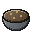
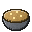
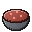
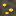
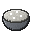
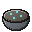
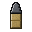
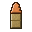
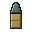

# CoreFactory Player Guide

Welcome to CoreFactory. This guide is for players. It tells you what the mod adds, how to find the rare ores, how the science works, how to run every machine, how to research, how to craft every item and bomb, and how to stay alive when the bombs go off.

You do not need to read it in order. Use the table of contents to jump to what you need. If you are new, read the [First hour](#first-hour) section, which walks you through your first session step by step.

## Welcome

CoreFactory turns TNT into a whole game. Mine rare ores, refine them in machines that work like a real nuclear fuel cycle, unlock new knowledge at a research console, and then build bombs from what you made. The bombs range from simple charges to the largest weapon in the game.

The mod has three big ideas.

- **Craft the weird TNT.** There are 42 TNT types. Many do something unusual: they pull blocks in, turn the ground to glass, lift mobs into the air, link to each other with a fuse, or make a fallout cloud.
- **Make the parts yourself.** The strong bombs need components. Some components need machines. Some machines need research. The whole chain is shown in this guide.
- **Stay safe.** Nuclear weapons leave fallout. A Radioactive Suit and a Geiger counter tell you when you are in danger.

Every mod item, bomb, machine, ore and research pack has its picture next to its name, so you can match what you see in your inventory with what the text says.

## How to use this guide

- Each **icon** is an item, a block, a machine or a research pack. Look for the same picture in your game, in the catalogue and in the recipe screens, when the server's resource pack is loaded.
- **Tables** give recipes, machine numbers and bomb stats. A recipe grid shows where each item goes in the 3 by 3 crafting table. Empty squares are empty. Vanilla items have no picture in this guide, so they are written as plain names.
- **Times** are shown in seconds. A machine that says 200 ticks takes 10 seconds, because 20 ticks make one second. Fuse times for bombs work the same way.
- **Numbers** come from the mod's own data. Nothing here is a guess.
- Some words are in the [Glossary](#glossary) at the end. When a word is new, look it up there.

## Table of contents

- [Welcome](#welcome)
- [How to use this guide](#how-to-use-this-guide)
- [Table of contents](#table-of-contents)
- [What this mod adds](#what-this-mod-adds)
- [The new items at a glance](#the-new-items-at-a-glance)
- [The new bombs at a glance](#the-new-bombs-at-a-glance)
- [Finding ores](#finding-ores)
  - [The ores](#the-ores)
  - [Uraninite](#uraninite)
  - [Pitchblende](#pitchblende)
  - [Monazite](#monazite)
  - [Thorite](#thorite)
  - [Galena](#galena)
  - [Cinnabar](#cinnabar)
  - [Fluorite](#fluorite)
  - [Crude petroleum deposit](#crude-petroleum-deposit)
  - [What to mine with](#what-to-mine-with)
  - [The silk touch trick](#the-silk-touch-trick)
  - [Finding ores in old land](#finding-ores-in-old-land)
  - [The Ore Density Scanner](#the-ore-density-scanner)
- [The science](#the-science)
  - [The big picture](#the-big-picture)
  - [Step 1 Crushing](#step-1-crushing)
  - [Step 2 Roasting](#step-2-roasting)
  - [Step 3 Separation](#step-3-separation)
  - [Step 4 Fluorination](#step-4-fluorination)
  - [Step 5 Enrichment](#step-5-enrichment)
  - [Thorium and U-233](#thorium-and-u-233)
  - [Plutonium](#plutonium)
  - [Hydrogen and deuterium](#hydrogen-and-deuterium)
  - [Particle physics and antiprotons](#particle-physics-and-antiprotons)
  - [Antimatter](#antimatter)
  - [Exotic matter](#exotic-matter)
  - [Is it realistic](#is-it-realistic)
  - [The whole chain in one table](#the-whole-chain-in-one-table)
- [The lab machines](#the-lab-machines)
  - [How every machine works](#how-every-machine-works)
  - [Hoppers and barrels](#hoppers-and-barrels)
  - [The hidden barrel](#the-hidden-barrel)
  - [Progress holograms](#progress-holograms)
  - [Machine effects](#machine-effects)
  - [Crusher](#crusher)
  - [Roasting kiln](#roasting-kiln)
  - [Centrifugal separator](#centrifugal-separator)
  - [Purification still](#purification-still)
  - [Fluorination converter](#fluorination-converter)
  - [Enrichment cascade](#enrichment-cascade)
  - [Neutron transmuter](#neutron-transmuter)
  - [Spectrometer](#spectrometer)
  - [Particle accelerator](#particle-accelerator)
  - [Antimatter condenser](#antimatter-condenser)
  - [Research console](#research-console)
- [Research](#research)
  - [How research works](#how-research-works)
  - [The research line](#the-research-line)
  - [The research packs](#the-research-packs)
  - [Using the research console](#using-the-research-console)
  - [Locked items and what unlocks them](#locked-items-and-what-unlocks-them)
- [Drills and petroleum](#drills-and-petroleum)
  - [What a drill does](#what-a-drill-does)
  - [Placing a drill](#placing-a-drill)
  - [The five levels](#the-five-levels)
  - [The power of a drill](#the-power-of-a-drill)
  - [Drill status](#drill-status)
  - [The drill hologram](#the-drill-hologram)
  - [Petroleum drills](#petroleum-drills)
  - [Ore drills](#ore-drills)
  - [The solar panel](#the-solar-panel)
  - [Petroleum](#petroleum)
- [Electricity](#electricity)
  - [Units in plain words](#units-in-plain-words)
  - [What powers what](#what-powers-what)
  - [The parts](#the-parts)
  - [Pylons](#pylons)
  - [Wires](#wires)
  - [Generators](#generators)
  - [Accumulators](#accumulators)
  - [The crude oil refinery and diesel](#the-crude-oil-refinery-and-diesel)
  - [Grids and outlines](#grids-and-outlines)
  - [Grid charts](#grid-charts)
  - [Building a grid in five steps](#building-a-grid-in-five-steps)
- [Belts and automation](#belts-and-automation)
  - [Belts](#belts)
  - [Placing a belt](#placing-a-belt)
  - [Corners](#corners)
  - [The end of a line](#the-end-of-a-line)
  - [Belts and chests: the claim rule](#belts-and-chests-the-claim-rule)
  - [Pickers](#pickers)
  - [Splitters](#splitters)
  - [Where a picker or splitter can go](#where-a-picker-or-splitter-can-go)
  - [Example: a crusher fed by a belt](#example-a-crusher-fed-by-a-belt)
  - [Example: a splitter that sorts raw ores](#example-a-splitter-that-sorts-raw-ores)
- [Ammunition and the machine gun turret](#ammunition-and-the-machine-gun-turret)
  - [The laser turret](#the-laser-turret)
  - [Upgrading a turret](#upgrading-a-turret)
  - [Turret commands](#turret-commands)
- [Crafting](#crafting)
  - [Crafting basics](#crafting-basics)
  - [Machine recipes](#machine-recipes)
  - [Drill recipes](#drill-recipes)
  - [Survey and power recipes](#survey-and-power-recipes)
  - [Component recipes](#component-recipes)
  - [Radioactive suit and Geiger counter](#radioactive-suit-and-geiger-counter)
  - [TNT recipes](#tnt-recipes)
  - [Items with no recipe](#items-with-no-recipe)
- [Bombs](#bombs)
  - [Placing and lighting](#placing-and-lighting)
  - [Fuse links and chains](#fuse-links-and-chains)
  - [Structural and physics bombs](#structural-and-physics-bombs)
  - [Terrain bombs](#terrain-bombs)
  - [Entity and status bombs](#entity-and-status-bombs)
  - [Timing and logic bombs](#timing-and-logic-bombs)
  - [Visual and sound bombs](#visual-and-sound-bombs)
  - [Utility bombs](#utility-bombs)
  - [Military bombs](#military-bombs)
  - [The exotic series](#the-exotic-series)
- [Nuclear weapons](#nuclear-weapons)
  - [The ten tiers](#the-ten-tiers)
  - [The three zones](#the-three-zones)
  - [The countdown and the sky](#the-countdown-and-the-sky)
  - [The mushroom cloud](#the-mushroom-cloud)
  - [The cut in the ground](#the-cut-in-the-ground)
  - [Fallout and dose](#fallout-and-dose)
  - [The beacon array](#the-beacon-array)
- [Protection](#protection)
  - [Radioactive suit in detail](#radioactive-suit-in-detail)
  - [Geiger counter in detail](#geiger-counter-in-detail)
  - [Staying alive checklist](#staying-alive-checklist)
- [Catalogue recipes and achievements](#catalogue-recipes-and-achievements)
  - [The catalogue](#the-catalogue)
  - [The tabs](#the-tabs)
  - [Reading a recipe](#reading-a-recipe)
  - [The guide book](#the-guide-book)
  - [Achievements](#achievements)
  - [Achievement families](#achievement-families)
- [First hour](#first-hour)
- [FAQ](#faq)
- [Glossary](#glossary)

## What this mod adds

CoreFactory adds seven things to your world.

1. **Ores.** Seven special ores, and a crude petroleum deposit, are hidden in the stone. They sit at different depths and show different colours. Each one gives a raw mineral when you mine it. See [Finding ores](#finding-ores).
2. **Machines.** Twenty machines turn raw minerals into the materials for bombs, ammunition and the turret. You place them like blocks, then open them to load and empty them. Hoppers can feed them. See [The lab machines](#the-lab-machines).
3. **Drills.** Ten drills dig for you. Five petroleum drills pump petroleum, and five ore drills mine the special ores. See [Drills and petroleum](#drills-and-petroleum).
4. **Power and belts.** Generators make power, pylons carry it to the machines, and accumulators store it. Belts, pickers and splitters move items between machines. See [Electricity](#electricity) and [Belts and automation](#belts-and-automation).
5. **Research.** A line of 15 research nodes controls what you can craft, place and light. Each node costs research packs, which the spectrometer makes from samples. See [Research](#research).
6. **Bombs.** Forty-two TNT types, from the simple Chain Reaction TNT to a 50 megaton Tsar Bomba and a 1000 megaton 4-dimensional bomb. See [Bombs](#bombs) and [Nuclear weapons](#nuclear-weapons).
7. **Radiation and achievements.** A Radioactive Suit and a Geiger counter protect you from fallout. A set of achievements, shown in the catalogue and in the Advancements screen, records what you have done. See [Protection](#protection) and [Achievements](#achievements).

The mod also gives you a **catalogue** of everything it adds, and a **guide book**. Both are described in [Catalogue recipes and achievements](#catalogue-recipes-and-achievements).

The rest of the guide goes through these things in the order you will meet them.

## The new items at a glance

There are three kinds of new item: the things you craft, the things you dig up or make in machines, and the things you need to research before you can use.

| Family | Items | Where they come from |
|---|---|---|
| Raw ores |  Raw uraninite,  Raw pitchblende,  Raw monazite,  Raw thorite,  Raw galena,  Raw cinnabar,  Raw fluorite | Mining the ore blocks |
| Crushed ores |  Crushed uraninite,  Crushed pitchblende,  Crushed monazite,  Crushed thorite,  Crushed galena,  Crushed cinnabar,  Crushed fluorite | Crusher |
| Process products |  Uranium calcine,  Slag,  Refined lead,  Mercury flask,  Yellowcake (U3O8),  Uranium tailings,  Rare earth concentrate,  Phosphate tailings,  Thorium concentrate,  Silicate tailings,  UF6 cylinder,  Depleted uranium,  Deuterium cell,  Purified iron,  High-purity graphite,  Uranium-233 oxide,  Plutonium oxide,  Fission waste | Machines (see each machine) |
| Advanced materials |  Enriched uranium,  Antiproton capsule,  Antimatter condensate,  Neutronium slug | Enrichment cascade (enriched uranium), particle accelerator (antiproton capsule and neutronium slug), antimatter condenser (antimatter condensate) |
| Crafted components |  Fuse linker,  Fuse wire,  Shaped charge lens,  Gravity core,  Vitrifier flux,  Sorting magnet,  Anchor crystal,  Pulse capacitor,  Quantum detonator,  Biohazard culture,  Napalm gel,  Anchor plate,  Plutonium pit,  Tritium booster,  Neutron initiator,  Nuclear casing,  Thermonuclear core | Crafting table |
| Protection |  Hazmat fabric, the four Radioactive Suit pieces,  Geiger counter | Crafting table, after research |
| Machines |  Crusher,  Roasting kiln,  Centrifugal separator,  Purification still,  Fluorination converter,  Enrichment cascade,  Neutron transmuter,  Spectrometer,  Particle accelerator,  Antimatter condenser,  Research console | Crafting table, after research |
| Drills and power |  Petroleum drills I to V,  Ore drills I to V,  Solar panel,  Ore density scanner | Crafting table, after research. The scanner needs Laboratory Basics |
| Petroleum |  Petroleum | Mining a crude petroleum deposit, or pumping one with a petroleum drill |
| Research packs |  Basic,  Chemical,  Nuclear,  Plasma,  Exotic | Spectrometer |
| Crafted parts for machines |  Superconducting magnet,  Neutron flux cell,  Tesseract lattice | Crafting table, after research |

Custom items only match custom items. If a recipe asks for a component, a vanilla item of the same material will not stand in for it. Read the recipe grids in [Crafting](#crafting) before you gather materials.

## The new bombs at a glance

Every bomb in the mod is a kind of TNT. Placed TNT looks like TNT, but each type has its own name, its own behaviour and its own recipe. There are 42 types in three groups.

| Group | How many | What they are |
|---|---|---|
| Everyday TNT | 29 | Blasts with a twist: chain reactions, shaped charges, gravity, terrain changes, status effects, logic gates, and utility charges such as the Harvest TNT. |
| Nuclear tiers | 10 | The ten nuclear weapons, from the tiny Davy Crockett to the 50 megaton Tsar Bomba. |
| Exotic weapons | 3 | The Exotic Neutron Bomb, the Antimatter Bomb and the 4-Dimensional Bomb. |

The full list is in [Bombs](#bombs) and [Nuclear weapons](#nuclear-weapons). The recipe for each one is in [TNT recipes](#tnt-recipes).

Some of the everyday bombs need only vanilla items. Others need components, so you cannot make them until you have the components. The nuclear weapons and the exotic weapons need the most. They also need research.

## Finding ores

Eight kinds of ore block are hidden in the stone of the world: seven special ores, and a crude petroleum deposit. None of them is visible from far away, so you must dig to find them. Each ore sits in a band of depths, and it appears only in the rock types it is allowed to replace. Ores are placed when a new piece of land is generated, so the same seed always gives the same veins.

Mining an ore block gives you its raw mineral. Raw minerals are not the end of the chain. They must be crushed, roasted and separated before they become useful. See [The science](#the-science) for what each one becomes.

Three things decide how easy an ore is to find:

- **Depth.** Each ore has a lowest and a highest level, written as y values. Y is the height in the world: the lowest point is -64, and higher numbers are higher up. The ranges are given below.
- **Rarity.** Some ores come in more veins per chunk than others. A chunk is a 16 by 16 block column. "Common" means the ore turns up in most chunks in its band. "Rare" means you must search a lot of chunks.
- **Vein size.** A vein is a small cluster of ore blocks. Bigger veins give more blocks in one spot, so one find can be a good haul.

### The ores

| Ore | Found between y | Rarity | Vein size (blocks) | Raw mineral you get per block |
|---|---|---|---|---|
|  Uraninite Ore | -48 and 24 | Fairly common | 5 to 8 | 2 to 4  Raw uraninite |
|  Pitchblende Ore | -64 and -8 | Uncommon | 4 to 7 | 1 to 3  Raw pitchblende |
|  Monazite Ore | 0 and 80 | Uncommon | 6 to 10 | 2 to 4  Raw monazite |
|  Thorite Ore | -64 and -16 | Rare | 3 to 6 | 1 to 3  Raw thorite |
|  Galena Ore | -32 and 40 | Common | 4 to 8 | 2 to 5  Raw galena |
|  Cinnabar Ore | -32 and 24 | Uncommon | 4 to 7 | 2 to 4  Raw cinnabar |
|  Fluorite Ore | -48 and 64 | Common | 6 to 12 | 3 to 6  Raw fluorite |
|  Crude Petroleum Deposit | -64 and 0 | Rare | 3 to 6 | 1 to 2  Petroleum |

Common ores are good for starting. Rare ores are good for later, when you need more of them.

The table is also a map. Deep ores (pitchblende and thorite) lie in the dark layer below sea level, where deepslate is common. High ores (monazite) lie in the upper stone and in mountains. Galena and fluorite are the widest, and you will see them at many depths.

In the world, an ore block is a block of grey stone with the mineral's colours flecked through it. The mineral's colour is shown in the icon next to each name. Without the server's resource pack, an ore block looks like a plain coloured block instead. If your ores look like plain terracotta, accept the server's resource pack.

### Uraninite

 **Uraninite Ore**

- **Where:** from y -48 to y 24, in stone, deepslate, tuff, andesite, granite and diorite.
- **The mineral:** black and pitchy, heavy, and faintly warm to the touch.
- **Drops:** 2 to 4  raw uraninite per block.
- **Next step:** crush the raw uraninite. Each raw piece becomes two crushed uraninite, and two crushed uraninite roast into one  uranium calcine. Two calcine give one  yellowcake, the first real uranium product.
- **Why it matters:** it is the main uranium ore. Most of the uranium chain starts here.

### Pitchblende

 **Pitchblende Ore**

- **Where:** from y -64 to y -8, in stone, deepslate and granite. This is the deep layer.
- **The mineral:** brown-black, almost all uranium oxide.
- **Drops:** 1 to 3  raw pitchblende per block.
- **Next step:** the same as uraninite. One raw pitchblende becomes one calcine after crushing and roasting, so two raw pitchblende make one yellowcake.
- **Why it matters:** the game calls it nearly pure uranium oxide. Its drops are fewer than uraninite's, so pitchblende is harder to collect in quantity.

### Monazite

 **Monazite Ore**

- **Where:** from y 0 to y 80, in stone, granite, diorite, andesite and tuff. This is the high band, so you often find it in mountains and high cliffs.
- **The mineral:** amber phosphate sand, golden in colour and rich in rare earths and thorium.
- **Drops:** 2 to 4  raw monazite per block.
- **Next step:** crush it, then run the crushed monazite through the centrifugal separator. The separator gives  rare earth concentrate and  phosphate tailings.
- **Why it matters:** rare earth concentrate is one of the two feeds for the neutron transmuter when you breed U-233. It is the harder of the two breeding routes. See [Thorium and U-233](#thorium-and-u-233).

### Thorite

 **Thorite Ore**

- **Where:** from y -64 to y -16, in deepslate, stone and tuff. This is the deepest ore in the game.
- **The mineral:** dark silicate rock that holds thorium-232.
- **Drops:** 1 to 3  raw thorite per block.
- **Next step:** crush it, then separate the crushed thorite. The separator gives  thorium concentrate and  silicate tailings.
- **Why it matters:** thorium concentrate breeds U-233 more reliably than rare earths do. Thorite is the rarest ore in the game, so each piece of it is worth keeping.

### Galena

 **Galena Ore**

- **Where:** from y -32 to y 40, in stone, andesite, diorite and deepslate. It is one of the most common ores, so it is a good first ore.
- **The mineral:** light grey cubes of lead sulfide, often with a little silver.
- **Drops:** 2 to 5  raw galena per block.
- **Next step:** crush it. Two crushed galena roast into  refined lead, with a chance of slag. You can also send one crushed galena straight to the spectrometer, which makes a  basic research pack.
- **Why it matters:** galena is your first research ore. Basic packs unlock the early nodes, including Radiation Safety, which gives you the suit and the Geiger counter. You do not need refined lead for any recipe, so it is a metal you can keep for later.

### Cinnabar

 **Cinnabar Ore**

- **Where:** from y -32 to y 24, in stone, deepslate and andesite.
- **The mineral:** red mercury ore. Roasting it releases the metal.
- **Drops:** 2 to 4  raw cinnabar per block.
- **Next step:** crush it. Two crushed cinnabar roast into one  mercury flask, with a chance of slag. Cinnabar can also go to the spectrometer, which makes a basic research pack from one crushed cinnabar.
- **Why it matters:** mercury is one of the two items for the chemical research pack, along with purified iron.

### Fluorite

 **Fluorite Ore**

- **Where:** from y -48 to y 64, in stone, deepslate, tuff and granite. Fluorite has the widest band and has large veins.
- **The mineral:** fluorine in a purple and green crystal. It is the source of every fluoride in the mod.
- **Drops:** 3 to 6  raw fluorite per block. This is the most you get from one block of any ore.
- **Next step:** crush it into  crushed fluorite. Two crushed fluorite go with one yellowcake into the fluorination converter, which makes a  UF6 cylinder.
- **Why it matters:** fluorine is the key to the enrichment step. Without fluorite you cannot make the gas that the enrichment cascade needs.

### Crude petroleum deposit

 **Crude Petroleum Deposit**

- **Where:** from y -64 to y 0, in stone and deepslate.
- **The mineral:** crude oil, black and thick. The game calls it petroleum.
- **Drops:** 1 to 2  petroleum per block. Mining the block removes it.
- **Silk touch:** keeps the block as an item, as it does for the other ores.
- **Pumping:** a petroleum drill pumps a deposit without removing it, so one deposit can supply a drill for a long time. See [Petroleum drills](#petroleum-drills).
- **Why it matters:** petroleum is the fuel of the ore drills. See [Petroleum](#petroleum).

### What to mine with

Any tool breaks an ore block. The mod takes over the drop, so the tool does not change what you get, apart from one thing: a silk touch enchantment keeps the ore block itself. See [The silk touch trick](#the-silk-touch-trick).

- **Use a pickaxe.** The ore blocks are hard stone-like blocks, and a pickaxe breaks them fastest. Use the best pickaxe you have.
- **Fortune does not help.** An enchantment called fortune does not give extra ore. Each block gives a fixed random amount in the range shown in the table.
- **Blasts destroy ore.** If an explosion breaks an ore block, the block is gone and it gives no raw minerals. Mine away from TNT, and do not let a bomb blow up a vein you want.
- **Mine in a safe spot.** Ores are found deep, often near lava or caves. Put torches up and check your surroundings first.

### The silk touch trick

Silk touch keeps the ore itself.

- Mine the ore block with a pickaxe that has silk touch.
- You get the **ore block as an item**, not raw minerals.
- Place that item in the world to put the ore back. You can place it at any height from y -64 to y 959. The placed block is a real ore again.
- Mine it again without silk touch to get the raw minerals. The drop is the same as before.

Why use it? Three reasons:

1. **Keep a rare ore.** Thorite is rare. If you find one vein and do not need all of it yet, you can keep the block and mine it later.
2. **Build a farm.** Put several ore items in a safe place. When you need raw minerals, mine them.
3. **Move the ore.** You can carry the block home and place it near your machines.

Silk touch does not add more raw minerals. The ore block item only keeps the block. It still gives the same amount of raw minerals when you mine it without silk touch.

### Finding ores in old land

Ores are placed when a new chunk is generated. Land that was generated before the mod was added may have no ores at all. If you explore an old area and find no ore, the land is simply older than the mod.

The easy fix is to explore new land. Travel far enough and you will find chunks that the mod has filled, and the ores are waiting there.

An ore block stays in place until you mine it or a blast destroys it.

### The Ore Density Scanner

 **Ore density scanner**

The scanner shows the ores of the chunk you stand in, before you dig. Hold it in your main hand and right-click. You can right-click in the air or on a block.

**What you get.**

- **A map.** A filled map of the chunk, which is 16 by 16 blocks. Each use makes a new map item. The map does not follow you, and earlier maps stay valid.
- **A chat summary.** The number of planned ore blocks in the chunk. Then one line for each ore that is planned there. Each line gives the planned count, the count still in the ground, and the depths the ore is planned between.

**How to read the map.**

- Each column of the chunk is one small square on the map. A square is 8 by 8 pixels, and the map is 16 squares across and 16 down.
- The colour of a square is the ore with the most planned blocks in that column.
- A dark square has few planned blocks. A full colour square has 64 or more.
- A thin dark line marks where the dominant ore changes from one square to the next.
- A plain dark grey square has no planned ore.

| Colour on the map | Ore |
|---|---|
| Near black | Uraninite ore |
| Very dark brown | Pitchblende ore, or crude petroleum deposit |
| Gold | Monazite ore |
| Dark grey | Thorite ore |
| Light grey | Galena ore |
| Dark red | Cinnabar ore |
| Purple | Fluorite ore |

Thorite is close to the plain grey of an empty square. Read the chat summary to be sure.

**The limit.** The planned count drops as ore is mined or blown up. A planned block that is gone no longer counts. Use the scanner before you dig, and use the count still in the ground to see what is left.

**Recipe and research.** The scanner needs Laboratory Basics. Its recipe is in [Survey and power recipes](#survey-and-power-recipes).

## The science

This part explains the science in plain words. It follows the real nuclear fuel cycle, which is the process that turns dug-up rock into fuel and, for weapons, into a fissile core. Each step is a machine in the mod. Times are in seconds, from the game's data.

Read it once from start to finish. After that, the [lab machines](#the-lab-machines) section gives you the exact inputs and outputs for each machine.

### The big picture

Uranium in the ground is almost all one kind of atom, uranium-238 (U-238). Only a small share, about 0.7 percent in real natural uranium, is uranium-235 (U-235). U-235 is the kind that can split in a chain reaction. U-238 can also be used, but it needs a different route.

So the work is to:

1. **Gather** the rock that holds the uranium.
2. **Concentrate** the uranium into an oxide, the yellowcake.
3. **Turn it into a gas**, uranium hexafluoride (UF6), because a gas can be sorted by weight.
4. **Enrich** the gas, so that the share of U-235 goes up.
5. **Build** the bomb or the fuel from the enriched metal.

Other parts of the mod follow the same logic:

- **Thorium** does not split on its own. It is turned into a fissile isotope, U-233, by neutrons. This is called breeding.
- **Plutonium** is also bred, from U-238, and it is the core of the implosion weapons.
- **Hydrogen** gives deuterium, a heavy form of hydrogen, for fusion fuel and for particle physics.
- **Antimatter** is made by accelerating particles to great speed, then trapping the antiparticles.
- **Exotic matter** is neutron-rich matter, which is the top of the tree.

### Step 1 Crushing

 **Crusher**

- **In:** 1 raw ore.
- **Out:** 2 crushed ore.
- **Time:** 100 ticks, which is 5 seconds.
- **Fuel:** none.

Crushed ore is the same mineral in finer grains. This works for all seven ores. Raw uraninite, for example, becomes crushed uraninite, which is a fine black powder ready for the roaster.

Why it is realistic: real mills break rock so that the mineral grains come free of the surrounding stone. Chemists can then treat the mineral more easily. The game gives two crushed pieces per raw piece, to keep the chain going.

### Step 2 Roasting

 **Roasting kiln**

- **In:** 2 crushed ore, in the feed slots.
- **Out:** calcine or another product, with a chance of slag.
- **Fuel:** one coal or charcoal per roast.

| Crushed ore in | Product out | Chance of slag | Time |
|---|---|---|---|
|  2 crushed uraninite |  1 uranium calcine | 40 percent | 200 ticks (10 s) |
|  2 crushed pitchblende |  1 uranium calcine | 50 percent | 200 ticks (10 s) |
|  2 crushed galena |  1 refined lead | 60 percent | 240 ticks (12 s) |
|  2 crushed cinnabar |  1 mercury flask | 30 percent | 200 ticks (10 s) |

 **Slag** is the waste from roasting. It is mostly iron and silica. You can keep it or throw it away. Nothing in the mod uses it.

Why it is realistic: roasting heats ore in air to drive off unwanted matter and to turn the metal into a stable oxide. The name "calcine" is the real word for the product. Galena and cinnabar are roasted for their metals, lead and mercury, and the mod follows that.

### Step 3 Separation

 **Centrifugal separator**

- **In:** 2 uranium calcine, or 2 crushed monazite, or 2 crushed thorite. Each run takes one kind.
- **Out:** a product and a waste.
- **Fuel:** none.

| Put in | Product | Waste | Time |
|---|---|---|---|
| 2  uranium calcine | 1  yellowcake | 1  uranium tailings | 240 ticks (12 s) |
| 2  crushed monazite | 1  rare earth concentrate | 1  phosphate tailings | 200 ticks (10 s) |
| 2  crushed thorite | 1  thorium concentrate | 1  silicate tailings | 200 ticks (10 s) |

Yellowcake is the key product of the whole uranium chain. It is a nickname for uranium oxide concentrate. Chemists write it as U3O8.

Why it is realistic: the separator stands in for the work of concentrating a mineral from its waste. The game shows it as a spinning machine that sends the heavy product one way and the light waste the other. Real yellowcake is made by chemical leaching and filtering, and the game simplifies that to one machine.

### Step 4 Fluorination

 **Fluorination converter**

- **In:** 1 yellowcake in the first feed slot, and 2 crushed fluorite in the second.
- **Out:** 1  UF6 cylinder.
- **Time:** 300 ticks, which is 15 seconds.
- **Fuel:** one coal or charcoal per run.

UF6 is uranium hexafluoride, a compound of uranium and fluorine. It is the feed of every enrichment cascade.

Why it is realistic: uranium oxide is solid and hard to sort. Uranium hexafluoride turns into a gas at a modest temperature. About 56 degrees Celsius is enough for it to sublime, which means go from solid straight to gas. A gas can be spun and sorted by weight, and that is why the real cycle uses it.

### Step 5 Enrichment

 **Enrichment cascade**

- **In:** 8 UF6 cylinders, one in each of eight slots.
- **Out:** 1  enriched uranium and 2  depleted uranium.
- **Time:** 1200 ticks, which is 60 seconds.
- **Fuel:** none.

Enriched uranium is U-235 metal. It is the weapons-grade fuel of the early warheads. It is made only by the cascade. There is no recipe for it, so you cannot craft it by hand.

Depleted uranium is the uranium that is left, with less U-235 than natural uranium. It is dense and cheap, and the mod keeps it as a by-product. Nothing in the mod's recipes uses it, so you can store it or throw it away.

Why it is realistic: the real process uses gas centrifuges. UF6 molecules with the heavier U-238 are slightly heavier than those with U-235, so a fast spin pushes the heavier ones a little further out. The gas that comes from the middle is slightly richer in U-235. Many stages, called a cascade, repeat the process until the U-235 share is high enough. The mod compresses this into one machine.

### Thorium and U-233

 **Neutron transmuter**

Thorium-232 does not split. But when it absorbs a neutron, it turns into thorium-233, which decays twice, and becomes U-233. U-233 is fissile, which means it can split in a chain reaction. This is called breeding. The thorium is the "fertile" material, and the neutrons come from a flux cell.

The transmuter takes a neutron flux cell in its core slot. A flux cell gives off free neutrons. In the game the flux cell is a component, and it is made from high-purity graphite, a neutron initiator and purified iron.

| Feed | Output | Chance | Time |
|---|---|---|---|
| 2  thorium concentrate, with 1  neutron flux cell | 1  uranium-233 oxide, and 1  fission waste | Always | 1200 ticks (60 s) |
| 2  rare earth concentrate, with 1  neutron flux cell | 1  uranium-233 oxide, and 1  fission waste | 50 percent | 1400 ticks (70 s) |

The thorium route is more reliable. The monazite route, through the rare earths, gives U-233 only half of the time, and it takes longer. Both routes leave fission waste behind. Keep the waste sealed, because the game calls it spent products of the flux.

Why it is realistic: the real breeding of U-233 happens in reactors, where thorium is held in neutron-rich fuel. The mod keeps the idea and the two routes. The lore calls U-233 rarer than U-235, which is the game's way of saying it is harder to get.

### Plutonium

 **Neutron transmuter**

- **In:** 2 yellowcake and 1 neutron flux cell.
- **Out:** 1  plutonium oxide and 1  fission waste.
- **Time:** 1600 ticks, which is 80 seconds.

Plutonium is made from the U-238 in yellowcake. The flux cell gives neutrons, and U-238 absorbs one, then decays twice to plutonium. This is the real route, and it is a slow one.

Plutonium oxide is the raw form. It is pressed into a  plutonium pit, which is the hollow sphere at the heart of an implosion bomb. The pit is crafted, not made in a machine:

- 4 plutonium oxide, a nether star and a gold block, arranged in any order, make 1 plutonium pit.

Why it is realistic: plutonium is made in reactors from U-238, just as the game does, and it is used in implosion weapons. The implosion squeezes a plutonium core into a dense ball. The mod shows that squeeze as a recipe.

### Hydrogen and deuterium

 **Purification still**

The still does three jobs. Each job takes its own inputs.

**Electrolysis (heavy water):**

- **In:** 2 water buckets, one in each tank.
- **Out:** 1  deuterium cell and 2 empty buckets.
- **Time:** 400 ticks, which is 20 seconds.

Deuterium is hydrogen with an extra neutron in its nucleus. It is a heavy hydrogen. It is the fuel for fusion and the starting point for the particle work below. Because water buckets do not stack, two buckets are needed, one for each slot.

**Zone refining iron:**

- **In:** 4 iron ingots.
- **Out:** 1  purified iron.
- **Time:** 300 ticks, which is 15 seconds.

**Zone refining graphite:**

- **In:** 2 coal blocks.
- **Out:** 1  high-purity graphite.
- **Time:** 240 ticks, which is 12 seconds.

Why it is realistic: real heavy water is concentrated from ordinary water by electrolysis. Hydrogen comes off faster than deuterium, so the water left behind grows richer in heavy water. Zone refining is a real method: a bar of metal is melted in one small zone and moved slowly along, so impurities move to the end. Purified iron and high-purity graphite are the two clean materials needed for magnets and for the flux cell.

The tritium booster is a fusion booster built from deuterium, blaze powder and a nether star. In real life, tritium is a heavier form of hydrogen with two neutrons, and it fuses very easily. The mod uses the booster to stand for that fuel. See [Items with no recipe](#items-with-no-recipe) for how it is crafted.

### Particle physics and antiprotons

 **Particle accelerator**

The accelerator runs two kinds of beam. Each run uses its own pair of inputs.

**Antiprotons:**

- **In:** 1 deuterium cell, and 1 superconducting magnet. The magnet is used up on every run.
- **Out:** 2  antiproton capsules.
- **Time:** 1200 ticks, which is 60 seconds.

**Neutronium:**

- **In:** 2 neutron flux cells, and 1 superconducting magnet, which is used up on every run.
- **Out:** 1  neutronium slug.
- **Time:** 1600 ticks, which is 80 seconds.

Why it is realistic: real antiprotons are made when fast protons hit a target. Strong magnets steer and focus the beam, and superconducting magnets, which carry current with almost no resistance, are how the big rings keep the beam tight. The mod's accelerator takes the same ingredients: a beam feed, magnets, and time.

### Antimatter

 **Antimatter condenser**

- **In:** 2 antiproton capsules and 1 neutron flux cell.
- **Out:** 1  antimatter condensate.
- **Time:** 2400 ticks, which is 120 seconds, or two minutes.

The condenser holds the antiprotons in a field and waits. The game lore calls it "two minutes of quiet, and a pinch of the impossible".

Antimatter is the mirror of matter. When it meets matter, both annihilate and release energy. Annihilation releases the full mass-energy of the particles, which is why it is so powerful for its weight.

Why it is realistic: real antimatter has been made only in tiny amounts, at great cost, and it must be held in magnetic or electric traps so that it never touches the walls. The mod shows the trapping, but it makes the amounts and the timings playable. The lore also points out that the antiproton capsule must not touch matter. That is true in real life too.

### Exotic matter

 **Neutronium slug**

Neutronium is a name for neutron-rich matter. Real neutron-rich matter exists in the core of a neutron star, and it is very dense. The mod makes it in the accelerator, from neutron flux cells and a superconducting magnet. Its lore says it is heavier than the rest of your inventory together. That is a joke about density, and it is the point of the item.

 **Tesseract lattice**

The tesseract is a four-dimensional cube. You cannot build one in our world, but you can draw its shadow. The lattice in the game is built by hand, from four superconducting magnets, four antiproton capsules and one high-purity graphite block. Its pattern is meant to look like the shadow of the 4D shape.

Why it is fiction: a tesseract is a real mathematical object, but it is not something a machine can make. The mod uses it as the last, hardest step of the research tree.

### Is it realistic

The mod follows real physics where it can. Where it cannot, it says so, or it changes the numbers so that the game is fun.

| Part | What is real | What the game changes |
|---|---|---|
| Ore and uranium share | Natural uranium is mostly U-238, with about 0.7 percent U-235. | The ore veins and the drops are game numbers. |
| Roasting and calcine | Roasting drives off unwanted matter and makes a stable oxide. | The chance of slag and the two-for-one ratio are for play. |
| Separation | Concentrating a mineral from waste is real. | The real method is chemical. The game shows one spinning machine. |
| UF6 gas | UF6 turns to gas at a modest temperature and can be spun. | The fluorination converter is one machine. |
| Enrichment | Gas centrifuges enrich U-235 in many stages. | The game uses one cascade. The 8 to 1 to 2 ratio is a play ratio, not a mass balance. |
| Thorium and U-233 | Thorium breeds U-233 with neutrons. | The flux cell is an item, and the two routes are game choices. |
| Plutonium | U-238 breeds plutonium in reactors. | A plutonium pit is a crafted item in the game. |
| Deuterium | Heavy water is separated by electrolysis. | The rate is a game rate. |
| Tritium booster | Tritium is a real fusion fuel. | The booster is a game item that stands for it. |
| Antiprotons | Accelerators make antiprotons and magnets steer them. | The time, magnet use and amounts are game values. |
| Antimatter | Real antimatter is made in tiny amounts and held in traps. | The condensate is a playable amount. |
| Neutronium and tesseract | Neutron-rich matter exists in neutron stars. A tesseract is a real geometric object. | Neutronium is made by a machine. The tesseract is fiction. |
| Bomb yields | The public figures are real: the Hiroshima and Nagasaki size, the Castle Bravo and Tsar Bomba size. | The radii, fuses and crater sizes are scaled for play. |
| Fallout | Fallout settles on the ground and fades over time. A dose builds up in the body. | The fallout rate and the half-life are game values. |

### The whole chain in one table

| Stage | Machine | In | Out | Time |
|---|---|---|---|---|
| Crush |  Crusher | 1 raw ore | 2 crushed ore | 5 s |
| Roast |  Roasting kiln | 2 crushed uranium ore | 1 uranium calcine | 10 s |
| Separate |  Centrifugal separator | 2 uranium calcine | 1 yellowcake | 12 s |
| Convert |  Fluorination converter | 1 yellowcake and 2 crushed fluorite | 1 UF6 cylinder | 15 s |
| Enrich |  Enrichment cascade | 8 UF6 cylinders | 1 enriched uranium and 2 depleted uranium | 60 s |
| Breed U-233 |  Neutron transmuter | 2 thorium concentrate and 1 flux cell | 1 U-233 oxide | 60 s |
| Breed plutonium |  Neutron transmuter | 2 yellowcake and 1 flux cell | 1 plutonium oxide | 80 s |
| Deuterium |  Purification still | 2 water buckets | 1 deuterium cell | 20 s |
| Antiprotons |  Particle accelerator | 1 deuterium cell and 1 superconducting magnet | 2 antiproton capsules | 60 s |
| Antimatter |  Antimatter condenser | 2 antiproton capsules and 1 flux cell | 1 antimatter condensate | 120 s |
| Packs |  Spectrometer | samples | research packs | 10 to 40 s |

## The lab machines

The lab machines are the heart of the science. Each one takes a set of items, works for a fixed time, and puts the products in its output slots. You place a machine like a block, right-click it to open its screen, load it, and come back later for the products.

This part covers every machine, with the exact inputs, outputs and times. Each machine has its own screen, so the layout of its slots is described too.

### How every machine works

**Placing.** Place a machine's item like any block. Research gates the machines. A machine you have not unlocked yet cannot be placed. See [Research](#research).

**Opening.** Right-click the machine. Its screen opens. The machine works while you are not looking, too, as long as its chunk is loaded. Put in items and walk away.

**Loading.** Click an item on your cursor into an input slot, and the item goes in if the machine accepts it. You can also drag an item from your inventory across the input and fuel slots. It goes into each covered slot that takes it, and the stack is shared between them. You can also shift-click an item from your inventory. It goes into the first input or fuel slot that takes it. A slot only takes what the machine can use. A drag that covers an output slot is refused whole.

**Unloading.** Click a product in an output slot to take it. Output slots only give items up. You cannot put things into them.

**Empty slots show a hint.** An empty slot shows a hint item. Its name and lore say what goes there. The hint is not a real item, and it disappears when you put something in.

**Progress.** A row of cells fills up as the run goes on. Each cell is a part of the run.

**Status.** One item in the screen shows the state of the machine.

| Status item | Meaning | What to do |
|---|---|---|
| Grey dye, "Idle" | The machine has no full set of inputs for a recipe. | Fill the inputs with one recipe. |
| Clock, "Running" with a percentage | The machine is working. The percentage is how far the run has got. | Wait. You can leave it. |
| Red dye, "Output full" | A run is finished, but the output slots have no room. | Take the products out. The machine then goes on. |

**A run needs everything at once.** A process runs only when every input is in full and there is room for the outputs. A half-loaded machine waits.

**Fuel.** Some machines burn coal or charcoal. A run that needs fuel will not start without it. One item of fuel is used up when the run finishes. Keep fuel in the fuel slot, and the machine goes on by itself.

**Breaking a machine.** Break a machine and the items inside it drop onto the ground.

**Blasts.** An explosion that reaches a machine breaks it, and the items inside drop. A machine outside the blast's radius is not touched, and it keeps running. Protected ground is spared.

**Loaded chunks.** A machine only works while its chunk is loaded, which is the area of the world near a player. Leave a machine far away and it pauses until someone comes near.

**Walk away.** When the chunk of a machine unloads, a screen you have open on it is closed, and any change you made in that screen is written to the machine first. Walk away and the machine keeps what you put in.

### Hoppers and barrels

Each lab machine and each drill stands on a barrel, and the barrel holds the machine's items. The machine's screen is a view of that barrel. What you see is what the barrel holds.

- **Hoppers feed the inputs and the fuel.** A hopper next to a machine puts one item at a time into the input or fuel slot that takes it. Inputs come first. An item that no slot takes is refused.
- **Hoppers take only the products.** A hopper next to a machine takes one item at a time from its output slots. Inputs and fuel never leave by hopper.
- **Machines can pass products on.** A hopper can carry a product from one machine into the input of another. A crusher's crushed ore, for example, can go into a roasting kiln.
- **Other moves are refused.** A hopper cannot push an item into a machine that has no slot for it. Nothing else can be pulled out of a machine.
- **Your screen and the hoppers share the barrel.** What you move in the screen goes into the barrel. What a hopper moves shows up in the screen.

Break a machine and everything in its barrel drops onto the ground.

### The hidden barrel

Under every lab machine and every drill there is a barrel. You do not see it. Nearby players see the machine's own model instead. The machine looks like the machine, not a barrel.

- **Clicks still work.** Right-click the machine to open its screen. Left-click it to break it. Breaking it drops its items and the machine itself.
- **From far away you see the barrel.** Past the range that the server sets, you see the real barrel.
- **Placing next to a machine.** For a moment after you place a block against a machine, you can see a ghost of the barrel. It goes away on its own.

### Progress holograms

When a lab tool runs, a hologram floats over it. The game calls it a hologram. It has three short lines, and a fourth for the power grid:

1. **The process.** The name of the run, such as Crush uraninite. An idle tool shows its own name here.
2. **The bar.** A bar of 20 segments. It fills as the run goes on.
3. **The progress.** The percentage, and the seconds left. A run that is almost done reads finishing. An idle tool reads idle.
4. **The grid.** The grid's voltage, the power the tool asks for, and the share it gets, such as `Grid 230.0 V  4.0 kW  50 %`. The line is green at full power. See [What powers what](#what-powers-what).

The hologram shows while the tool runs or has what it needs to start a run. When the tool is idle, the hologram goes. Players within the view distance can read it. The default view distance is 32 blocks. Some servers turn the lines off.

Drills have their own four-line hologram. See [The drill hologram](#the-drill-hologram).

### Machine effects

Each lab machine has its own small show when a run finishes. You can tell the machines apart from across a room.

| Machine | What you see when a run finishes |
|---|---|
| Crusher | A puff of grit, with glints |
| Roasting kiln | A burst of embers and smoke |
| Centrifugal separator | A spiral of sparks and steam |
| Purification still | A puff of steam |
| Fluorination converter | A puff of steam and fluorine fumes |
| Enrichment cascade | A spiral of sparks and neutron sparks |
| Neutron transmuter | A burst of neutron sparks |
| Spectrometer | A flash of sparks |
| Particle accelerator | A streak of neutron sparks along a line |
| Antimatter condenser | A ring of flares and glints |

A running machine also gives off a little steam now and then. Finishing a research node gives a burst of sparks. Breaking an ore block gives a burst of glints.

### Crusher

 **Crusher**

The crusher breaks raw ore into crushed ore. It is the first machine you will use, and it needs nothing but raw ore.

| | |
|---|---|
| **Put in** | 1 raw ore. A whole stack can go in, and it is crushed one piece at a time. |
| **Comes out** | 2 crushed ore for each raw piece. |
| **Time** | 100 ticks, which is 5 seconds, for every raw ore. |
| **Fuel** | None. |
| **Slots** | 1 input, 3 outputs. |

**Screen.** The input slot sits at the top of the screen. The three output slots sit along the bottom left. The progress cells run across the middle, and the status item sits in the centre of the bottom row.

**Tip.** Crushing one raw uraninite gives two crushed uraninite. Galena and cinnabar go on to the spectrometer for research packs, so keep some of their crushed ore for that.

### Roasting kiln

 **Roasting kiln**

The kiln heats crushed ore to drive off impurities and to make a stable oxide. It needs fuel, and it makes calcine, refined lead or mercury, with a chance of slag.

| | |
|---|---|
| **Put in** | 2 crushed ore, in the feed slots. The process runs on two pieces of the same kind. |
| **Comes out** | One product, plus slag with a chance. See the table below. |
| **Time** | 200 ticks for uraninite, pitchblende and cinnabar. 240 ticks for galena. |
| **Fuel** | One coal or charcoal per roast. The fuel slot takes coal, vanilla charcoal, and the charcoal that broken coal ore drops. |
| **Slots** | 2 inputs, 1 fuel, 3 outputs. |

| Put in | Comes out | Chance of slag | Time |
|---|---|---|---|
| 2  crushed uraninite |  uranium calcine | 40 percent | 10 s |
| 2  crushed pitchblende |  uranium calcine | 50 percent | 10 s |
| 2  crushed galena |  refined lead | 60 percent | 12 s |
| 2  crushed cinnabar |  mercury flask | 30 percent | 10 s |

**Screen.** The two feed slots sit on the left, and the firebox sits to their right. The fuel slot is further right, past the firebox. The firebox is a light: it lights, with blaze powder, while the kiln burns fuel, which is while a roast advances and the fuel slot holds fuel. Otherwise it shows gunpowder. The three outputs are on the right, and the progress cells run along the bottom left.

**Feeding it.** Put fuel in the fuel slot by click, by dragging an item across it, by shift-clicking it from your inventory, or with a hopper. A belt or a picker can feed the fuel slot too. Crushed ore from a belt or a picker goes into the two feed slots.

**Tip.** Keep coal in the fuel slot before you start. A roast does not begin without it.

### Centrifugal separator

 **Centrifugal separator**

The separator spins two feeds apart by weight and sends the product one way and the waste the other. It takes calcine or crushed monazite or crushed thorite, and it needs no fuel.

| | |
|---|---|
| **Put in** | 2 calcine, or 2 crushed monazite, or 2 crushed thorite. |
| **Comes out** | A product and a waste. |
| **Time** | 240 ticks (12 s) for calcine. 200 ticks (10 s) for monazite and thorite. |
| **Fuel** | None. |
| **Slots** | 2 inputs, 3 outputs. |

| Put in | Product | Waste | Time |
|---|---|---|---|
| 2  uranium calcine |  yellowcake |  uranium tailings | 12 s |
| 2  crushed monazite |  rare earth concentrate |  phosphate tailings | 10 s |
| 2  crushed thorite |  thorium concentrate |  silicate tailings | 10 s |

**Screen.** The progress cells run across the top row. The two feeds sit in the lower left, with a rotor between them. The products come out around a ring: the first product at the top, the second at the side, and the waste at the bottom.

**Tip.** Yellowcake is the product you want. The tailings are kept as a by-product. Nothing in the recipe list needs them.

### Purification still

 **Purification still**

The still has two tanks, one each side. It does three jobs: it makes deuterium from water, and it refines iron and coal blocks into clean materials. Each job uses one kind of input.

| | |
|---|---|
| **Put in** | Tank A takes a water bucket, iron ingots or coal blocks. Tank B takes a second feed for the same recipes. |
| **Comes out** | A product from the still. |
| **Fuel** | None. |
| **Slots** | 2 inputs, 2 outputs. |

| Put in | Comes out | Time |
|---|---|---|
| 2 water buckets, one per tank | 1  deuterium cell, and 2 empty buckets | 20 s |
| 4 iron ingots | 1  purified iron | 15 s |
| 2 coal blocks | 1  high-purity graphite | 12 s |

**Screen.** The two tanks sit on the left and right of the screen, and the two product slots are at the top left and top right. The progress row runs along the bottom.

**Tip.** Water buckets do not stack, so two buckets fill both tanks for the deuterium recipe. You get two empty buckets back.

### Fluorination converter

 **Fluorination converter**

The converter reacts yellowcake with crushed fluorite into a UF6 cylinder. It needs fuel.

| | |
|---|---|
| **Put in** | 1 yellowcake in the first feed. 2 crushed fluorite in the second feed. |
| **Comes out** | 1  UF6 cylinder. |
| **Time** | 300 ticks, which is 15 seconds. |
| **Fuel** | One coal or charcoal per run. |
| **Slots** | 2 inputs, 1 fuel, 1 output. |

**Screen.** The two feeds are on the top left. The arrow of progress runs across the middle, with the single output on the right. The status item is at the bottom centre, and the fuel slot sits at the bottom left.

**Tip.** Keep fuel in the fuel slot. Without it, the reaction will not start, even when both feeds are full.

### Enrichment cascade

 **Enrichment cascade**

The cascade is the big one. It is a bank of gas centrifuges, and it takes eight UF6 cylinders for each run. It is the only way to make enriched uranium.

| | |
|---|---|
| **Put in** | 8 UF6 cylinders, one in each of eight slots. |
| **Comes out** | 1  enriched uranium, and 2  depleted uranium. |
| **Time** | 1200 ticks, which is 60 seconds. |
| **Fuel** | None. |
| **Slots** | 8 inputs, 4 outputs. |

**Screen.** The eight feed slots sit in a row across the second line of the screen, with iron bars at the end. The progress row runs along the third line. The four outputs sit on the fourth line: enriched uranium on the left, and three depleted uranium slots beside it. The status item is in the middle of the bottom line.

**Tip.** Enriched uranium is the rare product here. It is the only way to get the metal that the early warheads need.

### Neutron transmuter

 **Neutron transmuter**

The transmuter is a flux chamber. It breeds U-233 from thorium and plutonium oxide from yellowcake, and it needs a neutron flux cell in its core slot every run.

| | |
|---|---|
| **Put in** | A feed in the left slot: thorium concentrate, rare earth concentrate or yellowcake, two at a time. A neutron flux cell in the core slot. |
| **Comes out** | A fissile product, a fission waste, and a spare output. |
| **Time** | 1200 ticks for thorium (60 s). 1400 ticks for rare earths (70 s). 1600 ticks for yellowcake (80 s). |
| **Fuel** | None. |
| **Slots** | 2 inputs, 3 outputs. |

| Feed | Comes out | Chance | Time |
|---|---|---|---|
| 2  thorium concentrate |  uranium-233 oxide, and  fission waste | Always | 60 s |
| 2  rare earth concentrate |  uranium-233 oxide, and  fission waste | 50 percent | 70 s |
| 2  yellowcake |  plutonium oxide, and  fission waste | Always | 80 s |

**Screen.** The status item sits at the top middle. The feed is on the left, the neutron core sits in the middle, and the three outputs run along the right. The progress row runs along the bottom.

**Tip.** Keep the fission waste sealed. The lore warns about it, and it is needed for nothing else.

### Spectrometer

 **Spectrometer**

The spectrometer reads a sample and prints a research pack. It is the only way to make research packs. It needs no fuel, and it works in one or two parts.

| Put in | Comes out | Time |
|---|---|---|
| 1  crushed galena | 1  basic pack | 10 s |
| 1  crushed cinnabar | 1  basic pack | 10 s |
| 1  purified iron, with 1  mercury flask in the reagent slot | 2  chemical packs | 20 s |
| 1  yellowcake | 1  nuclear pack | 20 s |
| 1  deuterium cell, with 1  tritium booster in the reagent slot | 2  plasma packs | 30 s |
| 1  antiproton capsule | 2  exotic packs | 40 s |

The reagent slot is the second input. Leave it empty for a one-part reading, and fill it for a two-part reading. The chemical and plasma recipes need the reagent. Basic, nuclear and exotic recipes use only the sample.

**Screen.** The sample slot is on the left, and the reagent slot sits below it. The screen in the middle shows the status. The two research pack outputs sit on the right. The progress cells run along the centre-bottom.

**Tip.** Basic packs are the cheapest and come from galena or cinnabar. A chemical run uses two inputs and gives two packs at once.

### Particle accelerator

 **Particle accelerator**

The accelerator runs two beams. It makes antiprotons from a deuterium cell, and it makes neutronium from neutron flux cells. Both beams need a superconducting magnet, and the magnet is used up each time.

| Put in | Comes out | Time |
|---|---|---|
| 1  deuterium cell, and 1  superconducting magnet | 2  antiproton capsules | 60 s |
| 2  neutron flux cells, and 1  superconducting magnet | 1  neutronium slug | 80 s |

**Screen.** The beam feed sits on the left, and the magnet slot sits just to the right of it. The progress cells run across the middle row. The status item sits in the centre of the bottom row, with the two outputs on either side of it.

**Tip.** Antiproton capsules are the start of antimatter. Keep a few for the research pack and for the condenser.

### Antimatter condenser

 **Antimatter condenser**

The condenser holds antiprotons in a field until they condense into antimatter. It takes two capsules and one neutron flux cell, and it takes two minutes.

| | |
|---|---|
| **Put in** | 2 antiproton capsules in the capsule slot, and 1 neutron flux cell in the flux slot. |
| **Comes out** | 1  antimatter condensate. |
| **Time** | 2400 ticks, which is 120 seconds. |
| **Fuel** | None. |
| **Slots** | 2 inputs, 1 output. |

**Screen.** The status item sits at the top, with the capsule slot on the left and the flux slot on the right. The condensate output sits in the middle, and the progress cells run along the bottom.

**Tip.** The lore says the condensate annihilates on contact with matter. Handle it with care, and do not drop it on the ground.

### Research console

 **Research console**

The research console is a machine with no processes. It has its own screen, and it is where you finish research nodes. The console has a page of research nodes and six pack slots along the bottom. See [Using the research console](#using-the-research-console) for how to use it.

## Research

Research decides what you may craft, place and light. Without research, the strong components, the machines and the big bombs stay locked. With it, the whole mod opens up.

Research is a single line of 15 steps, called nodes. You finish them in order, one at a time. You cannot skip a node, and each one needs the node before it.

### How research works

- **The line.** Each node has a name, a short description, the nodes it needs first, a cost in research packs, and a list of the items it unlocks.
- **Free nodes.** Laboratory Basics has no requirements and costs nothing, so it is finished from the start. It unlocks the console, the spectrometer, the crusher and the Ore Density Scanner.
- **Paid nodes.** Every other node costs packs. You feed the packs into the research console, and when the cost is paid the node is finished.
- **Partial progress.** You do not have to pay all the packs at once. Feed a few, leave, and come back. The progress is kept for each node.
- **Your own research.** Research belongs to each player. Your progress is yours, not the server's, so a friend starts their own line.
- **What is locked.** Until a node is finished, the items it unlocks cannot be crafted, placed or lit. Mining, crushing, roasting, separating and every other machine step work without research. Only crafting, placing and lighting are gated.

Once you finish a node, you will see a message: "Research finished". The console plays a sound at the same time.

### The research line

Each row below is one node, in the order you must finish them. "Needs" is the node you finish before this one. "Packs" is the total cost. "Unlocks" lists the items the node opens.

| # | Node | Needs | Packs | Unlocks |
|---|---|---|---|---|
| 1 | Laboratory Basics | Nothing | Free, finished at once |  Research console,  Spectrometer,  Crusher,  Ore density scanner |
| 2 | Radiation Safety | Laboratory Basics | 5  basic |  Hazmat fabric,  Radioactive helmet,  Radioactive chestplate,  Radioactive leggings,  Radioactive boots,  Geiger counter |
| 3 | Metallurgy | Radiation Safety | 10  basic |  Roasting kiln,  Solar panel |
| 4 | Chemical Separation | Metallurgy | 12  basic, 4  chemical |  Centrifugal separator,  Purification still,  Petroleum drill I,  Petroleum drill II |
| 5 | Fluorine Chemistry | Chemical Separation | 10  chemical |  Fluorination converter,  Ore drill I |
| 6 | Nuclear Fission | Fluorine Chemistry | 8  chemical, 8  nuclear |  Enrichment cascade,  Neutron transmuter,  Davy Crockett Warhead,  Little Boy,  Fat Man,  Joe-1,  Ore drill II |
| 7 | Hydrogen Processes | Nuclear Fission | 12  nuclear, 4  plasma |  Tritium booster,  Ivy King,  Petroleum drill III,  Petroleum drill IV |
| 8 | Materials Purification | Hydrogen Processes | 12  chemical, 6  nuclear |  Neutron flux cell,  Ore drill III,  Petroleum drill V,  Metal lathe,  Component assembly,  Optical lens,  Laser emitter |
| 9 | Plasma Physics | Materials Purification | 14  plasma |  Ivy Mike,  Castle Bravo,  Ore drill IV |
| 10 | Thermonuclear Engineering | Plasma Physics | 18  plasma, 10  nuclear |  Thermonuclear core,  Mk-17,  Tsar Bomba,  Ore drill V |
| 11 | Isotope Transmutation | Thermonuclear Engineering | 16  nuclear, 8  plasma |  Plutonium pit,  B83 Gravity Bomb |
| 12 | Particle Physics | Isotope Transmutation | 16  plasma, 12  chemical |  Particle accelerator,  Superconducting magnet |
| 13 | Antimatter Physics | Particle Physics | 6  exotic, 10  plasma |  Antimatter condenser,  Antimatter Bomb |
| 14 | Exotic Matter | Antimatter Physics | 10  exotic |  Exotic Neutron Bomb |
| 15 | Tesseract Geometry | Exotic Matter | 16  exotic, 10  plasma |  Tesseract lattice,  4-Dimensional Bomb,  Heavy weapons assembly,  Machine gun turret,  Laser turret |

The description of each node, as the game gives it:

- **Laboratory Basics.** Set up the first bench and learn to read a sample.
- **Radiation Safety.** Shielding and detection. Nothing else is safe to do without it.
- **Metallurgy.** Roast ore to free its metal and learn what the heat does.
- **Chemical Separation.** Density and chemistry. Split product from waste.
- **Fluorine Chemistry.** Convert yellowcake into the gas that can be enriched.
- **Nuclear Fission.** Enrich uranium, breed fissile isotopes, and build the first warheads.
- **Hydrogen Processes.** Heavy water, tritium, and the fuel of a boosted fission.
- **Materials Purification.** Zone refining and graphite purity. The neutron flux cell needs both.
- **Plasma Physics.** Confine a plasma long enough to fuse it.
- **Thermonuclear Engineering.** Staged fusion secondaries. Only the largest warheads need this.
- **Isotope Transmutation.** Breed plutonium and fissile isotopes in quantity, and build gravity bombs.
- **Particle Physics.** Accelerate charged particles to the energies where new matter appears.
- **Antimatter Physics.** Trap antiprotons until they condense. A few atoms of it are very valuable.
- **Exotic Matter.** Neutron-rich matter, and the weapons that use it.
- **Tesseract Geometry.** Fold a lattice into a fourth direction. The last thing that is ever researched.

### The research packs

Packs are printed by the spectrometer. You feed them into the research console. Each pack has its own colour and its own job.

| Pack | Made from | How many packs the whole line needs | Runs in the spectrometer |
|---|---|---|---|
|  Basic | 1 crushed galena, or 1 crushed cinnabar | 27 | 27 runs, 1 pack each |
|  Chemical | 1 purified iron, with 1 mercury flask | 46 | 23 runs, 2 packs each |
|  Nuclear | 1 yellowcake | 52 | 52 runs, 1 pack each |
|  Plasma | 1 deuterium cell, with 1 tritium booster | 80 | 40 runs, 2 packs each |
|  Exotic | 1 antiproton capsule | 32 | 16 runs, 2 packs each |

The totals are added up from the node costs. A run uses up its inputs, so every pack costs real material. The plasma packs are the most expensive, because each run uses a tritium booster, which itself needs four deuterium cells. The exotic packs need antiproton capsules, which need the accelerator.

Plan your runs before you start. The early packs are cheap. The middle of the line needs many chemical and nuclear packs, and the late line needs a steady supply of plasma and exotic packs.

### Using the research console

 **Research console**

The console screen has a page of research tiles and a row of six pack slots along the bottom. Each tile is one node.

**The colours of the tiles:**

- **Lime** means finished. You have done this node.
- **Yellow** means available. You can feed it now.
- **Grey** means locked. Finish the node it needs first.

**Reading a tile.** Each tile shows the node's name, its description, the items it unlocks (for finished nodes), and the cost. The cost lines show how many packs you have already fed, out of the total, for example "Basic 2/5".

**Feeding a node:**

1. Put research packs into the six pack slots along the bottom. Only research packs go in.
2. Click a yellow tile. The console takes the packs it needs from your slots.
3. The message in chat tells you what happened. "Fed 3 pack(s) into" the node means the progress was saved. "Research finished" means the node is done.
4. If you clicked a grey tile, the message says what you must finish first.
5. If you have no packs in the slots, the message asks you to put packs in first.

Packs that are not needed stay in the slots. You keep them.

**Tip.** Bring a stack of packs of each kind, then feed them all in one visit. Finishing a node takes only the packs it needs, so spares are kept.

### Locked items and what unlocks them

Locked items are blocked in three places.

- **Crafting.** The result of a locked recipe does not appear. A message tells you which node to finish.
- **Placing.** A locked block or machine cannot be placed. The placement is cancelled with the same message.
- **Lighting.** A locked TNT does not light. The flint and steel or fire charge does nothing, and you get the same message.

The list of what each node unlocks is in the research line table above. Items that no node lists are free from the start. Here are the free TNT types, which you can craft and light at once:

- Chain Reaction TNT, Shaped Charge TNT, Gravity Well TNT, Implosion TNT, Fuse-Linked TNT, Cluster Cascade TNT, Vitrify TNT, Liquefy TNT, Terraform TNT, Randomize TNT, Sculpt TNT, Concussion TNT, Launch TNT, Teleport TNT, Gravity-Flip TNT, Conditional TNT, Proximity TNT, Pulse TNT, Mirror TNT, Shockwave TNT, Debris TNT, Echo TNT, Silent TNT, Harvest TNT, Sorting TNT, Marker TNT, Anchor TNT, Biological TNT and Napalm TNT.

The free components include the fuse linker, the fuse wire, the shaped charge lens, the gravity core, the vitrifier flux, the sorting magnet, the anchor crystal, the pulse capacitor, the quantum detonator, the biohazard culture, the napalm gel, the anchor plate, the neutron initiator and the nuclear casing. The antiproton capsule and the deuterium cell are not locked by any node either. You still need the machines to make them. Petroleum and the crude petroleum deposit are not locked by any node either.

The TNT types that are locked are the ten nuclear tiers, the 4-Dimensional Bomb, the Exotic Neutron Bomb and the Antimatter Bomb.

## Drills and petroleum

Drills dig for you. A drill stands on a barrel and works a square of the world below it. The square grows with the drill's level. There are two kinds, and each has five levels.

- **Petroleum drills** pump petroleum out of crude petroleum deposits.
- **Ore drills** mine the special ores out of the ground.

Drills need research. The first ones come after Chemical Separation, and the last ones come at the end of the line. The levels are in [The five levels](#the-five-levels), and the recipes are in [Drill recipes](#drill-recipes).

### What a drill does

- **It works a square.** The square is centred on the drill. It reaches out to each side, and down from the drill's own layer.
- **It makes one item per cycle.** A cycle takes a fixed time at full power. A petroleum drill makes one petroleum. An ore drill mines one ore block.
- **It has its own storage.** Its barrel holds one fuel item and nine products. You take products out by clicking them. A hopper can fill the fuel slot and take products out. Nothing else goes in.
- **It needs power.** Without power, it does nothing. See [The power of a drill](#the-power-of-a-drill).
- **It waits when full.** When its output slots have no room, the cycle waits until there is room.
- **Explosions.** A blast that reaches the drill breaks it, and its storage drops. A drill outside the blast's radius, or on protected ground, stays where it is.

### Placing a drill

- **Stand it on hard stone.** The block under the drill must be stone, granite, diorite, andesite, tuff or deepslate. On any other block the drill will not place, and a message says why.
- **Open it with a right-click.** Its screen has the info item at the top, the fuel slot on the left, and the output slots in a grid. The info item shows the drill's level, area, depth, status, rate and power. It also lists what can power the drill, and says which source runs it.
- **Break it to take it back.** Breaking a drill drops its items on the ground, and the drill itself.
- **Levels IV and V are two blocks tall.** Like a door, they need the block above them free too. The block above is also checked
  by any claim or region there. If it is protected, the drill will not place, and the game says "This spot is protected." Breaking
  either half breaks the whole drill.
- **It moves while it works.** A running drill's head moves up and down into the ground. A drill that has stopped stays still.

### The five levels

| Level | Square (blocks) | Depth (layers, counting the drill's own layer) | Cycle at full power | Items a minute at full power |
|---|---|---|---|---|
| 1 | 10 by 10 | 48 | 30 seconds | 2 |
| 2 | 14 by 14 | 96 | 24 seconds | 2.5 |
| 3 | 20 by 20 | 144 | 18 seconds | 3.3 |
| 4 | 28 by 28 | 200 | 12 seconds | 5 |
| 5 | 40 by 40 | 280 | 6 seconds | 10 |

Each higher level is wider, deeper and faster. Every drill has nine output slots. A level 5 drill digs 280 layers down from its own layer. Placed at height 215 or lower, it digs below the bottom of the world, at y -64.

### The power of a drill

A drill runs at the power of its best source. The source's name shows on the drill's hologram and in its info item, such as Power: solar 33%.

| Drill | Source | What it needs | Power | Name shown |
|---|---|---|---|---|
| Petroleum | Solar | An older solar panel (a daylight detector) touching the drill, on any side | The panel's power out of 15 | solar |
| Petroleum | Redstone | A redstone block, redstone dust or a powered lever touching the drill | The redstone power out of 15. A redstone block gives 15 | redstone |
| Petroleum | Charcoal | Charcoal in the fuel slot | 35 percent | charcoal |
| Ore | Petroleum | Petroleum in the fuel slot | 100 percent | petroleum |
| Any drill | Grid | A pylon's square covers the drill, and a generator is wired to that pylon | The grid's share of full power, as a percentage | grid |

- **The best source wins.** If two sources are equal, the solar panel counts first, then redstone, then charcoal.
- **The grid wins only when it is stronger.** The grid is used when its share is more than the drill's other source. It can run an ore drill that has no petroleum.
- **Percentages round down.** A panel at power 5 reads 33 percent. That is less than the 35 percent of charcoal, so charcoal runs the drill instead. A panel at power 15 reads 100 percent.
- **Charcoal burns only when it runs the drill.** One charcoal burns every 8 cycles, and only in a cycle when charcoal is the source. When a panel or redstone is stronger, the charcoal stays in the slot.
- **An ore drill burns petroleum while it runs.** One petroleum burns every 2 cycles. Without petroleum, the drill stops.

### Drill status

The info item and the hologram show the drill's status. The status follows this order: no power, then output full, then no target. The first one that applies is shown.

| Status | What it means | What to do |
|---|---|---|
| No power | A petroleum drill has no redstone, older solar panel, charcoal or grid power to run on. | Put a redstone block next to it, put charcoal in the fuel slot, or place it inside a pylon's square with a generator wired to that pylon. |
| No petroleum | An ore drill has no petroleum in its fuel slot. | Put petroleum in the fuel slot, by hand or with a hopper. |
| Output full | The output slots have no room for another item. | Take the products out, by hand or with a hopper. |
| No deposit in range (depth 48) | A petroleum drill has power and room, but no deposit lies in its square. The number is the drill's depth, shown here for level I. | Place the drill closer to the deposits. They lie underground, from y -64 to y 0. |
| No special ore in range | An ore drill has power and room, but no special ore lies in its square. | Place the drill over special ore, within its square and its depth. |
| Done in range: move the drill | The drill had targets, and none it can mine is left in its square. It stays until it is moved. | Move the drill to a new spot. |
| Running | The drill has power, room and a target. | Nothing. |

The hologram goes when a drill has no power or its outputs are full. For those two, read the info item.

### The drill hologram

A drill's hologram has four lines, and a fifth for the power grid. It shows while the drill has power and room in its outputs.

1. **The name.** The level and the kind, such as L1 Petroleum drill.
2. **The power.** The source and its percentage, such as Power: solar 33%.
3. **The rate.** While the drill runs, its rate: items per second, then items per minute, such as 0.03/s (2.0/min) at level 1 and full power. When the drill cannot run, this line shows its status instead, such as No special ore in range.
4. **The storage and fuel.** The items in the output slots, then the most they can hold, then the fuel count, such as Stored 0/576 · fuel 0. The most is nine full stacks of 64, which is 576.

The info item shows the same rate. Its rate line reads stopped until the drill runs.

### Petroleum drills

A petroleum drill pumps petroleum from the nearest crude petroleum deposit in its square. A deposit is never used up, so the drill keeps pumping from it. Each cycle gives one petroleum.

- **Power.** It runs on redstone, on charcoal, or on the grid. See [The power of a drill](#the-power-of-a-drill).
- **Solar panel.** An older solar panel next to the drill gives it power. Full sun gives full speed, and night gives none. See [The solar panel](#the-solar-panel).
- **Charcoal.** Charcoal in the fuel slot gives 35 percent of full speed. One charcoal burns every 8 cycles, and only while charcoal is the source.

Several solar panels do not add up. The best one counts.

### Ore drills

An ore drill mines the special ores in its square. It takes the nearest ore block first, and that block is removed from the ground. It gives the raw mineral, which goes into the output slots. It does not touch ordinary stone, and it does not mine a deposit.

- **Fuel.** Petroleum goes in the fuel slot. One petroleum burns every 2 cycles. Without petroleum, the drill stops and shows No petroleum.
- **Power.** It runs at full speed while it has petroleum. Solar panels and redstone do nothing for an ore drill. A grid in range can run it without petroleum, at the grid's share of full speed.

An ore drill never gives you the ore block item, so silk touch does not apply to it. Coal veins are one of the things it mines, and each coal block gives you one charcoal.

### The solar panel

 **Solar panel**

A solar panel makes power from daylight. You place it on air, like a pylon, and wire it to a pylon. It makes nothing at night, and up to 320 W at noon. See [Generators](#generators).

Older solar panels are different. A solar panel placed before the electrical system is a daylight detector block. It still sends a redstone signal to the petroleum drill beside it.

- **Older panels: power.** Sunlight sets the power of an older panel, from 0 at night to 15 at full sun. A petroleum drill runs at that power out of 15. At full sun, that is full speed.
- **Older panels: redstone, in plain words.** A daylight detector sends a redstone signal to the blocks next to it. The strength of the signal is the sunlight, from 0 to 15. The drill reads that signal like any other redstone signal. So the old panel powers the drill through redstone, and no wire is needed.
- **A new panel does not power a drill by touching it.** Wire it to a pylon instead. A drill then gets power from the grid, if the pylon's square covers it.
- **Breaking it.** Breaking any daylight detector gives you a solar panel back. A new panel gives back the same item.

### Petroleum

 **Petroleum**

Petroleum is crude oil. It has one use: fuel for the ore drills. It has no recipe. There are two ways to get it:

- **Mine a crude petroleum deposit.** You get 1 or 2 petroleum. The deposit is gone.
- **Pump a deposit with a petroleum drill.** You get one petroleum per cycle, and the deposit stays.

Deposits lie from y -64 to y 0, in stone and deepslate. See [Crude petroleum deposit](#crude-petroleum-deposit).

## Electricity

Machines need power. Generators make it, pylons carry it to the machines, and wires join pylons and generators into grids. An accumulator stores power for the times when the generators make less than the machines need.

### Units in plain words

The power numbers in the game use real units. Each one is explained here in one sentence.

- **Watt (W).** A watt is the rate at which power flows. A kilowatt (kW) is 1000 watts, and a megawatt (MW) is 1000 kilowatts.
- **Volt (V).** A volt is the push that drives the electricity along a wire. Every grid runs at 230 volts.
- **Amp (A).** An amp is how much electricity flows past a point each second. It is the power divided by the volts.
- **Watt-hour (Wh) and kilowatt-hour (kWh).** A kilowatt-hour is the energy of one kilowatt running for one hour. Accumulator I holds 5 kWh.

A pylon carries power in watts. Its current limit is in amps. At 230 volts, a Pylon I can carry 100 amps, which is 23 kW.

### What powers what

- **Lab tools need power.** Each lab tool asks for 4 kW. With less power than that, it runs slower. At half power it runs at half speed. With no power, it stops.
- **Drills need power.** A drill asks for 15 kW at level I, 25 kW at level II, 40 kW at level III, 60 kW at level IV and 90 kW at level V. A drill can also run on its own power. See [The power of a drill](#the-power-of-a-drill).
- **Belts, pickers and splitters need power.** A belt asks for 0.2 kW, 0.4 kW or 0.8 kW, by level. A picker asks for 0.1 kW, 0.2 kW or 0.4 kW. A splitter asks for 0.5 kW, 1 kW or 1.5 kW. Without power, they stop.
- **Pylons, wires and generators need no power.** They make, carry or store it.

A lab tool or drill that is short of power shows a Grid line on its hologram. The line gives the grid's voltage, the power the machine asks for, and the share it gets, such as `Grid 230.0 V  4.0 kW  50 %`. The line is green at full power, yellow above zero and red at zero.

### The parts

| Part | What it does | Research |
|---|---|---|
|  Pylon I,  Pylon II,  Pylon III | Carries power to the machines in its square. | Metallurgy, Chemical Separation, Particle Physics |
|  Energy Wire | Joins two pylons, or a generator to a pylon. | Metallurgy |
|  Accumulator I,  Accumulator II,  Accumulator III | Stores power, and gives it back when a machine runs short. | Chemical Separation, Fluorine Chemistry, Particle Physics |
|  Wind Generator | Makes power from the wind. | Metallurgy |
|  Solar Panel | Makes power from daylight. | Metallurgy |
|  Charcoal Generator | Burns charcoal. | Chemical Separation |
|  Petroleum Generator | Burns petroleum. | Fluorine Chemistry |
|  Diesel Generator | Burns diesel. | Nuclear Fission |
|  Nuclear Generator | Makes the most power. It runs only in water. | Isotope Transmutation |
|  Crude Oil Refinery | Makes diesel from petroleum. | Fluorine Chemistry |
|  Diesel | Fuel for the diesel generator. | None |
|  Nuclear Fuel Rod | Fuel for the nuclear generator. | Hydrogen Processes |

### Pylons

A pylon is a tower. You place it on air. Around it is a square of ground, its range. Any machine inside that square can take power from the grid the pylon belongs to.

| Pylon | Reaches (blocks from the pylon, each way) | Square | Most current | Most power it carries |
|---|---|---|---|---|
| Pylon I | 5 | 11 by 11 blocks | 100 A | 23 kW |
| Pylon II | 9 | 19 by 19 blocks | 400 A | 92 kW |
| Pylon III | 15 | 31 by 31 blocks | 1600 A | 368 kW |

- **Placing.** Hold the pylon and right-click the side of a block. The pylon goes on the air beside the face you clicked. That spot must be air.
- **Machines need no wire.** A machine inside the square gets the power. Only pylons and generators take wires.
- **The edge counts.** A block on the edge of the square is in range.
- **Overlap adds up.** Where two squares overlap, a machine takes power from both grids. A machine in the overlap can get more than one grid can give it alone.
- **A grid carries up to its limit.** A grid can deliver no more than its pylons' limits added together. Its generators can make more than that, and the extra is not used.
- **Seeing the range.** Type `/cf pylons show` to draw the outline of each grid near you, in the grid's colour, for 15 seconds. Add a number to show it for longer, up to 120 seconds, such as `/cf pylons show 60`. Grids with a pylon more than 96 blocks away are not drawn.

### Wires

You join two pylons, or a generator to a pylon, with an energy wire.

1. Hold the wire.
2. Right-click the first device, such as a pylon.
3. Right-click the second device. The game says "Wire made."

The wire is not used up. You can make as many wires as you like.

- **Pylons and generators only.** Two pylons can be joined. A generator can be joined to a pylon. Two generators cannot be joined. A machine or an accumulator cannot be joined at all.
- **Twenty-four blocks at most.** The distance is across the ground in a straight line. Height does not count.
- **A generator can have more than one wire.** Its pylons then join into one grid, because the generator links them.
- **Cancel with a sneaking click.** The first click waits for 60 seconds. If you wait longer, you start again.
- **A wire is drawn.** It shows as a thin line of dust in its grid's colour, sagging a little between its two ends, so each grid's wires are easy to tell apart. When its grid is supplying power, small brighter pulses travel along a generator's wire toward the pylon. More power means more pulses, and faster ones. An idle grid shows no pulses, and a wire between two pylons shows none either.
- **You see wires near you.** Wires are drawn to you within 24 blocks. A server limits how many wire particles you are sent at once (`energy.wire-particle-cap`). The nearest wires are drawn first, so in a crowded area the farthest ones may be left out.
- **Taking a device takes its wires.** Break a pylon or a generator and its wires go too. Nothing is given back for them.

The game refuses a wire with a message:

| Message | Why |
|---|---|
| A wire cannot join a device to itself. | You clicked the same device twice. |
| This device takes no wire. Wires join a generator to a pylon, or two pylons. | You clicked a machine or an accumulator. |
| Two generators cannot be wired together. | Both ends are generators. |
| That is too far for a wire: at most 24 blocks. | The devices are more than 24 blocks apart. |
| A wire cannot cross worlds. | The devices are in different worlds. |
| Those two are already wired. | The two devices already have a wire. |

### Grids and outlines

A grid is a group of pylons joined by wires, with the generators wired to them. Each grid has its own colour and its own number.

- **One number and one colour.** Each grid has a number, such as Grid #3, and a colour, such as blue. The colour stays the same for as long as the grid exists. There are 16 colours, and they repeat after the sixteenth grid.
- **A grid of one.** A pylon with no wire is a grid by itself. It has its own colour, and it gives no power until a generator is wired to it.
- **Joining grids.** When a wire joins two grids, they become one grid. The smaller number stays.
- **The outline.** `/cf pylons show` draws the outline of each grid near you. The outline goes around all the squares of that grid's pylons, in the grid's colour. Each grid has its own outline, so where two grids overlap you see both.
- **Overlap.** Where two grids' squares overlap, a machine there takes power from both grids.
- **The pylon hologram.** It shows the grid's number, its voltage and its current, then the power the grid delivers and its most power, such as `2.8 kW of 23.0 kW`.

### Grid charts

A chart is a hologram that shows one grid over time. It is one block above your head when it is made.

- **Making one.** Stand inside the square of a pylon of the grid, and type `/cf grid create <name>`. The name is 1 to 24 letters, digits or underscores. Only players with the `corefactory.grid` permission can make a chart. Operators have it by default.
- **Limits.** One chart per grid, and five charts on the whole server.
- **Three modes.** `satisfaction` shows how much of the power the machines ask for is given, from 0 to 100 %. `production` shows the supply and the load in kW, as two graphs. `storage` shows the stored energy as a percentage of the grid's accumulators.
- **Changing the mode.** Type `/cf grid mode <name> satisfaction`, `production` or `storage`. Or right-click the chart: each click moves it to the next mode, and the last one goes back to the first. Only players with `corefactory.grid` can change a chart.
- **Looking at charts.** Every player can type `/cf grid list` to see the charts, and `/cf grid info` to see the grid they stand in.
- **How often it updates.** A chart updates twice a second, while a player is within 48 blocks of it. It shows the last 30 seconds.
- **Restarts.** The chart itself stays. Its graph starts empty after a restart.
- **Removing one.** Type `/cf grid remove <name>`.

### Generators

A generator makes power. You place it on air, like a pylon, and wire it to a pylon. The nuclear generator is the one exception: it can stand in water. The wind, charcoal, petroleum, diesel and nuclear generators are two blocks tall, like a door, so the block above the one you place on must be free too. Breaking either half breaks the generator. The solar panel stays one block.

| Generator | Power from | Fuel | Makes | One fuel item lasts |
|---|---|---|---|---|
| Wind Generator | The wind | None | 73 W to 3 kW | Not used |
| Solar Panel | The sun | None | Up to 320 W at noon, 0 at night | Not used |
| Charcoal Generator | Burning | Charcoal | 25 kW while burning | 30 seconds |
| Petroleum Generator | Burning | Petroleum | 80 kW while burning | About 160 seconds |
| Diesel Generator | Burning | Diesel | 150 kW while burning | About 96 seconds |
| Nuclear Generator | Nuclear fission | Nuclear Fuel Rod | 2 MW while burning, in water | 178 hours |

- **Wind.** The wind changes over the day and from moment to moment. It gives from about 73 W up to its 3 kW limit. It needs six blocks of open air above it, and it must stand at height 96 or higher.
- **Solar.** Its output rises in the morning, peaks at noon, and falls to nothing at night. A solar panel placed on air does not need open sky above it.
- **Burning generators.** A fuel item burns for its time, and the generator makes its full power while it burns. With no item burning and none in the fuel slot, it makes nothing. A generator keeps up to 64 fuel items.
- **Nuclear.** It makes power only in water. Its own block must be water, and so must the block above it and the four blocks beside it. Out of the water it stops, and it keeps its fuel.
- **The menu.** Right-click a generator to open its menu. The fuel slot takes the fuel for that generator, by hand or with a shift-click. You can take fuel back out. The status row shows four things: the output, the power made since the generator was placed, the fuel count with the time left on the burning item, and the status.
- **Breaking it.** Break a generator to take it back. Its fuel comes back to you with it.
- **One player at a time.** Only one player can have a generator's menu open. A second player sees "Someone is already using this generator."
- **Status words.** A generator shows one of five words. Running means it makes power or has fuel ready. No fuel means it has nothing to burn. Closed (wind) means the wind site is not open. Night (solar) means the sun is down. Not underwater (nuclear) means the nuclear generator is out of the water.
- **The hologram.** One line: the name, then the output, such as 25.0 kW, with the fuel count while it makes power. Otherwise the status word.
- **Particles.** A charcoal generator puffs smoke while it burns. A petroleum or diesel generator gives off a campfire-like smoke while it burns. A nuclear generator gives off sparks while it makes power.

### Accumulators

An accumulator stores power. It stands on air inside a pylon's square. It needs no wire.

| Accumulator | Holds | Takes in, most power | Gives out, most power |
|---|---|---|---|
| Accumulator I | 5 kWh | 5 kW | 5 kW |
| Accumulator II | 20 kWh | 20 kW | 20 kW |
| Accumulator III | 80 kWh | 60 kW | 60 kW |

- **It charges from spare power only.** It takes in power that no machine used during that moment, from the grid that covers it. A grid that is busy gives it nothing.
- **It keeps 90 % of what it takes in.** The rest is lost when it charges.
- **It gives power only when a machine is short.** A machine that cannot get enough from its grid takes the rest from an accumulator that shares a grid with it. A machine that is fully powered never draws from the accumulator.
- **The start.** When an accumulator starts to give power, a ring of sparks rises over its top, and a note-block chime sounds. Its hologram shows "Discharge started" for 2 seconds.
- **The hologram.** Two lines. The first gives the energy it holds and its capacity, the percentage, and its state (charging, discharging or idle), such as `Accumulator I  4.2 kWh / 20.0 kWh  21 %  charging`. The second line shows "Discharge started" only at the start of a discharge.

### The crude oil refinery and diesel

The crude oil refinery is a lab tool. Place it, then right-click it to open it. It works like the other lab tools, and it needs power.

- **The input.** One slot holds the petroleum.
- **The output.** Two slots hold the diesel.
- **The process.** Three petroleum make two diesel. One batch takes 30 seconds.
- **Hoppers.** A hopper next to the refinery fills the input and takes the diesel out. The other lab tools work the same way.

Diesel is the fuel of the diesel generator. Put it in the generator's fuel slot by hand. Or let a picker carry it: a picker placed on the side of the refinery takes the diesel out of it and moves it into the generator. See [Pickers](#pickers).

### Building a grid in five steps

You need the research for each part first. Finish Metallurgy at a [Research Console](#research-console) to unlock the pylon, the wire, the wind generator and the solar panel.

1. **Place a pylon.** Hold Pylon I and right-click the side of a block with air beside it. Its square is 11 blocks on each side.
2. **Place a generator.** Hold a wind generator or a solar panel. Place it on air, within 24 blocks of the pylon. A wind generator needs six blocks of air above it, and it must stand at height 96 or higher.
3. **Wire them.** Hold the Energy Wire. Right-click the pylon, then right-click the generator. The game says "Wire made."
4. **Check the range.** Type `/cf pylons show`. The outline in your grid's colour should cover the spot where you want a machine.
5. **Place a lab tool in the square.** Put a crusher inside the square. Its hologram's Grid line shows 100 % when the crusher has full power.

To run more, add generators and wires to the same grid, or add another pylon and wire it to the grid. A generator that is wired into a grid powers the whole grid.

## Belts and automation

Belts carry items from one place to another. Pickers move one item at a time from a belt, a machine's output or a drill's products to the next place. Splitters send each item straight on, or left or right, by a filter you set.

Belts, pickers and splitters need power from a grid that covers them. Without power, they stop.

### Belts

| Belt | Speed, blocks per second | Power | Research |
|---|---|---|---|
|  Transport Belt I | 1.875 | 0.2 kW | Chemical Separation |
|  Transport Belt II | 3.75 | 0.4 kW | Fluorine Chemistry |
|  Transport Belt III | 7.5 | 0.8 kW | Nuclear Fission |

- **Capacity.** A block holds up to four items.
- **The arrows.** The top of each belt shows arrows. Their tips point toward the bottom edge of the belt's top texture, and they scroll the same way. Belt II has yellow arrows, and Belt III has red-orange arrows. Whether the arrows agree with the way the items move on a belt is still being checked in game (see [COMPATIBILITY.md](COMPATIBILITY.md#pending-in-game-checks)).
- **Where items go.** A belt passes items to the next belt, to a lab tool that takes them (as an input, or as fuel where the lab tool burns it), to a generator's fuel slot, or into a chest. A chest is a container: a chest, trapped chest, barrel, shulker box or copper chest of any copper kind. The container fills until it is full, and then the belt waits. A belt holds items at its end when nothing takes them. See [Belts and chests: the claim rule](#belts-and-chests-the-claim-rule) for the claim rule.
- **Taking it back.** Left-click a belt with nothing in your hand to break it. Its items come back to you, and so does the belt. A left-click with a belt, picker or splitter in your hand does nothing to the device, so you do not break one by mistake.

### Placing a belt

- **Place it on air.** Hold a belt and right-click the side of a block. The belt goes on the air beside that face.
- **It flows the other way.** A belt flows opposite to the way you look. If you look east, it flows west, back toward you. To send items east, stand east of the spot and look west.
- **Extend a line.** Right-click the front face of the last belt, and look the way the items come from. The new belt goes on the next block.

### Corners

- **A belt gets its shape from its neighbours.** Normally a belt takes items from behind it. If a belt points into the side of another belt, that belt turns into a corner and takes items from its side.
- **You do not set corners.** The game works them out. A belt placed so that it points into the end of a line makes that end a corner.
- **A corner curves.** The top of a corner is a quarter circle. Its items come in from one side, curve round, and leave by the front, the side the arrows point to. The arrows follow the same curve.
- **Two inputs are refused.** Two belts cannot feed one belt. The game says "That would give a belt a second input. Two belts cannot feed one belt."
- **Head-on is refused.** Two belts cannot point at each other. The game refuses the second one with "That side is blocked: it would feed a belt head-on, or feed a picker or splitter from a side it does not take."

### The end of a line

- **Items wait at the end.** When the end of a line cannot pass an item on, the item stops there. The belt behind it fills up from the end, and stops until the end can take items again.
- **A line fills from the end back.** Each part of a line is updated from its end toward its start, so a full line stays full in order.
- **A dead end holds its items.** A belt that points at nothing keeps its items at its end. They do not disappear.

### Belts and chests: the claim rule

A belt, a picker or a splitter can put items into a chest, a trapped chest, a barrel, a shulker box or a copper chest. Where
a claim or a region covers that container, the game asks who placed the device. A picker takes nothing from a chest.

- **No claim, no question.** A container that no claim or region covers takes items from any device.
- **Your belt, your claim.** A belt you placed puts items into a container in your own claim. In a WorldGuard region, it works
  when you are a member or an owner of every region over the container.
- **Someone else's claim.** Your belt puts items into a container in another player's claim only when you have been trusted
  there with a container level. In GriefPrevention those are Inventory, Container, Build, Edit and Manage. Access alone is not
  enough, because it opens doors and buttons, not containers. In WorldGuard, you must be a member or an owner of the region.
- **A stranger's belt is refused.** Ana places a belt that points at Ben's chest, in Ben's claim. Ben has not trusted Ana with
  a container level, so the chest refuses the belt, and the belt stops at its end. Ben trusts Ana with Build, and the belt
  delivers at once. The check runs at each insert, so a change of trust takes effect straight away.
- **Old devices are refused in any claim.** A belt, picker or splitter placed before this update does not record who placed
  it. Inside any claim or region, it cannot put items into a container. Outside them, it works as before. To use it in a claim,
  pick it up and place it again. A device placed after the update records its placer.
- **Two owners, one chest.** Two belts with different placers that feed one chest are refused inside a claim or region. The
  game does not check each placer in turn: a chest fed by two different placers counts as fed by nobody. Let one player place
  both belts, and the chest accepts them if that player may use it.
- **Lab tools and hoppers.** A hopper that moves a lab tool's output into a plain chest is refused inside a claim, as it was
  before this update.
- **A plugin that did not start.** If a claim plugin is installed but its link failed at start, every chest is refused to all
  devices, and the console logs a warning. Fix the plugin, or ask the server admin to check the log.

What to do: place your belts and chests inside your own claim or your own region. If a chest is in someone else's claim, ask
the owner to trust you with a container level, or to add you as a member. If an old belt stops at a claim, pick it up and place
it again.

### Pickers

 **Picker**

A picker is a claw. It takes one item from its input and drops it on its output.

| Picker | Moves, items per second | Power | Research |
|---|---|---|---|
|  Picker I | 1 | 0.1 kW | Chemical Separation |
|  Picker II | 2 | 0.2 kW | Fluorine Chemistry |
|  Picker III | 4 | 0.4 kW | Nuclear Fission |

- **Placing.** Hold the picker and right-click the side of a block. You can use the north, south, east or west face. The top and the bottom do not work. The picker goes on the air beside that face.
- **The input is the face you click.** The block you clicked is where the picker takes from. Its output is on the far side. Its input side faces the machine and its output side faces away, so its arrows always point outward. You do not need to turn it.
- **What it takes.** It takes from a belt that points into it, from the output slots of a lab tool, or from the products of a drill. A picker placed beside a drill takes the drill's products.
- **Sideways from a belt.** A picker placed beside a straight belt, with the belt running past it, takes items off that belt. It takes only what its speed allows, and the items it leaves keep moving on the belt. A belt that turns a corner gives nothing sideways.
- **What it gives.** It gives to a belt that starts on its output side, to a lab tool that takes the item as an input (or as fuel, where the lab tool burns it), to the fuel slot of a generator that burns the item, or into a chest, subject to the claim rule above.
- **Only what fits.** The picker moves an item only when the output accepts it. Otherwise the item waits at the input. A belt that carries an item nothing takes is stopped, so the items behind it wait too.
- **The start.** When a picker starts moving after it has been idle or blocked, it waits half a second before its first move. Its moves after that come at its speed.

### Splitters

 **Splitter**

A splitter sorts items. Items come in from the belt or machine behind it, and go out to three sides: straight on, left and right.

| Splitter | Moves, items per second | Power | Research |
|---|---|---|---|
|  Splitter I | 2 | 0.5 kW | Fluorine Chemistry |
|  Splitter II | 4 | 1.0 kW | Nuclear Fission |
|  Splitter III | 8 | 1.5 kW | Hydrogen Processes |

- **Placing.** Place it the same way as a picker, on a side face. The block you clicked is behind it, and the belt or machine that feeds it is on that side.
- **The filter panel.** Right-click the splitter with nothing in your hand to open its panel. A sneaking right-click opens it too.
- **Two lists.** The left list sends items left. The right list sends items right. Each list holds up to nine kinds of item.
- **Setting the lists.** To add a kind, click an empty slot with an item of that kind on your cursor. To remove one, click it with an empty cursor.
- **Dragging and shift-clicking.** Drag an item from your inventory across a list's slots to add its kind to that list, once, however many slots you cover. A kind sits on one list only, so a drag that reaches both lists adds it to the left list alone. Shift-click an item in your inventory to add its kind to the first list with room: the left list for a left-click, the right list for a right-click. If that kind is already on the first list, the game says so and nothing moves.
- **One list per kind.** A kind can be on one list only. Adding it to the other list moves it.
- **Everything else goes straight.** An item on neither list goes straight on.
- **Its three outputs.** Each output can be a belt, a lab tool, a generator's fuel or a chest. A chest follows the claim rule, see [Belts and chests: the claim rule](#belts-and-chests-the-claim-rule).
- **It holds one item.** If the output it needs refuses the item, the splitter waits. Its hologram says "blocked" when this happens.
- **Breaking it clears the lists.** A splitter that is broken loses its lists.

The splitter's hologram has three lines: the name, the number of kinds on each list, and its status. The status is flowing, idle or blocked.

### Where a picker or splitter can go

A picker or a splitter needs a machine, a generator or a belt on the face you click. If the face is empty, the game refuses. These messages are the ones you may see:

| Message | Why |
|---|---|
| Place it on a side face of the machine: north, south, east or west, not its top or bottom. | You aimed at the top or the bottom. |
| Research 'NAME' is needed. | The research for the item is not finished. |
| A picker or a splitter takes from a machine, a generator, or a belt that flows into it. | Nothing on the face you clicked gives items. |
| That side is blocked: the block beside the face you aim at must be air. | A solid block is where the device would go. |
| Something stands in the spot where it would go. | A player, an item or a mob is there. |
| Another device already stands there. | Another logistics device or machine is there. |
| That would give a belt a second input. Two belts cannot feed one belt. | The new device would feed a belt that already has an input. |
| That side is blocked: it would feed a belt head-on, or feed a picker or splitter from a side it does not take. | The device would point into the front of a belt, or into the wrong side. |

### Example: a crusher fed by a belt

This example puts raw ore from a belt into a crusher. A picker carries the ore across the gap.

1. **Place the crusher** inside a pylon's square, so it has power.
2. **Lay a belt** with raw ore on it, so that its last block points at a gap. The gap is one empty block between the belt's end and the crusher.
3. **Place a picker in the gap.** Hold a picker, and right-click the front face of the last belt. The picker fills the gap. Its input is the belt, and its output is the crusher.
4. **Run it.** The picker moves one raw ore a second into the crusher, if the crusher takes that ore. Anything the crusher does not take stays on the belt, and it blocks the line.

### Example: a splitter that sorts raw ores

This example sends raw ores one way and everything else the other way. Mixed items come in on a belt.

1. **Place the splitter** at the end of the mixed belt, so the belt feeds its back.
2. **Set the right list.** Open the splitter's panel, and put each raw ore kind you want on the right list. Leave the left list empty.
3. **Put a crusher on the right output.** Raw ores on the right list go into the crusher.
4. **Put a lab tool on the straight output.** It must take the other items. An item that nothing can take waits at the splitter, and the line stops until it can go on.

Check the splitter's hologram. Its status changes to blocked when an output refuses an item.

## Ammunition and the machine gun turret

This is the late-game chain. It starts with the new ores, runs through seven machines, and ends in a turret that defends your base.

### The chain, step by step

1. **Mine the ores.** An ore drill mines  saltpeter deposits ( raw saltpeter),  sulfur deposits ( raw sulfur) and  zinc deposits ( raw sphalerite). See [New ores](#new-ores).
2. **Crush them.** The  crusher turns  raw saltpeter into  crude saltpeter,  raw sulfur into  sulfur, and  raw sphalerite into  zinc ore dust.
3. **Roast the zinc.** The  roaster turns  zinc ore dust into a  zinc ingot, and leaves  slag.
4. **Purify the saltpeter.** The  purifier takes a water bucket and two  crude saltpeter, and gives one  potassium nitrate. Run it again with a water bucket and two  potassium nitrate, and you get  high-purity potassium nitrate.
5. **Make brass.** The  induction furnace takes two copper ingots and one  zinc ingot, and gives three  brass ingots.
6. **Make gunpowder.** The  powder mill takes one  charcoal, one  sulfur and one  high-purity potassium nitrate, and gives three  high-grade gunpowder.
7. **Make empty shells.** The  cartridge press takes two  brass ingots, and gives four  empty shells. It is a large machine and draws 80 kW.
8. **Make bullets.** The  bullet swaging machine makes four kinds.  Regular:  refined lead gives two bullets.  Armour-piercing:  refined lead and an iron ingot.  Incendiary:  refined lead and blaze powder.  Depleted uranium:  depleted uranium and  refined lead. Each recipe gives two bullets.
9. **Make rounds.** The  ammunition assembly takes an  empty shell, a  bullet and a  high-grade gunpowder, and gives one round of the bullet's kind:  regular,  armour-piercing,  incendiary or  depleted uranium.
10. **Make the turret parts.** The  metal lathe (the precision machining station) takes four iron ingots and a  purified iron, and gives a  precision barrel. The mechanical  component assembly makes the  steel frame (six iron ingots and two  iron plates), the  turret mechanism (three  iron gears and an  iron plate), the  ammunition feed (two  iron gears and two  brass ingots), and the  targeting unit (two  circuit boards, a  pulse capacitor and an  iron plate).  Iron plates,  iron gears and  circuit boards are hand-crafted. The same lathe grinds  optical lenses from an amethyst shard and a  high-purity graphite, two to a pass, and the  component assembly makes  laser emitters from two circuit boards, glowstone dust and a brass ingot.
11. **Build the turret.** The  Heavy Weapons Assembly takes a  steel frame, eight  brass ingots, a  precision barrel, a  targeting unit, a  turret mechanism and an  ammunition feed, and gives a  machine gun turret. It is the largest machine here, it draws 250 kW, and one turret takes 60 seconds at full power.
12. **Build the laser turret.** The  Heavy Weapons Assembly takes a  steel frame, a  targeting unit, a  turret mechanism, four  optical lenses and two  laser emitters, and gives a  laser turret. It takes no precision barrel and no ammunition feed. It draws 250 kW, and one laser turret takes 70 seconds at full power.
13. **Make the upgrade kits.** Kits II and III come from the component assembly, and kits IV and V from the heavy weapons assembly. Each kit moves a turret up one level. The recipes and what each kit does are in [Upgrading a turret](#upgrading-a-turret).

### The machine gun turret

The turret is a placeable defence. Hold it and right-click the side of a block, on air, like a generator. It starts at level 1 and has five levels, and an upgrade kit makes it one level better. It is one block tall at levels 1 and 2, and two blocks tall at levels 3 to 5. See [Upgrading a turret](#upgrading-a-turret).

- **It needs power.** A turret with rounds asks the energy network for 24 kW at level 1, and more at each level, up to 60 kW at level 5. Without that power it does not fire. With less than its full share, it fires more slowly.
- **Loading.** Hold rounds and right-click the turret. It takes up to 128 rounds at level 1, and up to 768 at level 5, one kind at a time: a different kind is refused until the turret is empty.
- **Its menu.** Right-click the turret with no rounds in your hand, or sneak-click it, to open its menu. It has three rows. The first row holds the info item (the level, range, damage per hit, cannons, fire interval, power, and the rounds and their status), a load button that takes one stack from your inventory, an eject button that gives the rounds back, the friendly-fire switch, the team switch, and four category buttons. The two rows below hold the wool toggles for each mob. The hologram above the turret shows its name and level, such as `L3`. Anyone may open a turret's menu and look at it, but only the turret's owner can change anything in it. The buttons of anyone else refuse, with a message.
- **Targeting in the menu.** Four category buttons (monsters, phantoms, slimes and ghasts) and one wool toggle for each of 18 mobs: Zombie, Husk, Drowned, Skeleton, Stray, Wither Skeleton, Creeper, Spider, Enderman, Witch, Blaze, Pillager, Vindicator, Ravager, Phantom, Slime, Magma Cube and Ghast. Green wool means the turret fires at that kind, and red means it spares it. A single mob's wool overrides its category, and a category overrides the config. These choices are for this turret only.
- **What it shoots.** Every hostile monster within 24 blocks at level 1 (32 at level 5), by default, in every direction. Its arc is the whole turn by default, so it reaches a mob behind it as well as in front, and its tilt is 90 degrees, so a mob straight above or below it is in reach. It turns toward a target at 6 degrees a tick. The arc is centred on the way it faced when you placed it, and a smaller arc in the config restricts the turret to a sector. It looks for a target once a second (`search-interval-ticks`, 20 by default). Once it has a target it keeps it while the mob lives, stays in range and stays in the arc. Phantoms, slimes and ghasts are spared by default. Turn them on in the menu, or add them to `targets` in the `turrets` section of `config.yml`. Reach is a sphere measured to the nearest part of the mob, so a big mob at the edge of the range is hit.
- **The line of fire.** A solid block between the barrel and the mob stops the shot, so the turret never fires through a wall. Grass, flowers and snow layers do not block it.
- **Sounds.** The idle sweep is silent. The rotation sound plays only while the turret turns onto a target it has detected. The fire sound plays on each shot, and the reload sound on each load.
- **What it never shoots.** Its owner. Its friends. Players who are not its friends, unless friendly fire is on. A player set to spare. Villagers, golems, animals, tamed mobs, named mobs, and any mob in a protected region. Claim protection spares players as well as mobs.
- **Friends.** Your friends are the players you add with `/cf friends add <player>`, and players trusted in the claim where the turret stands: WorldGuard members and owners of the region there, and GriefPrevention players with Access or Manage. A turret never fires at a friend, unless you set that player to target with `/cf turret player`. See [Turret commands](#turret-commands) and [COMMANDS_AND_PERMISSIONS.md](COMMANDS_AND_PERMISSIONS.md).
- **Your team.** Your scoreboard team is treated by the team switch in the menu, or `/cf turret team`. `spare` (the default) treats teammates as friends. `target` treats them as strangers, so they are fired at only while friendly fire is on. `ignore` leaves the team out, and they are decided like any other player.
- **Friendly fire.** A switch in the turret's menu, off by default. Switched on, the turret fires at players who are not its friends. Switched off, it fires at no player at all. The owner can also set it with `/cf turret friendlyfire on` or `off`, while looking at the turret within 6 blocks. If you look at no turret, it uses your nearest turret within 8 blocks.
- **The four rounds.**

| Round | Effect |
|---|---|
|  Regular | The baseline. |
|  Armour-piercing | Ignores half of the target's armour. |
|  Incendiary | Sets the target on fire for 4 seconds. |
|  Depleted uranium | Ignores 35 percent of the armour, and its spread is half as wide, so it lands closer to the aim. |

Every round hits for the turret's damage at its level: 6 at level 1, and more with each level's boost. The round changes only what it does on a hit.

- **Two cannons.** At levels 4 and 5 a machine gun has two cannons, each with its own target. The second cannon fires at a second mob within 6 blocks of the first, and in range, so the two shots hit one area. With no such mob, the second cannon waits.
- **Feeding it by machine.** A belt or a picker can carry rounds into a turret. A hopper cannot.
- **Only the owner.** Only the owner, with the `corefactory.turret` permission, can load, eject, upgrade, change the targeting of, or break a turret. Anyone else can look at it, but a right-click with rounds, a kit, a menu button or a left-click is refused, and the game says who may change it.
- **Breaking it.** A left-click breaks it. The turret and the rounds in it drop, and the turret comes back at its level. A tall turret is broken from either of its two blocks, and it drops once.
- **Tall turrets and protection.** A turret at level 3 or higher is two blocks tall. Protection plugins are asked about both blocks. A claim or region that refuses the upper block refuses the placement, the upgrade that grows into it, and the break as well.
- **Blasts.** An explosion does not destroy a turret yet. Keep it out of the blast radius.

### The laser turret

The laser turret is the second defence. It fires a beam instead of rounds, so it never needs ammunition, and it reaches farther than the machine gun turret. Hold it and right-click the side of a block, on air, like the machine gun turret.

- **It needs power.** It asks the energy network for 60 kW at level 1, up to 120 kW at level 5, whenever it stands in a loaded chunk, whether it has a target or not. Without its share of that power it does not fire. With less than its full share, it fires more slowly.
- **No ammunition.** It has no load or eject buttons, and no belt, picker or hopper feeds it. Every right-click on it opens its menu.
- **Its menu.** The info slot shows its level, power, range (40 blocks at level 1), damage (12 a shot at level 1), its armour bypass (100 percent), how often it fires at full power (every 10 ticks) and its status. Below it are the friendly-fire switch, the team switch and the same targeting toggles as the machine gun turret. Only the owner can change them.
- **What it shoots.** The same mobs as the machine gun turret, from 40 blocks away at level 1 (60 at level 5), instead of 24 for a machine gun at level 1. It turns at 6 degrees a tick, and its arc and tilt are the same as the machine gun's: the whole sphere by default. Phantoms, slimes and ghasts are spared by default, as they are for the machine gun turret.
- **What it never shoots.** The same as the machine gun turret: its owner, its friends, players while friendly fire is off, villagers, golems, animals, tamed and named mobs as configured, and any mob in a protected region. A friend or a spared mob that stands on the line of fire stops the beam, and it takes no damage.
- **The beam.** When its barrel is on the target and no solid block is in the way, it fires at once. The beam runs straight along the barrel and stops at the first block or living thing it meets. A target it may harm takes 12 damage at level 1, and more at each level, and armour does not reduce that.
- **Light.** While it fires, its model glows at full brightness, and a light block shines in the air in front of the barrel for 4 ticks, a fifth of a second. Minecraft has no coloured light, so that light is white. The red comes from the glowing model and the beam. The light block is only placed on empty air outside a claim, and it goes away straight after.
- **Beam and sounds.** A red beam of dust shows the line of fire, with a burst of sparks where it hits. A level 5 laser's beam and sparks are blue. A sharp phaser sound plays with each shot, and a charging sound when it picks up a target. The server limits the laser particles each tick, so many lasers firing at once draw fewer beams.
- **How to get it.** The laser turret is researched at Tesseract Geometry, the last node. Its parts come from the chain above:
  -  **Optical lens**: made on the metal lathe from an amethyst shard and high-purity graphite, two to a pass. It is researched at Materials Purification.
  -  **Laser emitter**: made in the component assembly from two circuit boards, glowstone dust and a brass ingot. It is researched at Materials Purification.
  -  **Laser turret**: made in the heavy weapons assembly from a steel frame, a targeting unit, a turret mechanism, four optical lenses and two laser emitters. It takes 70 seconds at full power.
- **Breaking it.** A left-click breaks it, and the turret item drops. Only the owner can break it, and a tall laser turret is broken from either block.
- **Blasts.** An explosion does not destroy it yet either. Keep it out of the blast radius.

### Upgrading a turret

A turret has five levels, and each upgrade kit makes it one level better. Hold a kit and right-click a turret you own.

-  **Upgrade Kit II** makes a level 1 turret level 2. It is made in the component assembly from 2 circuit boards, 2 iron gears, a precision barrel and a brass ingot. It is researched at Materials Purification.
-  **Upgrade Kit III** makes a level 2 turret level 3, and the turret grows two blocks high. The block above it must be free. It is made in the component assembly from a steel frame, a turret mechanism, an ammunition feed and an optical lens. It is researched at Materials Purification.
-  **Upgrade Kit IV** makes a level 3 turret level 4. It is made in the heavy weapons assembly from a targeting unit, 2 precision barrels, a turret mechanism, a steel frame and 2 optical lenses. It is researched at Tesseract Geometry.
-  **Upgrade Kit V** makes a level 4 turret level 5, the last level. A laser turret turns blue. It is made in the heavy weapons assembly from a targeting unit, a turret mechanism, an ammunition feed, a precision barrel, 2 optical lenses and 2 laser emitters. It is researched at Tesseract Geometry.

The rules:

- **One kit, one level.** The kit must be the level just above the turret's. A kit of the wrong level is refused, and the message says which level the turret needs. A level 5 turret takes no kit.
- **The kit is used up.** One kit comes out of your hand. In creative mode it stays.
- **Rounds stay.** A machine gun keeps the rounds it holds, and its belt grows to the new level's capacity.
- **Tall levels need room.** Levels 3 to 5 are two blocks high. The first move into a tall level is from level 2 to level 3, and it needs the block above the turret to be free. If it is not, the game says "Nothing can grow above this turret: the block above it must be free.", and the kit stays in your hand. A turret that is already tall owns the block above it, so the moves from level 3 to 4 and from 4 to 5 work with nothing free above.
- **The messages.** A kit that works says "The turret is now level N.", and adds ", two blocks tall." when the turret grows to level 3 or higher. A kit of the wrong level says "This kit makes level N. The turret is at level X, so it takes a level X+1 kit." A level 5 turret says it is already at its highest level.
- **Only the owner.** Someone else's turret refuses the kit with "Only the owner of this turret can upgrade it."
- **Breaking keeps the level.** A broken turret gives back its item at its current level, so placing it again gives the same level.

The table of each level's numbers is in [MECHANICS.md](MECHANICS.md#upgrading-a-turret).

### Turret commands

The command changes the turret you look at, within 6 blocks. If you look at none, it uses your nearest turret within 8 blocks. Only the owner can use these commands, `info` included, and only for a turret they own. A player needs the `corefactory.turret` permission, which every player has by default.

- `/cf turret info` shows the turret's level, range, damage, cannons, fire interval and power, its friendly fire and team mode, its mob settings and its player stances.
- `/cf turret target <mob|category> <on|off>` makes the turret fire at a mob or a category, or spare it. The categories are `monsters`, `phantoms`, `slimes` and `ghasts`. A mob is named as in the menu, such as `ZOMBIE`.
- `/cf turret player <name> <target|spare|clear>` sets a stance for one player. `target` makes the player a target even while friendly fire is off. `spare` never targets the player. `clear` puts the player back under the friend rules. The name must be a player who has joined this server.
- `/cf turret team <spare|target|ignore>` sets how your scoreboard team is treated: `spare` treats teammates as friends (the default), `target` treats them as strangers, and `ignore` leaves the team out.
- `/cf turret friendlyfire <on|off>` switches friendly fire. On, the turret fires at players who are not your friends. Off, it fires at no player, unless a player is set to target.

You are never a target of your own turret. Tab completion offers the subcommands, the mob names, the online players and the words of each command.

### New ores

| Ore | Found in | Drill gives | Next step |
|---|---|---|---|
|  Saltpeter deposit | Its own block, lime glazed terracotta |  Raw saltpeter |  Crusher, then  purifier. |
|  Sulfur deposit | Its own block, orange glazed terracotta |  Raw sulfur |  Crusher, for the  powder mill. |
|  Zinc deposit | Its own block, cyan glazed terracotta |  Raw sphalerite |  Crusher, then  roaster, for brass. |
|  Coal ore | Coal veins in stone |  Charcoal, one per block |  Charcoal is also the  powder mill's charcoal. |

Coal is an ore target of the ore drills at every level, so a drill that mines coal gives you charcoal.

## Crafting

Crafting is how you turn materials into components, machines and bombs. Everything in this part is made at an ordinary crafting table, in its 3 by 3 grid. The tables below show each recipe in the same shape you should put it in.

### Crafting basics

- **Read the grid like the crafting table.** The top row of the table is the top row of your grid. The left column is the left side.
- **Empty squares are empty.** A blank square in a recipe table means that square must be empty.
- **Shaped recipes need exact positions.** The item must sit in the square the table shows.
- **Shapeless recipes need only the right items.** For these, the table shows the items in the order the recipe lists them, but any arrangement works.
- **Vanilla TNT is the base of most bombs.** Make one vanilla TNT in the normal vanilla way, from gunpowder and sand. Then use it in the bomb's grid. Some bombs do not use vanilla TNT, and their tables say so.
- **Custom items match only custom items.** A component needs the real component. A vanilla item of the same material does not stand in for it.
- **Research can lock a recipe.** A locked recipe shows nothing in the output square, and a message tells you which node to finish. See [Research](#research).
- **One craft makes one item**, unless a recipe says otherwise. Every recipe in this guide makes one.
- **Mod items have pictures, vanilla items do not.** Mod items show their icon and name in each cell. Vanilla items show only their names, because the guide has no picture of them.

If you forget a recipe, use the catalogue in the game. Right-clicking an item there opens its recipe. See [Reading a recipe](#reading-a-recipe).

### Machine recipes

Each machine is a block you place. Some machines need research before you can craft them. The grids below are the crafting recipes.

** Crusher** (id `crusher`)

Needs research: Laboratory Basics.

| | | |
|:---:|:---:|:---:|
| Iron ingot | Redstone | Iron ingot |
| Redstone | Dispenser | Redstone |
| Iron ingot | Redstone | Iron ingot |

Makes:  **Crusher**.

** Roasting Kiln** (id `roaster`)

Needs research: Metallurgy.

| | | |
|:---:|:---:|:---:|
| Brick | Redstone block | Brick |
| Brick | Furnace | Brick |
| Brick | Brick | Brick |

Makes:  **Roasting Kiln**.

** Centrifugal Separator** (id `separator`)

Needs research: Chemical Separation.

| | | |
|:---:|:---:|:---:|
| Glass | Iron ingot | Glass |
| Copper ingot | Cauldron | Copper ingot |
| Glass | Iron ingot | Glass |

Makes:  **Centrifugal Separator**.

** Purification Still** (id `purifier`)

Needs research: Chemical Separation.

| | | |
|:---:|:---:|:---:|
| Redstone | Iron ingot | Redstone |
| Iron ingot | Brewing stand | Iron ingot |
| Redstone | Iron ingot | Redstone |

Makes:  **Purification Still**.

** Fluorination Converter** (id `converter`)

Needs research: Fluorine Chemistry.

| | | |
|:---:|:---:|:---:|
|  Purified Iron | Hopper |  Purified Iron |
| Glass | Blast furnace | Glass |
|  Purified Iron | Hopper |  Purified Iron |

Makes:  **Fluorination Converter**.

** Enrichment Cascade** (id `enrichment_cascade`)

Needs research: Nuclear Fission.

| | | |
|:---:|:---:|:---:|
|  Superconducting Magnet |  Purified Iron |  Superconducting Magnet |
|  Purified Iron | Redstone block |  Purified Iron |
|  Superconducting Magnet |  Purified Iron |  Superconducting Magnet |

Makes:  **Enrichment Cascade**.

** Neutron Transmuter** (id `transmuter`)

Needs research: Nuclear Fission.

| | | |
|:---:|:---:|:---:|
|  Neutron Initiator |  Neutron Flux Cell |  Neutron Initiator |
|  Neutron Flux Cell | Lodestone |  Neutron Flux Cell |
|  Neutron Initiator |  Neutron Flux Cell |  Neutron Initiator |

Makes:  **Neutron Transmuter**.

** Spectrometer** (id `spectrometer`)

Needs research: Laboratory Basics.

| | | |
|:---:|:---:|:---:|
| Glass | Redstone | Glass |
| Redstone | Lapis lazuli | Redstone |
| Glass | Redstone | Glass |

Makes:  **Spectrometer**.

** Research Console** (id `research_console`)

Needs research: Laboratory Basics.

| | | |
|:---:|:---:|:---:|
| Book | Lapis lazuli | Book |
| Lapis lazuli | Redstone block | Lapis lazuli |
| Book | Lapis lazuli | Book |

Makes:  **Research Console**.

** Particle Accelerator** (id `particle_accelerator`)

Needs research: Particle Physics.

| | | |
|:---:|:---:|:---:|
|  Superconducting Magnet |  Superconducting Magnet |  Superconducting Magnet |
|  Superconducting Magnet | End crystal |  Superconducting Magnet |
|  Superconducting Magnet |  Superconducting Magnet |  Superconducting Magnet |

Makes:  **Particle Accelerator**.

** Antimatter Condenser** (id `antimatter_condenser`)

Needs research: Antimatter Physics.

| | | |
|:---:|:---:|:---:|
|  Superconducting Magnet |  Antiproton Capsule |  Superconducting Magnet |
|  Antiproton Capsule |  Neutron Flux Cell |  Antiproton Capsule |
|  Superconducting Magnet |  Antiproton Capsule |  Superconducting Magnet |

Makes:  **Antimatter Condenser**.

### Drill recipes

Drills are placed like machines, and each one needs its research first. The grids are the crafting recipes. A higher level uses the drill below it as an ingredient, so you need the level below before you can make the next one.

** Petroleum Drill I** (id `petroleum_drill_1`)

Needs research: Chemical Separation.

| | | |
|:---:|:---:|:---:|
| Iron ingot | Piston | Iron ingot |
| Hopper | Chest | Hopper |
| Iron ingot | Redstone | Iron ingot |

Makes:  **Petroleum Drill I**.

** Petroleum Drill II** (id `petroleum_drill_2`)

Needs research: Chemical Separation.

Any arrangement works. Shown in the order the recipe lists them.

| | | |
|:---:|:---:|:---:|
|  | Iron block | Redstone |
| Piston |  |  |
|  |  |  |

Makes:  **Petroleum Drill II**.

** Petroleum Drill III** (id `petroleum_drill_3`)

Needs research: Hydrogen Processes.

Any arrangement works. Shown in the order the recipe lists them.

| | | |
|:---:|:---:|:---:|
|  | Iron block | Redstone block |
| Piston | Hopper |  |
|  |  |  |

Makes:  **Petroleum Drill III**.

** Petroleum Drill IV** (id `petroleum_drill_4`)

Needs research: Hydrogen Processes.

Any arrangement works. Shown in the order the recipe lists them.

| | | |
|:---:|:---:|:---:|
|  | Diamond | Iron block |
| Redstone block | Piston | Hopper |
|  |  |  |

Makes:  **Petroleum Drill IV**.

** Petroleum Drill V** (id `petroleum_drill_5`)

Needs research: Materials Purification.

Any arrangement works. Shown in the order the recipe lists them.

| | | |
|:---:|:---:|:---:|
|  | Diamond block | Redstone block |
| Piston |  |  |
|  |  |  |

Makes:  **Petroleum Drill V**.

** Ore Drill I** (id `ore_drill_1`)

Needs research: Fluorine Chemistry.

| | | |
|:---:|:---:|:---:|
| Iron ingot |  Purified Iron | Iron ingot |
| Hopper | Chest | Hopper |
| Iron ingot | Redstone block | Iron ingot |

Makes:  **Ore Drill I**.

** Ore Drill II** (id `ore_drill_2`)

Needs research: Nuclear Fission.

Any arrangement works. Shown in the order the recipe lists them.

| | | |
|:---:|:---:|:---:|
|  | Iron block | Redstone |
| Piston |  |  |
|  |  |  |

Makes:  **Ore Drill II**.

** Ore Drill III** (id `ore_drill_3`)

Needs research: Materials Purification.

Any arrangement works. Shown in the order the recipe lists them.

| | | |
|:---:|:---:|:---:|
|  | Iron block | Redstone block |
| Piston | Hopper |  |
|  |  |  |

Makes:  **Ore Drill III**.

** Ore Drill IV** (id `ore_drill_4`)

Needs research: Plasma Physics.

Any arrangement works. Shown in the order the recipe lists them.

| | | |
|:---:|:---:|:---:|
|  | Diamond | Iron block |
| Redstone block | Piston | Hopper |
|  |  |  |

Makes:  **Ore Drill IV**.

** Ore Drill V** (id `ore_drill_5`)

Needs research: Thermonuclear Engineering.

Any arrangement works. Shown in the order the recipe lists them.

| | | |
|:---:|:---:|:---:|
|  | Diamond block | Redstone block |
| Piston |  |  |
|  |  |  |

Makes:  **Ore Drill V**.

### Survey and power recipes

** Ore Density Scanner** (id `ore_density_scanner`)

Needs research: Laboratory Basics.

| | | |
|:---:|:---:|:---:|
| Glass | Iron ingot | Glass |
| Iron ingot | Amethyst shard | Iron ingot |
| Glass | Redstone | Glass |

Makes:  **Ore Density Scanner**.

** Solar Panel** (id `solar_panel`)

Needs research: Metallurgy.

| | | |
|:---:|:---:|:---:|
| Blue stained glass pane | Blue stained glass pane | Blue stained glass pane |
| Redstone | Iron ingot | Redstone |
| Iron ingot | Redstone | Iron ingot |

Makes:  **Solar Panel**.

### Component recipes

Components are the custom parts that the strong bombs need. Vanilla items are written as plain names.

#### Crafted parts

** Fuse Linker** (id `fuse_linker`)

No research needed.

Any arrangement works. Shown in the order the recipe lists them.

| | | |
|:---:|:---:|:---:|
| Redstone | Redstone | Iron ingot |
|  |  |  |
|  |  |  |

Makes:  **Fuse Linker**.

** Fuse Wire** (id `fuse_wire`)

No research needed.

Any arrangement works. Shown in the order the recipe lists them.

| | | |
|:---:|:---:|:---:|
| Copper ingot | Copper ingot | Copper ingot |
| Redstone |  |  |
|  |  |  |

Makes:  **Fuse Wire**.

** Shaped Charge Lens** (id `shaped_charge_lens`)

No research needed.

| | | |
|:---:|:---:|:---:|
| Glass | Iron ingot | Glass |
| Iron ingot | Diamond | Iron ingot |
| Glass | Iron ingot | Glass |

Makes:  **Shaped Charge Lens**.

** Gravity Core** (id `gravity_core`)

No research needed.

| | | |
|:---:|:---:|:---:|
| Obsidian | Ender pearl | Obsidian |
| Ender pearl | Nether star | Ender pearl |
| Obsidian | Ender pearl | Obsidian |

Makes:  **Gravity Core**.

** Vitrifier Flux** (id `vitrifier_flux`)

No research needed.

Any arrangement works. Shown in the order the recipe lists them.

| | | |
|:---:|:---:|:---:|
| Sand | Sand | Sand |
| Sand | Glowstone dust | Blaze powder |
|  |  |  |

Makes:  **Vitrifier Flux**.

** Sorting Magnet** (id `sorting_magnet`)

No research needed.

Any arrangement works. Shown in the order the recipe lists them.

| | | |
|:---:|:---:|:---:|
| Iron ingot | Iron ingot | Redstone |
| Lodestone |  |  |
|  |  |  |

Makes:  **Sorting Magnet**.

** Anchor Crystal** (id `anchor_crystal`)

No research needed.

| | | |
|:---:|:---:|:---:|
|  | Amethyst shard |  |
| Amethyst shard | End crystal | Amethyst shard |
|  | Amethyst shard |  |

Makes:  **Anchor Crystal**.

** Pulse Capacitor** (id `pulse_capacitor`)

No research needed.

| | | |
|:---:|:---:|:---:|
| Redstone | Redstone | Redstone |
| Copper ingot | Copper ingot | Copper ingot |
| Redstone | Redstone | Redstone |

Makes:  **Pulse Capacitor**.

** Quantum Detonator** (id `quantum_detonator`)

No research needed.

| | | |
|:---:|:---:|:---:|
| Redstone | Diamond | Redstone |
| Diamond | Gold ingot | Diamond |
| Redstone | Diamond | Redstone |

Makes:  **Quantum Detonator**.

** Biohazard Culture** (id `biohazard_culture`)

No research needed.

Any arrangement works. Shown in the order the recipe lists them.

| | | |
|:---:|:---:|:---:|
| Rotten flesh | Rotten flesh | Spider eye |
| Fermented spider eye | Slime ball |  |
|  |  |  |

Makes:  **Biohazard Culture**.

** Napalm Gel** (id `napalm_gel`)

No research needed.

Any arrangement works. Shown in the order the recipe lists them.

| | | |
|:---:|:---:|:---:|
| Magma cream | Coal | Coal |
| Gunpowder | Slime ball |  |
|  |  |  |

Makes:  **Napalm Gel**.

** Anchor Plate** (id `anchor_plate`)

No research needed.

| | | |
|:---:|:---:|:---:|
| Iron ingot | Iron ingot | Iron ingot |
| Iron ingot | Gold ingot | Iron ingot |
| Iron ingot | Iron ingot | Iron ingot |

Makes:  **Anchor Plate**.

#### Nuclear and fusion parts

** Neutron Initiator** (id `neutron_initiator`)

No research needed.

Any arrangement works. Shown in the order the recipe lists them.

| | | |
|:---:|:---:|:---:|
| Amethyst block | Gunpowder | Gunpowder |
| Redstone block |  |  |
|  |  |  |

Makes:  **Neutron Initiator**.

** Nuclear Casing** (id `nuclear_casing`)

No research needed.

| | | |
|:---:|:---:|:---:|
| Iron block | Gold block | Iron block |
| Gold block | Diamond block | Gold block |
| Iron block | Gold block | Iron block |

Makes:  **Nuclear Casing**.

** Plutonium Pit** (id `plutonium_pit`)

Needs research: Isotope Transmutation.

Any arrangement works. Shown in the order the recipe lists them.

| | | |
|:---:|:---:|:---:|
|  Plutonium Oxide |  Plutonium Oxide |  Plutonium Oxide |
|  Plutonium Oxide | Nether star | Gold block |
|  |  |  |

Makes:  **Plutonium Pit**.

** Tritium Booster** (id `tritium_booster`)

Needs research: Hydrogen Processes.

| | | |
|:---:|:---:|:---:|
|  Deuterium Cell | Blaze powder |  Deuterium Cell |
| Blaze powder | Nether star | Blaze powder |
|  Deuterium Cell | Blaze powder |  Deuterium Cell |

Makes:  **Tritium Booster**.

** Thermonuclear Core** (id `thermonuclear_core`)

Needs research: Thermonuclear Engineering.

| | | |
|:---:|:---:|:---:|
|  Plutonium Pit |  Tritium Booster |  Plutonium Pit |
|  Tritium Booster |  Neutron Initiator |  Tritium Booster |
|  Plutonium Pit |  Tritium Booster |  Plutonium Pit |

Makes:  **Thermonuclear Core**.

#### Laboratory parts

** Neutron Flux Cell** (id `neutron_flux_cell`)

Needs research: Materials Purification.

| | | |
|:---:|:---:|:---:|
|  High-Purity Graphite |  Neutron Initiator |  High-Purity Graphite |
|  Neutron Initiator |  Purified Iron |  Neutron Initiator |
|  High-Purity Graphite |  Neutron Initiator |  High-Purity Graphite |

Makes:  **Neutron Flux Cell**.

** Superconducting Magnet** (id `superconducting_magnet`)

Needs research: Particle Physics.

| | | |
|:---:|:---:|:---:|
|  Purified Iron |  Deuterium Cell |  Purified Iron |
|  Deuterium Cell | Gold block |  Deuterium Cell |
|  Purified Iron |  Deuterium Cell |  Purified Iron |

Makes:  **Superconducting Magnet**.

** Tesseract Lattice** (id `tesseract_lattice`)

Needs research: Tesseract Geometry.

| | | |
|:---:|:---:|:---:|
|  Superconducting Magnet |  Antiproton Capsule |  Superconducting Magnet |
|  Antiproton Capsule |  High-Purity Graphite |  Antiproton Capsule |
|  Superconducting Magnet |  Antiproton Capsule |  Superconducting Magnet |

Makes:  **Tesseract Lattice**.

### Radioactive suit and Geiger counter

The four Radioactive Suit pieces need 24 hazmat fabric in total: 5 for the helmet, 8 for the chestplate, 7 for the leggings and 4 for the boots. Each hazmat fabric is 2 leather and 2 lead, so the whole suit takes 48 leather and 48 lead. The Geiger counter takes 2 hazmat fabric, which is 4 more leather and 4 more lead.

** Hazmat Fabric** (id `hazmat_fabric`)

Needs research: Radiation Safety.

Any arrangement works. Shown in the order the recipe lists them.

| | | |
|:---:|:---:|:---:|
| Leather | Leather | Lead |
| Lead |  |  |
|  |  |  |

Makes:  **Hazmat Fabric**.

** Radioactive Helmet** (id `radioactive_helmet`)

Needs research: Radiation Safety.

| | | |
|:---:|:---:|:---:|
|  Hazmat Fabric |  Hazmat Fabric |  Hazmat Fabric |
|  Hazmat Fabric |  |  Hazmat Fabric |
|  |  |  |

Makes:  **Radioactive Helmet**.

** Radioactive Chestplate** (id `radioactive_chestplate`)

Needs research: Radiation Safety.

| | | |
|:---:|:---:|:---:|
|  Hazmat Fabric |  |  Hazmat Fabric |
|  Hazmat Fabric |  Hazmat Fabric |  Hazmat Fabric |
|  Hazmat Fabric |  Hazmat Fabric |  Hazmat Fabric |

Makes:  **Radioactive Chestplate**.

** Radioactive Leggings** (id `radioactive_leggings`)

Needs research: Radiation Safety.

| | | |
|:---:|:---:|:---:|
|  Hazmat Fabric |  Hazmat Fabric |  Hazmat Fabric |
|  Hazmat Fabric |  |  Hazmat Fabric |
|  Hazmat Fabric |  |  Hazmat Fabric |

Makes:  **Radioactive Leggings**.

** Radioactive Boots** (id `radioactive_boots`)

Needs research: Radiation Safety.

| | | |
|:---:|:---:|:---:|
|  Hazmat Fabric |  |  Hazmat Fabric |
|  Hazmat Fabric |  |  Hazmat Fabric |
|  |  |  |

Makes:  **Radioactive Boots**.

** Geiger Counter** (id `geiger_counter`)

Needs research: Radiation Safety.

| | | |
|:---:|:---:|:---:|
| Iron ingot | Redstone | Iron ingot |
|  Hazmat Fabric | Compass |  Hazmat Fabric |
| Iron ingot | Redstone | Iron ingot |

Makes:  **Geiger Counter**.

### TNT recipes

Most bombs use one vanilla TNT block in the grid. The nuclear weapons and the exotic weapons use components only, so they do not need a TNT block.

#### Structural and physics bombs

** Chain Reaction TNT** (id `chain_reaction_tnt`)

No research needed.

| | | |
|:---:|:---:|:---:|
| Redstone | Redstone | Redstone |
| Redstone | TNT | Redstone |
| Redstone | Redstone | Redstone |

Makes:  **Chain Reaction TNT**.

** Shaped Charge TNT** (id `shaped_charge_tnt`)

No research needed.

| | | |
|:---:|:---:|:---:|
|  Shaped Charge Lens | Iron ingot |  Shaped Charge Lens |
| Iron ingot | TNT | Iron ingot |
|  Shaped Charge Lens | Iron ingot |  Shaped Charge Lens |

Makes:  **Shaped Charge TNT**.

** Gravity Well TNT** (id `gravity_well_tnt`)

No research needed.

| | | |
|:---:|:---:|:---:|
| Obsidian |  Gravity Core | Obsidian |
|  Gravity Core | TNT |  Gravity Core |
| Obsidian |  Gravity Core | Obsidian |

Makes:  **Gravity Well TNT**.

** Implosion TNT** (id `implosion_tnt`)

No research needed.

| | | |
|:---:|:---:|:---:|
| Diamond block | Diamond block | Diamond block |
| Diamond block | TNT | Diamond block |
| Diamond block | Diamond block | Diamond block |

Makes:  **Implosion TNT**.

** Fuse-Linked TNT** (id `fuse_linked_tnt`)

No research needed.

| | | |
|:---:|:---:|:---:|
|  Fuse Wire | Redstone |  Fuse Wire |
| Redstone | TNT | Redstone |
|  Fuse Wire | Redstone |  Fuse Wire |

Makes:  **Fuse-Linked TNT**.

** Cluster Cascade TNT** (id `delayed_cascade_tnt`)

No research needed.

| | | |
|:---:|:---:|:---:|
| Sand | Gunpowder | Sand |
| Gunpowder | TNT | Gunpowder |
| Sand | Gunpowder | Sand |

Makes:  **Cluster Cascade TNT**.

#### Terrain bombs

** Vitrify TNT** (id `vitrify_tnt`)

No research needed.

| | | |
|:---:|:---:|:---:|
|  Vitrifier Flux | Glass |  Vitrifier Flux |
| Glass | TNT | Glass |
|  Vitrifier Flux | Glass |  Vitrifier Flux |

Makes:  **Vitrify TNT**.

** Liquefy TNT** (id `liquefy_tnt`)

No research needed.

| | | |
|:---:|:---:|:---:|
| Water bucket | Lava bucket | Water bucket |
| Lava bucket | TNT | Lava bucket |
| Water bucket | Lava bucket | Water bucket |

Makes:  **Liquefy TNT**.

** Terraform TNT** (id `terraform_tnt`)

No research needed.

| | | |
|:---:|:---:|:---:|
| Dirt | Gravel | Dirt |
| Gravel | TNT | Gravel |
| Dirt | Gravel | Dirt |

Makes:  **Terraform TNT**.

** Randomize TNT** (id `randomize_tnt`)

No research needed.

| | | |
|:---:|:---:|:---:|
| Cobblestone | Redstone | Cobblestone |
| Redstone | TNT | Redstone |
| Cobblestone | Redstone | Cobblestone |

Makes:  **Randomize TNT**.

** Sculpt TNT** (id `sculpt_tnt`)

No research needed.

| | | |
|:---:|:---:|:---:|
| Iron block | Iron ingot | Iron block |
| Iron ingot | TNT | Iron ingot |
| Iron block | Iron ingot | Iron block |

Makes:  **Sculpt TNT**.

#### Entity and status bombs

** Concussion TNT** (id `concussion_tnt`)

No research needed.

| | | |
|:---:|:---:|:---:|
| Glowstone dust | Blaze powder | Glowstone dust |
| Blaze powder | TNT | Blaze powder |
| Glowstone dust | Blaze powder | Glowstone dust |

Makes:  **Concussion TNT**.

** Launch TNT** (id `launch_tnt`)

No research needed.

| | | |
|:---:|:---:|:---:|
| Slime block | Piston | Slime block |
| Piston | TNT | Piston |
| Slime block | Piston | Slime block |

Makes:  **Launch TNT**.

** Teleport TNT** (id `teleport_tnt`)

No research needed.

| | | |
|:---:|:---:|:---:|
| Ender pearl | Chorus fruit | Ender pearl |
| Chorus fruit | TNT | Chorus fruit |
| Ender pearl | Chorus fruit | Ender pearl |

Makes:  **Teleport TNT**.

** Gravity-Flip TNT** (id `gravity_flip_tnt`)

No research needed.

| | | |
|:---:|:---:|:---:|
| Feather |  Gravity Core | Feather |
|  Gravity Core | TNT |  Gravity Core |
| Feather |  Gravity Core | Feather |

Makes:  **Gravity-Flip TNT**.

#### Timing and logic bombs

** Conditional TNT** (id `conditional_tnt`)

No research needed.

| | | |
|:---:|:---:|:---:|
| Comparator | Redstone | Comparator |
| Redstone | TNT | Redstone |
| Comparator | Redstone | Comparator |

Makes:  **Conditional TNT**.

** Proximity TNT** (id `proximity_tnt`)

No research needed.

| | | |
|:---:|:---:|:---:|
|  Quantum Detonator | Stone pressure plate |  Quantum Detonator |
| Stone pressure plate | TNT | Stone pressure plate |
|  Quantum Detonator | Stone pressure plate |  Quantum Detonator |

Makes:  **Proximity TNT**.

** Pulse TNT** (id `pulse_tnt`)

No research needed.

| | | |
|:---:|:---:|:---:|
|  Pulse Capacitor | Redstone block |  Pulse Capacitor |
|  Pulse Capacitor | TNT |  Pulse Capacitor |
|  Pulse Capacitor | Redstone block |  Pulse Capacitor |

Makes:  **Pulse TNT**.

** Mirror TNT** (id `mirror_tnt`)

No research needed.

| | | |
|:---:|:---:|:---:|
| Glass | Iron ingot | Glass |
| Iron ingot | TNT | Iron ingot |
| Glass | Iron ingot | Glass |

Makes:  **Mirror TNT**.

#### Visual and sound bombs

** Shockwave TNT** (id `shockwave_tnt`)

No research needed.

| | | |
|:---:|:---:|:---:|
| Firework rocket | Firework rocket | Firework rocket |
| Firework rocket | TNT | Firework rocket |
| Firework rocket | Firework rocket | Firework rocket |

Makes:  **Shockwave TNT**.

** Debris TNT** (id `debris_tnt`)

No research needed.

| | | |
|:---:|:---:|:---:|
| Cobblestone | Cobblestone | Cobblestone |
| Cobblestone | TNT | Cobblestone |
| Cobblestone | Cobblestone | Cobblestone |

Makes:  **Debris TNT**.

** Echo TNT** (id `echo_tnt`)

No research needed.

| | | |
|:---:|:---:|:---:|
| Note block | Note block | Note block |
| Note block | TNT | Note block |
| Note block | Note block | Note block |

Makes:  **Echo TNT**.

** Silent TNT** (id `silent_tnt`)

No research needed.

| | | |
|:---:|:---:|:---:|
| White wool | White wool | White wool |
| White wool | TNT | White wool |
| White wool | White wool | White wool |

Makes:  **Silent TNT**.

#### Utility bombs

** Harvest TNT** (id `harvest_tnt`)

No research needed.

| | | |
|:---:|:---:|:---:|
| Hopper | Hopper | Hopper |
| Hopper | TNT | Hopper |
| Hopper | Hopper | Hopper |

Makes:  **Harvest TNT**.

** Sorting TNT** (id `sorting_tnt`)

No research needed.

| | | |
|:---:|:---:|:---:|
| Chest |  Sorting Magnet | Chest |
|  Sorting Magnet | TNT |  Sorting Magnet |
| Chest |  Sorting Magnet | Chest |

Makes:  **Sorting TNT**.

** Marker TNT** (id `marker_tnt`)

No research needed.

| | | |
|:---:|:---:|:---:|
| Paper | Lapis lazuli | Paper |
| Lapis lazuli | TNT | Lapis lazuli |
| Paper | Lapis lazuli | Paper |

Makes:  **Marker TNT**.

** Anchor TNT** (id `anchor_tnt`)

No research needed.

| | | |
|:---:|:---:|:---:|
|  Anchor Crystal | Crying obsidian |  Anchor Crystal |
| Crying obsidian | TNT | Crying obsidian |
|  Anchor Crystal | Crying obsidian |  Anchor Crystal |

Makes:  **Anchor TNT**.

#### Military bombs

** Biological TNT** (id `biological_tnt`)

No research needed.

| | | |
|:---:|:---:|:---:|
|  Biohazard Culture | Composter |  Biohazard Culture |
| Composter | TNT | Composter |
|  Biohazard Culture | Composter |  Biohazard Culture |

Makes:  **Biological TNT**.

** Napalm TNT** (id `napalm_tnt`)

No research needed.

| | | |
|:---:|:---:|:---:|
|  Napalm Gel | Gunpowder |  Napalm Gel |
| Gunpowder | TNT | Gunpowder |
|  Napalm Gel | Gunpowder |  Napalm Gel |

Makes:  **Napalm TNT**.

#### Nuclear weapons

** Davy Crockett Warhead** (id `nuke_davy_crockett`)

Needs research: Nuclear Fission.

| | | |
|:---:|:---:|:---:|
|  Enriched Uranium |  Neutron Initiator |  Enriched Uranium |
|  Neutron Initiator |  Nuclear Casing |  Neutron Initiator |
|  Enriched Uranium |  Neutron Initiator |  Enriched Uranium |

Makes:  **Davy Crockett Warhead**.

This recipe does not use a vanilla TNT block. Its grid is built from components only.

** Little Boy** (id `nuke_little_boy`)

Needs research: Nuclear Fission.

| | | |
|:---:|:---:|:---:|
|  Enriched Uranium |  Enriched Uranium |  Enriched Uranium |
|  Enriched Uranium |  Nuclear Casing |  Enriched Uranium |
|  Enriched Uranium |  Enriched Uranium |  Enriched Uranium |

Makes:  **Little Boy**.

This recipe does not use a vanilla TNT block. Its grid is built from components only.

** Fat Man** (id `nuke_fat_man`)

Needs research: Nuclear Fission.

| | | |
|:---:|:---:|:---:|
|  Plutonium Pit |  Enriched Uranium |  Plutonium Pit |
|  Enriched Uranium |  Nuclear Casing |  Enriched Uranium |
|  Plutonium Pit |  Enriched Uranium |  Plutonium Pit |

Makes:  **Fat Man**.

This recipe does not use a vanilla TNT block. Its grid is built from components only.

** Joe-1 (RDS-1)** (id `nuke_joe_1`)

Needs research: Nuclear Fission.

| | | |
|:---:|:---:|:---:|
|  Enriched Uranium |  Plutonium Pit |  Enriched Uranium |
|  Plutonium Pit |  Nuclear Casing |  Plutonium Pit |
|  Enriched Uranium |  Plutonium Pit |  Enriched Uranium |

Makes:  **Joe-1 (RDS-1)**.

This recipe does not use a vanilla TNT block. Its grid is built from components only.

** Ivy King** (id `nuke_ivy_king`)

Needs research: Hydrogen Processes.

| | | |
|:---:|:---:|:---:|
|  Plutonium Pit |  Tritium Booster |  Plutonium Pit |
|  Tritium Booster |  Nuclear Casing |  Tritium Booster |
|  Plutonium Pit |  Tritium Booster |  Plutonium Pit |

Makes:  **Ivy King**.

This recipe does not use a vanilla TNT block. Its grid is built from components only.

** B83 Gravity Bomb** (id `nuke_b83`)

Needs research: Isotope Transmutation.

| | | |
|:---:|:---:|:---:|
|  Tritium Booster |  Plutonium Pit |  Tritium Booster |
|  Plutonium Pit |  Nuclear Casing |  Plutonium Pit |
|  Tritium Booster |  Plutonium Pit |  Tritium Booster |

Makes:  **B83 Gravity Bomb**.

This recipe does not use a vanilla TNT block. Its grid is built from components only.

** Ivy Mike** (id `nuke_ivy_mike`)

Needs research: Plasma Physics.

| | | |
|:---:|:---:|:---:|
|  Tritium Booster |  Tritium Booster |  Tritium Booster |
|  Plutonium Pit |  Thermonuclear Core |  Plutonium Pit |
|  Tritium Booster |  Tritium Booster |  Tritium Booster |

Makes:  **Ivy Mike**.

This recipe does not use a vanilla TNT block. Its grid is built from components only.

** Castle Bravo** (id `nuke_castle_bravo`)

Needs research: Plasma Physics.

| | | |
|:---:|:---:|:---:|
|  Neutron Initiator |  Tritium Booster |  Neutron Initiator |
|  Plutonium Pit |  Thermonuclear Core |  Plutonium Pit |
|  Neutron Initiator |  Tritium Booster |  Neutron Initiator |

Makes:  **Castle Bravo**.

This recipe does not use a vanilla TNT block. Its grid is built from components only.

** Mk-17** (id `nuke_mk17`)

Needs research: Thermonuclear Engineering.

| | | |
|:---:|:---:|:---:|
|  Plutonium Pit |  Plutonium Pit |  Plutonium Pit |
|  Tritium Booster |  Thermonuclear Core |  Tritium Booster |
|  Plutonium Pit |  Plutonium Pit |  Plutonium Pit |

Makes:  **Mk-17**.

This recipe does not use a vanilla TNT block. Its grid is built from components only.

** Tsar Bomba** (id `nuke_tsar_bomba`)

Needs research: Thermonuclear Engineering.

| | | |
|:---:|:---:|:---:|
|  Thermonuclear Core |  Tritium Booster |  Thermonuclear Core |
|  Tritium Booster |  Nuclear Casing |  Tritium Booster |
|  Thermonuclear Core |  Tritium Booster |  Thermonuclear Core |

Makes:  **Tsar Bomba**.

This recipe does not use a vanilla TNT block. Its grid is built from components only.

#### Exotic weapons

** Exotic Neutron Bomb** (id `exotic_neutron_bomb`)

Needs research: Exotic Matter.

| | | |
|:---:|:---:|:---:|
|  Neutronium Slug |  Neutron Initiator |  Neutronium Slug |
|  Neutron Initiator |  Nuclear Casing |  Neutron Initiator |
|  Neutronium Slug |  Neutron Initiator |  Neutronium Slug |

Makes:  **Exotic Neutron Bomb**.

This recipe does not use a vanilla TNT block. Its grid is built from components only.

** Antimatter Bomb** (id `exotic_antimatter_bomb`)

Needs research: Antimatter Physics.

| | | |
|:---:|:---:|:---:|
|  Plutonium Pit |  Superconducting Magnet |  Plutonium Pit |
|  Superconducting Magnet |  Antimatter Condensate |  Superconducting Magnet |
|  Plutonium Pit |  Nuclear Casing |  Plutonium Pit |

Makes:  **Antimatter Bomb**.

This recipe does not use a vanilla TNT block. Its grid is built from components only.

** 4-Dimensional Bomb** (id `four_dimensional_tnt`)

Needs research: Tesseract Geometry.

| | | |
|:---:|:---:|:---:|
|  Tesseract Lattice |  Neutronium Slug |  Tesseract Lattice |
|  Neutronium Slug |  Antimatter Condensate |  Neutronium Slug |
|  Tesseract Lattice |  Thermonuclear Core |  Tesseract Lattice |

Makes:  **4-Dimensional Bomb**.

This recipe does not use a vanilla TNT block. Its grid is built from components only.

### Items with no recipe

Some items cannot be crafted. You get them from the world or from a machine. The table below lists them, with where each one comes from and what it is used for in the recipes.

| Item | Where it comes from | Used for |
|---|---|---|
|  Raw uraninite,  Raw pitchblende,  Raw monazite,  Raw thorite,  Raw galena,  Raw cinnabar,  Raw fluorite | Mining the ore blocks | Crushed in the crusher |
|  Crushed uraninite,  Crushed pitchblende,  Crushed monazite,  Crushed thorite,  Crushed galena,  Crushed cinnabar,  Crushed fluorite | Crusher | Roasting, separation, the converter, the spectrometer |
|  Uranium calcine | Roasting kiln, from uranium ore | Centrifugal separator |
|  Slag | Roasting kiln, as a by-product | Nothing in the recipes |
|  Refined lead | Roasting kiln, from galena | Nothing in the recipes |
|  Mercury flask | Roasting kiln, from cinnabar | Chemical research packs |
|  Yellowcake (U3O8) | Centrifugal separator | Fluorination converter, nuclear research packs, plutonium oxide |
|  Uranium tailings | Centrifugal separator, as a by-product | Nothing in the recipes |
|  Rare earth concentrate | Centrifugal separator, from monazite | Neutron transmuter (U-233) |
|  Phosphate tailings | Centrifugal separator, as a by-product | Nothing in the recipes |
|  Thorium concentrate | Centrifugal separator, from thorite | Neutron transmuter (U-233) |
|  Silicate tailings | Centrifugal separator, as a by-product | Nothing in the recipes |
|  UF6 cylinder | Fluorination converter | Enrichment cascade |
|  Enriched uranium | Enrichment cascade only | The first warheads: Davy Crockett, Little Boy, Fat Man and Joe-1 |
|  Depleted uranium | Enrichment cascade, as a by-product | Nothing in the recipes |
|  Deuterium cell | Purification still, from two water buckets | Tritium booster, superconducting magnet, accelerator, plasma research packs |
|  Purified iron | Purification still, from four iron ingots | Converter, enrichment cascade, neutron flux cell, superconducting magnet, chemical research packs |
|  High-purity graphite | Purification still, from two coal blocks | Neutron flux cell, tesseract lattice |
|  Uranium-233 oxide | Neutron transmuter | Nothing in the recipes. It counts toward an achievement |
|  Plutonium oxide | Neutron transmuter | Plutonium pit |
|  Fission waste | Neutron transmuter, as a by-product | Nothing in the recipes |
|  Antiproton capsule | Particle accelerator | Antimatter condenser, tesseract lattice, exotic research packs |
|  Neutronium slug | Particle accelerator | 4-Dimensional Bomb |
|  Antimatter condensate | Antimatter condenser | Antimatter Bomb, 4-Dimensional Bomb |
|  Basic pack,  Chemical pack,  Nuclear pack,  Plasma pack,  Exotic pack | Spectrometer | Research console |
|  Petroleum | Mining a crude petroleum deposit, or pumping one with a petroleum drill | Fuel for the ore drills |

**Two things to keep in mind:**

- The enriched uranium, the antiproton capsules, the neutronium slug and the antimatter condensate are the hardest items to get. Each one needs a long run in a big machine.
- Some by-products, such as slag, tailings and fission waste, have no use in any recipe. Keep them if you like, or throw them away. Fission waste should be kept sealed, because the lore warns about it.

**Plain vanilla items.** The recipes also use vanilla items such as iron, redstone, gunpowder, sand and glass. They are always just plain items in the game. You do not need research for them.

**The anchor plate** is the one component that can be crafted but that no bomb recipe uses. It is a sturdy plate made from iron and gold. It is there for your own builds, and nothing in the mod asks for it.

**The vanilla TNT block** is the base of most bombs. It is made the vanilla way, from gunpowder and sand, and it is not a mod item.

## Bombs

A bomb in CoreFactory is a type of TNT. You place it, light it, and it goes off after its fuse runs out. Most bombs act much like vanilla TNT, but each type has its own twist. Some only pull blocks in or lift mobs off the ground. Some do no damage at all. A few are for building, not for war.

Read this part to learn how bombs are placed and lit, how fuses are linked, and what each type does. The [nuclear weapons](#nuclear-weapons) have their own part, because their rules are different.

### Placing and lighting

- **Place it.** Place a TNT item like a block. The placed block shows its own texture, so you can see which type it is.
- **Light it.** Right-click the placed TNT with flint and steel, or a fire charge. The fuse starts.
- **Other ways to light it.** Fire and lava light placed TNT. So do lightning, a flaming arrow, a fire charge or fireball that hits it, a nearby explosion and redstone power. A claim or a region that denies fire keeps it from lighting.
- **Fuse times.** Each type has its own fuse, shown in seconds in the bomb tables below. A short fuse is a second or two. A long one is 20 seconds or more.
- **Breaking it.** Break a placed bomb to get the custom item back. It is not a vanilla TNT block.
- **Locked types.** A locked type does not light. See [Research](#research).
- **Throwing it.** Drop a bomb item from your hand. Some types react to the throw. The napalm TNT bursts where it lands.

Two more rules apply to every bomb.

- **The standard blast.** Most bombs share the same basic blast. It is a sphere. Blocks inside it are destroyed, except the very hard ones. Living things inside take damage, and the damage falls to nothing at the edge. Placed TNT caught in the blast is set off too, a moment later, so chains look right. Whatever the bomb, the machines and devices of the mod within its radius are destroyed too: lab tools, drills, pylons, generators, belts, pickers and splitters.
- **Protected ground.** If the land is claimed by a land-protection plugin, blasts leave it alone. The same goes for blocks that are marked as unbreakable.

### Fuse links and chains

**The Fuse Linker.** Craft a fuse linker, then hold it:

- Right-click one placed bomb. It is selected, and you are asked to click a second one.
- Right-click a second placed bomb. The two are linked both ways, and a red fuse line is drawn between them.
- Right-click the same bomb twice to see a message that a TNT cannot be linked to itself.
- Sneak-right-click a placed bomb to remove all of its links.

**Fuse-linked TNT.** This bomb does not explode on its own. When you light it, the signal runs along its links, one link after another, 4 ticks apart. That is a fifth of a second for each link. Use it to light a chain of charges in a planned order.

**Chains.** Most bombs set off the bombs near them. A blast ignites nearby placed TNT with a short delay, and the delay grows with distance. A vanilla explosion that reaches a placed bomb does the same. A chain of bombs can run for several seconds. Very long chains are cut short by the server, so that the game stays smooth.

### Structural and physics bombs

These bombs change the shape of the blast. They are for mining, demolition and building.

| Bomb | Fuse | Radius (blocks) | What it does |
|---|---|---|---|
|  **Chain Reaction TNT** | 3 s | 6 | After the blast, TNT out to 10 blocks is lit in a rolling wave. Each block away adds a short delay, so the wave runs outward. |
|  **Shaped Charge TNT** | 2 s | 14 | Blasts only inside a narrow cone. The cone points the way you faced when you placed it. It is for mining and breaching walls, with a 25 degree cone and a length of 14 blocks. |
|  **Gravity Well TNT** | 4 s | 8 | Blocks in the area turn into floating debris, and mobs and players are pulled in for two seconds. Then the debris vanishes into a smaller crater in the middle. |
|  **Implosion TNT** | 3 s | 8 | The reverse of an explosion. Everything in the radius collapses into a dense core of black concrete at the centre, with a core radius of about 2 blocks. |
|  **Fuse-Linked TNT** | 1 s | not used | No blast of its own. It relays the fire along its fuse links to other bombs. See [Fuse links and chains](#fuse-links-and-chains). |
|  **Cluster Cascade TNT** | 3 s | 10 | A cluster bomb. It sends three waves of small blasts, six to a wave, scattered around the target. The waves are a third of a second apart. |

### Terrain bombs

These bombs change the ground itself. Nothing is lost unless the bomb says so.

| Bomb | Fuse | Radius (blocks) | What it does |
|---|---|---|---|
|  **Vitrify TNT** | 3 s | 7 | Solid blocks in a sphere become glass, with an obsidian core in the middle. Nothing is destroyed or dropped. It is good for making a glass dome. |
|  **Liquefy TNT** | 3 s | 6 | Solid ground in the blast turns into lava. Stand well clear, and watch your feet. |
|  **Terraform TNT** | 3 s | 7 | The reverse of digging. Blocks are removed, and the crater is filled with dirt up to the old ground level. |
|  **Randomize TNT** | 3 s | 6 | Every block in the blast is swapped for a random one from a mix. The mix is mostly stone, with some deepslate, andesite, gravel and mossy cobblestone. It is chaos, good for games. |
|  **Sculpt TNT** | 3 s | 10 | Removes only a thin shell, about 1.5 blocks thick, along a sphere. The inside is left standing. It is precise demolition. |

### Entity and status bombs

These bombs deal with people and mobs, not with blocks. Most do not break any block.

| Bomb | Fuse | Radius (blocks) | What it does |
|---|---|---|---|
|  **Concussion TNT** | 2 s | 12 | No block damage and no deaths. Everything in range gets slowness for 8 seconds, nausea for 12 seconds and blindness for 5 seconds. |
|  **Launch TNT** | 2 s | 8 | Knocks everything in range up and away. Fall damage is cancelled for anyone it launches. |
|  **Teleport TNT** | 2 s | 10 | Moves the living things in range to a random spot within 12 blocks, keeping their formation. Blocks never move. |
|  **Gravity-Flip TNT** | 2 s | 9 | Lifts everything in range into the air for 5 seconds, then lets it fall. Players get levitation. Other mobs float. It is an approximation of inverted gravity. |

### Timing and logic bombs

These bombs do not go off the moment they are lit. They wait for a condition, or they send a signal.

| Bomb | Fuse | Radius (blocks) | What it does |
|---|---|---|---|
|  **Conditional TNT** | 4 s | 6 | A logic gate. It explodes only when its conditions hold. In the shipped setup, a redstone block must be within 3 blocks of it. If the condition fails, it fizzles and drops back as an item. |
|  **Proximity TNT** | 4 s | 6 | A trap. It arms itself 3 seconds after you place it. The first player who comes within 3 blocks starts its fuse. |
|  **Pulse TNT** | 2 s | 4 | Places a shell of redstone blocks around itself for 2 seconds. The shell powers nearby doors, lamps and pistons. The bomb may also explode. |
|  **Mirror TNT** | 3 s | 5 | Carves its blast, then carves the same shape again, reflected across a plane 24 blocks away. It is for symmetry builds and puzzles. |

### Visual and sound bombs

These bombs look or sound different, and some change nothing else.

| Bomb | Fuse | Radius (blocks) | What it does |
|---|---|---|---|
|  **Shockwave TNT** | 3 s | 6 | A ring of flame expands for about half a second before anything breaks. Only players near the ring see it. |
|  **Debris TNT** | 3 s | 6 | Destroyed blocks fly out as falling blocks. They land, and you can pick them up. |
|  **Echo TNT** | 3 s | 5 | The blast repeats three times, with sound and smoke, after the first boom. The echoes do no damage. It is a decoy. |
|  **Silent TNT** | 4 s | 5 | No hiss, no sound and no particles until it goes off. The stealth version. |

### Utility bombs

These bombs collect, mark or protect. They are useful in everyday play.

| Bomb | Fuse | Radius (blocks) | What it does |
|---|---|---|---|
|  **Harvest TNT** | 3 s | 6 | A mining charge. Blocks break, and their drops go to whoever lit it. If nobody lit it, the drops fall on the ground. Chests and other containers survive the blast. Up to 2000 items can be collected from one blast. |
|  **Sorting TNT** | 3 s | 6 | Pulls the listed ores out of the blast and into the nearest chest, barrel or shulker within 12 blocks. The list is the vanilla ores: iron, gold, diamond, emerald, coal, redstone and lapis, with their deepslate forms. Anything that does not fit falls on the ground. |
|  **Marker TNT** | 1 s | 10 | Does not explode. While it stands, it outlines its region for players nearby. Lighting it scans the region and reports the materials in it to the player who lit it. |
|  **Anchor TNT** | 1 s | 12 | Lighting it does nothing. While it stands, it makes an anti-TNT field. No explosion can change a block inside the field, and TNT inside it does not go off. Its boundary is outlined. |

### Military bombs

These bombs are dangerous to be near, and they leave something behind.

| Bomb | Fuse | Radius (blocks) | What it does |
|---|---|---|---|
|  **Biological TNT** | 2 s | 10 | A small burst, then a cloud of blight that lasts 30 seconds. Creatures inside are poisoned or withered and take damage. Grass turns to dirt path. Leaves, flowers and saplings die. Stay out of the cloud. |
|  **Napalm TNT** | 2 s | 5 | Throw it. It bursts where it lands and spreads fire along the way it fell, in a stretched shape. Placed and lit, it bursts in a circle. Some burning ground turns to magma or lava. |

**Biological TNT** is built from a biohazard culture, and the lore calls it hazardous. It is not a nuclear weapon, but the cloud hurts living things for as long as it lasts. Keep away from it.

### The exotic series

The three exotic weapons sit at the top of the bomb list. They are locked by the last research nodes, and they need the rarest items in the game.

| Bomb | Fuse | Radius (blocks) | What it does |
|---|---|---|---|
|  **Exotic Neutron Bomb** | 5 s | 45 | A small blast of about 5 kilotons. Most of its harm is neutron radiation. It kills by dose, not by fire. A player within 45 blocks takes the full dose of 4 sieverts. Beyond 45 blocks the dose falls in a straight line, to nothing at 90 blocks. A full Radioactive Suit holds the dose off, as the lore says. Living creatures in range are withered. |
|  **Antimatter Bomb** | 20 s | 260 | A pinch of condensed antimatter and a huge explosion, about 180 megatons. It is stronger than the Tsar Bomba. It is a nuclear-class blast, and it follows the rules in [Nuclear weapons](#nuclear-weapons). |
|  **4-Dimensional Bomb** | 40 s | 340 | The strongest weapon in the game, about 1000 megatons. It folds a fourth direction into the blast. Its lore says: "Not indoors". Its recipe does not use vanilla TNT. See [TNT recipes](#tnt-recipes). |

The exotic neutron bomb is the one to fear at a distance, because its dose reaches so far beyond its blast. The antimatter bomb and the 4-dimensional bomb are far larger than any other type.

## Nuclear weapons

The nuclear weapons are the top of the bomb list, and they follow the same rules. There are ten tiers. Each tier is a real weapon from history, or a close relative of one. The yields are the public figures from the lore, and the radii and crater sizes are scaled for play.

Nuclear weapons are the most dangerous things in the mod. They do three kinds of harm, in three zones. They leave fallout. Read this part before you build one, and read the [Protection](#protection) part before you stand near one.

### The ten tiers

Each tier has its own recipe, its own research node, and its own fuse. The fuse is the time between lighting the weapon and the blast, shown in seconds. The radius is the basic size R of the weapon. The three zones are worked out from R, and the next section explains them.

| Tier | Weapon | Yield | Radius R (blocks) | Fuse | Shape | Crater radius (blocks) |
|---|---|---|---|---|---|---|
| 1 |  Davy Crockett Warhead | about 20 tons | 14 | 5 s | Saucer | 30 |
| 2 |  Little Boy | about 15 kilotons | 28 | 10 s | Saucer | 60 |
| 3 |  Fat Man | about 21 kilotons | 32 | 11 s | Saucer | 65 |
| 4 |  Joe-1 (RDS-1) | about 22 kilotons | 34 | 12 s | Saucer | 70 |
| 5 |  Ivy King | about 500 kilotons | 80 | 15 s | Saucer | 110 |
| 6 |  B83 Gravity Bomb | about 1.2 megatons | 100 | 17 s | Sphere | 60 |
| 7 |  Ivy Mike | about 10.4 megatons | 130 | 20 s | Sphere | 75 |
| 8 |  Castle Bravo | about 15 megatons | 150 | 21 s | Sphere | 80 |
| 9 |  Mk-17 | about 25 megatons | 170 | 24 s | Sphere | 90 |
| 10 |  Tsar Bomba | about 50 megatons | 220 | 30 s | Sphere | 100 |

The lore of each tier names its history. The Davy Crockett is a small American warhead of the W54 family. Little Boy was used at Hiroshima in 1945, and Fat Man at Nagasaki in the same year. Joe-1 is the first Soviet test of 1949. Ivy King is an American boosted fission weapon of 1952, and Ivy Mike was the first thermonuclear test, also in 1952. Castle Bravo was tested at Bikini Atoll in 1954, and Mk-17 is a US design of 1954. The Tsar Bomba is the largest weapon ever detonated, tested by the USSR in 1961. The B83 is a strategic gravity bomb, with a variable yield of about 1.2 megatons at full power.

**What each tier takes.** The parts are the same as in the [TNT recipes](#tnt-recipes). Here is a summary, so you can plan a run:

| Tier | Weapon | Parts |
|---|---|---|
| 1 |  Davy Crockett | 4 enriched uranium, 4 neutron initiators, 1 nuclear casing |
| 2 |  Little Boy | 8 enriched uranium, 1 nuclear casing |
| 3 |  Fat Man | 4 plutonium pits, 4 enriched uranium, 1 nuclear casing |
| 4 |  Joe-1 | 4 enriched uranium, 4 plutonium pits, 1 nuclear casing |
| 5 |  Ivy King | 4 plutonium pits, 4 tritium boosters, 1 nuclear casing |
| 6 |  B83 | 4 tritium boosters, 4 plutonium pits, 1 nuclear casing |
| 7 |  Ivy Mike | 6 tritium boosters, 2 plutonium pits, 1 thermonuclear core |
| 8 |  Castle Bravo | 4 neutron initiators, 2 tritium boosters, 2 plutonium pits, 1 thermonuclear core |
| 9 |  Mk-17 | 6 plutonium pits, 2 tritium boosters, 1 thermonuclear core |
| 10 |  Tsar Bomba | 4 thermonuclear cores, 4 tritium boosters, 1 nuclear casing |

Two rules follow from the table. The first is that enriched uranium only comes from the enrichment cascade, so the first four tiers depend on the cascade. The second is that the thermonuclear core is the hardest part of the chain. It needs a plutonium pit, a tritium booster and a neutron initiator, so you can only make it after the isotope and thermonuclear research.

### The three zones

Every nuclear blast has three zones. They are measured from the centre of the blast. Each zone is a fraction of R, so a bigger weapon has bigger zones.

| Zone | Distance from the centre | What it does to you |
|---|---|---|
| Fireball | Up to 0.3 R | You are killed at once, whatever your armour, enchantments or health. |
| Blast area | From 0.3 R out to R | You take damage that falls away with distance. It is strongest at the edge of the fireball and weakest at R. Blast protection and the Radioactive Suit reduce it. You are set on fire for a time, unless you are fire resistant. |
| Fallout | From R out to 3 R | A radiation dose builds up while you stand in it. The fallout lasts for hours. |

The zones for each tier are below, in blocks. The numbers are worked out from R, so they are exact for this game.

| Tier | Weapon | Radius R | Fireball out to | Blast area out to | Fallout out to | Fallout rate at the centre (mSv per second) |
|---|---|---|---|---|---|---|
| 1 |  Davy Crockett | 14 | 4.2 | 14 | 42 | 0.045 |
| 2 |  Little Boy | 28 | 8.4 | 28 | 84 | 1.2 |
| 3 |  Fat Man | 32 | 9.6 | 32 | 96 | 1.4 |
| 4 |  Joe-1 | 34 | 10.2 | 34 | 102 | 1.5 |
| 5 |  Ivy King | 80 | 24 | 80 | 240 | 7.1 |
| 6 |  B83 | 100 | 30 | 100 | 300 | 11 |
| 7 |  Ivy Mike | 130 | 39 | 130 | 390 | 32 |
| 8 |  Castle Bravo | 150 | 45 | 150 | 450 | 39 |
| 9 |  Mk-17 | 170 | 51 | 170 | 510 | 50 |
| 10 |  Tsar Bomba | 220 | 66 | 220 | 660 | 71 |

The fallout rate at the centre is 0.01 sieverts per second, multiplied by the square root of the yield in megatons. The table shows the same rate in millisieverts, which is one thousandth of a sievert. It is the rate in the very middle of the fallout. It drops in a straight line to nothing at the edge, which is at 3 R.

The exotic weapons have their own numbers. The Antimatter Bomb has a fireball out to 78 blocks, a blast area out to 260 blocks and fallout out to 780 blocks. The 4-Dimensional Bomb has a fireball out to 102 blocks, a blast area out to 340 blocks and fallout out to 1020 blocks. The Exotic Neutron Bomb has no fireball zone of its own. Its blast reaches 45 blocks, its radiation dose reaches 90 blocks, and its fallout reaches 135 blocks.

Because the fireball only reaches 0.3 R, a weapon's most deadly zone is small. The blast area is wide and it is the one where most people survive, badly hurt. The fallout is the largest zone of all, and it is the one that hangs around.

### The countdown and the sky

A nuclear weapon does not go off in silence.

- **The alarm.** Anyone within 3 R hears the countdown alarm as soon as it is lit.
- **The zone titles.** Each zone has its own title on your screen, shown during the countdown with the seconds left as the subtitle. The title is shown again at the moment of the blast. The three titles are:
  - "YOU ARE IN THE FIREBALL RADIUS - INSTANT DEATH"
  - "YOU ARE IN THE BLAST AREA - HIGH DAMAGE"
  - "YOU ARE IN THE RADIATION FALLOUT AREA; LEAVE IMMEDIATELY"
- **The sky.** Within 3 R, your own view of the sky changes. The rain stops, and the clock holds at noon for five seconds. Then it slides back to the real time over 20 seconds. This is only on your screen, and other players are not affected. It lasts for the weapon's beam time, which is 30 seconds for most tiers and 60 seconds for the antimatter and the 4-dimensional bombs.
- **The blast fire.** The blast area burns for a time after the blast: 30 seconds for the nuclear tiers, 60 seconds for the antimatter and 4-dimensional bombs, and 10 seconds for the exotic neutron bomb.

### The mushroom cloud

A bigger blast lifts a taller cloud. The stem rises from the ground, and the cap spreads at its top. The cloud is made of dust, smoke and steam. Its height grows with the yield, up to 50 megatons:

- A blast of 0.5 megaton or less lifts its cloud to about 17 blocks.
- A 50 megaton blast lifts its cloud to about 78 blocks, the tallest of all.

A taller cloud has more puffs, so the biggest clouds look the thickest.

**The other visuals.** When a nuclear weapon goes off, the blast also draws:

- a fireball at the centre, which fills the fireball zone;
- a shock ring that rolls out along the ground to the blast radius;
- a ground surge of dust that rolls out just inside the ring;
- a drift of fallout over the fallout zone, marked with the radiation symbol.

The exotic weapons have their own visuals. The Exotic Neutron Bomb throws a burst of neutron sparks out to its dose reach, 90 blocks. The Antimatter Bomb gives a bright flash. The 4-Dimensional Bomb folds into a spiral of shards.

### The cut in the ground

Each blast cuts into the ground in one of two shapes, chosen by the weapon.

- **Saucer.** Tiers 1 to 5 are saucers. A saucer is a shallow bowl. Its deepest point is at the centre, and its rim is level with the ground. The bowl is about 60 blocks across at tier 1 and about 220 blocks across at tier 5. The floor of the bowl is compacted dirt, and it is fused to green glass at the centre.
- **Sphere.** Tiers 6 to 10 are spheres, and so are the antimatter and 4-dimensional bombs. A sphere is a hemispherical hole that goes down through the ground. The hole is about 120 to 200 blocks across at the surface. Outside the hole, the ground around the rim sinks, then fades out at the flatten radius.

Both shapes clear everything above the ground out to the flatten radius. Trees, grass and buildings are flattened, and debris clumps land on the flattened ring around the cut, and some of them catch fire. The cut is streamed over several ticks, so it looks like the ground is being carved. A sphere also gets magma and lava in the bottom of the hole.

Protected ground is never changed. Players in creative or spectator mode are not affected.

The flatten radius for each tier is in the table below.

| Tier | Weapon | Shape | Crater radius | Flatten radius |
|---|---|---|---|---|
| 1 |  Davy Crockett | Saucer | 30 | 50 |
| 2 |  Little Boy | Saucer | 60 | 100 |
| 3 |  Fat Man | Saucer | 65 | 110 |
| 4 |  Joe-1 | Saucer | 70 | 115 |
| 5 |  Ivy King | Saucer | 110 | 180 |
| 6 |  B83 | Sphere | 60 | 140 |
| 7 |  Ivy Mike | Sphere | 75 | 180 |
| 8 |  Castle Bravo | Sphere | 80 | 190 |
| 9 |  Mk-17 | Sphere | 90 | 210 |
| 10 |  Tsar Bomba | Sphere | 100 | 260 |

### Fallout and dose

Fallout is the slow killer. It is a disc of radioactive dust on the ground, out to 3 R from the centre. You cannot see it, but the Geiger counter can. See [Geiger counter in detail](#geiger-counter-in-detail).

**How the dose builds.**

- A player who stands in the fallout takes in the local rate every second.
- The rate is highest at the centre and falls to nothing at the edge.
- The fallout loses half its strength every 90 minutes, so a blast gets quieter with time, but it stays dangerous for hours.
- Outside the fallout, your dose clears by half every 20 minutes. A short visit is recovered from.

**What the dose does.**

| Dose | Effect |
|---|---|
| 1 sievert or more | Nausea. |
| 2 sieverts or more | You lose 0.25 health points each second. That is an eighth of a heart. |
| 5 sieverts or more | You lose 1 health point each second. That is half a heart. |

**Protection from fallout.** The [Radioactive Suit](#radioactive-suit-in-detail) is the main protection. Each worn piece shields a quarter of the fallout. All four pieces together shield it completely.

**Things to know.**

- Fallout is kept in memory and is not saved. A server restart clears all the fallout.
- Creative and spectator players are not affected by fallout.
- The Exotic Neutron Bomb leaves a thin fallout. Its dose comes from neutrons, which reach 90 blocks out, far past its blast of 45 blocks. See [The exotic series](#the-exotic-series).

### The beacon array

Only the largest weapons show it. A blast with a yield of 10 megatons or more shows a ring of light beams. These are the beams of beacons, and they rise into the sky around the centre. The weapons that show them are the Ivy Mike, Castle Bravo, Mk-17, Tsar Bomba, the Antimatter Bomb and the 4-Dimensional Bomb.

The beams are a display only. Players nearby see them, but they are not real blocks, and nothing is built in the world. The smaller tiers show no beams at all.

### Locking a nuclear TNT

Every nuclear TNT is unlocked when you place it. If you want to keep it safe, lock it with a 4-digit PIN:

- Sneak-right-click the placed TNT with an empty hand. Enter 4 digits, press OK, then enter the same 4 digits and press OK again.
- A locked TNT does not go off. Fire, lava, arrows, lightning, redstone, an explosion next to it and a chain from another blast all do nothing, and the message "This nuclear TNT is locked." appears. A player cannot break it either.
- Right-click it to open the keypad, enter the PIN and press OK. A correct PIN unlocks it until you lock it again.
- After 3 wrong PINs the keypad waits 30 seconds before it takes another try.
- Sneak-right-click a locked TNT and enter the PIN to change the PIN or remove the lock. A TNT that is unlocked but has a PIN can have its lock removed without asking for it.

The lock is saved with the TNT, so it still works after a restart. The PIN is never written down, but a 4-digit PIN is short, so the lock only stops players from setting off a TNT by accident or on a whim. It does not stop someone with access to the server's files.

## Protection

Bombs are dangerous, but you can plan for them. Two items protect you from the radiation of a nuclear blast: the Radioactive Suit, which you wear, and the Geiger counter, which you hold to read what is around you. This part explains both, and gives you a checklist for staying alive.

Remember one thing before anything else. A suit does not protect you from the fireball. Inside the fireball zone you are killed at once, whatever you wear. Stay out of that zone.

### Radioactive suit in detail

The Radioactive Suit is four pieces of leather-look armour: a helmet, a chestplate, leggings and boots. Each piece is made from hazmat fabric, which is a sealed, dense cloth.

| Piece | Icon | Hazmat fabric needed |
|---|---|---|
| Radioactive Helmet |  | 5 |
| Radioactive Chestplate |  | 8 |
| Radioactive Leggings |  | 7 |
| Radioactive Boots |  | 4 |

**What each piece does:**

- **Fallout.** Each worn piece shields a quarter of the fallout dose. Wear all four pieces, and the fallout dose is shielded completely. You take no dose and no nausea from it.
- **Blast damage.** Each worn piece absorbs 4 percent of blast damage. All four together absorb about 16 percent.
- **Neutron dose.** The suit scales down the neutron dose from an exotic neutron bomb as well. The lore says a full suit holds it off.
- **Armour.** The pieces are leather armour, so they also give the usual leather protection in a fight.

**Partial protection.** A single piece helps, but only a little. Each piece is a quarter of the fallout shield. If you wear three pieces, you still take a quarter of the dose. Wear all four pieces before you go near a test.

**Where the suit comes from.** Research Radiation Safety, which costs five basic packs. Then craft the hazmat fabric, and the four pieces. The recipes are in [Radioactive suit and Geiger counter](#radioactive-suit-and-geiger-counter).

The whole suit needs 24 hazmat fabric, which is 48 leather and 48 lead. That is a lot of leather and lead, so plan for it. Make the suit before you need it, not during a countdown.

### Geiger counter in detail

The Geiger counter is a tool. It reads the radiation where you stand. You hold it in either hand, and its reading shows on the action bar, which is the line of text above your hotbar.

**What the reading shows:**

- **The rate.** How fast radiation is hitting you where you stand. It is shown in microsieverts per hour below one millisievert per hour, and in millisieverts per hour above that.
- **The kind of radiation.** Gamma and beta radiation from fallout, or the natural background. When you stand outside the fallout, you see the background.
- **Your dose.** How much radiation you have taken in total, so far. It goes down slowly once you leave the fallout.

**The colour of the reading** follows how bad it is:

| Colour | Rate |
|---|---|
| Green | Below 0.1 millisievert per hour |
| Yellow | Below 10 millisieverts per hour |
| Orange | Below 1000 millisieverts per hour |
| Red | Above 1000 millisieverts per hour |

**Using it.** Walk toward a blast site with the counter in hand. Watch the colour. The colour rises as you get closer to the centre of the fallout. When it turns to orange or red, turn back. Once you are out of the fallout, your dose starts to clear.

**Recipe.** The Geiger counter is made from iron ingots, redstone, hazmat fabric and a compass. The grid is in [Radioactive suit and Geiger counter](#radioactive-suit-and-geiger-counter). It needs the Radiation Safety research.

### Staying alive checklist

Use this list before, during and after a blast.

**Before a blast.**

- Research Radiation Safety, and craft the suit and a Geiger counter.
- Know where the three zones are. A tier's radius R tells you the fireball, the blast area and the fallout. See [The three zones](#the-three-zones).
- Wear all four suit pieces before you light anything nuclear.
- Keep a Geiger counter in your hand.
- Plan your way out. Know which direction is open ground and which way the fallout will drift. Fallout spreads across the ground out to 3 R, so you need to be out past 3 R.
- Make sure you are not inside the fireball. Stay well past 0.3 R, and go further if you can.

**When the countdown starts.**

- Listen for the alarm, and read the zone title on your screen. Each title tells you what the zone does to you.
- If you see "INSTANT DEATH", you are in the fireball. You cannot survive it. Get clear as fast as you can.
- If you see "LEAVE IMMEDIATELY", move out of the fallout now. Walk away from the centre in a straight line.

**During the blast.**

- If you are in the blast area, you will be set on fire. Fire resistance stops the burning, but it does not stop the damage.
- Stay clear of the falling debris from the blast. Debris clumps land on the flattened ring around the cut, and they are set on fire.
- Do not walk into the cut. Sparse fire is left on a saucer's floor, and a sphere also gets magma and lava.

**After the blast.**

- Use the Geiger counter to find where the fallout is. Walk only where the colour is green.
- Do not dig into the fallout. Wait for it to fade. It loses half its strength every 90 minutes, so waiting a few hours makes a big difference.
- Once you are outside the fallout, your dose clears by half every 20 minutes. Rest in clean ground.
- If you feel nausea, you are at 1 sievert or more. Leave the fallout at once.
- If you lose health each second, you are at 2 sieverts or more. At 5 sieverts or more you lose half a heart each second. Get out and wait.

**Other dangers.**

- The biological cloud keeps hurting while it lasts. Stay out of it. See [Military bombs](#military-bombs).
- The exotic neutron bomb reaches 90 blocks with its dose, which is far past the blast. A suit is your best defence. See [The exotic series](#the-exotic-series).
- Creatures in range of an exotic neutron bomb are withered by its dose.

The safest rule of all is simple: distance and time are your friends. The further you are, and the less time you spend in the fallout, the less dose you take.

## Catalogue recipes and achievements

CoreFactory gives you four tools for finding your way around: a catalogue of everything, a recipe viewer, a guide book, and a set of achievements. This part explains each of them.

### The catalogue

Type `/cf gui` to open the catalogue. It is one menu with every TNT type, every component, every machine, every drill, every ore block and every research pack the mod adds.

- **Tabs.** The top row has one tab for each category. The open tab is lit up. See [The tabs](#the-tabs).
- **Pages.** Each tab shows 36 entries a page. The arrows at the bottom turn the pages.
- **Research.** An entry that is still locked says which node it needs. An entry that you have unlocked says which node opened it.
- **Left-click an entry** to get one copy, if the server lets you take items from the catalogue.
- **Right-click an entry** to open its recipe. Ore blocks have no recipe, so right-clicking one only shows a message.

If the catalogue will not open for you, and you see a message to say so, use the recipe viewer, the guide book and the achievements instead. They work for everyone.

### The tabs

The catalogue has seventeen categories, in this order. Each one is a tab of its own.

| Tab | What it holds |
|---|---|
| Nuclear warheads | The ten nuclear tiers, from the Davy Crockett to the Tsar Bomba. |
| Exotic matter series | The Exotic Neutron Bomb, the Antimatter Bomb and the 4-Dimensional Bomb. |
| Other TNT | The rest of the TNT types, grouped by what they do. |
| Crafting parts | The components you craft, such as the fuse linker and the nuclear casing. |
| Radiation gear | The four Radioactive Suit pieces and the Geiger counter. |
| Science materials | The materials of the process chain, and petroleum. |
| Research packs | The five research packs. |
| Lab machines | The twenty process machines, including the research console, the crude oil refinery, the induction furnace, the powder mill and the other machines of the ammunition chain, and the Ore Density Scanner. |
| Drills | The ten drills: petroleum drills I to V and ore drills I to V. |
| Electricity | Pylons I to III, accumulators I to III and the energy wire. |
| Generators | The wind, solar, charcoal, petroleum, diesel and nuclear generators, and the diesel and the nuclear fuel rod. |
| Belts | Transport belts I to III. |
| Pickers | Pickers I to III. |
| Splitters | Splitters I to III. |
| Ammunition | The empty shell, the high-grade gunpowder, and the bullets and rounds of the four kinds. |
| Defences | The machine gun turret and the laser turret, and the parts they are built from: the precision barrel, the steel frame, the turret mechanism, the ammunition feed, the targeting unit, the optical lens and the laser emitter. |
| Ores | The twelve ore blocks: the seven special ores, the crude petroleum deposit, saltpeter, sulfur, zinc and coal. |

When the tabs do not all fit in the top row, the arrows at each end of the row scroll them. Seven tabs show at a time. The
arrow on the left shows the earlier categories, and the arrow on the right shows the later ones.

### Reading a recipe

Type `/cf recipe` followed by the id of an item, for example:

- `/cf recipe nuke_little_boy`
- `/cf recipe chain_reaction_tnt`

Each item's id is written in its recipe section in this guide, in brackets after its name. Use the id exactly as it is written, with underscores.

The recipe viewer shows a 3 by 3 grid. The ingredients sit in their places in the grid, and the result is on the right of an arrow.

**Browsing recipes.**

- Click an ingredient that is one of the mod's own items, and if that item has a recipe of its own, its recipe opens. You can go deeper and deeper this way. For example, the recipe of a Little Boy shows a Nuclear Casing, and clicking the casing shows its recipe.
- The **Back** button, at the bottom of the screen, goes back to the recipe you were looking at before. From the first recipe, it goes back to the catalogue.
- Vanilla items in the grid have no recipe in the viewer, because they are not mod items. Make them the normal way.

**Shapeless recipes.** A shapeless recipe shows its items in the order the recipe lists them. Any arrangement of those items works.

### The guide book

Type `/cf book` to get the guide book. It is a written book in your hand, in short chapters.

- The first chapters cover crafting, placing bombs, the fuse linker, components, nuclear weapons, achievements and commands.
- The later chapters are the science: the ores, the uranium chain, breeding, hydrogen and particle physics, exotic matter, research, warheads, and the machines.
- Recipes and costs in the book are read from the game's own files, so they match what you see in the game.

The book is a short guide. This guide is longer, and it is the place to look for the reasons behind each step.

### Achievements

Type `/cf achievements` to open your achievements. The menu shows 45 achievements a page, and the arrows at the bottom turn the pages. This version has 364 achievements in all.

- **Unlocked** achievements glow, and they show the date you earned them.
- **Locked** achievements show your progress toward them, so you can see how far you have to go.

Each time you unlock an achievement, you get a toast on your screen, and the server posts a message in chat that you have made it. The achievements also appear in the Advancements screen, under a CoreFactory tab. Open the Advancements screen from the book icon in your inventory. Each category is a branch of the tab, and each achievement is a node under its category, with the TNT or component as its icon.

**What counts.** Achievements measure what you do yourself:

| What you do | Who gets credit |
|---|---|
| Craft a TNT or component at a crafting table | You, the player who took the result. |
| Use a component as an ingredient in another recipe | You, the player who crafted it. |
| Light a placed TNT with flint and steel or a fire charge | You, the player who lit it. |
| Set off a TNT, including a chain it starts | You, the player who started the chain. |
| Link two placed TNT with the fuse linker | You, the player who made the link. |
| Drop a TNT item | You, the player who dropped it. |
| Mine an ore block | You, the player who mined it. |
| Take an item out of a machine's output slot | You, the player who took it. |
| Place a machine or a drill | You, the player who placed it. |
| Finish a research node at the console | You, the player who fed the last packs. |

**What does not count.**

- Items the server gives you, and items from the catalogue, do not count.
- A blast started by redstone power, or by another plugin, is not credited to anyone.
- A craft that makes several items at once counts as one craft.
- A fuse link counts when it is made, even if you clear it again later.
- Two achievements are judged ten seconds after a nuclear blast. Village Nuker needs three villagers killed near the centre, and Still Standing needs you alive. A player who logs out before the check is not credited.

### Achievement families

The achievements fall into a few families. Each family has a clear goal.

**Per TNT type.** Every TNT type has three achievements, named after it:

- **Forged** (for example "Forged: Tsar Bomba"). Craft one from its recipe.
- **Lit** (for example "Lit: Shaped Charge TNT"). Light a placed one.
- **Detonated** (for example "Detonated: Ivy King"). Set one off.

The nuclear tiers are listed under Detonated, and they count toward the Atomic Age mastery.

**Per component.** Every component has two achievements. Machines, drills, the scanner and the solar panel are components too:

- **Forged.** Craft one.
- **Used.** Use it as an ingredient in another recipe.

**Counters and feats.** These are milestones with a counter or a single goal:

| Achievement | What it needs |
|---|---|
| First Steps | Craft any TNT or component. |
| Busy Hands | Craft 25 TNT or components. |
| Factory Floor | Craft 100 TNT or components. |
| First Spark | Light any TNT. |
| Pyromaniac | Light 50 TNT. |
| Boom | Set off your first TNT. |
| Ten Blasts | Set off 10 TNT. |
| Demolition | Set off 100 TNT. |
| Armageddon | Set off 1000 TNT. |
| Wired Up | Link two placed TNT with the fuse linker. |
| Electrician | Link 50 placed TNT. |
| Throw It | Drop a TNT item. |
| Napalm Pitcher | Throw a napalm TNT, so it bursts on landing. |
| Domino | Start a chain of three detonations. |
| Cascade | Start a chain of eight detonations. |
| Mushroom Cloud | Set off a nuclear weapon. |
| Nuclear Habit | Set off ten nuclear weapons. |
| Village Nuker | A nuclear blast kills at least three villagers near its centre. |
| Still Standing | Stand within 1.5 times a nuclear blast's radius when it goes off, and be alive ten seconds later. |

**Science.** These follow the science part of the guide:

| Achievement | What it needs |
|---|---|
| Prospector | Mine any ore block. |
| Crushing Work | Take crushed ore out of a  crusher. |
| First Research Pack | Take a research pack out of a  spectrometer. |
| Made: Yellowcake | Take yellowcake out of a machine. |
| Made: UF6 Cylinder | Take a UF6 cylinder out of a machine. |
| Made: Enriched Uranium | Take enriched uranium out of a machine. |
| Made: Uranium-233 Oxide | Take U-233 oxide out of a machine. |
| Made: Plutonium Oxide | Take plutonium oxide out of a machine. |
| Made: Deuterium Cell | Take a deuterium cell out of a machine. |
| Made: Antimatter Condensate | Take antimatter condensate out of a machine. |
| Researched: a node | Finish each research node. There is one for each of the 15 nodes. |
| First Machine | Place any machine. |
| Full Laboratory | Place one machine of every kind. |
| First Blast: Exotic Neutron Bomb | Set off one Exotic Neutron Bomb. |
| First Blast: Antimatter Bomb | Set off one Antimatter Bomb. |
| First Blast: 4-Dimensional Bomb | Set off one 4-Dimensional Bomb. |

The three First Blast achievements also count toward the matching Detonated achievement.

**Mastery.** Each mastery is unlocked when every achievement in its group is unlocked:

| Mastery | Group |
|---|---|
| Full Arsenal | Every TNT type forged. |
| Full Armoury | Every component forged. |
| Every Spark | Every TNT type lit. |
| Annihilator | Every TNT type detonated. |
| Atomic Age | Every nuclear tier detonated. |
| Engineer | Every component used in a recipe. |
| Completionist | Every other achievement. |

**Tip.** The achievements are a checklist. You do not have to chase them all. Let them guide you toward the parts of the mod you have not tried yet.

## First hour

This is a walkthrough for a new player. It does not promise a time. It shows you the order that works best, so you do not waste materials or hunt for things you cannot yet use.

The goal of your first session is to set up your first laboratory, finish the first research node, and make the start of your radiation gear. Everything after that builds on those three things.

**Step 1. Read the book.** Type `/cf book` and read the first chapters. They are short, and they show you the mod's main ideas. You can come back to the book later for the science.

**Step 2. Look at the recipes.** Type `/cf gui` to see the catalogue, or type `/cf recipe chain_reaction_tnt` to see the recipe for one bomb. Look at the recipes for the lab machines too: the crusher, the spectrometer and the research console. You will craft all three soon.

**Step 3. Light your first bomb.** Craft a vanilla TNT, then a  Chain Reaction TNT. Its recipe is a ring of redstone around a TNT block. It is free, so you can craft it straight away. Place it on open ground, walk well away, light it with flint and steel, and watch the fuse. It is a good way to learn how the fuse works.

**Step 4. Find galena.** Dig into stone at a height between -32 and 40. Galena ore is light grey, and it is one of the most common ores. Mine a few. Each block gives 2 to 5  raw galena. You need at least five crushed galena for your first research, so mine until you have a good handful.

**Step 5. Craft the lab.** Craft these three machines. None of them needs research, because Laboratory Basics is free and finished from the start:

-  **Crusher.** Recipe: iron ingots, redstone and a dispenser. See [Machine recipes](#machine-recipes).
-  **Spectrometer.** Recipe: glass, redstone and lapis lazuli.
-  **Research console.** Recipe: books, lapis lazuli and redstone blocks.

Place all three in a safe, dry place near your base. Right-click the crusher to open it.

**Step 6. Crush the galena.** Put raw galena in the crusher's input slot. It crushes one piece at a time, into two crushed galena for each raw piece. Take the crushed galena out of the output slots.

**Step 7. Make your first research packs.** Open the spectrometer. Put one crushed galena in the sample slot. Leave the reagent slot empty, because galena is a one-part reading. After 10 seconds, a  basic research pack comes out. Make five of them. Each pack takes one crushed galena.

**Step 8. Finish Radiation Safety.** Open the research console. Put the five basic packs in the six pack slots along the bottom. Click the yellow tile called Radiation Safety. The console uses the five packs, and the node is finished. You will see "Research finished" in chat.

**Step 9. Craft your radiation gear.** You now have access to the hazmat fabric, the four Radioactive Suit pieces and the Geiger counter. The hazmat fabric is made from leather and lead, which are vanilla items. Start with a few pieces of hazmat fabric, then craft a Geiger counter. The Geiger counter takes 2 hazmat fabric, plus iron, redstone and a compass. Hold it in your hand to see the radiation around you.

**Step 10. Look for uraninite.** The next research step is Metallurgy, which costs ten basic packs and unlocks the roasting kiln. You will need more galena for that. You will also need uraninite, which is the main uranium ore. Uraninite is found between y -48 and 24, in stone, deepslate and similar rock. Mine a little uraninite and keep it. You will need it when you have a roasting kiln.

**A tip for the search.** Once Laboratory Basics is finished, craft the Ore Density Scanner. It maps the planned ore of the chunk you stand in, before you dig. See [The Ore Density Scanner](#the-ore-density-scanner).

**What you should have after the first hour:**

- A working crusher, a spectrometer and a research console.
- Radiation Safety finished, shown in your console as a lime tile.
- A Geiger counter, and the first pieces of hazmat fabric.
- A set of raw galena, and the start of a raw uraninite stock.
- A clear plan for Metallurgy, which is your next step.

From here, go on to the [research line](#the-research-line), the [science](#the-science) and the [machines](#the-lab-machines). Work through the nodes in order, and you will find the whole mod opens up step by step.

## FAQ

**Why can I not craft this item?**

It is probably locked by research. A message in chat tells you which node you need. Finish that node at a research console, and the item unlocks. See [Research](#research).

**Why do my ores look like plain terracotta?**

The ores are shown with the server's resource pack. If you see plain coloured terracotta, the pack is not loaded for you yet. Accept the server's resource pack, and the ores will show their proper look.

**I dug and found no ore. What now?**

Ores are placed when a chunk is first created. Old land made before the mod may have no ore at all. Explore new land, which is where the ore is. See [Finding ores in old land](#finding-ores-in-old-land).

**Can I keep an ore block instead of mining it for raw minerals?**

Yes. Mine it with a pickaxe that has silk touch, and you get the ore block as an item. Place it again to get an ore back, and mine that without silk touch to get the raw minerals. See [The silk touch trick](#the-silk-touch-trick).

**Does fortune give me more ore?**

No. The amount from each ore block is fixed in a range, and fortune does not change it. See [What to mine with](#what-to-mine-with).

**Where do I get enriched uranium?**

Only from the enrichment cascade. It has no recipe, so you cannot craft it by hand. You need eight UF6 cylinders for each run. See [Step 5 Enrichment](#step-5-enrichment).

**Why does a machine say "Idle"?**

It does not have a full set of inputs for any recipe. Put in the items for one recipe. The machine starts as soon as the inputs are complete.

**Why does a machine say "Output full"?**

The products have nowhere to go. Take the products out of the output slots, and the machine carries on.

**Why does a machine not start, even with its inputs?**

Check its fuel. The roasting kiln, the fluorination converter and any other machine that burns fuel needs one coal or charcoal in its fuel slot before a run can start.

**My machine stopped working when I walked away.**

Machines work only while their chunk is loaded, which means someone is near. Go back near it, and it carries on.

**Do blasts destroy machines?**

Yes, if it is inside the blast's radius. The machine's block is removed and its items drop. A machine outside the radius, or on protected ground, is not touched, and it keeps running.

**Can a blast destroy my ores?**

Yes. An ore block that a blast destroys is gone, and it drops nothing.

**Is my research shared with my friends?**

No. Research belongs to each player. Your finished nodes and your partial progress are your own.

**Why did my bomb not light?**

There are a few reasons. The bomb may be locked by research. The bomb may be an anchor TNT, which does nothing when it is lit. Or the bomb may be inside an anchor field, where TNT does not go off.

**Why was I hurt less than my friend by the same blast?**

Distance decides it. The fireball kills everything inside 0.3 R, and the blast area hurts you less the further out you stand. Check where you were in the zones. See [The three zones](#the-three-zones).

**Does the Radioactive Suit stop the fireball?**

No. The fireball kills at once, whatever you wear. The suit protects you from the fallout and absorbs a little blast damage. See [Radioactive suit in detail](#radioactive-suit-in-detail).

**Is the fallout saved when the server restarts?**

No. The fallout is kept in memory, so a restart clears it.

**How do I check my achievements?**

Type `/cf achievements`. You can also see them in the Advancements screen, under the CoreFactory tab.

**Why did an achievement not count?**

It probably came from an item you were given, from the catalogue, or from a blast started by redstone or by another plugin. See [What counts](#achievements).

**Why does the 4-Dimensional Bomb not need vanilla TNT?**

Its recipe is built from components only, so it does not use a vanilla TNT block. Its grid is in [TNT recipes](#tnt-recipes).

**What is the difference between raw, crushed and calcine?**

Raw is the mineral you dig out of the ore. Crushed is the same mineral in fine powder, from the crusher. Calcine is the roasted uranium, from the kiln. See the [Glossary](#glossary).

**How many research packs do I need in total?**

The totals for the whole line are in [The research packs](#the-research-packs). Plasma packs are the most expensive.

**What does "tick" mean?**

A tick is a twentieth of a second. So 20 ticks make one second, and 200 ticks make 10 seconds. The machine times in this guide are given in seconds. The game's own data counts in ticks, so the numbers match.

**Why is my drill not working?**

Open the drill and read the status line in its info item. The status tells you what to fix:

- **No power.** Put a redstone block next to a petroleum drill, or put charcoal in its fuel slot. A drill also runs on the grid: place it inside a pylon's square, with a generator wired to that pylon.
- **No petroleum.** An ore drill needs petroleum in its fuel slot.
- **Output full.** Take the products out, by hand or with a hopper.
- **No deposit in range.** Place the drill closer to the deposits. They lie underground, from y -64 to y 0. The drill only works inside its square, down from its own layer.
- **No special ore in range.** Place the drill over special ore, inside its square.

The hologram goes when a drill has no power or its outputs are full, so check the info item for those two. See [Drill status](#drill-status).

**Where do I find petroleum?**

In crude petroleum deposits. They lie from y -64 to y 0, in stone and deepslate. Mine a deposit for one or two petroleum, or place a petroleum drill over deposits and let it pump. See [Petroleum](#petroleum).

**Why does my petroleum drill stop at night?**

An older solar panel gives no power at night. Then the drill needs a redstone source, charcoal in its fuel slot, or grid power. The power line of the info item shows which source runs the drill. See [The power of a drill](#the-power-of-a-drill).

**Why did the planned count on my scanner go down?**

Mining and blasts remove ore blocks. Once an ore block is gone, it is no longer planned. See [The Ore Density Scanner](#the-ore-density-scanner).

**Can a hopper fill a lab machine with anything?**

No. A hopper puts in only what the machine uses, into the slot that takes it. It takes only products out. See [Hoppers and barrels](#hoppers-and-barrels).

**Why do I not see a progress line over a machine?**

The line shows only while the machine runs or has something it can start. Some servers turn the lines off. See [Progress holograms](#progress-holograms).

## Glossary

**Accumulator.** A store for power. It takes in spare power, and gives it back when a machine in its range runs short. See [Accumulators](#accumulators).

**Alarm.** The countdown sound that a nuclear weapon makes. Anyone within 3 R hears it.

**Anchor field.** The protected area that an anchor TNT creates. Explosions cannot change blocks inside it.

**Antimatter.** The mirror of ordinary matter. When it meets matter, both are destroyed and release energy. In the mod, it is made as an antimatter condensate.

**Antiproton.** The antiparticle of the proton. The particle accelerator makes it, and the capsule holds it.

**Barrel.** The block under each lab machine and drill. It holds the machine's items, and hoppers work with it. Players see the machine's model, not the barrel.

**Belt.** A conveyor that carries items one block at a time, along its line. See [Belts](#belts).

**Blast area.** The zone from 0.3 R out to R. You are hurt there, and set on fire, but not killed at once. See [The three zones](#the-three-zones).

**Breeding.** Making a fissile material from one that does not split. Thorium breeds U-233, and U-238 breeds plutonium.

**Calcine.** Uranium that has been roasted, a dull green-black cake. It is the feed for the separator.

**Catalogue.** The menu of every TNT, component and ore block. Open it with `/cf gui`.

**Chunk.** A square column of the world, 16 blocks across. Machines run only in loaded chunks, and ores are placed chunk by chunk.

**Component.** A custom item that a bomb or machine needs as an ingredient. Components are made by crafting or by machines.

**Crude petroleum deposit.** An ore block that holds petroleum. Mine it, or pump it with a petroleum drill.

**Crushed ore.** Raw ore after the crusher. It is a fine powder, and two crushed pieces come from each raw piece.

**Deuterium.** Heavy hydrogen. A deuterium cell is made from water in the purification still.

**Dose.** The total radiation you have taken. It is measured in sieverts. The dose builds in fallout, and it clears slowly outside.

**Drill.** A machine that works a square of the world below it. Petroleum drills pump petroleum, and ore drills mine the special ores.

**Enrichment.** Raising the share of U-235 in uranium. The enrichment cascade does it.

**Exotic matter.** Neutron-rich matter, made in the particle accelerator. It is the top of the science tree.

**Fallout.** The radioactive dust that a nuclear blast leaves. It lies out to 3 R, and it fades by half every 90 minutes.

**Fireball.** The inner zone of a nuclear blast, out to 0.3 R. Everything inside it is killed at once.

**Fissile.** A material that can split in a chain reaction. U-235, U-233 and plutonium are fissile.

**Flux cell.** A neutron flux cell. It gives off free neutrons, and the transmuter uses it.

**Fuel.** Coal or charcoal, put into the fuel slot of a machine that burns it.

**Fuse.** The countdown between lighting a bomb and its blast. Fuses are given in seconds.

**Fuse linker.** A tool that links two placed bombs with a fuse. Fuse-linked TNT relays fire along its links.

**Geiger counter.** A tool that reads the radiation where you stand.

**Generator.** A block that makes power, from wind, sun or a fuel that burns. It is wired to a pylon. See [Generators](#generators).

**Hazmat fabric.** The sealed cloth that the Radioactive Suit is made from.

**Half-life.** The time it takes for a quantity to fall by half. For the fallout in the mod, the half-life is 90 minutes.

**Hologram.** The text that floats over a running lab tool or drill. A lab tool's has three lines and a grid line, and a drill's has four lines and a grid line. Players near it can read it.

**Hopper.** A block that moves items. It can feed a lab machine or take its products.

**Implosion.** A way of squeezing a plutonium core into a dense ball, so that it can start a chain reaction. Implosion weapons such as Fat Man and Joe-1 use it.

**Input slot.** A slot in a machine that takes items to process.

**Isotope.** A version of an element with a different number of neutrons. U-235 and U-238 are isotopes of uranium.

**Grid.** Pylons joined by wires, with the generators wired to them. A grid has a number and a colour. Its range is the squares of its pylons, and `/cf pylons show` draws its outline. See [Grids and outlines](#grids-and-outlines).

**Machine.** A block you place to process items. Twenty machines are in the mod.

**Megaton.** A million tons of TNT. The yield of the big weapons is given in megatons.

**Mechanic.** The rule that makes a bomb work, such as a sphere blast or a chain. Each bomb type has one.

**Mushroom cloud.** The cloud a nuclear blast raises above its centre.

**Node.** A research step, on the line of 15 nodes. You finish a node by feeding it packs.

**Ore density scanner.** A held item. It makes a map of the planned ore in the chunk you stand in.

**Output slot.** A slot in a machine that holds its products. You can take items out, but not put them in.

**Pack.** A research pack, made by the spectrometer. Packs are fed into the research console.

**Petroleum.** Crude oil. It is the fuel of the ore drills.

**Picker.** A claw that moves one item from its input to its output. See [Pickers](#pickers).

**Plutonium pit.** The hollow sphere of plutonium at the heart of an implosion bomb.

**Pylon.** A tower that carries power to the machines in its square. See [Pylons](#pylons).

**Radiation.** Energy that comes out of unstable atoms. The fallout and the neutron dose both deliver it.

**Raw ore.** The mineral you get from mining an ore block, before it is crushed.

**Recipe.** The grid of items that makes a result when crafted.

**Research console.** The machine where you finish research nodes.

**Roasting.** Heating ore in the kiln to drive off impurities and make a stable oxide.

**Satisfaction.** The share of its full power that a machine gets, from 0 to 100 percent. A machine at 50 percent runs at half speed, and one at 0 percent stops. See [Electricity](#electricity).

**Separator.** The centrifugal separator. It splits calcine into yellowcake and tailings.

**Shaped recipe.** A recipe that needs each item in an exact place in the grid.

**Shapeless recipe.** A recipe that needs the right items in any arrangement.

**Sievert (Sv).** The unit of radiation dose. A millisievert is one thousandth of a sievert.

**Silk touch.** An enchantment that keeps a block whole when you mine it. For ore blocks, it gives you the ore block itself.

**Slag.** The waste that roasting can leave behind. It has no use in the recipes.

**Solar panel.** A generator that makes power from daylight. Place it on air and wire it to a pylon. Older solar panels are daylight detectors: placed next to a petroleum drill, they send a redstone signal from the sunlight.

**Splitter.** A block that sends each item straight on, or left or right, by its filter. See [Splitters](#splitters).

**Tailings.** The waste left over from the separator.

**Tesseract.** A four-dimensional cube. The tesseract lattice is the component that the 4-Dimensional Bomb needs.

**Thermonuclear core.** A staged fusion secondary, needed for the largest tiers of the nuclear weapons.

**Tick.** A twentieth of a second in the game.

**Transmuter.** The neutron transmuter, which breeds U-233 and plutonium.

**Tritium.** A heavier form of hydrogen with two neutrons, used for fusion. The tritium booster stands for it in the mod.

**UF6.** Uranium hexafluoride. It is a gas at a modest temperature, and the enrichment cascade uses it.

**U-233.** A fissile isotope of uranium, bred from thorium.

**U-235.** The fissile isotope of uranium. Natural uranium has only a small share of it.

**Wire.** An energy wire. It joins two pylons, or a generator to a pylon, up to 24 blocks away. See [Wires](#wires).

**U-238.** The common isotope of uranium. It breeds plutonium.

**Yellowcake.** Uranium oxide concentrate, written U3O8. It is the key product of the uranium chain.

**Yield.** The energy of a blast, given as tons or megatons of TNT.

**Zone.** One of the three areas of a nuclear blast: fireball, blast area and fallout.
