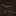
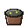
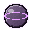
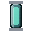
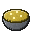
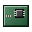

# The science of CoreFactory

CoreFactory has a production chain modelled on the real nuclear fuel cycle, a research tree that gates every bomb, and a
set of exotic weapons at the top. This guide follows the chain from the ground to the warhead. The numbers and recipes
are in `processes.yml`, `materials.yml`, `research.yml` and `ores.yml`, which you can change.

## 1. Find the ore

Ore is laid in deposits on top of the vanilla terrain. A deposit is a circular patch of one ore, with a remaining amount,
and its blocks are that ore's host block, about 30 percent of the stone in the patch, so a patch shows as scattered ore
blocks over stone. The deposits are planned from the world seed, so the same seed always gives the same deposits. Mining a
placed ore block gives its raw mineral and nothing else. Drills take raw minerals from a deposit, one for each unit they
take. The planning numbers are in the `deposits` section of `config.yml`, and `/cf geology deposits [radius]` lists the
deposits near you. See `ores.yml` for the height band and the host block of each ore.

| Ore | Found | Raw mineral | Why it matters |
|---|---|---|---|
|  Uraninite | deep |  Raw uraninite | The main uranium ore. Black, pitchy, faintly warm. |
|  Pitchblende | very deep |  Raw pitchblende | Almost pure uranium oxide. |
|  Monazite | high up |  Raw monazite | Rare earths and thorium. |
|  Thorite | very deep |  Raw thorite | Thorium-232, the fertile isotope. |
|  Galena | mid |  Raw galena | Lead, for shielding. |
|  Cinnabar | mid |  Raw cinnabar | Mercury. Roasting frees it. |
|  Fluorite | wide |  Raw fluorite | Fluorine, for converting uranium into a gas. |
|  Crude petroleum deposit | deep, from y -64 to y 0 |  Petroleum | Fuel for the ore drills. A petroleum drill draws the deposit down, one petroleum for each unit it takes. |

Ores that were already in your world before the plugin was installed are laid the first time their chunks load after the
upgrade. Each chunk is laid once, so a restart adds no ore blocks. There is no retrofit command.

## 2. The uranium chain

Uranium does not split as it comes out of the ground. It has to be concentrated, converted into a gas, and enriched
until the U-235 is a larger share. Each step below is a machine.

1.  **Crusher.** Raw ore becomes crushed grit (two crushed per raw).
2.  **Roasting kiln.** Crushed uranium ore is roasted with fuel (coal or charcoal). It gives  *uranium calcine* and some
    slag. Roasting drives off volatiles and oxidises the uranium.
3.  **Centrifugal separator.** Calcine is separated by density into  **yellowcake** and tailings. Yellowcake is U3O8, the
   concentrated uranium oxide.
4.  **Fluorination converter.** Yellowcake and  crushed fluorite react, with fuel, into a  **UF6 cylinder**. Uranium
   hexafluoride turns into a gas at modest temperature, and its isotopes can be separated in a gas, which is why the cycle uses it.
5.  **Enrichment cascade.** Eight UF6 cylinders enter a bank of gas centrifuges. Heavier U-238 spins outward and lighter
   U-235 collects. The cascade gives  **enriched uranium** (U-235 metal) and two cylinders of  **depleted uranium**.

Enriched uranium is the fuel of the first warheads. Depleted uranium is dense and cheap, and is kept as a by-product.

## 3. Thorium, U-233 and plutonium

 Monazite and  thorite do not fission on their own. They breed. In the  **neutron transmuter**, a  thorium concentrate or a
rare-earth concentrate is put in a neutron flux with a  flux cell. Thorium-232 absorbs a neutron, becomes thorium-233,
decays twice, and becomes  **U-233 oxide**, a fissile isotope. Monazite gives U-233 only half of the time, so it is the
harder source.

 Yellowcake breeds  **plutonium oxide** in the same transmuter, and a  plutonium pit is pressed from four plutonium oxide pellets, a
nether star and a block of gold. Plutonium is what the implosion designs ( Fat Man,  Joe-1 and the thermonuclear secondaries) need.

## 4. Hydrogen and particle physics

The  purification still does two things.

- **Electrolysis.** Two buckets of water become a  **deuterium cell**. Deuterium is hydrogen with a neutron. It is the
  fuel of the fusion stages and of the  tritium booster.
- **Zone refining.** Iron ingots are refined into  **purified iron**, and coal blocks into  **high-purity graphite** (a
  moderator). Both are needed for magnets and  flux cells.

The  particle accelerator takes deuterium and a  superconducting magnet, and makes **antiprotons**.  Antiproton capsules
are the start of antimatter. In the  **antimatter condenser**, two capsules and a flux cell are held in a field for a
long time (about two minutes), and condense into  **antimatter condensate**: a few atoms of it, enough for one bomb.

## 5. Exotic matter

The accelerator can also run neutron-rich material into a  **neutronium slug**, which is heavier than the rest of your
inventory together. The  **tesseract lattice** is built by hand from magnets, antiprotons and graphite. It is the
hardest item in the game to make by hand.

## 6. Research

The research tree is one line. Each node needs the one before it, and no node can be skipped. A node is finished by
feeding packs into a  **research console**. The packs come from the  **spectrometer**, which reads a sample and prints a
pack. Each pack has its own colour and its own cost:

| Pack | Made from |
|---|---|
|  Basic |  crushed galena or  cinnabar |
|  Chemical |  purified iron and mercury |
|  Nuclear |  yellowcake |
|  Plasma | deuterium and a  tritium booster |
|  Exotic |  antiproton capsules |

Progress is saved permanently, in SQLite (one file, one server) or PostgreSQL (shared by several servers, set in
`config.yml`). A gated item cannot be crafted, placed or lit until its node is finished. The gate exists so that nobody
can take a bomb from another player, or hack one together, without the research.

The nodes, in order: laboratory basics, radiation safety, metallurgy, chemical separation, fluorine chemistry, nuclear
fission, hydrogen processes, materials purification, plasma physics, thermonuclear engineering, isotope transmutation,
particle physics, antimatter physics, exotic matter, tesseract geometry.

The drills and the solar panel are on the same line. Petroleum drills I and II come with Chemical Separation, and ore drill I with Fluorine Chemistry. The higher levels follow the line, up to the thermonuclear node. The solar panel comes with Metallurgy. See [CRAFTING.md](CRAFTING.md) for the recipes.

## 7. Warheads

| Weapon | Node | Yield | What it does |
|---|---|---|---|
|  Davy Crockett,  Little Boy,  Fat Man,  Joe-1 | nuclear fission | 20 t to 22 kt | The fission bombs. |
|  Ivy King | hydrogen processes | 0.5 Mt | Boosted fission. |
|  Ivy Mike,  Castle Bravo | plasma physics | 10 to 15 Mt | Thermonuclear. Show beacon beams to nearby clients. |
|  Mk-17,  Tsar Bomba | thermonuclear engineering | 25 and 50 Mt | The largest deliverable and tested weapons. |
|  B83 gravity bomb | isotope transmutation | 1.2 Mt | A strategic weapon. |
|  Exotic neutron bomb | exotic matter | 5 kt | A small blast. Kills by radiation dose, far beyond the blast. A full suit holds the dose off. |
|  Antimatter bomb | antimatter physics | 180 Mt | A pinch of condensed antimatter and a huge explosion. |
|  4-dimensional bomb | tesseract geometry | 1000 Mt | The strongest weapon in the game. Its recipe is the hardest. |

The fallout of every bomb is described in [MECHANICS.md](MECHANICS.md), and the protection (the Radioactive Suit and
the  Geiger counter) in the same place.

## 8. Machines at a glance

| Machine | Does | Fuel |
|---|---|---|
|  Crusher | Raw ore to crushed ore | no |
|  Roasting kiln | Crushed ore to calcine, lead, mercury | yes |
|  Centrifugal separator | Calcine to  yellowcake;  monazite and  thorite to concentrates | no |
|  Purification still | Water to deuterium; iron to  purified iron; coal to graphite | no |
|  Fluorination converter |  Yellowcake and  fluorite to UF6 | yes |
|  Enrichment cascade | UF6 to enriched and  depleted uranium | no |
|  Neutron transmuter | Thorium,  monazite and  yellowcake to U-233 and plutonium | no |
|  Spectrometer | Samples to research packs | no |
|  Particle accelerator | Deuterium to antiprotons;  flux cells to neutronium | no |
|  Antimatter condenser | Antiprotons to  antimatter condensate | no |
|  Research console | Packs to finished research | no |
|  Induction furnace | Copper and  zinc ingots to  brass ingots | Electric |
|  Powder mill |  Charcoal,  sulfur and  high-purity potassium nitrate to  high-grade gunpowder | Electric |
|  Cartridge press |  Brass ingots to  empty shells | Electric, 80 kW |
|  Bullet swaging machine | Lead, with iron, blaze powder or  depleted uranium, to  bullets of four kinds | Electric |
|  Ammunition assembly | An  empty shell, a  bullet and  gunpowder to a  round | Electric |
|  Metal lathe | Iron and  purified iron to a  precision barrel, and amethyst with  high-purity graphite to  optical lenses | Electric |
|  Mechanical component assembly | The  steel frame,  turret mechanism,  ammunition feed and  targeting unit, and two  circuit boards with glowstone and  brass to a  laser emitter, and the upgrade kits  II and  III | Electric, 40 kW |
|  Heavy weapons assembly | The six turret parts and  brass to a  machine gun turret, or, with four optical lenses and two laser emitters, a  laser turret, and the upgrade kits  IV and  V | Electric, 250 kW |

Each machine has its own screen. Put items in the input slots, take them from the output slots, and keep fuel in the
fuel slot where a machine asks for it. Machines only work in loaded chunks. Each machine stands on a barrel that holds its items, and hoppers can feed it and take its products. See [MECHANICS.md](MECHANICS.md#lab-tools-hoppers-and-barrels).

## 9. Petroleum and drills

Crude petroleum is a second resource. Its deposits are patches of the `crude_petroleum_deposit` ore in the stone, planned and
laid like the solid ores, each with a remaining amount. A petroleum drill draws a deposit down, one petroleum for each unit
it takes, until the deposit is empty.

Two kinds of drill work a square below themselves, and each kind has five levels. The levels are set in `DrillTable`
in the code. `processes.yml` names each drill's kind and level, and `materials.yml` gives its name and host block.

| Level | Square | Depth (layers) | Cycle (ticks) | Items per minute at full power |
|---|---|---|---|---|
| 1 | 10 by 10 | 48 | 600 | 60 |
| 2 | 14 by 14 | 96 | 480 | 90 |
| 3 | 20 by 20 | 144 | 360 | 150 |
| 4 | 28 by 28 | 200 | 240 | 240 |
| 5 | 40 by 40 | 280 | 120 | 360 |

The rates are set by `drill-rates` in `config.yml`: 1.0, 1.5, 2.5, 4.0 and 6.0 items per second for levels 1 to 5. The
square sets which deposits a drill finds. The depth is shown on the drill's info item, but it does not limit anything. The
cycle no longer sets the output. It counts the fuel use while a drill runs, and it sets the menu's progress bar.

- **Mining:** a drill works one deposit at a time. It keeps its current deposit while that has something left, and otherwise
  moves to the deposit in its square with the most left. Each unit taken from a deposit is one item, and a full output stops
  the drill.
- **Petroleum drills** run on the strongest of a solar panel (its power over 15), redstone (its power over 15) or charcoal (0.35).
  Charcoal burns one item every 8 cycles, and only while charcoal is the source of power.
- **Ore drills** run on petroleum. Efficiency is 1 while petroleum is in the fuel slot, and one petroleum burns every
  2 cycles while the drill runs. They mine the solid ore deposits in their square.

The chain runs from deposit to petroleum, from petroleum to the fuel of the ore drills, and from the ore drills to the
raw minerals that start the process chain above.

## 10. Ore blocks and the scanner

Each special ore has a placeable block item: the host block, named after the ore. Placing it registers the block as that
ore. Mining a placed ore block gives the raw mineral, and silk touch gives the block item back.

A patch block that the world generator laid is not registered. Breaking one by hand gives its ordinary drop (glazed
terracotta drops itself, and coal ore drops coal), not raw ore. Drills are the only source of raw minerals from a deposit.

The Ore Density Scanner can still be crafted after Laboratory Basics, but it does nothing. Right-clicking it shows no map
and no summary.

## 11. Brass, gunpowder and ammunition

A second chain starts from the new ores.  Saltpeter becomes  high-purity potassium nitrate, the oxidiser of the powder.  Sulfur and  charcoal are the other two ingredients, and charcoal comes from coal. Zinc and copper make  brass. Brass gives the cartridge cases and the mechanisms of the turret. Lead, with a second metal or a special material, makes the  bullets, and a bullet, a  shell and  gunpowder make a  round. The steps and the machines are in [MECHANICS.md](MECHANICS.md#chemistry-and-ammunition), and the order a player follows is in the player guide, [Ammunition and the machine gun turret](PLAYER_GUIDE.md#ammunition-and-the-machine-gun-turret).

The four rounds differ in what they do.  Regular is the baseline.  Armour-piercing ignores part of the target's armour.  Incendiary sets the target alight.  Depleted uranium ignores some armour, and its spread is tighter. A round adds no damage of its own: every round hits for the damage of its turret's level.

## 12. The machine gun turret

The  turret is the end of the chain: it is made in the  heavy weapons assembly from six parts, and it fires at hostile monsters
in its range. It needs power, and it takes rounds by hand or by belt. It has five levels, and the upgrade kits in section 14 take it up one level at a time. Its settings are the `turrets` section of `config.yml`, and
its rules are in [MECHANICS.md](MECHANICS.md#machine-gun-turret).

## 13. The laser turret

The  laser turret is the other turret, and it needs no ammunition. It fires a beam, not rounds, and it reaches 40 blocks against the machine gun's 24. It is made in the  heavy weapons assembly from a steel frame, a targeting unit and a turret mechanism, with four  optical lenses and two  laser emitters. The lenses come from the metal lathe, from amethyst and high-purity graphite. The emitters come from the component assembly, from circuit boards, glowstone dust and brass. The turret draws 60 kW at level 1, and each beam does 12 damage at level 1, which armour does not reduce. It has the same five levels as the machine gun, and a level 5 laser's beam is blue. Its rules are in [MECHANICS.md](MECHANICS.md#laser-turret), and its numbers are the `laser-turret` section of `config.yml`.

## 14. Upgrade kits

Four kits move a turret up its five levels, one level for each kit. Kits II and III are made in the  component assembly and are researched at Materials Purification. Kits IV and V are made in the  heavy weapons assembly and are researched at Tesseract Geometry. Kit III and the kits after it make a turret two blocks tall. The kits' recipes, their numbers and the level table are in [MECHANICS.md](MECHANICS.md#upgrading-a-turret).

