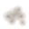

# Textures

Every TNT type, every crafting component, every placeable machine, every ore block and every effect sprite has its own texture. The textures are painted by
Java code in the ResourcePack module, written as PNG files with a YAML descriptor beside each one, and packed into the
resource pack zip. Nothing is drawn by hand, and every texture is unique and repeatable: the same code always gives the
same pixels.

For the pack's files, hosting and the pack format for each server version, see [RESOURCE_PACK.md](RESOURCE_PACK.md).

## 1. Specification

| Item | Requirement |
|---|---|
| Size | 32 × 32 pixels, for TNT blocks, components, every face of a machine and every effect sprite. Ore blocks are 16 × 16, the size of a vanilla block. |
| Format | PNG, 32-bit RGBA. Components and effect sprites are transparent outside their silhouette. Ore blocks are opaque. |
| TNT block | `textures/block/tnt/<id>.png`, used on all six faces of the block. |
| Component | `textures/item/component/<id>.png`, a flat sprite in the inventory and in the hand. |
| Machine face | `textures/block/machine/<id>/<face>.png`, one per side: `north`, `south`, `east`, `west`, `up`, `down`. |
| Ore block | `textures/block/ore/<id>.png`, 16 × 16, used on all six faces of the ore's block. See [Ore blocks](#5-ore-blocks). |
| Effect sprite | `textures/item/particle/<name>.png`, a flat sprite shown by an item display. See [Effect sprites](#6-effect-sprites). |
| Descriptor | `specs/tnt/<id>.yml`, `specs/component/<id>.yml`, `specs/machine/<id>.yml`, `specs/ore/<id>.yml` or `specs/particle/<name>.yml`, one per item. The pack builder reads only these. |
| Machine model | `models/item/machine/<id>.json`, generated from the machine descriptor. See [Machine model](#4-machine-model). |
| Pack icon | `pack.png`, 128 × 128, the first TNT texture scaled up four times. |

### Folders and the atlas

Block textures (TNT faces, machine and drill faces, ore blocks) go under `textures/block/`. Item textures (component
and effect sprites) go under `textures/item/`. The rule and its reason are in
[RESOURCE_PACK.md](RESOURCE_PACK.md#texture-folders-and-the-atlas).

### What the painters are built from

Painting code lives in `CoreFactory-ResourcePack/src/main/java/io/corefactory/resourcepack/art`.

| Class | Role |
|---|---|
| `Canvas` | The 32 × 32 surface. `paint(area, colour)` composites a colour; `shade(area, shader)` computes each pixel. |
| `Area` | A region tested at pixel centres: discs, rings, rounded rectangles, polygons, arcs, tilted orbits, lines, and `and` / `or` / `minus` to combine them. |
| `Color` | Hex parsing (six digits only), mixing, scaling, alpha and compositing. |
| `Noise` | Seeded grain and smooth mottling, so the same id always gets the same texture. |
| `Font` | A 3 × 5 pixel font for the short codes on TNT labels. |
| `Icon` | Thirty-nine pictograms drawn from the shapes above (radiation, a mushroom cloud, a skull, a flare, a chain, a flame, and so on). |
| `Sprite` | Lights a silhouette: a bright bevel on the lit edge, a dark bevel on the shaded edge, grain, and a one-pixel outline. Used by every component. |
| `TntArt` | The TNT block face: a casing with a light falloff, a top and bottom band, a label panel, a pictogram and a code. |
| `ComponentArt` | The component sprites: one silhouette and set of details per component. Machines get an inventory sprite here too. |
| `MachineArt` | The machine models: the generators, the lab machines, the ten drills (five petroleum and five ore), the large lab machines and the two turrets (see [Turret models](#turret-models)). Each one has the cuboids of its silhouette and the six face textures. |
| `OreArt` | The ore blocks: a rock colour with each mineral's inclusions, painted at 32 × 32 and reduced to 16 × 16 by `OreArt.block`, a 2 × 2 box filter. |
| `ParticleArt` | The effect sprites: soft glows and clouds that fade at their edge, and hard shapes, one painter per name. |
| `ArtGenerator` | Writes all PNGs, descriptors and a contact sheet. |

### TNT block layout

Each block face is one 32 × 32 texture laid out the same way:

- A casing in the TNT's base colour, lighter at the top, with fine grain and soft mottling.
- A band across the top and bottom three rows. The band is one of four styles: `HAZARD` (diagonal warning stripes),
  `RIVETS` (a dark band with rivets), `STRIPE` (a solid accent band with pinstripes), or `PLAIN`.
- A rounded label panel with a frame in the accent colour. The panel is `CREAM` (warm paper), `STEEL` (brushed grey)
  or `DARK` (the casing colour, darkened).
- A pictogram in the centre of the panel, and a code under it, up to five letters or digits.

The label must fit the panel. Codes are checked by a test to be at most five characters.

### Component layout

A component is a silhouette (a canister, a capacitor, a crystal, a sphere with rings, and so on), lit by `Sprite`, with
details painted on top in the accent colour. Its outline is one pixel in a darkened base colour. Glows are drawn behind
the silhouette at reduced opacity.

The science components follow these families, so that the set reads at a glance:

- Raw ore drops show the mineral itself:  uraninite black with green glints,  pitchblende brown-black,  monazite amber,
   thorite black with orange veins,  galena grey cubes,  cinnabar red shards,  fluorite purple and green crystals.
- Crushed ores are a heap of powder in a steel dish, speckled with the mineral's colour.
- Products are one object each: a crucible, an ingot, a flask, a sack, a jar, a bucket, a cylinder, a drum, a magnet
  coil, a capsule, and so on.
- Research packs are cards (basic white, chemical green) or cartridges (nuclear yellow-green, plasma blue, exotic violet).
- Machine sprites are a lit housing with a coloured top panel and a pictogram.

### Machine layout

A machine is a 3D item model rather than a flat sprite. Its silhouette is a few cuboids, and each side of the model has
its own 32 × 32 texture:

- `north` is the front. It carries the machine's own detail: a fire door, a pressure gauge, a rotor drum, a lens, a
  screen, a dewar window, and so on.
- `south` is the back: a row of vents and a status light.
- `east` has a horizontal pipe band, and `west` has vertical bars.
- `up` has a hatch ring, and `down` has a hazard band.

The casing colour and the accent colour belong to the machine, so every face of every machine is different, and a
machine can be told apart from any side. A test checks that no two faces in the whole set are identical.

### Drill layout

A drill is a machine with its own 3D model. There are ten drill models: one for each level of each kind. A drill's bit,
housing and tower grow with its level, and the cap on top is its level indicator.

- The north face has five slots down the tower, with a band at each end. The first `level` slots are lit yellow
  (`#FFD040`), so a level 1 drill shows one lit slot and a level 5 drill shows all five.
- A petroleum drill is dark grey with rust-red accents (`#2B2B2F` and `#B5482A`), and it has a pump head on the east
  side of its tower. An ore drill is steel grey with blue accents (`#6E7884` and `#3AA8FF`).
- The item definitions and the faces follow the rules of [Machine model](#4-machine-model).

### Belt layout

A belt is a flat slab, 16 by 2 by 16 model units (an eighth of a block high), with a straight top or a corner top on it. Each
belt level has both tops, and both are animated. An animated top is a vertical strip of eight square 16-pixel frames, so the
file is 16 × 128 pixels, and each frame is shown for 2 ticks.

- The arrows on the straight top are chevrons with their tips toward the bottom edge of the texture. Frame `k` moves them `k`
  pixels toward that edge, so they scroll the way their tips point, and the strip repeats after eight frames.
- The belt's front is the bottom edge of the texture, the +Z side of the model. The corner top's arc runs from the middle of the
  right edge, where its items come in, to the middle of the bottom edge, where they leave. The arrows lie on that arc and point
  along it toward the bottom edge.
- The steel is `#2A2E36` for all three levels. The arrows are `#E8ECF2` for level I, `#FFD040` for level II and `#FF5A20` for
  level III. The rails are `#6E7884`.

### Animated faces

A machine can have one animated face instead of a static one. The face is a vertical strip of eight square frames, 16 pixels
wide, and its `.mcmeta` sets the frame time. The animated faces are the pylons (`pylon_1` to `pylon_3`, on the up face), the
accumulators (`accumulator_1` to `accumulator_3`, on the north face), the generators (`wind_generator`, `charcoal_generator`,
`petroleum_generator`, `diesel_generator` and `nuclear_generator`, on the north face), the crude oil refinery (up) and the
solar panel (up), and the turrets at every level: the machine gun turret's amber indicator (north, every 3 ticks) and the laser turret's
red lens (north, every 2 ticks; on the upper half of a tall laser, from level 3). The frame time is 2, 3 or 4 ticks, by machine. The other faces stay static.

### Two-block models and process machines

A device that stands two blocks tall has two models: `machine/<id>` for the lower block, and `machine/<id>_top` for the upper
block (the wind, charcoal, petroleum, diesel and nuclear generators, and the ore and petroleum drills of level IV and V). Both are
written by `MachineArt` and `MachineAnimation`, and the upper model's animated face is named in the clip list. The eight process
machines are painted by `ProcessMachineArt`, which writes their descriptors itself; they are not in `MachineArt.ALL`. Their
fronts are eight-frame strips, and each one's frame time is in `ProcessMachineArt.CLIPS`.

### Turret models

Each turret kind has a model for each of its five levels. Level 1 is `machine/machine_gun_turret` and `machine/laser_turret`, painted by
`TurretArt`. Levels 2 to 5 are `machine/machine_gun_turret_2` to `_5` and `machine/laser_turret_2` to `_5`, painted by `TurretLevelArt`.
Levels 3 to 5 are two blocks tall, so each has a lower model under its id and an upper model with `_top` added: for example
`machine/machine_gun_turret_3` and `machine/machine_gun_turret_3_top`. A level 2 model is one block tall. The models are listed in
`MachineArt.ALL` and `TurretLevelArt.ALL`, and the animated faces in `TurretLevelArt.CLIPS`. The upper half of a tall turret is shown
one block above the lower. `ModelKeys` names every model, so a rename in the pack must follow there.

The machine gun turret has 11 cuboids: a base plate, a pedestal, a yoke,
a barrel with a muzzle brake, and an ammunition box on its west side. Its north face is the animated front, an amber indicator that pulses
every 3 ticks (`TurretArt.CLIPS`). The laser turret has 9 cuboids: a dark body on a base, a stepped emitter dish, two cooling fins, and
a red lens on its north face, which pulses every 2 ticks. The placed turret's item display is turned to the barrel's yaw and pitch, so the
model turns toward its target. The laser's inventory sprite, and the sprites of the laser emitter and the optical lens, are in
`TurretArt.SPRITES`. The four upgrade kits have item sprites too, `turret_upgrade_2` to `turret_upgrade_5` in `TurretLevelArt.SPRITES`:
a sealed brass cartridge with a window of pips, one pip lit for kit II up to four for kit V, in silver, green, blue and gold.

### Colours

- Write a colour as six hex digits with a `#`: `#E8FF60`. Three-digit forms are rejected with an error, so a typo
  fails the build rather than producing the wrong colour.
- The descriptor records the base and accent colours it was painted with, so the table below is accurate.

## 2. Tools

| Tool | What it does | Command |
|---|---|---|
| `ArtGenerator` | Paints every texture and writes the PNGs, the descriptors and `contact-sheet.png`. | `java -cp CoreFactory-ResourcePack/target/classes io.corefactory.resourcepack.art.ArtGenerator CoreFactory-ResourcePack/art` |
| `contact-sheet.png` | Every texture on one sheet, at three times scale, for review. It is not packed and not committed. | Run `ArtGenerator` locally, then open `CoreFactory-ResourcePack/art/contact-sheet.png`. |
| `ResourcePackBuilder` | Packs the art into the zip, with the pack format it is given. Run by `mvn package`. | `mvn package` (see [RESOURCE_PACK.md](RESOURCE_PACK.md)) |
| `ArtTest` | Checks the size, uniqueness and repeatability of every texture and machine face, that every id in `tnts.yml`, `items.yml`, `materials.yml` and `ores.yml` has art (and that each ore's host block matches `ores.yml`), that every machine's cuboids lie within one block, and that every effect sprite has a transparent border and visible pixels. | `mvn test` |
| `ResourcePackBuilderTest` | Generates into a temporary folder, builds a zip, and checks the pack format, every item's files, that every machine model has elements whose faces refer to written textures, that every ore has its block model, item definition and host blockstate with every variant pointing at a model in the zip, and that every effect sprite has its three files and visible pixels. | `mvn test` |

The generator is deterministic. Running it twice gives identical files, so a diff in `art/` means a painter changed.

## 3. Processes

### Change the look of an existing item

1. Find the item's entry in `TntArt.ALL` (for a TNT), `ComponentArt.ALL` (for a component) or `MachineArt.ALL` (for a
   machine). It holds the id, the colours, and for TNT the code, pictogram, band and panel.
2. Change the entry. To change the drawing itself, edit the matching painter in `ComponentArt`, `MachineArt` or the
   shared `Icon`.
3. Regenerate: run `ArtGenerator` (command above). Check `contact-sheet.png`.
4. Build: `mvn package`. The zip is rebuilt from the new `art/`.

### Add a new TNT type

1. Add the entry to `tnts.yml` with its mechanic, radius and recipe, as in [CONFIGURATION.md](CONFIGURATION.md).
2. Add a matching `TntArt.Spec` to `TntArt.ALL`, with a new id, a label of at most five characters, a pictogram from
   `Icon`, the two colours, a band and a panel. Pick a pictogram and colours that no other TNT uses, so the textures
   stay distinct. `ArtTest` fails if two are the same.
3. Run `ArtGenerator`, check the sheet, and run `mvn verify`.

### Add a new pictogram

1. Add a constant to `Icon` and a `case` to its `draw` method. Draw inside the radius `r` given, using `Area` shapes and
   the `ink` and `accent` colours.
2. Use it in a `TntArt.Spec`, regenerate, and check the sheet at full size. A pictogram must still read at 32 pixels.

### Add a new component

1. Add the entry to `materials.yml` (or `items.yml`).
2. Add a `ComponentArt.Spec` with its colours and a painter method. Build the silhouette with `Sprite.body` and add the
   details with `Canvas.paint`.
3. Regenerate and check. The silhouette should be recognisable at a glance in the inventory. `ArtTest` fails if a
   component is declared in the config without art, or if `materials.yml` and the sprites disagree.

### Add a new machine

1. Add the machine to `materials.yml` (a placeable component) and to `processes.yml` if it runs processes.
2. Add a `MachineArt.Spec` to `MachineArt.ALL`: the id, the two colours, the list of `Box` cuboids that make the silhouette
   (coordinates from 0 to 16), and a front painter, which draws the `north` face. The other five faces come from the
   shared painter, so give the machine a distinct colour and a distinct front.
3. Add a `ComponentArt.Spec` for the machine's inventory sprite, with an `Icon` (`ComponentArt.machine(Icon.X)`).
4. Regenerate, check the contact sheet, and run `mvn test`. `ArtTest` checks the cuboids, and
   `ResourcePackBuilderTest` checks that every face of the built model refers to a texture in the pack.

The placed machine is shown with its item model, `corefactory:item/machine/<id>`. The inventory item is shown with the
component sprite, `corefactory:item/component/<id>`, because a component's item always uses its component model.

### Hand-painted art

There is no override folder. `ArtGenerator` clears `textures/` and `specs/` on every run, so a PNG edited by hand in
`art/` is lost the next time the generator runs. To use hand-painted art, change the painter so it draws that picture
instead, or add the image as a file the generator does not touch and point a new descriptor at it. Neither is automated
yet.

### Check it in the game

| Symptom | Likely cause |
|---|---|
| The item looks like plain TNT or a plain material | The pack is not applied: the pack format does not match the server. See [RESOURCE_PACK.md](RESOURCE_PACK.md#pack-format). |
| Pink and black checkerboard | The item model names a texture the pack does not contain. Rebuild the pack and check the descriptor's `texture` path. |
| A machine shows as a flat sprite, or as a block | The display uses the component model, not `corefactory:item/machine/<id>`. |
| The placed block shows vanilla TNT | `display.custom-textures` is `false`, or the display was not spawned. See [MECHANICS.md](MECHANICS.md). |

## 4. Machine model

The machine model is the item model kind `machine`. It is written by `ResourcePackBuilder` from a descriptor that
`ArtGenerator` writes to `art/specs/machine/<id>.yml`.

### Descriptor

```yaml
id: crusher
kind: machine
model: machine
palette:
  base: "#5A6470"
  accent: "#FFB000"
textures:
  north: textures/block/machine/crusher/north.png
  south: textures/block/machine/crusher/south.png
  east: textures/block/machine/crusher/east.png
  west: textures/block/machine/crusher/west.png
  up: textures/block/machine/crusher/up.png
  down: textures/block/machine/crusher/down.png
elements:
  - from: [1, 0, 1]
    to: [15, 9, 15]
```

- `textures` has exactly the six sides. Each path is relative to `art/`. The builder fails if a side is missing or its PNG
  is not there.
- `elements` is one entry per cuboid. `from` and `to` are the minimum and maximum corners in model units, 0 to 16, with y
  pointing up. Fractional values are allowed.

### Generated JSON

The builder writes `assets/corefactory/models/item/machine/<id>.json`:

```json
{
  "textures": {
    "north": "corefactory:block/machine/crusher/north",
    "south": "corefactory:block/machine/crusher/south",
    "east": "corefactory:block/machine/crusher/east",
    "west": "corefactory:block/machine/crusher/west",
    "up": "corefactory:block/machine/crusher/up",
    "down": "corefactory:block/machine/crusher/down"
  },
  "elements": [
    {
      "from": [1, 0, 1],
      "to": [15, 9, 15],
      "faces": {
        "north": {"texture": "#north"},
        "south": {"texture": "#south"},
        "east": {"texture": "#east"},
        "west": {"texture": "#west"},
        "up": {"texture": "#up"},
        "down": {"texture": "#down"}
      }
    }
  ],
  "display": {
    "gui": {"rotation": [30, 225, 0], "translation": [0, 0, 0], "scale": [0.625, 0.625, 0.625]},
    "fixed": {"rotation": [0, 0, 0], "translation": [0, 0, 0], "scale": [1, 1, 1]}
  }
}
```

- `textures` maps each side to a texture in the pack, `corefactory:block/machine/<id>/<side>`, at
  `assets/corefactory/textures/block/machine/<id>/<side>.png`.
- `elements` has one cuboid per descriptor entry. Every element has all six faces, and each face refers to its side with
  `"#<side>"`, so every reference resolves to a key of `textures`.
- `display.fixed` is full size, which a placed machine's item display uses. `display.gui` is the small view in the GUI.
- The item definition, `assets/corefactory/items/machine/<id>.json`, points at the model in the usual way:
  `{"model": {"type": "minecraft:model", "model": "corefactory:item/machine/<id>"}}`.

## 5. Ore blocks

Spigot cannot register a new block type, so each ore is a vanilla block that the pack re-textures. An ore block item is
the host block's item carrying the ore's id: placing it registers the block as that ore, and breaking it with silk touch
gives the item back. The ore's host is
the vanilla block the plugin places (`host` in `ores.yml`). The pack replaces that block's appearance, so a placed ore
shows its mineral and not the vanilla block's own pattern.

### Descriptor

```yaml
id: uraninite_ore
kind: ore
model: block
host: BLACK_GLAZED_TERRACOTTA
texture: textures/block/ore/uraninite_ore.png
palette:
  base: "#1B1D20"
  accent: "#7CFF5A"
```

- `host` is the vanilla material name. The builder lowercases it to find the blockstate file. Two ores may not share
  a host, and the builder fails if they do.
- `texture` is a 16 × 16 PNG, the size of a vanilla block texture.

### Generated files

For each ore the builder writes:

- `assets/corefactory/textures/block/ore/<id>.png`, the block texture.
- `assets/corefactory/models/block/ore/<id>.json`, a block model with parent `minecraft:block/cube_all` and
  `"all": "corefactory:block/ore/<id>"`.
- `assets/corefactory/items/ore/<id>.json`, an item definition that points at that block model. It is the ore item's
  inventory icon, used when the item carries the `minecraft:item_model` component `corefactory:ore/<id>`.
- `assets/minecraft/blockstates/<host>.json`, the blockstate override of the host block.

### Blockstate override

The host block's blockstate is replaced in the pack, so the file lists every variant of the host. Glazed terracotta has
four, one per facing, and each one names the ore's model with no rotation:

```json
{
  "variants": {
    "facing=north": {"model": "corefactory:block/ore/uraninite_ore"},
    "facing=south": {"model": "corefactory:block/ore/uraninite_ore"},
    "facing=east": {"model": "corefactory:block/ore/uraninite_ore"},
    "facing=west": {"model": "corefactory:block/ore/uraninite_ore"}
  }
}
```

Because the override replaces the vanilla file, every glazed terracotta block in the world shows the ore texture of its
host, including any the players placed as decoration. A vanilla glazed terracotta item model is not changed. A held or
dropped ore item shows the vanilla glazed terracotta icon unless the plugin sets its `minecraft:item_model` component.

### The ores

| id | Host block | Rock | Mineral | Look |
|---|---|---|---|---|
|  `uraninite_ore` | `BLACK_GLAZED_TERRACOTTA` | `#1B1D20` | `#7CFF5A` | Black rock with green glints and dark cracks |
|  `pitchblende_ore` | `BROWN_GLAZED_TERRACOTTA` | `#2A1D12` | `#9A7A46` | Brown-black with tar blobs and a tarry sheen |
|  `monazite_ore` | `YELLOW_GLAZED_TERRACOTTA` | `#E0B040` | `#B8651A` | Yellow with amber grains and pale highlights |
|  `thorite_ore` | `GRAY_GLAZED_TERRACOTTA` | `#2C2C30` | `#FF8A20` | Grey-black with orange veins |
|  `galena_ore` | `LIGHT_GRAY_GLAZED_TERRACOTTA` | `#9AA2AC` | `#F4F7FA` | Grey rock with silver cubes |
|  `cinnabar_ore` | `RED_GLAZED_TERRACOTTA` | `#A8201E` | `#141010` | Red with black speckles and lighter grains |
|  `fluorite_ore` | `PURPLE_GLAZED_TERRACOTTA` | `#8A4DC4` | `#E8DCFF` | Purple with pale crystal facets |
|  `crude_petroleum_deposit` | `WHITE_GLAZED_TERRACOTTA` | `#2B1F17` | `#3FC8A8` | Dark brown rock with dark dots and teal cracks |

The painters are deterministic: the grain and scatter use the ore's id as the seed.

## 6. Effect sprites

Effect sprites are the flat textures of in-world effects, such as a fireball or a cloud of steam. They are shown by item
displays, so each one is an item model: a `minecraft:item/generated` model with the sprite as `layer0`, and an item
definition beside it.

### Descriptor

```yaml
id: fireball_core
kind: particle
model: sprite
texture: textures/item/particle/fireball_core.png
```

The builder writes `assets/corefactory/textures/item/particle/<name>.png`,
`assets/corefactory/models/item/particle/<name>.json` and `assets/corefactory/items/particle/<name>.json`.

### The sprites

Each sprite is 32 × 32 on a transparent background. A soft sprite fades to nothing at its edge, and a hard one has a
crisp outline.

| name | Look | Edge |
|---|---|---|
|  `fireball_core` | White-yellow core with an orange halo | Soft |
|  `fireball_ember` | Orange-red spark with small flecks | Soft halo, hard core |
|  `shock_ring` | Thin bright ring | Hard |
|  `smoke_puff` | Grey cloud | Soft |
|  `steam_puff` | White cloud | Soft |
|  `dust_cloud` | Brown-grey cloud | Soft |
|  `neutron_spark` | Pale blue star with a cross flare | Hard, soft halo |
|  `radiation_trefoil` | Yellow trefoil | Hard |
|  `antimatter_flare` | Violet-white flare with a dark core | Hard, soft halo |
|  `tesseract_shard` | Magenta cube wireframe | Hard |
|  `research_spark` | Green sparkle | Hard, soft halo |
|  `geiger_tick` | Small yellow tick | Hard, soft halo |
|  `crystal_glint` | White diamond glint | Hard, soft halo |
|  `machine_steam` | Pale warm grey puff | Soft |
|  `fluorine_fume` | Pale green cloud | Soft |

## 7. Every texture

These tables come from the generated descriptors, so they match the shipped files.

### TNT blocks

| id | Label | Pictogram | Casing | Accent | Band | Panel |
|---|---|---|---|---|---|---|
|  `anchor_tnt` | ANC | ANCHOR | `#2A1A50` | `#9AF0FF` | PLAIN | DARK |
|  `biological_tnt` | BIO | BIOHAZARD | `#2A5A1A` | `#9AFF40` | HAZARD | CREAM |
|  `chain_reaction_tnt` | CHN | CHAIN | `#B5362A` | `#FFB347` | HAZARD | CREAM |
|  `concussion_tnt` | CON | BURST | `#D8C84A` | `#3A3A10` | HAZARD | CREAM |
|  `conditional_tnt` | IF | QUESTION | `#3A3A3A` | `#FF3A3A` | RIVETS | CREAM |
|  `debris_tnt` | DBR | SHARDS | `#5A5A5A` | `#9A8A6A` | RIVETS | STEEL |
|  `delayed_cascade_tnt` | DLY | HOURGLASS | `#4A4F55` | `#D0D6DC` | RIVETS | STEEL |
|  `echo_tnt` | ECH | ECHO | `#3A1A5A` | `#D0A0FF` | PLAIN | DARK |
|  `exotic_antimatter_bomb` | ANTI | FLARE | `#14082A` | `#F4F0FF` | PLAIN | DARK |
|  `exotic_neutron_bomb` | NTR | SKULL | `#A9D9F2` | `#2A4A6A` | STRIPE | STEEL |
|  `four_dimensional_tnt` | 4D | TESSERACT | `#7A0A5A` | `#FF6BE0` | HAZARD | DARK |
|  `fuse_linked_tnt` | LNK | LINK | `#8C1D1D` | `#FF5555` | STRIPE | CREAM |
|  `gravity_flip_tnt` | FLP | FLIP | `#1E4A6A` | `#E8F8FF` | STRIPE | STEEL |
|  `gravity_well_tnt` | GRV | SPIRAL | `#2A1442` | `#B57BFF` | PLAIN | DARK |
|  `harvest_tnt` | HRV | SPROUT | `#2A6A3A` | `#E8D050` | STRIPE | CREAM |
|  `implosion_tnt` | IMP | ARROWS_IN | `#1A1A1E` | `#5C5C66` | RIVETS | STEEL |
|  `launch_tnt` | LCH | UP | `#3AAA6A` | `#D8FFE8` | STRIPE | CREAM |
|  `liquefy_tnt` | LIQ | DROP | `#5A1A00` | `#FF8A1A` | HAZARD | CREAM |
|  `marker_tnt` | MRK | CROSSHAIR | `#1E3A5A` | `#55FFFF` | STRIPE | DARK |
|  `mirror_tnt` | MIR | SPLIT | `#C8E8F0` | `#3A6A7A` | STRIPE | CREAM |
|  `napalm_tnt` | NPM | FLAME | `#8A2A0A` | `#FFB020` | HAZARD | STEEL |
|  `nuke_b83` | B83 | ORB | `#5A2A18` | `#FF8040` | RIVETS | DARK |
|  `nuke_castle_bravo` | BRV | SUN | `#6A1A1A` | `#FF4A20` | HAZARD | STEEL |
|  `nuke_davy_crockett` | W54 | RADIATION | `#3A4A2A` | `#E8FF60` | STRIPE | CREAM |
|  `nuke_fat_man` | FM | BOMB | `#4A4A2A` | `#FFE860` | RIVETS | CREAM |
|  `nuke_ivy_king` | IVY | ATOM | `#5A3A18` | `#FFA030` | HAZARD | DARK |
|  `nuke_ivy_mike` | MIKE | MUSHROOM | `#6A2A1A` | `#FF6030` | STRIPE | CREAM |
|  `nuke_joe_1` | RDS1 | SUN | `#4A3A20` | `#FFD060` | STRIPE | STEEL |
|  `nuke_little_boy` | LB | MUSHROOM | `#4A5A2A` | `#F0FF70` | RIVETS | STEEL |
|  `nuke_mk17` | MK17 | WARNING | `#5A0A0A` | `#FF3A3A` | HAZARD | CREAM |
|  `nuke_tsar_bomba` | TSAR | MUSHROOM | `#2A0A0A` | `#FF2A2A` | RIVETS | DARK |
|  `proximity_tnt` | PRX | TARGET | `#4A0A0A` | `#FFD000` | HAZARD | DARK |
|  `pulse_tnt` | PLS | WAVE | `#8A1A1A` | `#FF6060` | PLAIN | STEEL |
|  `randomize_tnt` | RND | DIE | `#505050` | `#E040E0` | RIVETS | STEEL |
|  `sculpt_tnt` | SCL | CHISEL | `#2A6E8A` | `#A8E0FF` | PLAIN | CREAM |
|  `shaped_charge_tnt` | SHP | CONE | `#C9A227` | `#3A3010` | RIVETS | STEEL |
|  `shockwave_tnt` | SHK | RINGS | `#2A2A3A` | `#FFD8A0` | PLAIN | DARK |
|  `silent_tnt` | SIL | MUTE | `#262626` | `#4A4A4A` | PLAIN | STEEL |
|  `sorting_tnt` | SRT | BARS | `#34507A` | `#A0C8FF` | RIVETS | CREAM |
|  `teleport_tnt` | TLP | PORTAL | `#1A0A2E` | `#8A4DFF` | PLAIN | DARK |
|  `terraform_tnt` | TER | MOUNTAIN | `#6B4A2A` | `#3E7A2A` | PLAIN | CREAM |
|  `vitrify_tnt` | VIT | CRYSTAL | `#A8E8F0` | `#2A1A40` | PLAIN | CREAM |

The four-dimensional bomb is the strongest of the set, so its casing is the brightest magenta with the hazard band
and a dark panel, and its tesseract pictogram is the largest contrast on the block.

### Components

| id | Base | Accent |
|---|---|---|
|  `anchor_crystal` | `#7B5CC4` | `#D8C8FF` |
|  `anchor_plate` | `#9AA0A8` | `#D0D4DA` |
|  `antimatter_condensate` | `#2A1040` | `#E0B0FF` |
|  `antimatter_condenser` | `#1A1E3A` | `#C080FF` |
|  `antiproton_capsule` | `#5ACBE0` | `#F0FFFF` |
|  `biohazard_culture` | `#3B7A2A` | `#A8FF60` |
|  `converter` | `#5A5A6A` | `#FFD040` |
|  `crushed_cinnabar` | `#B8382A` | `#FF9080` |
|  `crushed_fluorite` | `#7A5AB0` | `#7AF0A0` |
|  `crushed_galena` | `#9AA0AA` | `#FFFFFF` |
|  `crushed_monazite` | `#D9A040` | `#FFE8A0` |
|  `crushed_pitchblende` | `#5E4124` | `#C89A5A` |
|  `crushed_thorite` | `#2B2622` | `#FF9A3A` |
|  `crushed_uraninite` | `#2A2E30` | `#8CFF70` |
|  `crusher` | `#5A6470` | `#FFB000` |
|  `depleted_uranium` | `#4A5A46` | `#D8C23A` |
|  `deuterium_cell` | `#2A4A8A` | `#7FD0FF` |
|  `enriched_uranium` | `#4E5A3A` | `#A6FF3A` |
|  `enrichment_cascade` | `#3A4A60` | `#C0F060` |
|  `fission_waste` | `#2A4A7A` | `#FFD000` |
|  `fuse_linker` | `#3A3F4A` | `#E0302A` |
|  `fuse_wire` | `#C07040` | `#FFB070` |
|  `geiger_counter` | `#4A4E57` | `#FFD000` |
|  `gravity_core` | `#1E1030` | `#9A4DFF` |
|  `hazmat_fabric` | `#D8C23A` | `#2A2A2A` |
|  `high_purity_graphite` | `#2A2A2C` | `#6A6E78` |
|  `mercury_flask` | `#9AA8B8` | `#E8F0FF` |
|  `napalm_gel` | `#B84A10` | `#FFB030` |
|  `neutron_flux_cell` | `#2E6A5A` | `#C0FF80` |
|  `neutron_initiator` | `#6A4A9A` | `#FFE070` |
|  `neutronium_slug` | `#1C1C28` | `#7A7AFF` |
|  `nuclear_casing` | `#2E3238` | `#FFB020` |
|  `ore_density_scanner` | `#B08A3A` | `#3CFF7A` |
|  `ore_drill_1` | `#6E7884` | `#3AA8FF` |
|  `ore_drill_2` | `#6E7884` | `#3AA8FF` |
|  `ore_drill_3` | `#6E7884` | `#3AA8FF` |
|  `ore_drill_4` | `#6E7884` | `#3AA8FF` |
|  `ore_drill_5` | `#6E7884` | `#3AA8FF` |
|  `particle_accelerator` | `#4A4E60` | `#7AB8FF` |
|  `petroleum` | `#2A2014` | `#FFC83A` |
|  `petroleum_drill_1` | `#2B2B2F` | `#B5482A` |
|  `petroleum_drill_2` | `#2B2B2F` | `#B5482A` |
|  `petroleum_drill_3` | `#2B2B2F` | `#B5482A` |
|  `petroleum_drill_4` | `#2B2B2F` | `#B5482A` |
|  `petroleum_drill_5` | `#2B2B2F` | `#B5482A` |
|  `phosphate_tailings` | `#9AA070` | `#D8DC9A` |
|  `plutonium_oxide` | `#3A4A6A` | `#7AB0FF` |
|  `plutonium_pit` | `#5A3A70` | `#E8A0FF` |
|  `pulse_capacitor` | `#7A1010` | `#FF4040` |
|  `purified_iron` | `#C8D0DA` | `#FFFFFF` |
|  `purifier` | `#2F6A5A` | `#7FFFD0` |
|  `quantum_detonator` | `#222222` | `#FFD000` |
|  `radioactive_boots` | `#D8C23A` | `#2A2A2A` |
|  `radioactive_chestplate` | `#D8C23A` | `#2A2A2A` |
|  `radioactive_helmet` | `#D8C23A` | `#7FE0FF` |
|  `radioactive_leggings` | `#D8C23A` | `#2A2A2A` |
|  `rare_earth_concentrate` | `#3E5AA0` | `#A0C0FF` |
|  `raw_cinnabar` | `#A8201E` | `#FF6A55` |
|  `raw_fluorite` | `#8A4DC4` | `#62E89A` |
|  `raw_galena` | `#7E8794` | `#E4E9F0` |
|  `raw_monazite` | `#C98A2A` | `#FFD87A` |
|  `raw_pitchblende` | `#3B2A1C` | `#8A6A3A` |
|  `raw_thorite` | `#161616` | `#FF8A20` |
|  `raw_uraninite` | `#1B1D20` | `#7CFF5A` |
|  `refined_lead` | `#5C6172` | `#A8B4D0` |
|  `research_console` | `#4A5058` | `#66FF99` |
|  `research_pack_basic` | `#EEF0F4` | `#3A4048` |
|  `research_pack_chemical` | `#3FB85A` | `#E0FFE8` |
|  `research_pack_exotic` | `#7A2AE0` | `#E0A0FF` |
|  `research_pack_nuclear` | `#B8D83A` | `#2A2A10` |
|  `research_pack_plasma` | `#2A7AE0` | `#A8E8FF` |
|  `roaster` | `#6A3A24` | `#FF7A20` |
|  `separator` | `#3A5A6A` | `#9FF0FF` |
|  `shaped_charge_lens` | `#A8E0F0` | `#2F7F9F` |
|  `silicate_tailings` | `#B8C4CC` | `#F0F8FF` |
|  `slag` | `#353030` | `#7A9A9A` |
|  `solar_panel` | `#C4CBD4` | `#2A6FD8` |
|  `sorting_magnet` | `#505A70` | `#A0B0D0` |
|  `spectrometer` | `#2A3A44` | `#55FFFF` |
|  `superconducting_magnet` | `#B86A3A` | `#7FD8FF` |
|  `tailings` | `#8C8478` | `#B8AE9A` |
|  `tesseract_lattice` | `#3A1A5A` | `#FF70FF` |
|  `thermonuclear_core` | `#7A1020` | `#FF6A6A` |
|  `thorium_concentrate` | `#6A8A6A` | `#D0F0C8` |
|  `transmuter` | `#2A2038` | `#B56BFF` |
|  `tritium_booster` | `#1E6A70` | `#7FFFE0` |
|  `turret_upgrade_2` | `#B8914A` | `#C8CED6` |
|  `turret_upgrade_3` | `#B8914A` | `#55E07A` |
|  `turret_upgrade_4` | `#B8914A` | `#4A9BFF` |
|  `turret_upgrade_5` | `#B8914A` | `#FFC040` |
|  `u233_oxide` | `#3EA070` | `#B8FFD8` |
|  `uf6_cylinder` | `#5E7A9A` | `#FFD040` |
|  `uranium_calcine` | `#4A4E3A` | `#C8D060` |
|  `vitrifier_flux` | `#E8D8A0` | `#FFFFFF` |
|  `yellowcake` | `#E0C23A` | `#FFF6B0` |

### Machines

The machine's inventory sprite is listed under Components above. Its 3D model has these faces and cuboids.

| id | Casing | Accent | Cuboids | Front face |
|---|---|---|---|---|
|  `antimatter_condenser` | `#1A1E3A` | `#C080FF` | 5 | Dewar window and cryogenic band |
|  `converter` | `#5A5A6A` | `#FFD040` | 3 | Pressure gauge on a pod |
|  `crusher` | `#5A6470` | `#FFB000` | 3 | Hopper mouth and rotor drum |
|  `enrichment_cascade` | `#3A4A60` | `#C0F060` | 4 | Row of three dials over a manifold; three tall cylinders |
|  `laser_turret` | `#2A2E36` | `#FF2A2A` | 9 | Red lens on the front, pulsing every 2 ticks; fins at the sides |
|  `laser_turret_2` | `#33383F` | `#FF2A2A` | 11 | One block tall. Red lens on the front, pulsing every 2 ticks |
|  `laser_turret_3` | `#2E333B` | `#FF2A2A` | 6 | Lower half of level 3; the lens is in the upper half |
|  `laser_turret_3_top` | `#2E333B` | `#FF2A2A` | 3 | Upper half of level 3, with the red lens pulsing every 2 ticks |
|  `laser_turret_4` | `#30353D` | `#FF2A2A` | 6 | Lower half of level 4 |
|  `laser_turret_4_top` | `#30353D` | `#FF2A2A` | 3 | Upper half of level 4, with the red lens pulsing every 2 ticks |
|  `laser_turret_5` | `#23272F` | `#4FB6FF` | 6 | Lower half of level 5 |
|  `laser_turret_5_top` | `#23272F` | `#4FB6FF` | 3 | Upper half of level 5, with the blue lens pulsing every 2 ticks |
|  `machine_gun_turret` | `#4B5A44` | `#E0A030` | 11 | Amber indicator on the front, pulsing every 3 ticks |
|  `machine_gun_turret_2` | `#6E7884` | `#E0A030` | 11 | One block tall. Amber indicator on the front, pulsing every 3 ticks |
|  `machine_gun_turret_3` | `#5E6774` | `#55D8FF` | 12 | Lower half of level 3; amber indicator pulsing every 3 ticks |
|  `machine_gun_turret_3_top` | `#5E6774` | `#55D8FF` | 4 | Upper half of level 3 |
|  `machine_gun_turret_4` | `#8C6239` | `#E8A040` | 12 | Lower half of level 4, bronze casing; indicator pulsing every 3 ticks |
|  `machine_gun_turret_4_top` | `#8C6239` | `#E8A040` | 4 | Upper half of level 4 |
|  `machine_gun_turret_5` | `#2B3038` | `#FF6A2A` | 13 | Lower half of level 5, dark gunmetal casing; indicator pulsing every 3 ticks |
|  `machine_gun_turret_5_top` | `#2B3038` | `#FF6A2A` | 7 | Upper half of level 5 |
|  `ore_drill_1` | `#6E7884` | `#3AA8FF` | 5 | Five level slots down the tower; the lit slots show the level |
|  `ore_drill_2` | `#6E7884` | `#3AA8FF` | 5 | Five level slots down the tower; the lit slots show the level |
|  `ore_drill_3` | `#6E7884` | `#3AA8FF` | 5 | Five level slots down the tower; the lit slots show the level |
|  `ore_drill_4` | `#6E7884` | `#3AA8FF` | 5 | Five level slots down the tower; the lit slots show the level |
|  `ore_drill_5` | `#6E7884` | `#3AA8FF` | 5 | Five level slots down the tower; the lit slots show the level |
|  `particle_accelerator` | `#4A4E60` | `#7AB8FF` | 6 | Beamline through a ring |
|  `petroleum_drill_1` | `#2B2B2F` | `#B5482A` | 6 | Five level slots down the tower; the lit slots show the level |
|  `petroleum_drill_2` | `#2B2B2F` | `#B5482A` | 6 | Five level slots down the tower; the lit slots show the level |
|  `petroleum_drill_3` | `#2B2B2F` | `#B5482A` | 6 | Five level slots down the tower; the lit slots show the level |
|  `petroleum_drill_4` | `#2B2B2F` | `#B5482A` | 6 | Five level slots down the tower; the lit slots show the level |
|  `petroleum_drill_5` | `#2B2B2F` | `#B5482A` | 6 | Five level slots down the tower; the lit slots show the level |
|  `purifier` | `#2F6A5A` | `#7FFFD0` | 4 | Sight tube between coil bands |
|  `research_console` | `#4A5058` | `#66FF99` | 5 | Screen on a desk, with a keyboard on the desk top |
|  `roaster` | `#6A3A24` | `#FF7A20` | 3 | Fire door, under a tall kiln stack |
|  `separator` | `#3A5A6A` | `#9FF0FF` | 3 | Gauge and sight glass, under a centrifuge lid |
|  `spectrometer` | `#2A3A44` | `#55FFFF` | 4 | Lens tube and a screen |
|  `transmuter` | `#2A2038` | `#B56BFF` | 6 | Glowing core ring around a column |

The research console's keyboard is a cuboid on the desk top. Its top face uses the shared pattern, not key rows.
